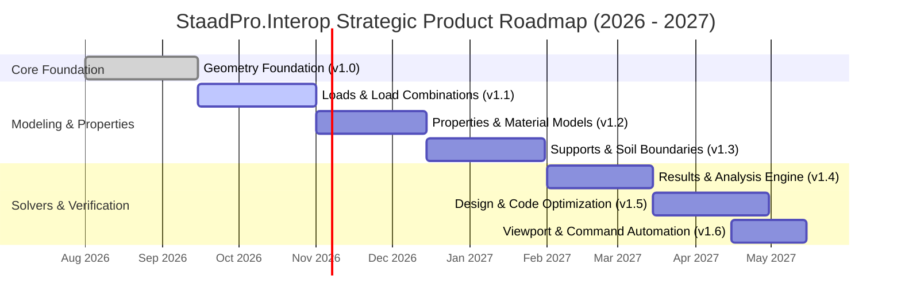

# StaadPro.Interop — Strategic Product Roadmap

This document outlines the architectural roadmap and upcoming milestone releases for the **StaadPro.Interop** open-source ecosystem.

Our mission is to provide the structural engineering and computational design community with a modern, high-performance, strongly-typed .NET suite covering the entire Bentley STAAD.Pro automation lifecycle.

---

## Current implementation and next steps — 27 October 2026

**Latest prepared preview:** 1.0.0-preview.20261028.2 adds ten further existing main-project Table lifecycle/typography methods. Table now has twenty of 29 reference overloads, reaching 20/24 native names; nine reference overloads remain. Reused the established result/status types and common service, with full XML documentation and 6,780 passed offline tests. See [current contracts](docs/Table-Lifecycle-and-Formatting.md). Retained the compact Markdown banner and independence/trademark notices.

**Previous prepared preview:** 1.0.0-preview.20261028.1 adds ten existing main-project Table functions and independence/trademark notices. Table covers 10/24 native names, with 19/29 main-source overloads still pending. Complete main-source functions before adding missing native-only APIs. See [Table report foundations](docs/Table-Report-Foundations.md). Live native report qualification remains separate.

**Previous prepared preview:** 1.0.0-preview.20261027.2 (compact README banner; same managed API scope as 1.0.0-preview.20261027.1) includes the completed 35 Commands/Support/Design methods and adopted logo assets. Release validation passed 6,448 offline tests and 1,222 installed-package XML examples. The source, documentation and package remain a preview; public NuGet.org availability is not confirmed.

**Design foundation increment:** Added ten common Design methods reaching five native names, adapting all seven main-source common workflows plus a brief-code query and two query-batch overloads. Extended GROUP and forty union Design native names remain pending. Passed **6,448 offline tests**, including 128 Design cases, and compiled/executed all **70 new guarded XML examples** across the completed increments. See [Design contracts and usage](docs/Design-Porting.md) and [the interrupted-work audit](docs/reports/Porting-Continuation-Audit-2026-10-27.md).

**Commands and Support increment:** Added 25 methods: 17 Commands methods over all sixteen active analysis-command routes, plus eight foundation/assignment operations. Support now covers 27/35 documented native routes. Steel-command creation/catalog work and eight Support contract gates remain pending. The API-usability redesign is isolated on `main-api-usability`; this increment uses the parent `main` contracts. See [the exact signatures and usage](docs/Commands-and-Support-Porting.md).

**Latest Output increment:** Added **25 Output overloads** for plate-corner extraction, indexed sparse/Cartesian selections, explicit metadata families and member-local projections: 18 synchronous main-source adaptations plus seven typed enabling overloads. Output now exposes **96 managed overloads reaching 47/60 documented native names**, with **13 documented native routes pending**. All additions use the newly enabled GetPlateCornerForces route. See [the plate-corner guide](docs/Output-Plate-Corners.md) for exact signatures, comparisons, axes evidence and limitations.

Passed a Release build with zero warnings/errors and **6,036 offline tests**, including **248 new corner cases**. Isolated package verification covers **1,152 selected XML examples**, including all 192 Output examples. Read-only native checks support the global force/moment contract on sampled STAAD.Pro 2026.0.0.340 observations; broader native/engineering qualification remains pending.
The user resumed documented Property work and requested the next 25 functions in the following domain. Property now exposes **249 common overloads plus five optional catalog queries**, covering **195/204 active documented native routes**. P2–P6, P9 and P10 allocations are implemented; P7 retains four gates and P8 retains five. The [Property completion guide](docs/Property-Profile-Names-and-Final-Cleanup.md) records the final four P10 operations and the nine unresolved transport/status/context contracts.

**Previous Output workflow increment:** Added **25 managed Output overloads**: 23 synchronous main-project workflow adaptations and two typed enabling overloads for explicit native axes and Beam ratio queries. Output now exposes **71 managed overloads reaching 46/60 documented native names**. The fourteen native contract gates remain; this increment adds compositions, entity conveniences and ordered batches over qualified native routes. See [the managed workflow guide](docs/Output-Managed-Workflows.md) for exact contracts and comparative usage.

Added governing-case resolution, per-item batch outcomes, staged caller utilization caches, native global offset-transfer audit packets, geometry bases, plate-center composites, ordered static checks and opposite support actions. All new APIs have matching XML documentation and examples; no public ref/out, tuples, partial adapters or thread-pool COM calls were introduced.

The preceding **Output** increment added 25 documented routes, bringing coverage to **40/60**; the following completed increment added six qualified Output routes and 19 Support functions. Coverage at that checkpoint was **46/60 Output** and **19/35 Support**. The [steel-block Output guide](docs/Output-Steel-Design-Blocks.md) and [Support foundation guide](docs/Support-Foundations.md) record the new contracts. The [extended Output guide](docs/Output-Extended-Queries.md) records exact typed signatures, differences between similar operations, native return conventions, units, bounds, version assumptions and state checks. The fourteen remaining Output routes retain their individual layout, direction, transport or qualification work; the thirteen supplemental Output unit candidates remain separate discovery work.

**Reminder checkpoint:** before further Property expansion or the next public NuGet release, remind the user about **fifteen supplemental Property discovery candidates** and the **nine documented Property gates**. Supplemental candidates were expressly excluded from this increment and need separate review/approval. This is a durable workflow checkpoint, not a scheduled notification.

Next complete existing main-source methods and managed workflows before expanding native-only API coverage: review remaining Commands catalog conveniences, Support and Output source workflows, then continue Table/View and IDEA StatiCa in the [remaining-adapter sequence](docs/reports/OpenSTAAD-Remaining-Adapters-Review-Index.md#3-recommended-implementation-sequence). Current Table coverage is twenty of 29 main-source overloads. Native-only additions follow reference parity. Preserve the approval requirements for parked Load and Property work, one non-partial adapter per domain, and internal common/version-policy services. Native qualification is separate from source implementation.

### Parked Load work — explicit approval required

At the user's request, further Load implementation is parked. The completed 36-method expansion and existing Load APIs remain implemented. No further Load port, native-contract interpretation or qualification-driven behavior change is authorized by the move to another domain.

- `AddSeismicDefElementWeight` and `AddSeismicDefFloorWeight`: pending native-contract review and implementation, outside the 129-function documented inventory.
- Remaining native qualification and richer-contract questions: reference/nodal indices, plate-command UI selection, floor distribution, beam split/merge behavior, attribute payload interpretation and actual 2024–2026 COM/engineering validation. These concern implemented APIs and must not be counted as another list of missing functions.
- Before further Load implementation, present the evidence and proposed contracts/changes for the user's review and obtain explicit approval. Prior Load implementation approval does not authorize this deferred work.

**Reminder checkpoint:** before resuming Load **or preparing the next public NuGet release**, remind the user of these parked items, their validation limits and the explicit approval requirement. This is a recorded workflow checkpoint, not a scheduled calendar notification. See the [Load contract and implementation record](docs/reports/OpenSTAAD-Load-Expansion-Contracts-and-Type-Plan.md#9-parked-work-and-approval-checkpoint).

## Milestone Overview

---

## Phase 1: StaadPro.Interop Geometry (v1.0 — Current Release)

*Status: **Released & Active (Q3 2026)***

- **OpenStaadWrapper Architecture**:
  - `OpenStaadWrapper` and `OpenStaadWrapperProvider` supporting ROT inspection, running process attachment, and automated startup.
- **Fluent Geometry Generation**: Node, Beam, Plate, and Physical Member creation with fluent chaining.
- **Parametric Surface & Mesh Generation**:
  - Annular surfaces with inner/outer boundary generation and polygonal openings.
  - Solid circular surfaces with radial mesh control points.
  - Linear and point mesh density controllers (`AddDensityPointToSurface`, `AddDensityLineToSurface`).
- **High-Performance Batch & Async Queries**:
  - Multi-threaded entity extraction (`GetAllEntities<T>`, `GetEntityGroups<T>`).
  - Thread-safe Task-based async wrapper methods.
  - Incident element topology querying (`GetPlatesConnectedAtNode`, `GetBeamsConnectedAtNode`).
- **Analytical Vector & Math Extensions**:
  - 3D coordinate transforms, plan angle calculations, radial distance helpers, torque distribution algorithms.
- **CI/CD & Offline Testing**:
  - Full GitHub Actions CI matrix on `windows-latest`.
  - Comprehensive NUnit test suite decoupled from live COM dependencies.

---

## Phase 2: StaadPro.Interop.Loads & Combinations (v1.1 — Active Milestone)

*Status: **Target: Q4 2026***

Expands the suite with strongly-typed load generation, combination building, and load group management (`IOSLoad` and `OSLoadAdapter`):

- **Load Case Management**:
  - Primary load case definitions (`CreateNewPrimaryLoad`, `CreateNewPrimaryLoadEx`, `CreateNewPrimaryLoadEx2`).
  - Reference load definitions (`CreateNewReferenceLoad`).
  - Load case metadata querying (`GetLoadCaseTitle`).
  - Active load case switching (`SetLoadCaseActive`).
  - Primary and reference load case clearing (`ClearPrimaryLoadCase`, `ClearReferenceLoadCase`).
  - Load combinations (Linear superposition, SRSS, ABS combinations).
  - Repeat load definitions for second-order P-Delta analysis.
- **Nodal Loading**:
  - Concentrated force ($F_x, F_y, F_z$) and moment ($M_x, M_y, M_z$) assignments.
  - Inclined nodal loads with coordinate system transforms.
- **Beam Loading**:
  - Uniform distributed forces and moments (global and local axes).
  - Concentrated point loads and concentrated moments at fractional distances.
  - Linear trapezoidal distributed loads and hydrostatic linear variations.
- **Area & Floor Pressure Loading**:
  - Automatic one-way and two-way tributary area load distribution algorithms.
  - Elevation Y-range floor load definitions with column exclusion rules.
- **Plate & Surface Loading**:
  - Uniform pressure over full plate surface (local Z, global projections).
  - Hydrostatic triangular pressure distributions across plate groups.
  - Thermal gradient and temperature variation loading.
- **Environmental & Dynamic Load Generators**:
  - Seismic definition parameters (ASCE 7, IS 1893, Eurocode 8, NBC).
  - Wind load definitions (ASCE 7 wind intensity vs height profiles, exposure factors).
- **Parallel & Async Load Operations**:
  - Multi-threaded load assignments across large element selections.

---

## Phase 3: StaadPro.Interop.Properties & Materials (v1.2)

*Status: **Target: Q4 2026***

Provides structural section catalogs, material models, and element specification management (`IOSProperty` and `OSPropertyAdapter`):

- **Standard Section Database Integration**:
  - Strongly-typed section library mapping for AISC, British (BS), European (Euroroll), Indian (IS), Australian (AS), and Japanese (JIS) steel profiles.
  - Wide Flange (W), Channels (C/MC), Angles (L/2L), Hollow Structural Sections (HSS/Pipe/Tube), Tees (WT).
- **Prismatic & Parametric Profiles**:
  - Rectangular, Circular, Tee, Trapezoidal, and Custom cross-sections.
  - User-Defined Tables (UPT) and General section definitions ($A_x, A_y, A_z, I_x, I_y, I_z, C_w, J$).
  - Tapered beam definitions with variable start/end dimensions.
- **Plate & Shell Properties**:
  - Uniform thickness assignment and multi-layered composite shell definitions.
  - Surface thickness modifiers and orthotropic membrane definitions.
- **Constitutive Material Models**:
  - Isotropic and orthotropic materials: modulus of elasticity ($E$), Poisson's ratio ($\nu$), density ($\rho$), thermal expansion coefficient ($\alpha$), and damping ratio ($\beta$).
  - Standard material presets: Structural Steel (A992, A36, S355, E250), Concrete (C25/30, C30/37, 4000 psi), Aluminum, Timber.
- **Member Specifications & Releases**:
  - Beam end releases (Start/End $F_x, F_y, F_z, M_x, M_y, M_z$ with partial moment release and elastic spring constants).
  - Truss / Axial-only member specifications.
  - Tension-only and Compression-only non-linear member behavior.
  - Section property modifiers (cracked concrete reduction factors for $I_{yy}, I_{zz}, A_x$).
- **Local Coordinate System Orientation**:
  - Beta angle assignments and reference node orientation alignments.

---

## Phase 4: StaadPro.Interop.Supports & Boundaries (v1.3)

*Status: **Target: Q1 2027***

Comprehensive boundary condition, support constraint, and foundation spring management (`IOSSupport` and `OSSupportAdapter`):

- **Standard Support Conditions**:
  - Pinned, Fixed, Roller (X, Y, Z release), and Free.
- **6-DOF Elastic Foundation & Spring Supports**:
  - Translational springs ($K_{fx}, K_{fy}, K_{fz}$) and Rotational springs ($K_{mx}, K_{my}, K_{mz}$).
  - Compression-only and Tension-only foundation spring behavior.
- **Subgrade Modulus & Elastic Mat Foundations**:
  - Automatic spring stiffness calculation based on soil subgrade reaction modulus ($k_s$) and tributary influence areas.
- **Multilinear & Non-Linear Spring Curves**:
  - Force-displacement ($P-\delta$) piecewise linear spring curves for soil-structure interaction.
- **Inclined & Skewed Support Coordinates**:
  - Cylindrical and rotated Cartesian support reference frames.

---

## Phase 5: StaadPro.Interop.Results & Analysis Engine (v1.4)

*Status: **Target: Q1 2027***

High-throughput post-processing, solver invocation, and analytical result extraction (`IOSOutput` and `OSOutputAdapter`):

- **Solver Invocation & Health Monitoring**:
  - Programmatic analysis execution (Linear Static, P-Delta, Modal Frequency, Response Spectrum, Buckling).
  - Solver convergence verification and error log parser.
- **Nodal Results**:
  - Global displacements and rotations across all load cases/combinations.
  - Support reaction forces and moments with equilibrium checks ($\sum F, \sum M$).
  - Modal eigenvectors, natural frequencies, participation factors, and modal mass percentages.
- **Beam Internal Forces & Deflections**:
  - Member end forces ($F_x, F_y, F_z, M_x, M_y, M_z$).
  - Intermediate section internal force extraction ($N$ sections along beam length).
  - Maximum/minimum force envelopes across load combinations.
  - Beam local deflections and relative span deflection ratios ($L/\Delta$).
- **Plate & Shell Stress Resultants**:
  - Center and corner node stresses: Principal stresses ($\sigma_1, \sigma_2$), Von Mises equivalent stress ($\sigma_{vm}$), Maximum shear ($\tau_{max}$).
  - Membrane forces ($N_x, N_y, N_{xy}$), Bending moments ($M_x, M_y, M_{xy}$), Out-of-plane transverse shear ($Q_x, Q_y$).
  - Top and bottom surface stress layer extraction.

---

## Phase 6: StaadPro.Interop.Design & Code Optimization (v1.5)

*Status: **Target: Q2 2027***

Design code automation, parameter assignment, and code compliance evaluation (`IOSDesign` and `OSDesignAdapter`):

- **Design Code Parameter Management**:
  - Steel design parameters: Yield strength (`FYLD`), Ultimate tensile strength (`FU`), Unbraced length ratios (`UNT`, `UNB`), Effective length factors (`KY`, `KZ`), Moment amplification coefficients (`CMX`, `CMZ`).
  - Supported design codes: AISC 360 (LRFD/ASD), IS 800 (LSM/WSM), Eurocode 3 (EN 1993-1-1), AS 4100, BS 5950.
- **Code Check Execution & Optimization**:
  - Automated `CHECK CODE` and `SELECT MEMBER` batch execution.
  - Extraction of governing load cases, critical design clauses, and governing failure modes.
  - Maximum utilization ratio ($UR$) extraction across all structural members.
  - Automated member profile resizing and weight optimization loops.

---

## Phase 7: StaadPro.Interop.Visualization & Scripting Automation (v1.6)

*Status: **Target: Q2 2027***

Viewport graphical automation, diagnostic visualizers, and direct command stream execution (`IOSView` and `IOSCommands`):

- **Viewport Camera & Diagnostic Rendering**:
  - Viewport control: Zoom Extents, Pan, Isometric, Plan, Elevation views.
  - Diagnostic color shading by Property ID, Material Type, Group Name, or Utilization Ratio heatmaps.
  - Programmatic activation of BMD, SFD, AFD diagrams and high-resolution screenshot captures for PDF calculation reports.
- **Direct Command Stream Scripting**:
  - Low-level raw command dispatch and transactional batch queuing directly to the active model buffer.

---

## How to Contribute to the Roadmap

We encourage structural engineers, software developers, and research institutions to participate in shaping the future of StaadPro.Interop:

1. **Vote on Features**: Check out our [GitHub Discussions](https://github.com/structuraldeveloper/StaadPro.Interop/discussions) and upvote proposals.
2. **Submit RFCs**: Propose new design code support or engineering workflows via [Feature Requests](.github/ISSUE_TEMPLATE/feature_request.md).
---

*StaadPro.Interop is an independent open-source project and is not officially affiliated with or endorsed by Bentley Systems, Incorporated.*
