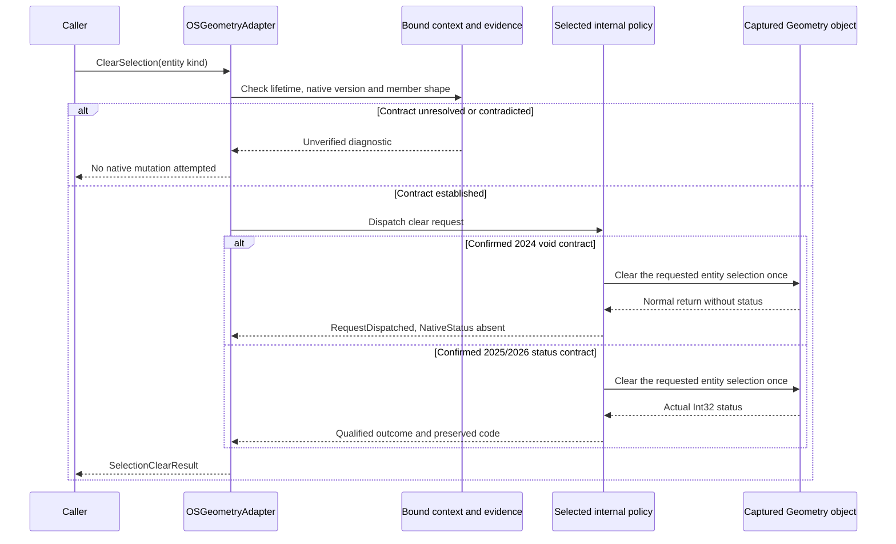
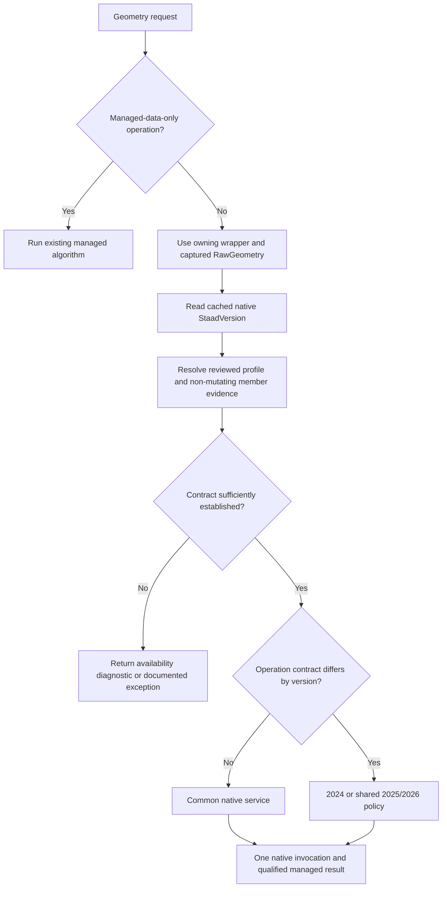

# OpenSTAAD Geometry multi-version comparison, architecture and implementation plan

**Review date:** 22 October 2026
**Baseline:** `main` at `1483c9c`
**Scope:** Installed STAAD.Pro 2024, 2025 and 2026 Geometry help, all linked Geometry subgroups, current interface/adapter source, and passive inspection of the installed 2025/2026 vendor interop assemblies.
**Status:** Review and proposed architecture only. No production interface, adapter, wrapper, strategy or native behavior was changed.

## 1. Findings and decisions

The three installed Geometry references contain the same **135 native function names**: **134 detailed function contracts and one summary-only deprecated alias**. No Geometry function was added or removed between these reviewed references. This differs from the earlier Root comparison, where newer versions introduced additional functions.

The contracts are not completely interchangeable. Four selection-clearing functions change their documented native return from void in 2024 to long in 2025/2026. Six other functions change documented error/status or licensing information. Four further functions have type or wording clarifications. The normalized 2025 and 2026 declarations, contract prose and code examples match.

Use one shared implementation for unchanged operations, internal version policies for the ten return/status-sensitive functions, and shared value conversion for all versions. Do not create a complete adapter implementation for each product year. Current evidence does not justify year-exclusive public Geometry interfaces because all 135 reviewed names occur in all three references. The current Geometry adapter has no native-version strategy selection; Root capability routing does not automatically apply to Geometry.

| Measure | Finding |
| --- | ---: |
| Native names in each reviewed year | 135 |
| Detailed entries in each year | 134 |
| Deprecated summary-only entry in each year | 1: CreatePMember |
| Union / intersection of the three name sets | 135 / 135 |
| Detailed functions with unchanged signatures and normalized non-example contracts | 120 |
| Further functions with type/wording clarifications | 4 |
| Functions with return-shape changes | 4 |
| Further functions with status/licensing changes | 6 |
| Current managed IOSGeometry / OSGeometryAdapter overloads | 143 / 143 |
| Reviewed native names with a production dispatch in the adapter | 59 |
| Reviewed names without a direct native dispatch | 76 |
| Methods declared by each inspected 2025/2026 vendor IOSGeometryUI | 176 |
| Additional metadata names outside these Geometry help sections | 41 |
| Those additional names currently dispatched by this adapter | 3 |
| Total distinct native names currently dispatched | 62 |

**The 143-overload completion claim is parity with the private main project's managed Geometry surface. It is not full coverage of Bentley's Geometry manual or its vendor interop interface.** A managed overload can compose several native operations; multiple overloads can call the same native operation; a managed algorithm can use no native API. Conversely, a native dispatch can exist inside a private helper without a matching public method name.

**Documentation and managed interop metadata are evidence of declared contracts, not live native certification.** A changed help entry may represent a native change, a correction or build-specific behavior. The installed 2024 vendor interop DLL was not present at the corresponding path, so its actual ABI was not corroborated. Neither installed assemblies nor the help folders identify the version of a future acquired running instance.

## 2. References and reproducibility

| Installed reference | Documented build | Pages | Native names | Detailed coverage |
| --- | --- | ---: | ---: | --- |
| [2024 Geometry help](../../../../../../../../Program%20Files/Bentley/Engineering/STAAD.Pro%202024/OSAPP_Help/group___geometry_group.html) | `24.00.02.354` | 8 | 135 | 134 + 1 deprecated summary |
| [2025 Geometry help](../../../../../../../../Program%20Files/Bentley/Engineering/STAAD.Pro%202025/OSAPP_Help/group___geometry_group.html) | `25.00.01.424` | 8 | 135 | 134 + 1 deprecated summary |
| [2026 Geometry help](../../../../../../../../Program%20Files/Bentley/Engineering/STAAD.Pro%202026/OSAPP_Help/group___geometry_group.html) | `26.00.00.340` | 8 | 135 | 134 + 1 deprecated summary |

The top-level Geometry page contains only four functions. Reviewing that page alone would miss Node, Beam, Physical Member, Plate, Solid, Group and Parametric Surface operations. All eight pages per year were traversed; the inventories distinguish summary-only entries from detailed contracts and preserve native names, parameter lists, directions and return labels.

| Section | 2024 | 2025 | 2026 | Current documented-name dispatches |
| --- | ---: | ---: | ---: | ---: |
| General | 4 | 4 | 4 | 0 |
| Node | 23 | 23 | 23 | 14 |
| Beam | 32 | 32 | 32 | 13 |
| Physical Member | 15 | 15 | 15 | 2 |
| Plate | 19 | 19 | 19 | 10 |
| Solid | 16 | 16 | 16 | 6 |
| Group | 9 | 9 | 9 | 5 |
| Parametric Surface | 17 | 17 | 17 | 9 |

The full machine-readable evidence is [Geometry comparison data](data/OpenSTAAD-Geometry-2024-2026-Comparison.json). It contains page fingerprints, functional declarations, contract/example hashes, native parameter directions, inspected CLR parameter/reference shapes, current call sites and the managed interface inventory. Vendor manual narrative and complete examples are not reproduced in that data file.

### 2.1 Installed vendor interop corroboration

| Installed product | Inspected interface | Method declarations | SHA-256 |
| --- | --- | ---: | --- |
| 2025 | `OpenSTAADUI.IOSGeometryUI` | 176 | `CC724993AC9119138B7323E8C684997257E2851DE62E1551BA5D6D67A9DADC19` |
| 2026 | `OpenSTAADUI.IOSGeometryUI` | 176 | `6D153E80ED356A1B167ABB2EF19227FCFF510707A578AD304154652CC6C1F6D4` |

Assembly identity in both cases: `StaadPro.Interop, Version=1.0.0.0, Culture=neutral, PublicKeyToken=b4d201f8319cef86`. The exact installed paths are linked in the [contract annex](OpenSTAAD-Geometry-API-Coverage-and-Contract-Inventory.md#2-supplemental-installed-interop-inventory).

Both inspected files declare **176 distinct IOSGeometryUI methods**. Their names, CLR return types, parameter types, by-reference shapes and recorded in/out/optional flags match. All 135 reviewed help names occur in both interfaces. The four changed clear-selection methods return Int32 in both vendor assemblies. All current native call sites have matching argument counts and explicit C# ref/value shapes against these inspected declarations.

This does not verify native execution, actual acquired IDispatch/type information, SAFEARRAY contents, units, model state, licensing or every marshaling annotation. C++ FAR references in help declarations are not mechanically equivalent to public C# ref parameters. For example, GetSelectedNodes has a by-reference output buffer but a by-value sorting argument in the inspected metadata.

The vendor DLL has the same short filename as this repository's library. Inspection used the explicit installed product paths and separate reflection-only processes; it did not substitute the repository assembly. No Bentley binary was copied or referenced by the product project, and no COM server was activated. The product remains a net481 library; the analysis utility does not establish modern .NET package support.

### 2.2 Comparison method

1. Traverse the Geometry page and its linked subgroup pages for each year.
2. Independently inventory summary entries and detailed member blocks. Accept CreatePMember as a deprecated summary-only declaration rather than inventing a detailed contract or discarding it.
3. Compare summary declarations, detailed declarations, parameter directions, return/error tables, notes and examples. Retain summary/detail name discrepancies separately.
4. Normalize HTML, whitespace, Doxygen access labels, generated source-definition tooltips and source line references. Compare examples separately from non-example contract prose.
5. Parse current C# method syntax to inventory 143 public interface and 143 public adapter overloads, native dispatch targets and source locations.
6. Passively inspect vendor interop metadata for 2025/2026. Compare declarations and current call shapes without invoking methods.
7. Classify documentation differences and current implementation limitations. Do not translate the observations into runtime changes in this review.

The substantive comparison produces 120 unchanged detailed contracts, four clarified contracts and ten return/status-sensitive contracts. Explicit parameter direction/name tables match across the three references. The deprecated alias is a separate 135th entry. Raw example text changes in 27 entries; 13 of those have otherwise unchanged contracts, predominantly formatting edits plus expanded GUID examples. Example formatting alone does not warrant a version strategy.

## 3. Complete cross-version function matrix

Each year cell links directly to that function's installed reference. **VARIANT** describes the native declaration, not an assurance of a particular scalar, array, Boolean or status representation.

**Common:** unchanged detailed signature and normalized non-example contract. **Clarified:** same signature, added type/wording information. **Return:** changed native return declaration. **Status:** same declaration, changed error/licensing documentation. **Deprecated:** summary-only alias.

**D:** current production native dispatch exists somewhere in OSGeometryAdapter, including private helpers. It does not certify output validation or runtime support. **N:** no direct dispatch to that native name was found; a managed alternative may exist. The [contract and coverage annex](OpenSTAAD-Geometry-API-Coverage-and-Contract-Inventory.md) contains native parameter declarations/directions, return labels, metadata and coverage disposition for every row.

| Native function | 2024 return | 2025 return | 2026 return | Comparison | Dispatch | Current caller / disposition |
| --- | --- | --- | --- | --- | --- | --- |
| [DoTranslationalRepeat](OpenSTAAD-Geometry-API-Coverage-and-Contract-Inventory.md#dotranslationalrepeat) | [VARIANT](../../../../../../../../Program%20Files/Bentley/Engineering/STAAD.Pro%202024/OSAPP_Help/group___geometry_group.html#ga12070670794760edbc6b6ad41d62d078) | [VARIANT](../../../../../../../../Program%20Files/Bentley/Engineering/STAAD.Pro%202025/OSAPP_Help/group___geometry_group.html#ga12070670794760edbc6b6ad41d62d078) | [VARIANT](../../../../../../../../Program%20Files/Bentley/Engineering/STAAD.Pro%202026/OSAPP_Help/group___geometry_group.html#ga12070670794760edbc6b6ad41d62d078) | Common | N | No direct native mapping |
| [SetFlagForHiddenEntities](OpenSTAAD-Geometry-API-Coverage-and-Contract-Inventory.md#setflagforhiddenentities) | [void](../../../../../../../../Program%20Files/Bentley/Engineering/STAAD.Pro%202024/OSAPP_Help/group___geometry_group.html#ga2932ced8b91c04c2150a04b832cb4fdc) | [void](../../../../../../../../Program%20Files/Bentley/Engineering/STAAD.Pro%202025/OSAPP_Help/group___geometry_group.html#ga2932ced8b91c04c2150a04b832cb4fdc) | [void](../../../../../../../../Program%20Files/Bentley/Engineering/STAAD.Pro%202026/OSAPP_Help/group___geometry_group.html#ga2932ced8b91c04c2150a04b832cb4fdc) | Common | N | No direct native mapping |
| [GetFlagForHiddenEntities](OpenSTAAD-Geometry-API-Coverage-and-Contract-Inventory.md#getflagforhiddenentities) | [VARIANT](../../../../../../../../Program%20Files/Bentley/Engineering/STAAD.Pro%202024/OSAPP_Help/group___geometry_group.html#ga5645f5cee0257a2f8c26563666c227d3) | [VARIANT](../../../../../../../../Program%20Files/Bentley/Engineering/STAAD.Pro%202025/OSAPP_Help/group___geometry_group.html#ga5645f5cee0257a2f8c26563666c227d3) | [VARIANT](../../../../../../../../Program%20Files/Bentley/Engineering/STAAD.Pro%202026/OSAPP_Help/group___geometry_group.html#ga5645f5cee0257a2f8c26563666c227d3) | Common | N | No direct native mapping |
| [HasHiddenEntities](OpenSTAAD-Geometry-API-Coverage-and-Contract-Inventory.md#hashiddenentities) | [VARIANT](../../../../../../../../Program%20Files/Bentley/Engineering/STAAD.Pro%202024/OSAPP_Help/group___geometry_group.html#gad36e1400b2660aa9eb13f31c15a81c4a) | [VARIANT](../../../../../../../../Program%20Files/Bentley/Engineering/STAAD.Pro%202025/OSAPP_Help/group___geometry_group.html#gad36e1400b2660aa9eb13f31c15a81c4a) | [VARIANT](../../../../../../../../Program%20Files/Bentley/Engineering/STAAD.Pro%202026/OSAPP_Help/group___geometry_group.html#gad36e1400b2660aa9eb13f31c15a81c4a) | Common | N | No direct native mapping |
| [CreateNode](OpenSTAAD-Geometry-API-Coverage-and-Contract-Inventory.md#createnode) | [void](../../../../../../../../Program%20Files/Bentley/Engineering/STAAD.Pro%202024/OSAPP_Help/group___node_group.html#gadede1ccb23b89e1e1bb8539dc1b62c3a) | [void](../../../../../../../../Program%20Files/Bentley/Engineering/STAAD.Pro%202025/OSAPP_Help/group___node_group.html#gadede1ccb23b89e1e1bb8539dc1b62c3a) | [void](../../../../../../../../Program%20Files/Bentley/Engineering/STAAD.Pro%202026/OSAPP_Help/group___node_group.html#gadede1ccb23b89e1e1bb8539dc1b62c3a) | Common | D | [CreateNode](../../src/StaadPro.Interop/Adapters/Models/OSGeometryAdapter.cs#L213), [CreateMultipleNodes](../../src/StaadPro.Interop/Adapters/Models/OSGeometryAdapter.cs#L856) |
| [AddNode](OpenSTAAD-Geometry-API-Coverage-and-Contract-Inventory.md#addnode) | [VARIANT](../../../../../../../../Program%20Files/Bentley/Engineering/STAAD.Pro%202024/OSAPP_Help/group___node_group.html#ga99d586496fdc2fe5f96f70c592816177) | [VARIANT](../../../../../../../../Program%20Files/Bentley/Engineering/STAAD.Pro%202025/OSAPP_Help/group___node_group.html#ga99d586496fdc2fe5f96f70c592816177) | [VARIANT](../../../../../../../../Program%20Files/Bentley/Engineering/STAAD.Pro%202026/OSAPP_Help/group___node_group.html#ga99d586496fdc2fe5f96f70c592816177) | Common | D | [AddNode](../../src/StaadPro.Interop/Adapters/Models/OSGeometryAdapter.cs#L633) |
| [DeleteNode](OpenSTAAD-Geometry-API-Coverage-and-Contract-Inventory.md#deletenode) | [void](../../../../../../../../Program%20Files/Bentley/Engineering/STAAD.Pro%202024/OSAPP_Help/group___node_group.html#ga17d3a7ce308b8db04af97cd5bb45d15c) | [void](../../../../../../../../Program%20Files/Bentley/Engineering/STAAD.Pro%202025/OSAPP_Help/group___node_group.html#ga17d3a7ce308b8db04af97cd5bb45d15c) | [void](../../../../../../../../Program%20Files/Bentley/Engineering/STAAD.Pro%202026/OSAPP_Help/group___node_group.html#ga17d3a7ce308b8db04af97cd5bb45d15c) | Common | D | [DeleteAllNodes](../../src/StaadPro.Interop/Adapters/Models/OSGeometryAdapter.cs#L908) |
| [GetLastNodeNo](OpenSTAAD-Geometry-API-Coverage-and-Contract-Inventory.md#getlastnodeno) | [VARIANT](../../../../../../../../Program%20Files/Bentley/Engineering/STAAD.Pro%202024/OSAPP_Help/group___node_group.html#gab1d3939f78bfba9f4ec380b8da0ce936) | [VARIANT](../../../../../../../../Program%20Files/Bentley/Engineering/STAAD.Pro%202025/OSAPP_Help/group___node_group.html#gab1d3939f78bfba9f4ec380b8da0ce936) | [VARIANT](../../../../../../../../Program%20Files/Bentley/Engineering/STAAD.Pro%202026/OSAPP_Help/group___node_group.html#gab1d3939f78bfba9f4ec380b8da0ce936) | Common | D | [GetLastNodeNo](../../src/StaadPro.Interop/Adapters/Models/OSGeometryAdapter.cs#L498) |
| [GetNoOfSelectedNodes](OpenSTAAD-Geometry-API-Coverage-and-Contract-Inventory.md#getnoofselectednodes) | [VARIANT](../../../../../../../../Program%20Files/Bentley/Engineering/STAAD.Pro%202024/OSAPP_Help/group___node_group.html#gaf8eac5db1d9fc7866221e2e3908a168a) | [VARIANT](../../../../../../../../Program%20Files/Bentley/Engineering/STAAD.Pro%202025/OSAPP_Help/group___node_group.html#gaf8eac5db1d9fc7866221e2e3908a168a) | [VARIANT](../../../../../../../../Program%20Files/Bentley/Engineering/STAAD.Pro%202026/OSAPP_Help/group___node_group.html#gaf8eac5db1d9fc7866221e2e3908a168a) | Common | D | [AnyItemsSelected](../../src/StaadPro.Interop/Adapters/Models/OSGeometryAdapter.cs#L505), [GetSelectedNodesIds](../../src/StaadPro.Interop/Adapters/Models/OSGeometryAdapter.cs#L575), [GetSelectedNodesListAsync](../../src/StaadPro.Interop/Adapters/Models/OSGeometryAdapter.cs#L1177) |
| [GetSelectedNodes](OpenSTAAD-Geometry-API-Coverage-and-Contract-Inventory.md#getselectednodes) | [void](../../../../../../../../Program%20Files/Bentley/Engineering/STAAD.Pro%202024/OSAPP_Help/group___node_group.html#ga0178f5f0ab53cb5a52002770e5d97985) | [void](../../../../../../../../Program%20Files/Bentley/Engineering/STAAD.Pro%202025/OSAPP_Help/group___node_group.html#ga0178f5f0ab53cb5a52002770e5d97985) | [void](../../../../../../../../Program%20Files/Bentley/Engineering/STAAD.Pro%202026/OSAPP_Help/group___node_group.html#ga0178f5f0ab53cb5a52002770e5d97985) | Common | D | [GetSelectedNodesIds](../../src/StaadPro.Interop/Adapters/Models/OSGeometryAdapter.cs#L575), [GetSelectedNodesListAsync](../../src/StaadPro.Interop/Adapters/Models/OSGeometryAdapter.cs#L1177) |
| [GetNodeCoordinates](OpenSTAAD-Geometry-API-Coverage-and-Contract-Inventory.md#getnodecoordinates) | [void](../../../../../../../../Program%20Files/Bentley/Engineering/STAAD.Pro%202024/OSAPP_Help/group___node_group.html#ga3105f93484eca2596a659bf68cddf66c) | [void](../../../../../../../../Program%20Files/Bentley/Engineering/STAAD.Pro%202025/OSAPP_Help/group___node_group.html#ga3105f93484eca2596a659bf68cddf66c) | [void](../../../../../../../../Program%20Files/Bentley/Engineering/STAAD.Pro%202026/OSAPP_Help/group___node_group.html#ga3105f93484eca2596a659bf68cddf66c) | Common | D | [GetNode](../../src/StaadPro.Interop/Adapters/Models/OSGeometryAdapter.cs#L737) |
| [SetNodeCoordinate](OpenSTAAD-Geometry-API-Coverage-and-Contract-Inventory.md#setnodecoordinate) | [void](../../../../../../../../Program%20Files/Bentley/Engineering/STAAD.Pro%202024/OSAPP_Help/group___node_group.html#ga148833fe28dae09d77681d9fc928bd27) | [void](../../../../../../../../Program%20Files/Bentley/Engineering/STAAD.Pro%202025/OSAPP_Help/group___node_group.html#ga148833fe28dae09d77681d9fc928bd27) | [void](../../../../../../../../Program%20Files/Bentley/Engineering/STAAD.Pro%202026/OSAPP_Help/group___node_group.html#ga148833fe28dae09d77681d9fc928bd27) | Common | D | [SetNodeCoordinate](../../src/StaadPro.Interop/Adapters/Models/OSGeometryAdapter.cs#L495) |
| [GetNodeNumber](OpenSTAAD-Geometry-API-Coverage-and-Contract-Inventory.md#getnodenumber) | [VARIANT](../../../../../../../../Program%20Files/Bentley/Engineering/STAAD.Pro%202024/OSAPP_Help/group___node_group.html#ga6c05f160cc71e4d0de33ad784c8e3357) | [VARIANT](../../../../../../../../Program%20Files/Bentley/Engineering/STAAD.Pro%202025/OSAPP_Help/group___node_group.html#ga6c05f160cc71e4d0de33ad784c8e3357) | [VARIANT](../../../../../../../../Program%20Files/Bentley/Engineering/STAAD.Pro%202026/OSAPP_Help/group___node_group.html#ga6c05f160cc71e4d0de33ad784c8e3357) | Status | N | No direct native mapping |
| [GetNodeDistance](OpenSTAAD-Geometry-API-Coverage-and-Contract-Inventory.md#getnodedistance) | [VARIANT](../../../../../../../../Program%20Files/Bentley/Engineering/STAAD.Pro%202024/OSAPP_Help/group___node_group.html#gae103e955a853451c5a7abc6393d1267e) | [VARIANT](../../../../../../../../Program%20Files/Bentley/Engineering/STAAD.Pro%202025/OSAPP_Help/group___node_group.html#gae103e955a853451c5a7abc6393d1267e) | [VARIANT](../../../../../../../../Program%20Files/Bentley/Engineering/STAAD.Pro%202026/OSAPP_Help/group___node_group.html#gae103e955a853451c5a7abc6393d1267e) | Status | N | No direct native mapping |
| [SelectMultipleNodes](OpenSTAAD-Geometry-API-Coverage-and-Contract-Inventory.md#selectmultiplenodes) | [VARIANT](../../../../../../../../Program%20Files/Bentley/Engineering/STAAD.Pro%202024/OSAPP_Help/group___node_group.html#gacdf9f9ada351e906981bf8a993119e38) | [VARIANT](../../../../../../../../Program%20Files/Bentley/Engineering/STAAD.Pro%202025/OSAPP_Help/group___node_group.html#gacdf9f9ada351e906981bf8a993119e38) | [VARIANT](../../../../../../../../Program%20Files/Bentley/Engineering/STAAD.Pro%202026/OSAPP_Help/group___node_group.html#gacdf9f9ada351e906981bf8a993119e38) | Common | D | [SelectMultipleNodes](../../src/StaadPro.Interop/Adapters/Models/OSGeometryAdapter.cs#L484) |
| [SelectNode](OpenSTAAD-Geometry-API-Coverage-and-Contract-Inventory.md#selectnode) | [VARIANT](../../../../../../../../Program%20Files/Bentley/Engineering/STAAD.Pro%202024/OSAPP_Help/group___node_group.html#gabe35568c795c6380e74040ac30399368) | [VARIANT](../../../../../../../../Program%20Files/Bentley/Engineering/STAAD.Pro%202025/OSAPP_Help/group___node_group.html#gabe35568c795c6380e74040ac30399368) | [VARIANT](../../../../../../../../Program%20Files/Bentley/Engineering/STAAD.Pro%202026/OSAPP_Help/group___node_group.html#gabe35568c795c6380e74040ac30399368) | Common | N | No direct native mapping |
| [AddMultipleNodes](OpenSTAAD-Geometry-API-Coverage-and-Contract-Inventory.md#addmultiplenodes) | [void](../../../../../../../../Program%20Files/Bentley/Engineering/STAAD.Pro%202024/OSAPP_Help/group___node_group.html#gadca7c14419a3a1bfea9bada5260cc262) | [void](../../../../../../../../Program%20Files/Bentley/Engineering/STAAD.Pro%202025/OSAPP_Help/group___node_group.html#gadca7c14419a3a1bfea9bada5260cc262) | [void](../../../../../../../../Program%20Files/Bentley/Engineering/STAAD.Pro%202026/OSAPP_Help/group___node_group.html#gadca7c14419a3a1bfea9bada5260cc262) | Common | N | No direct native mapping |
| [CreateMultipleNodes](OpenSTAAD-Geometry-API-Coverage-and-Contract-Inventory.md#createmultiplenodes) | [void](../../../../../../../../Program%20Files/Bentley/Engineering/STAAD.Pro%202024/OSAPP_Help/group___node_group.html#ga7cb1897a94230abce092204ea1f0eec1) | [void](../../../../../../../../Program%20Files/Bentley/Engineering/STAAD.Pro%202025/OSAPP_Help/group___node_group.html#ga7cb1897a94230abce092204ea1f0eec1) | [void](../../../../../../../../Program%20Files/Bentley/Engineering/STAAD.Pro%202026/OSAPP_Help/group___node_group.html#ga7cb1897a94230abce092204ea1f0eec1) | Common | D | [CreateMultipleNodesExtended](../../src/StaadPro.Interop/Adapters/Models/OSGeometryAdapter.cs#L83) |
| [GetNodeCount](OpenSTAAD-Geometry-API-Coverage-and-Contract-Inventory.md#getnodecount) | [VARIANT](../../../../../../../../Program%20Files/Bentley/Engineering/STAAD.Pro%202024/OSAPP_Help/group___node_group.html#ga2f3966e116a500cb292d61e5dc97e1bd) | [VARIANT](../../../../../../../../Program%20Files/Bentley/Engineering/STAAD.Pro%202025/OSAPP_Help/group___node_group.html#ga2f3966e116a500cb292d61e5dc97e1bd) | [VARIANT](../../../../../../../../Program%20Files/Bentley/Engineering/STAAD.Pro%202026/OSAPP_Help/group___node_group.html#ga2f3966e116a500cb292d61e5dc97e1bd) | Common | D | [GetAllNodesList](../../src/StaadPro.Interop/Adapters/Models/OSGeometryAdapter.cs#L788), [GetAllNodesListAsync](../../src/StaadPro.Interop/Adapters/Models/OSGeometryAdapter.cs#L1150) |
| [GetNodeList](OpenSTAAD-Geometry-API-Coverage-and-Contract-Inventory.md#getnodelist) | [void](../../../../../../../../Program%20Files/Bentley/Engineering/STAAD.Pro%202024/OSAPP_Help/group___node_group.html#ga2ad1d66e6248fcb0be49724baba64ffb) | [void](../../../../../../../../Program%20Files/Bentley/Engineering/STAAD.Pro%202025/OSAPP_Help/group___node_group.html#ga2ad1d66e6248fcb0be49724baba64ffb) | [void](../../../../../../../../Program%20Files/Bentley/Engineering/STAAD.Pro%202026/OSAPP_Help/group___node_group.html#ga2ad1d66e6248fcb0be49724baba64ffb) | Common | D | [GetAllNodesList](../../src/StaadPro.Interop/Adapters/Models/OSGeometryAdapter.cs#L788), [GetAllNodesListAsync](../../src/StaadPro.Interop/Adapters/Models/OSGeometryAdapter.cs#L1150) |
| [GetNodeIncidence](OpenSTAAD-Geometry-API-Coverage-and-Contract-Inventory.md#getnodeincidence) | [VARIANT](../../../../../../../../Program%20Files/Bentley/Engineering/STAAD.Pro%202024/OSAPP_Help/group___node_group.html#gae5e798eb1f40c74f3989f3bd6966c4aa) | [VARIANT](../../../../../../../../Program%20Files/Bentley/Engineering/STAAD.Pro%202025/OSAPP_Help/group___node_group.html#gae5e798eb1f40c74f3989f3bd6966c4aa) | [VARIANT](../../../../../../../../Program%20Files/Bentley/Engineering/STAAD.Pro%202026/OSAPP_Help/group___node_group.html#gae5e798eb1f40c74f3989f3bd6966c4aa) | Clarified | N | No direct native mapping |
| [ClearNodeSelection](OpenSTAAD-Geometry-API-Coverage-and-Contract-Inventory.md#clearnodeselection) | [void](../../../../../../../../Program%20Files/Bentley/Engineering/STAAD.Pro%202024/OSAPP_Help/group___node_group.html#ga6e40fd0051358ad1252de5a2bba44e54) | [long](../../../../../../../../Program%20Files/Bentley/Engineering/STAAD.Pro%202025/OSAPP_Help/group___node_group.html#ga99aa626353f9ffe5abf8241ef7108e11) | [long](../../../../../../../../Program%20Files/Bentley/Engineering/STAAD.Pro%202026/OSAPP_Help/group___node_group.html#ga99aa626353f9ffe5abf8241ef7108e11) | Return | D | [ClearNodeSelection](../../src/StaadPro.Interop/Adapters/Models/OSGeometryAdapter.cs#L462) |
| [SetNodeUniqueID](OpenSTAAD-Geometry-API-Coverage-and-Contract-Inventory.md#setnodeuniqueid) | [void](../../../../../../../../Program%20Files/Bentley/Engineering/STAAD.Pro%202024/OSAPP_Help/group___node_group.html#ga659e31b5410b50e08bcc659e73d0ee15) | [void](../../../../../../../../Program%20Files/Bentley/Engineering/STAAD.Pro%202025/OSAPP_Help/group___node_group.html#ga659e31b5410b50e08bcc659e73d0ee15) | [void](../../../../../../../../Program%20Files/Bentley/Engineering/STAAD.Pro%202026/OSAPP_Help/group___node_group.html#ga659e31b5410b50e08bcc659e73d0ee15) | Common | N | No direct native mapping |
| [GetNodeUniqueID](OpenSTAAD-Geometry-API-Coverage-and-Contract-Inventory.md#getnodeuniqueid) | [VARIANT](../../../../../../../../Program%20Files/Bentley/Engineering/STAAD.Pro%202024/OSAPP_Help/group___node_group.html#gab6f65fdc91d066325086f92ab30a9fe3) | [VARIANT](../../../../../../../../Program%20Files/Bentley/Engineering/STAAD.Pro%202025/OSAPP_Help/group___node_group.html#gab6f65fdc91d066325086f92ab30a9fe3) | [VARIANT](../../../../../../../../Program%20Files/Bentley/Engineering/STAAD.Pro%202026/OSAPP_Help/group___node_group.html#gab6f65fdc91d066325086f92ab30a9fe3) | Common | N | No direct native mapping |
| [GetNodeIncidence_CIS2](OpenSTAAD-Geometry-API-Coverage-and-Contract-Inventory.md#getnodeincidence_cis2) | [VARIANT](../../../../../../../../Program%20Files/Bentley/Engineering/STAAD.Pro%202024/OSAPP_Help/group___node_group.html#ga8fd3b6508a89f4092ea54c6d54adceb0) | [VARIANT](../../../../../../../../Program%20Files/Bentley/Engineering/STAAD.Pro%202025/OSAPP_Help/group___node_group.html#ga8fd3b6508a89f4092ea54c6d54adceb0) | [VARIANT](../../../../../../../../Program%20Files/Bentley/Engineering/STAAD.Pro%202026/OSAPP_Help/group___node_group.html#ga8fd3b6508a89f4092ea54c6d54adceb0) | Common | N | No direct native mapping |
| [IsOrphanNode](OpenSTAAD-Geometry-API-Coverage-and-Contract-Inventory.md#isorphannode) | [VARIANT](../../../../../../../../Program%20Files/Bentley/Engineering/STAAD.Pro%202024/OSAPP_Help/group___node_group.html#gadd56dd50d016c8a219e129f6076ec36a) | [VARIANT](../../../../../../../../Program%20Files/Bentley/Engineering/STAAD.Pro%202025/OSAPP_Help/group___node_group.html#gadd56dd50d016c8a219e129f6076ec36a) | [VARIANT](../../../../../../../../Program%20Files/Bentley/Engineering/STAAD.Pro%202026/OSAPP_Help/group___node_group.html#gadd56dd50d016c8a219e129f6076ec36a) | Common | N | No direct native mapping |
| [MergeNodes](OpenSTAAD-Geometry-API-Coverage-and-Contract-Inventory.md#mergenodes) | [VARIANT](../../../../../../../../Program%20Files/Bentley/Engineering/STAAD.Pro%202024/OSAPP_Help/group___node_group.html#gac23ef3fbcd22a260c576cd78c3993fd5) | [VARIANT](../../../../../../../../Program%20Files/Bentley/Engineering/STAAD.Pro%202025/OSAPP_Help/group___node_group.html#gac23ef3fbcd22a260c576cd78c3993fd5) | [VARIANT](../../../../../../../../Program%20Files/Bentley/Engineering/STAAD.Pro%202026/OSAPP_Help/group___node_group.html#gac23ef3fbcd22a260c576cd78c3993fd5) | Common | D | [MergeNodesExtended](../../src/StaadPro.Interop/Adapters/Models/OSGeometryAdapter.cs#L111) |
| [CreateBeam](OpenSTAAD-Geometry-API-Coverage-and-Contract-Inventory.md#createbeam) | [void](../../../../../../../../Program%20Files/Bentley/Engineering/STAAD.Pro%202024/OSAPP_Help/group___mem_group.html#ga0db25e622b229b79fed304db8cc9ceb1) | [void](../../../../../../../../Program%20Files/Bentley/Engineering/STAAD.Pro%202025/OSAPP_Help/group___mem_group.html#ga0db25e622b229b79fed304db8cc9ceb1) | [void](../../../../../../../../Program%20Files/Bentley/Engineering/STAAD.Pro%202026/OSAPP_Help/group___mem_group.html#ga0db25e622b229b79fed304db8cc9ceb1) | Common | D | [CreateMultipleBeamsExtended](../../src/StaadPro.Interop/Adapters/Models/OSGeometryAdapter.cs#L51), [CreateBeam](../../src/StaadPro.Interop/Adapters/Models/OSGeometryAdapter.cs#L220), [CreateMultipleBeams](../../src/StaadPro.Interop/Adapters/Models/OSGeometryAdapter.cs#L863) |
| [AddBeam](OpenSTAAD-Geometry-API-Coverage-and-Contract-Inventory.md#addbeam) | [VARIANT](../../../../../../../../Program%20Files/Bentley/Engineering/STAAD.Pro%202024/OSAPP_Help/group___mem_group.html#gaa80b6e8c60ee521abc18adef10db331e) | [VARIANT](../../../../../../../../Program%20Files/Bentley/Engineering/STAAD.Pro%202025/OSAPP_Help/group___mem_group.html#gaa80b6e8c60ee521abc18adef10db331e) | [VARIANT](../../../../../../../../Program%20Files/Bentley/Engineering/STAAD.Pro%202026/OSAPP_Help/group___mem_group.html#gaa80b6e8c60ee521abc18adef10db331e) | Common | N | No direct native mapping |
| [DeleteBeam](OpenSTAAD-Geometry-API-Coverage-and-Contract-Inventory.md#deletebeam) | [void](../../../../../../../../Program%20Files/Bentley/Engineering/STAAD.Pro%202024/OSAPP_Help/group___mem_group.html#ga21e519d3d6f431f8a2eceae35159bd8b) | [void](../../../../../../../../Program%20Files/Bentley/Engineering/STAAD.Pro%202025/OSAPP_Help/group___mem_group.html#ga21e519d3d6f431f8a2eceae35159bd8b) | [void](../../../../../../../../Program%20Files/Bentley/Engineering/STAAD.Pro%202026/OSAPP_Help/group___mem_group.html#ga21e519d3d6f431f8a2eceae35159bd8b) | Common | D | [DeleteAllBeams](../../src/StaadPro.Interop/Adapters/Models/OSGeometryAdapter.cs#L901) |
| [SplitBeam](OpenSTAAD-Geometry-API-Coverage-and-Contract-Inventory.md#splitbeam) | [void](../../../../../../../../Program%20Files/Bentley/Engineering/STAAD.Pro%202024/OSAPP_Help/group___mem_group.html#gaf548964ec30978c451b96592de2c22b4) | [void](../../../../../../../../Program%20Files/Bentley/Engineering/STAAD.Pro%202025/OSAPP_Help/group___mem_group.html#gaf548964ec30978c451b96592de2c22b4) | [void](../../../../../../../../Program%20Files/Bentley/Engineering/STAAD.Pro%202026/OSAPP_Help/group___mem_group.html#gaf548964ec30978c451b96592de2c22b4) | Common | N | No direct native mapping |
| [SplitBeamInEqlParts](OpenSTAAD-Geometry-API-Coverage-and-Contract-Inventory.md#splitbeamineqlparts) | [void](../../../../../../../../Program%20Files/Bentley/Engineering/STAAD.Pro%202024/OSAPP_Help/group___mem_group.html#ga86c90a78d70f4f7686b58e02187956b7) | [void](../../../../../../../../Program%20Files/Bentley/Engineering/STAAD.Pro%202025/OSAPP_Help/group___mem_group.html#ga86c90a78d70f4f7686b58e02187956b7) | [void](../../../../../../../../Program%20Files/Bentley/Engineering/STAAD.Pro%202026/OSAPP_Help/group___mem_group.html#ga86c90a78d70f4f7686b58e02187956b7) | Common | N | No direct native mapping |
| [GetLastBeamNo](OpenSTAAD-Geometry-API-Coverage-and-Contract-Inventory.md#getlastbeamno) | [VARIANT](../../../../../../../../Program%20Files/Bentley/Engineering/STAAD.Pro%202024/OSAPP_Help/group___mem_group.html#ga5ff6be60637bbe6b6dbb6662bf1eadb0) | [VARIANT](../../../../../../../../Program%20Files/Bentley/Engineering/STAAD.Pro%202025/OSAPP_Help/group___mem_group.html#ga5ff6be60637bbe6b6dbb6662bf1eadb0) | [VARIANT](../../../../../../../../Program%20Files/Bentley/Engineering/STAAD.Pro%202026/OSAPP_Help/group___mem_group.html#ga5ff6be60637bbe6b6dbb6662bf1eadb0) | Clarified | D | [GetLastBeamNo](../../src/StaadPro.Interop/Adapters/Models/OSGeometryAdapter.cs#L500) |
| [GetNoOfSelectedBeams](OpenSTAAD-Geometry-API-Coverage-and-Contract-Inventory.md#getnoofselectedbeams) | [VARIANT](../../../../../../../../Program%20Files/Bentley/Engineering/STAAD.Pro%202024/OSAPP_Help/group___mem_group.html#ga8ef4cf38d6e94967828ea887d65e1acf) | [VARIANT](../../../../../../../../Program%20Files/Bentley/Engineering/STAAD.Pro%202025/OSAPP_Help/group___mem_group.html#ga8ef4cf38d6e94967828ea887d65e1acf) | [VARIANT](../../../../../../../../Program%20Files/Bentley/Engineering/STAAD.Pro%202026/OSAPP_Help/group___mem_group.html#ga8ef4cf38d6e94967828ea887d65e1acf) | Common | D | [AnyItemsSelected](../../src/StaadPro.Interop/Adapters/Models/OSGeometryAdapter.cs#L505), [GetSelectedBeamsIds](../../src/StaadPro.Interop/Adapters/Models/OSGeometryAdapter.cs#L539), [GetSelectedBeamsListAsync](../../src/StaadPro.Interop/Adapters/Models/OSGeometryAdapter.cs#L1168) |
| [GetSelectedBeams](OpenSTAAD-Geometry-API-Coverage-and-Contract-Inventory.md#getselectedbeams) | [void](../../../../../../../../Program%20Files/Bentley/Engineering/STAAD.Pro%202024/OSAPP_Help/group___mem_group.html#ga4a9f2582f4d749d0f958087792042a1d) | [void](../../../../../../../../Program%20Files/Bentley/Engineering/STAAD.Pro%202025/OSAPP_Help/group___mem_group.html#ga4a9f2582f4d749d0f958087792042a1d) | [void](../../../../../../../../Program%20Files/Bentley/Engineering/STAAD.Pro%202026/OSAPP_Help/group___mem_group.html#ga4a9f2582f4d749d0f958087792042a1d) | Common | D | [GetSelectedBeamsIds](../../src/StaadPro.Interop/Adapters/Models/OSGeometryAdapter.cs#L539), [GetSelectedBeamsListAsync](../../src/StaadPro.Interop/Adapters/Models/OSGeometryAdapter.cs#L1168) |
| [GetBeamLength](OpenSTAAD-Geometry-API-Coverage-and-Contract-Inventory.md#getbeamlength) | [VARIANT](../../../../../../../../Program%20Files/Bentley/Engineering/STAAD.Pro%202024/OSAPP_Help/group___mem_group.html#ga705ebaf73ae58b2d4f67b02bdbfb75c8) | [VARIANT](../../../../../../../../Program%20Files/Bentley/Engineering/STAAD.Pro%202025/OSAPP_Help/group___mem_group.html#ga705ebaf73ae58b2d4f67b02bdbfb75c8) | [VARIANT](../../../../../../../../Program%20Files/Bentley/Engineering/STAAD.Pro%202026/OSAPP_Help/group___mem_group.html#ga705ebaf73ae58b2d4f67b02bdbfb75c8) | Common | N | No direct native mapping |
| [SelectMultipleBeams](OpenSTAAD-Geometry-API-Coverage-and-Contract-Inventory.md#selectmultiplebeams) | [VARIANT](../../../../../../../../Program%20Files/Bentley/Engineering/STAAD.Pro%202024/OSAPP_Help/group___mem_group.html#ga70d22e97024806f372426b855da286d0) | [VARIANT](../../../../../../../../Program%20Files/Bentley/Engineering/STAAD.Pro%202025/OSAPP_Help/group___mem_group.html#ga70d22e97024806f372426b855da286d0) | [VARIANT](../../../../../../../../Program%20Files/Bentley/Engineering/STAAD.Pro%202026/OSAPP_Help/group___mem_group.html#ga70d22e97024806f372426b855da286d0) | Common | D | [SelectMultipleBeams](../../src/StaadPro.Interop/Adapters/Models/OSGeometryAdapter.cs#L486) |
| [SelectBeam](OpenSTAAD-Geometry-API-Coverage-and-Contract-Inventory.md#selectbeam) | [VARIANT](../../../../../../../../Program%20Files/Bentley/Engineering/STAAD.Pro%202024/OSAPP_Help/group___mem_group.html#ga8b0ce15bd30c7b31ef336c243ee7d1bb) | [VARIANT](../../../../../../../../Program%20Files/Bentley/Engineering/STAAD.Pro%202025/OSAPP_Help/group___mem_group.html#ga8b0ce15bd30c7b31ef336c243ee7d1bb) | [VARIANT](../../../../../../../../Program%20Files/Bentley/Engineering/STAAD.Pro%202026/OSAPP_Help/group___mem_group.html#ga8b0ce15bd30c7b31ef336c243ee7d1bb) | Common | N | No direct native mapping |
| [AddMultipleBeams](OpenSTAAD-Geometry-API-Coverage-and-Contract-Inventory.md#addmultiplebeams) | [void](../../../../../../../../Program%20Files/Bentley/Engineering/STAAD.Pro%202024/OSAPP_Help/group___mem_group.html#gaf857067eb642076b8202cec4f0df1b09) | [void](../../../../../../../../Program%20Files/Bentley/Engineering/STAAD.Pro%202025/OSAPP_Help/group___mem_group.html#gaf857067eb642076b8202cec4f0df1b09) | [void](../../../../../../../../Program%20Files/Bentley/Engineering/STAAD.Pro%202026/OSAPP_Help/group___mem_group.html#gaf857067eb642076b8202cec4f0df1b09) | Common | N | No direct native mapping |
| [SetCheckForIdenticalEntity](OpenSTAAD-Geometry-API-Coverage-and-Contract-Inventory.md#setcheckforidenticalentity) | [VARIANT](../../../../../../../../Program%20Files/Bentley/Engineering/STAAD.Pro%202024/OSAPP_Help/group___mem_group.html#ga3da5d18cd82dd747b5f7331e3003e2de) | [VARIANT](../../../../../../../../Program%20Files/Bentley/Engineering/STAAD.Pro%202025/OSAPP_Help/group___mem_group.html#ga3da5d18cd82dd747b5f7331e3003e2de) | [VARIANT](../../../../../../../../Program%20Files/Bentley/Engineering/STAAD.Pro%202026/OSAPP_Help/group___mem_group.html#ga3da5d18cd82dd747b5f7331e3003e2de) | Common | N | No direct native mapping |
| [CreateMultipleBeams](OpenSTAAD-Geometry-API-Coverage-and-Contract-Inventory.md#createmultiplebeams) | [void](../../../../../../../../Program%20Files/Bentley/Engineering/STAAD.Pro%202024/OSAPP_Help/group___mem_group.html#ga24fd360103cd5e261d145ed5e91e045b) | [void](../../../../../../../../Program%20Files/Bentley/Engineering/STAAD.Pro%202025/OSAPP_Help/group___mem_group.html#ga24fd360103cd5e261d145ed5e91e045b) | [void](../../../../../../../../Program%20Files/Bentley/Engineering/STAAD.Pro%202026/OSAPP_Help/group___mem_group.html#ga24fd360103cd5e261d145ed5e91e045b) | Common | N | Serial managed workaround; no bulk dispatch |
| [GetMemberCount](OpenSTAAD-Geometry-API-Coverage-and-Contract-Inventory.md#getmembercount) | [VARIANT](../../../../../../../../Program%20Files/Bentley/Engineering/STAAD.Pro%202024/OSAPP_Help/group___mem_group.html#ga949e2df9a040dfc277e4ec2a73b1a800) | [VARIANT](../../../../../../../../Program%20Files/Bentley/Engineering/STAAD.Pro%202025/OSAPP_Help/group___mem_group.html#ga949e2df9a040dfc277e4ec2a73b1a800) | [VARIANT](../../../../../../../../Program%20Files/Bentley/Engineering/STAAD.Pro%202026/OSAPP_Help/group___mem_group.html#ga949e2df9a040dfc277e4ec2a73b1a800) | Common | D | [GetAllBeamsList](../../src/StaadPro.Interop/Adapters/Models/OSGeometryAdapter.cs#L779), [GetAllBeamsListAsync](../../src/StaadPro.Interop/Adapters/Models/OSGeometryAdapter.cs#L1141) |
| [GetBeamList](OpenSTAAD-Geometry-API-Coverage-and-Contract-Inventory.md#getbeamlist) | [void](../../../../../../../../Program%20Files/Bentley/Engineering/STAAD.Pro%202024/OSAPP_Help/group___mem_group.html#ga5e2082b8d7be7ba22d7b6f13081b9be6) | [void](../../../../../../../../Program%20Files/Bentley/Engineering/STAAD.Pro%202025/OSAPP_Help/group___mem_group.html#ga5e2082b8d7be7ba22d7b6f13081b9be6) | [void](../../../../../../../../Program%20Files/Bentley/Engineering/STAAD.Pro%202026/OSAPP_Help/group___mem_group.html#ga5e2082b8d7be7ba22d7b6f13081b9be6) | Common | D | [GetAllBeamsList](../../src/StaadPro.Interop/Adapters/Models/OSGeometryAdapter.cs#L779), [GetAllBeamsListAsync](../../src/StaadPro.Interop/Adapters/Models/OSGeometryAdapter.cs#L1141) |
| [GetMemberIncidence](OpenSTAAD-Geometry-API-Coverage-and-Contract-Inventory.md#getmemberincidence) | [VARIANT](../../../../../../../../Program%20Files/Bentley/Engineering/STAAD.Pro%202024/OSAPP_Help/group___mem_group.html#ga5f3c5f19ca82ed9dde4c463534d44c10) | [VARIANT](../../../../../../../../Program%20Files/Bentley/Engineering/STAAD.Pro%202025/OSAPP_Help/group___mem_group.html#ga5f3c5f19ca82ed9dde4c463534d44c10) | [VARIANT](../../../../../../../../Program%20Files/Bentley/Engineering/STAAD.Pro%202026/OSAPP_Help/group___mem_group.html#ga5f3c5f19ca82ed9dde4c463534d44c10) | Clarified | D | [GetBeam](../../src/StaadPro.Interop/Adapters/Models/OSGeometryAdapter.cs#L720) |
| [ClearMemberSelection](OpenSTAAD-Geometry-API-Coverage-and-Contract-Inventory.md#clearmemberselection) | [void](../../../../../../../../Program%20Files/Bentley/Engineering/STAAD.Pro%202024/OSAPP_Help/group___mem_group.html#ga5a0669ba75ec602204b0ac7e3c14ec0a) | [long](../../../../../../../../Program%20Files/Bentley/Engineering/STAAD.Pro%202025/OSAPP_Help/group___mem_group.html#ga761c068531727a05ba07c3379154b9fe) | [long](../../../../../../../../Program%20Files/Bentley/Engineering/STAAD.Pro%202026/OSAPP_Help/group___mem_group.html#ga761c068531727a05ba07c3379154b9fe) | Return | D | [ClearMemberSelection](../../src/StaadPro.Interop/Adapters/Models/OSGeometryAdapter.cs#L464) |
| [SetMemberUniqueID](OpenSTAAD-Geometry-API-Coverage-and-Contract-Inventory.md#setmemberuniqueid) | [void](../../../../../../../../Program%20Files/Bentley/Engineering/STAAD.Pro%202024/OSAPP_Help/group___mem_group.html#ga40eea400ba8ff5c69836b30d28657e21) | [void](../../../../../../../../Program%20Files/Bentley/Engineering/STAAD.Pro%202025/OSAPP_Help/group___mem_group.html#ga40eea400ba8ff5c69836b30d28657e21) | [void](../../../../../../../../Program%20Files/Bentley/Engineering/STAAD.Pro%202026/OSAPP_Help/group___mem_group.html#ga40eea400ba8ff5c69836b30d28657e21) | Common | N | No direct native mapping |
| [GetMemberUniqueID](OpenSTAAD-Geometry-API-Coverage-and-Contract-Inventory.md#getmemberuniqueid) | [VARIANT](../../../../../../../../Program%20Files/Bentley/Engineering/STAAD.Pro%202024/OSAPP_Help/group___mem_group.html#ga81e60a3d395a4fdaaae305a3be5414e9) | [VARIANT](../../../../../../../../Program%20Files/Bentley/Engineering/STAAD.Pro%202025/OSAPP_Help/group___mem_group.html#ga81e60a3d395a4fdaaae305a3be5414e9) | [VARIANT](../../../../../../../../Program%20Files/Bentley/Engineering/STAAD.Pro%202026/OSAPP_Help/group___mem_group.html#ga81e60a3d395a4fdaaae305a3be5414e9) | Common | N | No direct native mapping |
| [GetMemberIncidence_CIS2](OpenSTAAD-Geometry-API-Coverage-and-Contract-Inventory.md#getmemberincidence_cis2) | [VARIANT](../../../../../../../../Program%20Files/Bentley/Engineering/STAAD.Pro%202024/OSAPP_Help/group___mem_group.html#ga8faf66aa6cd624ed6488885c105d524a) | [VARIANT](../../../../../../../../Program%20Files/Bentley/Engineering/STAAD.Pro%202025/OSAPP_Help/group___mem_group.html#ga8faf66aa6cd624ed6488885c105d524a) | [VARIANT](../../../../../../../../Program%20Files/Bentley/Engineering/STAAD.Pro%202026/OSAPP_Help/group___mem_group.html#ga8faf66aa6cd624ed6488885c105d524a) | Common | N | No direct native mapping |
| [IsZUp](OpenSTAAD-Geometry-API-Coverage-and-Contract-Inventory.md#iszup) | [VARIANT](../../../../../../../../Program%20Files/Bentley/Engineering/STAAD.Pro%202024/OSAPP_Help/group___mem_group.html#ga54c14fbd6b433b1cb19c6a55aea0cc5b) | [VARIANT](../../../../../../../../Program%20Files/Bentley/Engineering/STAAD.Pro%202025/OSAPP_Help/group___mem_group.html#ga54c14fbd6b433b1cb19c6a55aea0cc5b) | [VARIANT](../../../../../../../../Program%20Files/Bentley/Engineering/STAAD.Pro%202026/OSAPP_Help/group___mem_group.html#ga54c14fbd6b433b1cb19c6a55aea0cc5b) | Common | D | [IsZUp](../../src/StaadPro.Interop/Adapters/Models/OSGeometryAdapter.cs#L179) |
| [IsBeam](OpenSTAAD-Geometry-API-Coverage-and-Contract-Inventory.md#isbeam) | [VARIANT](../../../../../../../../Program%20Files/Bentley/Engineering/STAAD.Pro%202024/OSAPP_Help/group___mem_group.html#ga0fd98a4e5f1e658513c6a521765a82f9) | [VARIANT](../../../../../../../../Program%20Files/Bentley/Engineering/STAAD.Pro%202025/OSAPP_Help/group___mem_group.html#ga0fd98a4e5f1e658513c6a521765a82f9) | [VARIANT](../../../../../../../../Program%20Files/Bentley/Engineering/STAAD.Pro%202026/OSAPP_Help/group___mem_group.html#ga0fd98a4e5f1e658513c6a521765a82f9) | Status | N | No direct native mapping |
| [IsColumn](OpenSTAAD-Geometry-API-Coverage-and-Contract-Inventory.md#iscolumn) | [VARIANT](../../../../../../../../Program%20Files/Bentley/Engineering/STAAD.Pro%202024/OSAPP_Help/group___mem_group.html#ga8250cc536dbce64de7ddb1d7915b2e4b) | [VARIANT](../../../../../../../../Program%20Files/Bentley/Engineering/STAAD.Pro%202025/OSAPP_Help/group___mem_group.html#ga8250cc536dbce64de7ddb1d7915b2e4b) | [VARIANT](../../../../../../../../Program%20Files/Bentley/Engineering/STAAD.Pro%202026/OSAPP_Help/group___mem_group.html#ga8250cc536dbce64de7ddb1d7915b2e4b) | Status | N | No direct native mapping |
| [GetNoOfBeamsConnectedAtNode](OpenSTAAD-Geometry-API-Coverage-and-Contract-Inventory.md#getnoofbeamsconnectedatnode) | [VARIANT](../../../../../../../../Program%20Files/Bentley/Engineering/STAAD.Pro%202024/OSAPP_Help/group___mem_group.html#ga67204dfa35cf10b102e7dd88b06b2d93) | [VARIANT](../../../../../../../../Program%20Files/Bentley/Engineering/STAAD.Pro%202025/OSAPP_Help/group___mem_group.html#ga67204dfa35cf10b102e7dd88b06b2d93) | [VARIANT](../../../../../../../../Program%20Files/Bentley/Engineering/STAAD.Pro%202026/OSAPP_Help/group___mem_group.html#ga67204dfa35cf10b102e7dd88b06b2d93) | Common | D | [GetBeamsConnectedAtNode](../../src/StaadPro.Interop/Adapters/Models/OSGeometryAdapter.cs#L1072) |
| [GetBeamsConnectedAtNode](OpenSTAAD-Geometry-API-Coverage-and-Contract-Inventory.md#getbeamsconnectedatnode) | [VARIANT](../../../../../../../../Program%20Files/Bentley/Engineering/STAAD.Pro%202024/OSAPP_Help/group___mem_group.html#gaaaf0f9e0a46deb41c36d037d358763f7) | [VARIANT](../../../../../../../../Program%20Files/Bentley/Engineering/STAAD.Pro%202025/OSAPP_Help/group___mem_group.html#gaaaf0f9e0a46deb41c36d037d358763f7) | [VARIANT](../../../../../../../../Program%20Files/Bentley/Engineering/STAAD.Pro%202026/OSAPP_Help/group___mem_group.html#gaaaf0f9e0a46deb41c36d037d358763f7) | Common | D | [GetBeamsConnectedAtNode](../../src/StaadPro.Interop/Adapters/Models/OSGeometryAdapter.cs#L1072) |
| [RenumberBeam](OpenSTAAD-Geometry-API-Coverage-and-Contract-Inventory.md#renumberbeam) | [VARIANT](../../../../../../../../Program%20Files/Bentley/Engineering/STAAD.Pro%202024/OSAPP_Help/group___mem_group.html#ga4904dd27eaff80af6cc3de5532a31448) | [VARIANT](../../../../../../../../Program%20Files/Bentley/Engineering/STAAD.Pro%202025/OSAPP_Help/group___mem_group.html#ga4904dd27eaff80af6cc3de5532a31448) | [VARIANT](../../../../../../../../Program%20Files/Bentley/Engineering/STAAD.Pro%202026/OSAPP_Help/group___mem_group.html#ga4904dd27eaff80af6cc3de5532a31448) | Common | N | No direct native mapping |
| [MergeBeams](OpenSTAAD-Geometry-API-Coverage-and-Contract-Inventory.md#mergebeams) | [VARIANT](../../../../../../../../Program%20Files/Bentley/Engineering/STAAD.Pro%202024/OSAPP_Help/group___mem_group.html#gaae5c43ab7eaf3f65eac9d18e579f8208) | [VARIANT](../../../../../../../../Program%20Files/Bentley/Engineering/STAAD.Pro%202025/OSAPP_Help/group___mem_group.html#gaae5c43ab7eaf3f65eac9d18e579f8208) | [VARIANT](../../../../../../../../Program%20Files/Bentley/Engineering/STAAD.Pro%202026/OSAPP_Help/group___mem_group.html#gaae5c43ab7eaf3f65eac9d18e579f8208) | Common | N | No direct native mapping |
| [IntersectBeams](OpenSTAAD-Geometry-API-Coverage-and-Contract-Inventory.md#intersectbeams) | [VARIANT](../../../../../../../../Program%20Files/Bentley/Engineering/STAAD.Pro%202024/OSAPP_Help/group___mem_group.html#ga5baa2ac3c82eadbcc8bd6cf9d4320692) | [VARIANT](../../../../../../../../Program%20Files/Bentley/Engineering/STAAD.Pro%202025/OSAPP_Help/group___mem_group.html#ga5baa2ac3c82eadbcc8bd6cf9d4320692) | [VARIANT](../../../../../../../../Program%20Files/Bentley/Engineering/STAAD.Pro%202026/OSAPP_Help/group___mem_group.html#ga5baa2ac3c82eadbcc8bd6cf9d4320692) | Common | N | No direct native mapping |
| [GetCountOfBreakableBeamsAtSpecificNodes](OpenSTAAD-Geometry-API-Coverage-and-Contract-Inventory.md#getcountofbreakablebeamsatspecificnodes) | [VARIANT](../../../../../../../../Program%20Files/Bentley/Engineering/STAAD.Pro%202024/OSAPP_Help/group___mem_group.html#ga980459aa4994655dc5df5b7555a7164a) | [VARIANT](../../../../../../../../Program%20Files/Bentley/Engineering/STAAD.Pro%202025/OSAPP_Help/group___mem_group.html#ga980459aa4994655dc5df5b7555a7164a) | [VARIANT](../../../../../../../../Program%20Files/Bentley/Engineering/STAAD.Pro%202026/OSAPP_Help/group___mem_group.html#ga980459aa4994655dc5df5b7555a7164a) | Common | N | No direct native mapping |
| [BreakBeamsAtSpecificNodes](OpenSTAAD-Geometry-API-Coverage-and-Contract-Inventory.md#breakbeamsatspecificnodes) | [VARIANT](../../../../../../../../Program%20Files/Bentley/Engineering/STAAD.Pro%202024/OSAPP_Help/group___mem_group.html#ga31d6570cc8be3e733d8115b495aaf0a1) | [VARIANT](../../../../../../../../Program%20Files/Bentley/Engineering/STAAD.Pro%202025/OSAPP_Help/group___mem_group.html#ga31d6570cc8be3e733d8115b495aaf0a1) | [VARIANT](../../../../../../../../Program%20Files/Bentley/Engineering/STAAD.Pro%202026/OSAPP_Help/group___mem_group.html#ga31d6570cc8be3e733d8115b495aaf0a1) | Common | N | No direct native mapping |
| [GetIntersectBeamsCount](OpenSTAAD-Geometry-API-Coverage-and-Contract-Inventory.md#getintersectbeamscount) | [VARIANT](../../../../../../../../Program%20Files/Bentley/Engineering/STAAD.Pro%202024/OSAPP_Help/group___mem_group.html#ga9d7a9d731e091e7d188e319a0c38f599) | [VARIANT](../../../../../../../../Program%20Files/Bentley/Engineering/STAAD.Pro%202025/OSAPP_Help/group___mem_group.html#ga9d7a9d731e091e7d188e319a0c38f599) | [VARIANT](../../../../../../../../Program%20Files/Bentley/Engineering/STAAD.Pro%202026/OSAPP_Help/group___mem_group.html#ga9d7a9d731e091e7d188e319a0c38f599) | Common | N | No direct native mapping |
| [SetPhysicalMemberUniqueID](OpenSTAAD-Geometry-API-Coverage-and-Contract-Inventory.md#setphysicalmemberuniqueid) | [void](../../../../../../../../Program%20Files/Bentley/Engineering/STAAD.Pro%202024/OSAPP_Help/group___phy_mem_group.html#gae86d014395f43e4442a81a1254b82ad5) | [void](../../../../../../../../Program%20Files/Bentley/Engineering/STAAD.Pro%202025/OSAPP_Help/group___phy_mem_group.html#gae86d014395f43e4442a81a1254b82ad5) | [void](../../../../../../../../Program%20Files/Bentley/Engineering/STAAD.Pro%202026/OSAPP_Help/group___phy_mem_group.html#gae86d014395f43e4442a81a1254b82ad5) | Common | N | No direct native mapping |
| [GetPhysicalMemberUniqueID](OpenSTAAD-Geometry-API-Coverage-and-Contract-Inventory.md#getphysicalmemberuniqueid) | [VARIANT](../../../../../../../../Program%20Files/Bentley/Engineering/STAAD.Pro%202024/OSAPP_Help/group___phy_mem_group.html#ga4b41f2f7d54507ee9ec436cb0712d719) | [VARIANT](../../../../../../../../Program%20Files/Bentley/Engineering/STAAD.Pro%202025/OSAPP_Help/group___phy_mem_group.html#ga4b41f2f7d54507ee9ec436cb0712d719) | [VARIANT](../../../../../../../../Program%20Files/Bentley/Engineering/STAAD.Pro%202026/OSAPP_Help/group___phy_mem_group.html#ga4b41f2f7d54507ee9ec436cb0712d719) | Common | N | No direct native mapping |
| [CreatePhysicalMember](OpenSTAAD-Geometry-API-Coverage-and-Contract-Inventory.md#createphysicalmember) | [VARIANT](../../../../../../../../Program%20Files/Bentley/Engineering/STAAD.Pro%202024/OSAPP_Help/group___phy_mem_group.html#gab8ad4c9d8f3b16d93daefd8738683a1c) | [VARIANT](../../../../../../../../Program%20Files/Bentley/Engineering/STAAD.Pro%202025/OSAPP_Help/group___phy_mem_group.html#gab8ad4c9d8f3b16d93daefd8738683a1c) | [VARIANT](../../../../../../../../Program%20Files/Bentley/Engineering/STAAD.Pro%202026/OSAPP_Help/group___phy_mem_group.html#gab8ad4c9d8f3b16d93daefd8738683a1c) | Common | N | No direct native mapping |
| [DeletePhysicalMember](OpenSTAAD-Geometry-API-Coverage-and-Contract-Inventory.md#deletephysicalmember) | [VARIANT](../../../../../../../../Program%20Files/Bentley/Engineering/STAAD.Pro%202024/OSAPP_Help/group___phy_mem_group.html#ga9986e3152d51b12a9235f3ff3d24996a) | [VARIANT](../../../../../../../../Program%20Files/Bentley/Engineering/STAAD.Pro%202025/OSAPP_Help/group___phy_mem_group.html#ga9986e3152d51b12a9235f3ff3d24996a) | [VARIANT](../../../../../../../../Program%20Files/Bentley/Engineering/STAAD.Pro%202026/OSAPP_Help/group___phy_mem_group.html#ga9986e3152d51b12a9235f3ff3d24996a) | Common | N | No direct native mapping |
| [GetAnalyticalMemberCountForPhysicalMember](OpenSTAAD-Geometry-API-Coverage-and-Contract-Inventory.md#getanalyticalmembercountforphysicalmember) | [VARIANT](../../../../../../../../Program%20Files/Bentley/Engineering/STAAD.Pro%202024/OSAPP_Help/group___phy_mem_group.html#ga22edd8693b535084365b01159b977a9a) | [VARIANT](../../../../../../../../Program%20Files/Bentley/Engineering/STAAD.Pro%202025/OSAPP_Help/group___phy_mem_group.html#ga22edd8693b535084365b01159b977a9a) | [VARIANT](../../../../../../../../Program%20Files/Bentley/Engineering/STAAD.Pro%202026/OSAPP_Help/group___phy_mem_group.html#ga22edd8693b535084365b01159b977a9a) | Common | N | No direct native mapping |
| [GetAnalyticalMembersForPhysicalMember](OpenSTAAD-Geometry-API-Coverage-and-Contract-Inventory.md#getanalyticalmembersforphysicalmember) | [VARIANT](../../../../../../../../Program%20Files/Bentley/Engineering/STAAD.Pro%202024/OSAPP_Help/group___phy_mem_group.html#ga6b56b1d6311c6cfd8bee94074e55d06c) | [VARIANT](../../../../../../../../Program%20Files/Bentley/Engineering/STAAD.Pro%202025/OSAPP_Help/group___phy_mem_group.html#ga6b56b1d6311c6cfd8bee94074e55d06c) | [VARIANT](../../../../../../../../Program%20Files/Bentley/Engineering/STAAD.Pro%202026/OSAPP_Help/group___phy_mem_group.html#ga6b56b1d6311c6cfd8bee94074e55d06c) | Common | N | No direct native mapping |
| [GetLastPhysicalMemberNo](OpenSTAAD-Geometry-API-Coverage-and-Contract-Inventory.md#getlastphysicalmemberno) | [VARIANT](../../../../../../../../Program%20Files/Bentley/Engineering/STAAD.Pro%202024/OSAPP_Help/group___phy_mem_group.html#ga290a478ba0f5994046ab87de93c25c7d) | [VARIANT](../../../../../../../../Program%20Files/Bentley/Engineering/STAAD.Pro%202025/OSAPP_Help/group___phy_mem_group.html#ga290a478ba0f5994046ab87de93c25c7d) | [VARIANT](../../../../../../../../Program%20Files/Bentley/Engineering/STAAD.Pro%202026/OSAPP_Help/group___phy_mem_group.html#ga290a478ba0f5994046ab87de93c25c7d) | Common | N | No direct native mapping |
| [GetNoOfSelectedPhysicalMembers](OpenSTAAD-Geometry-API-Coverage-and-Contract-Inventory.md#getnoofselectedphysicalmembers) | [VARIANT](../../../../../../../../Program%20Files/Bentley/Engineering/STAAD.Pro%202024/OSAPP_Help/group___phy_mem_group.html#gaf01a150e6d9856217982959867682af4) | [VARIANT](../../../../../../../../Program%20Files/Bentley/Engineering/STAAD.Pro%202025/OSAPP_Help/group___phy_mem_group.html#gaf01a150e6d9856217982959867682af4) | [VARIANT](../../../../../../../../Program%20Files/Bentley/Engineering/STAAD.Pro%202026/OSAPP_Help/group___phy_mem_group.html#gaf01a150e6d9856217982959867682af4) | Common | D | [AnyItemsSelected](../../src/StaadPro.Interop/Adapters/Models/OSGeometryAdapter.cs#L505) |
| [GetSelectedPhysicalMembers](OpenSTAAD-Geometry-API-Coverage-and-Contract-Inventory.md#getselectedphysicalmembers) | [void](../../../../../../../../Program%20Files/Bentley/Engineering/STAAD.Pro%202024/OSAPP_Help/group___phy_mem_group.html#ga5a37ffddd8695df6ac2ed1603e561e8d) | [void](../../../../../../../../Program%20Files/Bentley/Engineering/STAAD.Pro%202025/OSAPP_Help/group___phy_mem_group.html#ga5a37ffddd8695df6ac2ed1603e561e8d) | [void](../../../../../../../../Program%20Files/Bentley/Engineering/STAAD.Pro%202026/OSAPP_Help/group___phy_mem_group.html#ga5a37ffddd8695df6ac2ed1603e561e8d) | Common | N | No direct native mapping |
| [SelectPhysicalMember](OpenSTAAD-Geometry-API-Coverage-and-Contract-Inventory.md#selectphysicalmember) | [void](../../../../../../../../Program%20Files/Bentley/Engineering/STAAD.Pro%202024/OSAPP_Help/group___phy_mem_group.html#ga05bb8c246f4f1859d82f4dea93e823c1) | [void](../../../../../../../../Program%20Files/Bentley/Engineering/STAAD.Pro%202025/OSAPP_Help/group___phy_mem_group.html#ga05bb8c246f4f1859d82f4dea93e823c1) | [void](../../../../../../../../Program%20Files/Bentley/Engineering/STAAD.Pro%202026/OSAPP_Help/group___phy_mem_group.html#ga05bb8c246f4f1859d82f4dea93e823c1) | Common | N | No direct native mapping |
| [SelectMultiplePhysicalMembers](OpenSTAAD-Geometry-API-Coverage-and-Contract-Inventory.md#selectmultiplephysicalmembers) | [void](../../../../../../../../Program%20Files/Bentley/Engineering/STAAD.Pro%202024/OSAPP_Help/group___phy_mem_group.html#gab70eb230045bdeeff2b1804152c297d6) | [void](../../../../../../../../Program%20Files/Bentley/Engineering/STAAD.Pro%202025/OSAPP_Help/group___phy_mem_group.html#gab70eb230045bdeeff2b1804152c297d6) | [void](../../../../../../../../Program%20Files/Bentley/Engineering/STAAD.Pro%202026/OSAPP_Help/group___phy_mem_group.html#gab70eb230045bdeeff2b1804152c297d6) | Common | D | [SelectMultiplePhysicalMembers](../../src/StaadPro.Interop/Adapters/Models/OSGeometryAdapter.cs#L492) |
| [GetPhysicalMemberCount](OpenSTAAD-Geometry-API-Coverage-and-Contract-Inventory.md#getphysicalmembercount) | [VARIANT](../../../../../../../../Program%20Files/Bentley/Engineering/STAAD.Pro%202024/OSAPP_Help/group___phy_mem_group.html#gacd5015175741fdbee9a2ffc0280a314a) | [VARIANT](../../../../../../../../Program%20Files/Bentley/Engineering/STAAD.Pro%202025/OSAPP_Help/group___phy_mem_group.html#gacd5015175741fdbee9a2ffc0280a314a) | [VARIANT](../../../../../../../../Program%20Files/Bentley/Engineering/STAAD.Pro%202026/OSAPP_Help/group___phy_mem_group.html#gacd5015175741fdbee9a2ffc0280a314a) | Common | N | No direct native mapping |
| [GetPhysicalMemberList](OpenSTAAD-Geometry-API-Coverage-and-Contract-Inventory.md#getphysicalmemberlist) | [void](../../../../../../../../Program%20Files/Bentley/Engineering/STAAD.Pro%202024/OSAPP_Help/group___phy_mem_group.html#ga92d1db4b1a397d5cb92eea38773773be) | [void](../../../../../../../../Program%20Files/Bentley/Engineering/STAAD.Pro%202025/OSAPP_Help/group___phy_mem_group.html#ga92d1db4b1a397d5cb92eea38773773be) | [void](../../../../../../../../Program%20Files/Bentley/Engineering/STAAD.Pro%202026/OSAPP_Help/group___phy_mem_group.html#ga92d1db4b1a397d5cb92eea38773773be) | Common | N | No direct native mapping |
| [GetPMemberCount](OpenSTAAD-Geometry-API-Coverage-and-Contract-Inventory.md#getpmembercount) | [VARIANT](../../../../../../../../Program%20Files/Bentley/Engineering/STAAD.Pro%202024/OSAPP_Help/group___phy_mem_group.html#ga7f62a79ec26db34b5661795ad7bd82c7) | [VARIANT](../../../../../../../../Program%20Files/Bentley/Engineering/STAAD.Pro%202025/OSAPP_Help/group___phy_mem_group.html#ga7f62a79ec26db34b5661795ad7bd82c7) | [VARIANT](../../../../../../../../Program%20Files/Bentley/Engineering/STAAD.Pro%202026/OSAPP_Help/group___phy_mem_group.html#ga7f62a79ec26db34b5661795ad7bd82c7) | Common | N | No direct native mapping |
| [CreatePMember](OpenSTAAD-Geometry-API-Coverage-and-Contract-Inventory.md#createpmember) | [VARIANT](../../../../../../../../Program%20Files/Bentley/Engineering/STAAD.Pro%202024/OSAPP_Help/group___phy_mem_group.html) | [VARIANT](../../../../../../../../Program%20Files/Bentley/Engineering/STAAD.Pro%202025/OSAPP_Help/group___phy_mem_group.html) | [VARIANT](../../../../../../../../Program%20Files/Bentley/Engineering/STAAD.Pro%202026/OSAPP_Help/group___phy_mem_group.html) | Deprecated | N | Deprecated; prefer CreatePhysicalMember |
| [CreatePlate](OpenSTAAD-Geometry-API-Coverage-and-Contract-Inventory.md#createplate) | [void](../../../../../../../../Program%20Files/Bentley/Engineering/STAAD.Pro%202024/OSAPP_Help/group___plate_group.html#ga8a4c1d7afeb60ee577a25492d526c1cc) | [void](../../../../../../../../Program%20Files/Bentley/Engineering/STAAD.Pro%202025/OSAPP_Help/group___plate_group.html#ga8a4c1d7afeb60ee577a25492d526c1cc) | [void](../../../../../../../../Program%20Files/Bentley/Engineering/STAAD.Pro%202026/OSAPP_Help/group___plate_group.html#ga8a4c1d7afeb60ee577a25492d526c1cc) | Common | D | [CreatePlate](../../src/StaadPro.Interop/Adapters/Models/OSGeometryAdapter.cs#L227), [CreateMultiplePlates](../../src/StaadPro.Interop/Adapters/Models/OSGeometryAdapter.cs#L870) |
| [AddPlate](OpenSTAAD-Geometry-API-Coverage-and-Contract-Inventory.md#addplate) | [VARIANT](../../../../../../../../Program%20Files/Bentley/Engineering/STAAD.Pro%202024/OSAPP_Help/group___plate_group.html#ga508a5c465ce389b6db8d4e8462290923) | [VARIANT](../../../../../../../../Program%20Files/Bentley/Engineering/STAAD.Pro%202025/OSAPP_Help/group___plate_group.html#ga508a5c465ce389b6db8d4e8462290923) | [VARIANT](../../../../../../../../Program%20Files/Bentley/Engineering/STAAD.Pro%202026/OSAPP_Help/group___plate_group.html#ga508a5c465ce389b6db8d4e8462290923) | Common | N | No direct native mapping |
| [DeletePlate](OpenSTAAD-Geometry-API-Coverage-and-Contract-Inventory.md#deleteplate) | [void](../../../../../../../../Program%20Files/Bentley/Engineering/STAAD.Pro%202024/OSAPP_Help/group___plate_group.html#ga5cbe1da89f6fb0c3ee0dc99a1a0761ca) | [void](../../../../../../../../Program%20Files/Bentley/Engineering/STAAD.Pro%202025/OSAPP_Help/group___plate_group.html#ga5cbe1da89f6fb0c3ee0dc99a1a0761ca) | [void](../../../../../../../../Program%20Files/Bentley/Engineering/STAAD.Pro%202026/OSAPP_Help/group___plate_group.html#ga5cbe1da89f6fb0c3ee0dc99a1a0761ca) | Common | D | [DeleteAllPlates](../../src/StaadPro.Interop/Adapters/Models/OSGeometryAdapter.cs#L894) |
| [GetLastPlateNo](OpenSTAAD-Geometry-API-Coverage-and-Contract-Inventory.md#getlastplateno) | [VARIANT](../../../../../../../../Program%20Files/Bentley/Engineering/STAAD.Pro%202024/OSAPP_Help/group___plate_group.html#gaa52b12616c1c0cbb136b39a91f6ff2e0) | [VARIANT](../../../../../../../../Program%20Files/Bentley/Engineering/STAAD.Pro%202025/OSAPP_Help/group___plate_group.html#gaa52b12616c1c0cbb136b39a91f6ff2e0) | [VARIANT](../../../../../../../../Program%20Files/Bentley/Engineering/STAAD.Pro%202026/OSAPP_Help/group___plate_group.html#gaa52b12616c1c0cbb136b39a91f6ff2e0) | Common | D | [GetLastPlateNo](../../src/StaadPro.Interop/Adapters/Models/OSGeometryAdapter.cs#L502) |
| [GetNoOfSelectedPlates](OpenSTAAD-Geometry-API-Coverage-and-Contract-Inventory.md#getnoofselectedplates) | [VARIANT](../../../../../../../../Program%20Files/Bentley/Engineering/STAAD.Pro%202024/OSAPP_Help/group___plate_group.html#ga239d538dabbdb25d9f383e2b891c98e8) | [VARIANT](../../../../../../../../Program%20Files/Bentley/Engineering/STAAD.Pro%202025/OSAPP_Help/group___plate_group.html#ga239d538dabbdb25d9f383e2b891c98e8) | [VARIANT](../../../../../../../../Program%20Files/Bentley/Engineering/STAAD.Pro%202026/OSAPP_Help/group___plate_group.html#ga239d538dabbdb25d9f383e2b891c98e8) | Common | D | [AnyItemsSelected](../../src/StaadPro.Interop/Adapters/Models/OSGeometryAdapter.cs#L505), [GetSelectedPlatesIds](../../src/StaadPro.Interop/Adapters/Models/OSGeometryAdapter.cs#L512), [GetSelectedPlatesListAsync](../../src/StaadPro.Interop/Adapters/Models/OSGeometryAdapter.cs#L1159) |
| [GetSelectedPlates](OpenSTAAD-Geometry-API-Coverage-and-Contract-Inventory.md#getselectedplates) | [void](../../../../../../../../Program%20Files/Bentley/Engineering/STAAD.Pro%202024/OSAPP_Help/group___plate_group.html#gad1925ca845c2ca6655b1c4d10104d371) | [void](../../../../../../../../Program%20Files/Bentley/Engineering/STAAD.Pro%202025/OSAPP_Help/group___plate_group.html#gad1925ca845c2ca6655b1c4d10104d371) | [void](../../../../../../../../Program%20Files/Bentley/Engineering/STAAD.Pro%202026/OSAPP_Help/group___plate_group.html#gad1925ca845c2ca6655b1c4d10104d371) | Common | D | [GetSelectedPlatesIds](../../src/StaadPro.Interop/Adapters/Models/OSGeometryAdapter.cs#L512), [GetSelectedPlatesListAsync](../../src/StaadPro.Interop/Adapters/Models/OSGeometryAdapter.cs#L1159) |
| [SelectMultiplePlates](OpenSTAAD-Geometry-API-Coverage-and-Contract-Inventory.md#selectmultipleplates) | [VARIANT](../../../../../../../../Program%20Files/Bentley/Engineering/STAAD.Pro%202024/OSAPP_Help/group___plate_group.html#ga7ee89b5f01003fae8dee1e092e3e5dc3) | [VARIANT](../../../../../../../../Program%20Files/Bentley/Engineering/STAAD.Pro%202025/OSAPP_Help/group___plate_group.html#ga7ee89b5f01003fae8dee1e092e3e5dc3) | [VARIANT](../../../../../../../../Program%20Files/Bentley/Engineering/STAAD.Pro%202026/OSAPP_Help/group___plate_group.html#ga7ee89b5f01003fae8dee1e092e3e5dc3) | Common | D | [SelectMultiplePlates](../../src/StaadPro.Interop/Adapters/Models/OSGeometryAdapter.cs#L488) |
| [SelectPlate](OpenSTAAD-Geometry-API-Coverage-and-Contract-Inventory.md#selectplate) | [VARIANT](../../../../../../../../Program%20Files/Bentley/Engineering/STAAD.Pro%202024/OSAPP_Help/group___plate_group.html#ga1cf73e62f13570600fd4e1568e20e0bf) | [VARIANT](../../../../../../../../Program%20Files/Bentley/Engineering/STAAD.Pro%202025/OSAPP_Help/group___plate_group.html#ga1cf73e62f13570600fd4e1568e20e0bf) | [VARIANT](../../../../../../../../Program%20Files/Bentley/Engineering/STAAD.Pro%202026/OSAPP_Help/group___plate_group.html#ga1cf73e62f13570600fd4e1568e20e0bf) | Common | N | No direct native mapping |
| [CreateMultiplePlates](OpenSTAAD-Geometry-API-Coverage-and-Contract-Inventory.md#createmultipleplates) | [void](../../../../../../../../Program%20Files/Bentley/Engineering/STAAD.Pro%202024/OSAPP_Help/group___plate_group.html#ga7c689c0da1fe53a9b7a3332846469d71) | [void](../../../../../../../../Program%20Files/Bentley/Engineering/STAAD.Pro%202025/OSAPP_Help/group___plate_group.html#ga7c689c0da1fe53a9b7a3332846469d71) | [void](../../../../../../../../Program%20Files/Bentley/Engineering/STAAD.Pro%202026/OSAPP_Help/group___plate_group.html#ga7c689c0da1fe53a9b7a3332846469d71) | Common | N | No direct native mapping |
| [AddMultiplePlates](OpenSTAAD-Geometry-API-Coverage-and-Contract-Inventory.md#addmultipleplates) | [void](../../../../../../../../Program%20Files/Bentley/Engineering/STAAD.Pro%202024/OSAPP_Help/group___plate_group.html#ga8cc5d7726f3077b25c4fe32084af66a6) | [void](../../../../../../../../Program%20Files/Bentley/Engineering/STAAD.Pro%202025/OSAPP_Help/group___plate_group.html#ga8cc5d7726f3077b25c4fe32084af66a6) | [void](../../../../../../../../Program%20Files/Bentley/Engineering/STAAD.Pro%202026/OSAPP_Help/group___plate_group.html#ga8cc5d7726f3077b25c4fe32084af66a6) | Common | N | No direct native mapping |
| [GetPlateCount](OpenSTAAD-Geometry-API-Coverage-and-Contract-Inventory.md#getplatecount) | [VARIANT](../../../../../../../../Program%20Files/Bentley/Engineering/STAAD.Pro%202024/OSAPP_Help/group___plate_group.html#ga6309ea1d3827606a3826b296ebadb437) | [VARIANT](../../../../../../../../Program%20Files/Bentley/Engineering/STAAD.Pro%202025/OSAPP_Help/group___plate_group.html#ga6309ea1d3827606a3826b296ebadb437) | [VARIANT](../../../../../../../../Program%20Files/Bentley/Engineering/STAAD.Pro%202026/OSAPP_Help/group___plate_group.html#ga6309ea1d3827606a3826b296ebadb437) | Common | D | [GetAllPlatesList](../../src/StaadPro.Interop/Adapters/Models/OSGeometryAdapter.cs#L770), [GetAllPlatesListAsync](../../src/StaadPro.Interop/Adapters/Models/OSGeometryAdapter.cs#L1102), [GetAllPlateIdsFromCom](../../src/StaadPro.Interop/Adapters/Models/OSGeometryAdapter.cs#L1306) |
| [GetPlateList](OpenSTAAD-Geometry-API-Coverage-and-Contract-Inventory.md#getplatelist) | [void](../../../../../../../../Program%20Files/Bentley/Engineering/STAAD.Pro%202024/OSAPP_Help/group___plate_group.html#ga12eb65824cb564b32b50eea069317e1e) | [void](../../../../../../../../Program%20Files/Bentley/Engineering/STAAD.Pro%202025/OSAPP_Help/group___plate_group.html#ga12eb65824cb564b32b50eea069317e1e) | [void](../../../../../../../../Program%20Files/Bentley/Engineering/STAAD.Pro%202026/OSAPP_Help/group___plate_group.html#ga12eb65824cb564b32b50eea069317e1e) | Common | D | [GetAllPlatesList](../../src/StaadPro.Interop/Adapters/Models/OSGeometryAdapter.cs#L770), [GetAllPlatesListAsync](../../src/StaadPro.Interop/Adapters/Models/OSGeometryAdapter.cs#L1102), [GetAllPlateIdsFromCom](../../src/StaadPro.Interop/Adapters/Models/OSGeometryAdapter.cs#L1306) |
| [GetPlateIncidence](OpenSTAAD-Geometry-API-Coverage-and-Contract-Inventory.md#getplateincidence) | [VARIANT](../../../../../../../../Program%20Files/Bentley/Engineering/STAAD.Pro%202024/OSAPP_Help/group___plate_group.html#gace0bd8d034605ea6a9bc8032804dd661) | [VARIANT](../../../../../../../../Program%20Files/Bentley/Engineering/STAAD.Pro%202025/OSAPP_Help/group___plate_group.html#gace0bd8d034605ea6a9bc8032804dd661) | [VARIANT](../../../../../../../../Program%20Files/Bentley/Engineering/STAAD.Pro%202026/OSAPP_Help/group___plate_group.html#gace0bd8d034605ea6a9bc8032804dd661) | Clarified | D | [GetPlateIncidence](../../src/StaadPro.Interop/Adapters/Models/OSGeometryAdapter.cs#L664), [GetPlate](../../src/StaadPro.Interop/Adapters/Models/OSGeometryAdapter.cs#L694), [GetPlateIncidenceIdsFromCom](../../src/StaadPro.Interop/Adapters/Models/OSGeometryAdapter.cs#L1334) |
| [ClearPlateSelection](OpenSTAAD-Geometry-API-Coverage-and-Contract-Inventory.md#clearplateselection) | [void](../../../../../../../../Program%20Files/Bentley/Engineering/STAAD.Pro%202024/OSAPP_Help/group___plate_group.html#ga7f97a775eab6d9864a8f4180b781b943) | [long](../../../../../../../../Program%20Files/Bentley/Engineering/STAAD.Pro%202025/OSAPP_Help/group___plate_group.html#gaafca4ce4e500324f0cb9e29a398f09fd) | [long](../../../../../../../../Program%20Files/Bentley/Engineering/STAAD.Pro%202026/OSAPP_Help/group___plate_group.html#gaafca4ce4e500324f0cb9e29a398f09fd) | Return | D | [ClearPlateSelection](../../src/StaadPro.Interop/Adapters/Models/OSGeometryAdapter.cs#L468) |
| [SetPlateUniqueID](OpenSTAAD-Geometry-API-Coverage-and-Contract-Inventory.md#setplateuniqueid) | [void](../../../../../../../../Program%20Files/Bentley/Engineering/STAAD.Pro%202024/OSAPP_Help/group___plate_group.html#gaec663bc2b15935324492071b38cf8ec4) | [void](../../../../../../../../Program%20Files/Bentley/Engineering/STAAD.Pro%202025/OSAPP_Help/group___plate_group.html#gaec663bc2b15935324492071b38cf8ec4) | [void](../../../../../../../../Program%20Files/Bentley/Engineering/STAAD.Pro%202026/OSAPP_Help/group___plate_group.html#gaec663bc2b15935324492071b38cf8ec4) | Common | N | No direct native mapping |
| [GetPlateUniqueID](OpenSTAAD-Geometry-API-Coverage-and-Contract-Inventory.md#getplateuniqueid) | [VARIANT](../../../../../../../../Program%20Files/Bentley/Engineering/STAAD.Pro%202024/OSAPP_Help/group___plate_group.html#ga728c1670d741a4fe47679ac41b2d6d6b) | [VARIANT](../../../../../../../../Program%20Files/Bentley/Engineering/STAAD.Pro%202025/OSAPP_Help/group___plate_group.html#ga728c1670d741a4fe47679ac41b2d6d6b) | [VARIANT](../../../../../../../../Program%20Files/Bentley/Engineering/STAAD.Pro%202026/OSAPP_Help/group___plate_group.html#ga728c1670d741a4fe47679ac41b2d6d6b) | Common | N | No direct native mapping |
| [GetPlateIncidence_CIS2](OpenSTAAD-Geometry-API-Coverage-and-Contract-Inventory.md#getplateincidence_cis2) | [VARIANT](../../../../../../../../Program%20Files/Bentley/Engineering/STAAD.Pro%202024/OSAPP_Help/group___plate_group.html#ga985a15a5f15a40cc74a316f2a1c9ca12) | [VARIANT](../../../../../../../../Program%20Files/Bentley/Engineering/STAAD.Pro%202025/OSAPP_Help/group___plate_group.html#ga985a15a5f15a40cc74a316f2a1c9ca12) | [VARIANT](../../../../../../../../Program%20Files/Bentley/Engineering/STAAD.Pro%202026/OSAPP_Help/group___plate_group.html#ga985a15a5f15a40cc74a316f2a1c9ca12) | Common | N | No direct native mapping |
| [GetPlateNodeCount](OpenSTAAD-Geometry-API-Coverage-and-Contract-Inventory.md#getplatenodecount) | [VARIANT](../../../../../../../../Program%20Files/Bentley/Engineering/STAAD.Pro%202024/OSAPP_Help/group___plate_group.html#gafe55d08c7a5ef983dae11cc0a996444e) | [VARIANT](../../../../../../../../Program%20Files/Bentley/Engineering/STAAD.Pro%202025/OSAPP_Help/group___plate_group.html#gafe55d08c7a5ef983dae11cc0a996444e) | [VARIANT](../../../../../../../../Program%20Files/Bentley/Engineering/STAAD.Pro%202026/OSAPP_Help/group___plate_group.html#gafe55d08c7a5ef983dae11cc0a996444e) | Common | N | No direct native mapping |
| [GetAreaOfPlates](OpenSTAAD-Geometry-API-Coverage-and-Contract-Inventory.md#getareaofplates) | [VARIANT](../../../../../../../../Program%20Files/Bentley/Engineering/STAAD.Pro%202024/OSAPP_Help/group___plate_group.html#gadcb883f4891ec07856113a2d9fe215cb) | [VARIANT](../../../../../../../../Program%20Files/Bentley/Engineering/STAAD.Pro%202025/OSAPP_Help/group___plate_group.html#gadcb883f4891ec07856113a2d9fe215cb) | [VARIANT](../../../../../../../../Program%20Files/Bentley/Engineering/STAAD.Pro%202026/OSAPP_Help/group___plate_group.html#gadcb883f4891ec07856113a2d9fe215cb) | Common | N | No direct native mapping |
| [CreateSolid](OpenSTAAD-Geometry-API-Coverage-and-Contract-Inventory.md#createsolid) | [void](../../../../../../../../Program%20Files/Bentley/Engineering/STAAD.Pro%202024/OSAPP_Help/group___solid_group.html#gaa3fb9f329aaf4de51593ac66d38d1793) | [void](../../../../../../../../Program%20Files/Bentley/Engineering/STAAD.Pro%202025/OSAPP_Help/group___solid_group.html#gaa3fb9f329aaf4de51593ac66d38d1793) | [void](../../../../../../../../Program%20Files/Bentley/Engineering/STAAD.Pro%202026/OSAPP_Help/group___solid_group.html#gaa3fb9f329aaf4de51593ac66d38d1793) | Common | N | No direct native mapping |
| [AddSolid](OpenSTAAD-Geometry-API-Coverage-and-Contract-Inventory.md#addsolid) | [VARIANT](../../../../../../../../Program%20Files/Bentley/Engineering/STAAD.Pro%202024/OSAPP_Help/group___solid_group.html#gac5dbfcb0fa33dd65c5981837aff25ea2) | [VARIANT](../../../../../../../../Program%20Files/Bentley/Engineering/STAAD.Pro%202025/OSAPP_Help/group___solid_group.html#gac5dbfcb0fa33dd65c5981837aff25ea2) | [VARIANT](../../../../../../../../Program%20Files/Bentley/Engineering/STAAD.Pro%202026/OSAPP_Help/group___solid_group.html#gac5dbfcb0fa33dd65c5981837aff25ea2) | Common | N | No direct native mapping |
| [DeleteSolid](OpenSTAAD-Geometry-API-Coverage-and-Contract-Inventory.md#deletesolid) | [void](../../../../../../../../Program%20Files/Bentley/Engineering/STAAD.Pro%202024/OSAPP_Help/group___solid_group.html#gadb173f6cd72c6cfae23112aced4c7c66) | [void](../../../../../../../../Program%20Files/Bentley/Engineering/STAAD.Pro%202025/OSAPP_Help/group___solid_group.html#gadb173f6cd72c6cfae23112aced4c7c66) | [void](../../../../../../../../Program%20Files/Bentley/Engineering/STAAD.Pro%202026/OSAPP_Help/group___solid_group.html#gadb173f6cd72c6cfae23112aced4c7c66) | Common | D | [DeleteAllSolids](../../src/StaadPro.Interop/Adapters/Models/OSGeometryAdapter.cs#L887) |
| [GetLastSolidNo](OpenSTAAD-Geometry-API-Coverage-and-Contract-Inventory.md#getlastsolidno) | [VARIANT](../../../../../../../../Program%20Files/Bentley/Engineering/STAAD.Pro%202024/OSAPP_Help/group___solid_group.html#ga5b8db583ebfe7478525e59275a1d9510) | [VARIANT](../../../../../../../../Program%20Files/Bentley/Engineering/STAAD.Pro%202025/OSAPP_Help/group___solid_group.html#ga5b8db583ebfe7478525e59275a1d9510) | [VARIANT](../../../../../../../../Program%20Files/Bentley/Engineering/STAAD.Pro%202026/OSAPP_Help/group___solid_group.html#ga5b8db583ebfe7478525e59275a1d9510) | Common | N | No direct native mapping |
| [GetNoOfSelectedSolids](OpenSTAAD-Geometry-API-Coverage-and-Contract-Inventory.md#getnoofselectedsolids) | [VARIANT](../../../../../../../../Program%20Files/Bentley/Engineering/STAAD.Pro%202024/OSAPP_Help/group___solid_group.html#ga78302b9e966dece5f43073abb209a0e3) | [VARIANT](../../../../../../../../Program%20Files/Bentley/Engineering/STAAD.Pro%202025/OSAPP_Help/group___solid_group.html#ga78302b9e966dece5f43073abb209a0e3) | [VARIANT](../../../../../../../../Program%20Files/Bentley/Engineering/STAAD.Pro%202026/OSAPP_Help/group___solid_group.html#ga78302b9e966dece5f43073abb209a0e3) | Common | D | [AnyItemsSelected](../../src/StaadPro.Interop/Adapters/Models/OSGeometryAdapter.cs#L505) |
| [GetSelectedSolids](OpenSTAAD-Geometry-API-Coverage-and-Contract-Inventory.md#getselectedsolids) | [void](../../../../../../../../Program%20Files/Bentley/Engineering/STAAD.Pro%202024/OSAPP_Help/group___solid_group.html#ga36f903900617588ed0d44f8357c011af) | [void](../../../../../../../../Program%20Files/Bentley/Engineering/STAAD.Pro%202025/OSAPP_Help/group___solid_group.html#ga36f903900617588ed0d44f8357c011af) | [void](../../../../../../../../Program%20Files/Bentley/Engineering/STAAD.Pro%202026/OSAPP_Help/group___solid_group.html#ga36f903900617588ed0d44f8357c011af) | Common | N | No direct native mapping |
| [SelectMultipleSolids](OpenSTAAD-Geometry-API-Coverage-and-Contract-Inventory.md#selectmultiplesolids) | [VARIANT](../../../../../../../../Program%20Files/Bentley/Engineering/STAAD.Pro%202024/OSAPP_Help/group___solid_group.html#ga3686e1e3968ac182ae7645563b8c685f) | [VARIANT](../../../../../../../../Program%20Files/Bentley/Engineering/STAAD.Pro%202025/OSAPP_Help/group___solid_group.html#ga3686e1e3968ac182ae7645563b8c685f) | [VARIANT](../../../../../../../../Program%20Files/Bentley/Engineering/STAAD.Pro%202026/OSAPP_Help/group___solid_group.html#ga3686e1e3968ac182ae7645563b8c685f) | Common | D | [SelectMultipleSolids](../../src/StaadPro.Interop/Adapters/Models/OSGeometryAdapter.cs#L490) |
| [SelectSolid](OpenSTAAD-Geometry-API-Coverage-and-Contract-Inventory.md#selectsolid) | [VARIANT](../../../../../../../../Program%20Files/Bentley/Engineering/STAAD.Pro%202024/OSAPP_Help/group___solid_group.html#gaf8f465bbefc2395b7807486ac039ec5f) | [VARIANT](../../../../../../../../Program%20Files/Bentley/Engineering/STAAD.Pro%202025/OSAPP_Help/group___solid_group.html#gaf8f465bbefc2395b7807486ac039ec5f) | [VARIANT](../../../../../../../../Program%20Files/Bentley/Engineering/STAAD.Pro%202026/OSAPP_Help/group___solid_group.html#gaf8f465bbefc2395b7807486ac039ec5f) | Common | N | No direct native mapping |
| [AddMultipleSolids](OpenSTAAD-Geometry-API-Coverage-and-Contract-Inventory.md#addmultiplesolids) | [void](../../../../../../../../Program%20Files/Bentley/Engineering/STAAD.Pro%202024/OSAPP_Help/group___solid_group.html#ga090538564ee1748994f2da6a60f94bd0) | [void](../../../../../../../../Program%20Files/Bentley/Engineering/STAAD.Pro%202025/OSAPP_Help/group___solid_group.html#ga090538564ee1748994f2da6a60f94bd0) | [void](../../../../../../../../Program%20Files/Bentley/Engineering/STAAD.Pro%202026/OSAPP_Help/group___solid_group.html#ga090538564ee1748994f2da6a60f94bd0) | Common | N | No direct native mapping |
| [GetSolidCount](OpenSTAAD-Geometry-API-Coverage-and-Contract-Inventory.md#getsolidcount) | [VARIANT](../../../../../../../../Program%20Files/Bentley/Engineering/STAAD.Pro%202024/OSAPP_Help/group___solid_group.html#ga7941b067bc8c76437067d55629d0c3f2) | [VARIANT](../../../../../../../../Program%20Files/Bentley/Engineering/STAAD.Pro%202025/OSAPP_Help/group___solid_group.html#ga7941b067bc8c76437067d55629d0c3f2) | [VARIANT](../../../../../../../../Program%20Files/Bentley/Engineering/STAAD.Pro%202026/OSAPP_Help/group___solid_group.html#ga7941b067bc8c76437067d55629d0c3f2) | Common | D | [GetAllSolidsList](../../src/StaadPro.Interop/Adapters/Models/OSGeometryAdapter.cs#L761), [GetAllSolidsListAsync](../../src/StaadPro.Interop/Adapters/Models/OSGeometryAdapter.cs#L1093) |
| [GetSolidList](OpenSTAAD-Geometry-API-Coverage-and-Contract-Inventory.md#getsolidlist) | [void](../../../../../../../../Program%20Files/Bentley/Engineering/STAAD.Pro%202024/OSAPP_Help/group___solid_group.html#ga1f4334f52c6f74cc452774522b1b340a) | [void](../../../../../../../../Program%20Files/Bentley/Engineering/STAAD.Pro%202025/OSAPP_Help/group___solid_group.html#ga1f4334f52c6f74cc452774522b1b340a) | [void](../../../../../../../../Program%20Files/Bentley/Engineering/STAAD.Pro%202026/OSAPP_Help/group___solid_group.html#ga1f4334f52c6f74cc452774522b1b340a) | Common | D | [GetAllSolidsList](../../src/StaadPro.Interop/Adapters/Models/OSGeometryAdapter.cs#L761), [GetAllSolidsListAsync](../../src/StaadPro.Interop/Adapters/Models/OSGeometryAdapter.cs#L1093) |
| [GetSolidIncidence](OpenSTAAD-Geometry-API-Coverage-and-Contract-Inventory.md#getsolidincidence) | [VARIANT](../../../../../../../../Program%20Files/Bentley/Engineering/STAAD.Pro%202024/OSAPP_Help/group___solid_group.html#gabc6798b3a42c987325ac20a8c0ac4a6c) | [VARIANT](../../../../../../../../Program%20Files/Bentley/Engineering/STAAD.Pro%202025/OSAPP_Help/group___solid_group.html#gabc6798b3a42c987325ac20a8c0ac4a6c) | [VARIANT](../../../../../../../../Program%20Files/Bentley/Engineering/STAAD.Pro%202026/OSAPP_Help/group___solid_group.html#gabc6798b3a42c987325ac20a8c0ac4a6c) | Status | N | No direct native mapping |
| [ClearSolidSelection](OpenSTAAD-Geometry-API-Coverage-and-Contract-Inventory.md#clearsolidselection) | [void](../../../../../../../../Program%20Files/Bentley/Engineering/STAAD.Pro%202024/OSAPP_Help/group___solid_group.html#gac59e963ae254f1c2323aa748fe181c09) | [long](../../../../../../../../Program%20Files/Bentley/Engineering/STAAD.Pro%202025/OSAPP_Help/group___solid_group.html#ga0abd0408cd11523dcd5f2fee4afa76b3) | [long](../../../../../../../../Program%20Files/Bentley/Engineering/STAAD.Pro%202026/OSAPP_Help/group___solid_group.html#ga0abd0408cd11523dcd5f2fee4afa76b3) | Return | D | [ClearSolidSelection](../../src/StaadPro.Interop/Adapters/Models/OSGeometryAdapter.cs#L470) |
| [SetSolidUniqueID](OpenSTAAD-Geometry-API-Coverage-and-Contract-Inventory.md#setsoliduniqueid) | [void](../../../../../../../../Program%20Files/Bentley/Engineering/STAAD.Pro%202024/OSAPP_Help/group___solid_group.html#ga6c8d6c4412edea850a221f50ab0ffaf7) | [void](../../../../../../../../Program%20Files/Bentley/Engineering/STAAD.Pro%202025/OSAPP_Help/group___solid_group.html#ga6c8d6c4412edea850a221f50ab0ffaf7) | [void](../../../../../../../../Program%20Files/Bentley/Engineering/STAAD.Pro%202026/OSAPP_Help/group___solid_group.html#ga6c8d6c4412edea850a221f50ab0ffaf7) | Common | N | No direct native mapping |
| [GetSolidUniqueID](OpenSTAAD-Geometry-API-Coverage-and-Contract-Inventory.md#getsoliduniqueid) | [VARIANT](../../../../../../../../Program%20Files/Bentley/Engineering/STAAD.Pro%202024/OSAPP_Help/group___solid_group.html#ga091c95da0744749af73b150952f3f434) | [VARIANT](../../../../../../../../Program%20Files/Bentley/Engineering/STAAD.Pro%202025/OSAPP_Help/group___solid_group.html#ga091c95da0744749af73b150952f3f434) | [VARIANT](../../../../../../../../Program%20Files/Bentley/Engineering/STAAD.Pro%202026/OSAPP_Help/group___solid_group.html#ga091c95da0744749af73b150952f3f434) | Common | N | No direct native mapping |
| [GetSolidIncidence_CIS2](OpenSTAAD-Geometry-API-Coverage-and-Contract-Inventory.md#getsolidincidence_cis2) | [VARIANT](../../../../../../../../Program%20Files/Bentley/Engineering/STAAD.Pro%202024/OSAPP_Help/group___solid_group.html#gad12b0b25029975c5091c8847cb8dfb03) | [VARIANT](../../../../../../../../Program%20Files/Bentley/Engineering/STAAD.Pro%202025/OSAPP_Help/group___solid_group.html#gad12b0b25029975c5091c8847cb8dfb03) | [VARIANT](../../../../../../../../Program%20Files/Bentley/Engineering/STAAD.Pro%202026/OSAPP_Help/group___solid_group.html#gad12b0b25029975c5091c8847cb8dfb03) | Common | N | No direct native mapping |
| [CreateGroup](OpenSTAAD-Geometry-API-Coverage-and-Contract-Inventory.md#creategroup) | [VARIANT](../../../../../../../../Program%20Files/Bentley/Engineering/STAAD.Pro%202024/OSAPP_Help/group___group_group.html#gaa71bf19a58f2315de3b486082e6ebc25) | [VARIANT](../../../../../../../../Program%20Files/Bentley/Engineering/STAAD.Pro%202025/OSAPP_Help/group___group_group.html#gaa71bf19a58f2315de3b486082e6ebc25) | [VARIANT](../../../../../../../../Program%20Files/Bentley/Engineering/STAAD.Pro%202026/OSAPP_Help/group___group_group.html#gaa71bf19a58f2315de3b486082e6ebc25) | Common | N | No direct native mapping |
| [GetGroupCountAll](OpenSTAAD-Geometry-API-Coverage-and-Contract-Inventory.md#getgroupcountall) | [VARIANT](../../../../../../../../Program%20Files/Bentley/Engineering/STAAD.Pro%202024/OSAPP_Help/group___group_group.html#ga836e6b8494225a4be001ca33774268c1) | [VARIANT](../../../../../../../../Program%20Files/Bentley/Engineering/STAAD.Pro%202025/OSAPP_Help/group___group_group.html#ga836e6b8494225a4be001ca33774268c1) | [VARIANT](../../../../../../../../Program%20Files/Bentley/Engineering/STAAD.Pro%202026/OSAPP_Help/group___group_group.html#ga836e6b8494225a4be001ca33774268c1) | Common | N | No direct native mapping |
| [GetGroupCount](OpenSTAAD-Geometry-API-Coverage-and-Contract-Inventory.md#getgroupcount) | [VARIANT](../../../../../../../../Program%20Files/Bentley/Engineering/STAAD.Pro%202024/OSAPP_Help/group___group_group.html#ga2e4859e882e8f0cc49a07bac0266fe4f) | [VARIANT](../../../../../../../../Program%20Files/Bentley/Engineering/STAAD.Pro%202025/OSAPP_Help/group___group_group.html#ga2e4859e882e8f0cc49a07bac0266fe4f) | [VARIANT](../../../../../../../../Program%20Files/Bentley/Engineering/STAAD.Pro%202026/OSAPP_Help/group___group_group.html#ga2e4859e882e8f0cc49a07bac0266fe4f) | Common | D | [GetGroupNames](../../src/StaadPro.Interop/Adapters/Models/OSGeometryAdapter.cs#L636), [GetEntityGroups](../../src/StaadPro.Interop/Adapters/Models/OSGeometryAdapter.cs#L997), [GetEntityGroupsAsync](../../src/StaadPro.Interop/Adapters/Models/OSGeometryAdapter.cs#L1280) |
| [GetGroupNames](OpenSTAAD-Geometry-API-Coverage-and-Contract-Inventory.md#getgroupnames) | [VARIANT](../../../../../../../../Program%20Files/Bentley/Engineering/STAAD.Pro%202024/OSAPP_Help/group___group_group.html#ga18527dea508aa2a7bbcf1db81a69378b) | [VARIANT](../../../../../../../../Program%20Files/Bentley/Engineering/STAAD.Pro%202025/OSAPP_Help/group___group_group.html#ga18527dea508aa2a7bbcf1db81a69378b) | [VARIANT](../../../../../../../../Program%20Files/Bentley/Engineering/STAAD.Pro%202026/OSAPP_Help/group___group_group.html#ga18527dea508aa2a7bbcf1db81a69378b) | Common | D | [GetGroupNames](../../src/StaadPro.Interop/Adapters/Models/OSGeometryAdapter.cs#L636), [GetEntityGroups](../../src/StaadPro.Interop/Adapters/Models/OSGeometryAdapter.cs#L997), [GetEntityGroupsAsync](../../src/StaadPro.Interop/Adapters/Models/OSGeometryAdapter.cs#L1280) |
| [GetGroupEntityCount](OpenSTAAD-Geometry-API-Coverage-and-Contract-Inventory.md#getgroupentitycount) | [VARIANT](../../../../../../../../Program%20Files/Bentley/Engineering/STAAD.Pro%202024/OSAPP_Help/group___group_group.html#ga185ba5c3ac858788baa781a1c1672963) | [VARIANT](../../../../../../../../Program%20Files/Bentley/Engineering/STAAD.Pro%202025/OSAPP_Help/group___group_group.html#ga185ba5c3ac858788baa781a1c1672963) | [VARIANT](../../../../../../../../Program%20Files/Bentley/Engineering/STAAD.Pro%202026/OSAPP_Help/group___group_group.html#ga185ba5c3ac858788baa781a1c1672963) | Common | D | [GetIdsOfEntitiesInGroup](../../src/StaadPro.Interop/Adapters/Models/OSGeometryAdapter.cs#L655), [GetEntitiesInGroup](../../src/StaadPro.Interop/Adapters/Models/OSGeometryAdapter.cs#L1033), [GetEntitiesInGroupAsync](../../src/StaadPro.Interop/Adapters/Models/OSGeometryAdapter.cs#L1255) |
| [GetGroupEntities](OpenSTAAD-Geometry-API-Coverage-and-Contract-Inventory.md#getgroupentities) | [VARIANT](../../../../../../../../Program%20Files/Bentley/Engineering/STAAD.Pro%202024/OSAPP_Help/group___group_group.html#ga71faf45acfe0633b562b34e4e0547f6f) | [VARIANT](../../../../../../../../Program%20Files/Bentley/Engineering/STAAD.Pro%202025/OSAPP_Help/group___group_group.html#ga71faf45acfe0633b562b34e4e0547f6f) | [VARIANT](../../../../../../../../Program%20Files/Bentley/Engineering/STAAD.Pro%202026/OSAPP_Help/group___group_group.html#ga71faf45acfe0633b562b34e4e0547f6f) | Common | D | [GetIdsOfEntitiesInGroup](../../src/StaadPro.Interop/Adapters/Models/OSGeometryAdapter.cs#L655), [GetEntitiesInGroup](../../src/StaadPro.Interop/Adapters/Models/OSGeometryAdapter.cs#L1033), [GetEntitiesInGroupAsync](../../src/StaadPro.Interop/Adapters/Models/OSGeometryAdapter.cs#L1255) |
| [CreateGroupEx](OpenSTAAD-Geometry-API-Coverage-and-Contract-Inventory.md#creategroupex) | [VARIANT](../../../../../../../../Program%20Files/Bentley/Engineering/STAAD.Pro%202024/OSAPP_Help/group___group_group.html#ga1bd0b4c646a808eaf83b3511a2fdb53f) | [VARIANT](../../../../../../../../Program%20Files/Bentley/Engineering/STAAD.Pro%202025/OSAPP_Help/group___group_group.html#ga1bd0b4c646a808eaf83b3511a2fdb53f) | [VARIANT](../../../../../../../../Program%20Files/Bentley/Engineering/STAAD.Pro%202026/OSAPP_Help/group___group_group.html#ga1bd0b4c646a808eaf83b3511a2fdb53f) | Common | D | [CreateGroupFrom](../../src/StaadPro.Interop/Adapters/Models/OSGeometryAdapter.cs#L249) |
| [DeleteGroup](OpenSTAAD-Geometry-API-Coverage-and-Contract-Inventory.md#deletegroup) | [VARIANT](../../../../../../../../Program%20Files/Bentley/Engineering/STAAD.Pro%202024/OSAPP_Help/group___group_group.html#ga0df8a74e4de94d59080776640064d9a8) | [VARIANT](../../../../../../../../Program%20Files/Bentley/Engineering/STAAD.Pro%202025/OSAPP_Help/group___group_group.html#ga0df8a74e4de94d59080776640064d9a8) | [VARIANT](../../../../../../../../Program%20Files/Bentley/Engineering/STAAD.Pro%202026/OSAPP_Help/group___group_group.html#ga0df8a74e4de94d59080776640064d9a8) | Common | N | No direct native mapping |
| [UpdateGroup](OpenSTAAD-Geometry-API-Coverage-and-Contract-Inventory.md#updategroup) | [VARIANT](../../../../../../../../Program%20Files/Bentley/Engineering/STAAD.Pro%202024/OSAPP_Help/group___group_group.html#gad30c168709cc74b90abebfacf1f2ddd7) | [VARIANT](../../../../../../../../Program%20Files/Bentley/Engineering/STAAD.Pro%202025/OSAPP_Help/group___group_group.html#gad30c168709cc74b90abebfacf1f2ddd7) | [VARIANT](../../../../../../../../Program%20Files/Bentley/Engineering/STAAD.Pro%202026/OSAPP_Help/group___group_group.html#gad30c168709cc74b90abebfacf1f2ddd7) | Common | N | No direct native mapping |
| [DefineParametricSurface](OpenSTAAD-Geometry-API-Coverage-and-Contract-Inventory.md#defineparametricsurface) | [VARIANT](../../../../../../../../Program%20Files/Bentley/Engineering/STAAD.Pro%202024/OSAPP_Help/group___parametric_surface_group.html#ga86b68fa2fcde44811bcca1db3b37029a) | [VARIANT](../../../../../../../../Program%20Files/Bentley/Engineering/STAAD.Pro%202025/OSAPP_Help/group___parametric_surface_group.html#ga86b68fa2fcde44811bcca1db3b37029a) | [VARIANT](../../../../../../../../Program%20Files/Bentley/Engineering/STAAD.Pro%202026/OSAPP_Help/group___parametric_surface_group.html#ga86b68fa2fcde44811bcca1db3b37029a) | Common | D | [DefineParametricSurface](../../src/StaadPro.Interop/Adapters/Models/OSGeometryAdapter.cs#L439) |
| [AddParametricSurfaceToModel](OpenSTAAD-Geometry-API-Coverage-and-Contract-Inventory.md#addparametricsurfacetomodel) | [VARIANT](../../../../../../../../Program%20Files/Bentley/Engineering/STAAD.Pro%202024/OSAPP_Help/group___parametric_surface_group.html#gaef3d7b15f67c1ea16870f24dbcc7d34e) | [VARIANT](../../../../../../../../Program%20Files/Bentley/Engineering/STAAD.Pro%202025/OSAPP_Help/group___parametric_surface_group.html#gaef3d7b15f67c1ea16870f24dbcc7d34e) | [VARIANT](../../../../../../../../Program%20Files/Bentley/Engineering/STAAD.Pro%202026/OSAPP_Help/group___parametric_surface_group.html#gaef3d7b15f67c1ea16870f24dbcc7d34e) | Common | D | [AddParametricSurfaceToModel](../../src/StaadPro.Interop/Adapters/Models/OSGeometryAdapter.cs#L453) |
| [CommitParametricSurfaceMesh](OpenSTAAD-Geometry-API-Coverage-and-Contract-Inventory.md#commitparametricsurfacemesh) | [VARIANT](../../../../../../../../Program%20Files/Bentley/Engineering/STAAD.Pro%202024/OSAPP_Help/group___parametric_surface_group.html#ga51c9c7bd44f30b58027c9971c3c4573e) | [VARIANT](../../../../../../../../Program%20Files/Bentley/Engineering/STAAD.Pro%202025/OSAPP_Help/group___parametric_surface_group.html#ga51c9c7bd44f30b58027c9971c3c4573e) | [VARIANT](../../../../../../../../Program%20Files/Bentley/Engineering/STAAD.Pro%202026/OSAPP_Help/group___parametric_surface_group.html#ga51c9c7bd44f30b58027c9971c3c4573e) | Common | D | [CommitParametricSurfaceMesh](../../src/StaadPro.Interop/Adapters/Models/OSGeometryAdapter.cs#L455) |
| [RemoveParametricSurfaceMesh](OpenSTAAD-Geometry-API-Coverage-and-Contract-Inventory.md#removeparametricsurfacemesh) | [VARIANT](../../../../../../../../Program%20Files/Bentley/Engineering/STAAD.Pro%202024/OSAPP_Help/group___parametric_surface_group.html#gadb32d3cb050c738b98a8c836712991d0) | [VARIANT](../../../../../../../../Program%20Files/Bentley/Engineering/STAAD.Pro%202025/OSAPP_Help/group___parametric_surface_group.html#gadb32d3cb050c738b98a8c836712991d0) | [VARIANT](../../../../../../../../Program%20Files/Bentley/Engineering/STAAD.Pro%202026/OSAPP_Help/group___parametric_surface_group.html#gadb32d3cb050c738b98a8c836712991d0) | Common | D | [RemoveParametricSurfaceMesh](../../src/StaadPro.Interop/Adapters/Models/OSGeometryAdapter.cs#L279) |
| [AddDensityPointToSurface](OpenSTAAD-Geometry-API-Coverage-and-Contract-Inventory.md#adddensitypointtosurface) | [VARIANT](../../../../../../../../Program%20Files/Bentley/Engineering/STAAD.Pro%202024/OSAPP_Help/group___parametric_surface_group.html#ga81b897a8d35da03911f39a9b548f837f) | [VARIANT](../../../../../../../../Program%20Files/Bentley/Engineering/STAAD.Pro%202025/OSAPP_Help/group___parametric_surface_group.html#ga81b897a8d35da03911f39a9b548f837f) | [VARIANT](../../../../../../../../Program%20Files/Bentley/Engineering/STAAD.Pro%202026/OSAPP_Help/group___parametric_surface_group.html#ga81b897a8d35da03911f39a9b548f837f) | Common | D | [AddDensityPointToSurface](../../src/StaadPro.Interop/Adapters/Models/OSGeometryAdapter.cs#L356) |
| [AddDensityLineToSurface](OpenSTAAD-Geometry-API-Coverage-and-Contract-Inventory.md#adddensitylinetosurface) | [VARIANT](../../../../../../../../Program%20Files/Bentley/Engineering/STAAD.Pro%202024/OSAPP_Help/group___parametric_surface_group.html#ga13c8b799948fcb6b0815097251870e1f) | [VARIANT](../../../../../../../../Program%20Files/Bentley/Engineering/STAAD.Pro%202025/OSAPP_Help/group___parametric_surface_group.html#ga13c8b799948fcb6b0815097251870e1f) | [VARIANT](../../../../../../../../Program%20Files/Bentley/Engineering/STAAD.Pro%202026/OSAPP_Help/group___parametric_surface_group.html#ga13c8b799948fcb6b0815097251870e1f) | Common | D | [AddDensityLineToSurface](../../src/StaadPro.Interop/Adapters/Models/OSGeometryAdapter.cs#L369) |
| [AddCircularRegionToSurface](OpenSTAAD-Geometry-API-Coverage-and-Contract-Inventory.md#addcircularregiontosurface) | [VARIANT](../../../../../../../../Program%20Files/Bentley/Engineering/STAAD.Pro%202024/OSAPP_Help/group___parametric_surface_group.html#gae49c93263f71a959b9841147013616e9) | [VARIANT](../../../../../../../../Program%20Files/Bentley/Engineering/STAAD.Pro%202025/OSAPP_Help/group___parametric_surface_group.html#gae49c93263f71a959b9841147013616e9) | [VARIANT](../../../../../../../../Program%20Files/Bentley/Engineering/STAAD.Pro%202026/OSAPP_Help/group___parametric_surface_group.html#gae49c93263f71a959b9841147013616e9) | Common | D | [AddCircularRegionToSurface](../../src/StaadPro.Interop/Adapters/Models/OSGeometryAdapter.cs#L416) |
| [AddPolygonalRegionToSurface](OpenSTAAD-Geometry-API-Coverage-and-Contract-Inventory.md#addpolygonalregiontosurface) | [VARIANT](../../../../../../../../Program%20Files/Bentley/Engineering/STAAD.Pro%202024/OSAPP_Help/group___parametric_surface_group.html#gabbe67b98b65d50544e4f57bf091967c3) | [VARIANT](../../../../../../../../Program%20Files/Bentley/Engineering/STAAD.Pro%202025/OSAPP_Help/group___parametric_surface_group.html#gabbe67b98b65d50544e4f57bf091967c3) | [VARIANT](../../../../../../../../Program%20Files/Bentley/Engineering/STAAD.Pro%202026/OSAPP_Help/group___parametric_surface_group.html#gabbe67b98b65d50544e4f57bf091967c3) | Common | D | [AddPolygonalRegionToSurface](../../src/StaadPro.Interop/Adapters/Models/OSGeometryAdapter.cs#L396) |
| [GetParametricSurfaceCount](OpenSTAAD-Geometry-API-Coverage-and-Contract-Inventory.md#getparametricsurfacecount) | [VARIANT](../../../../../../../../Program%20Files/Bentley/Engineering/STAAD.Pro%202024/OSAPP_Help/group___parametric_surface_group.html#gac0939a90d84852530e6518adbea151ec) | [VARIANT](../../../../../../../../Program%20Files/Bentley/Engineering/STAAD.Pro%202025/OSAPP_Help/group___parametric_surface_group.html#gac0939a90d84852530e6518adbea151ec) | [VARIANT](../../../../../../../../Program%20Files/Bentley/Engineering/STAAD.Pro%202026/OSAPP_Help/group___parametric_surface_group.html#gac0939a90d84852530e6518adbea151ec) | Common | D | [GetParametricSurfaceCount](../../src/StaadPro.Interop/Adapters/Models/OSGeometryAdapter.cs#L273) |
| [GetParametricSurfaceInfoEx](OpenSTAAD-Geometry-API-Coverage-and-Contract-Inventory.md#getparametricsurfaceinfoex) | [long](../../../../../../../../Program%20Files/Bentley/Engineering/STAAD.Pro%202024/OSAPP_Help/group___parametric_surface_group.html#ga24b26091c82ee3ac1b3b7f354b56d93a) | [long](../../../../../../../../Program%20Files/Bentley/Engineering/STAAD.Pro%202025/OSAPP_Help/group___parametric_surface_group.html#ga24b26091c82ee3ac1b3b7f354b56d93a) | [long](../../../../../../../../Program%20Files/Bentley/Engineering/STAAD.Pro%202026/OSAPP_Help/group___parametric_surface_group.html#ga24b26091c82ee3ac1b3b7f354b56d93a) | Common | N | No direct native mapping |
| [GetParametricSurfaceInfo](OpenSTAAD-Geometry-API-Coverage-and-Contract-Inventory.md#getparametricsurfaceinfo) | [VARIANT](../../../../../../../../Program%20Files/Bentley/Engineering/STAAD.Pro%202024/OSAPP_Help/group___parametric_surface_group.html#ga93b10ab90640ebc723dade3ce256cebd) | [VARIANT](../../../../../../../../Program%20Files/Bentley/Engineering/STAAD.Pro%202025/OSAPP_Help/group___parametric_surface_group.html#ga93b10ab90640ebc723dade3ce256cebd) | [VARIANT](../../../../../../../../Program%20Files/Bentley/Engineering/STAAD.Pro%202026/OSAPP_Help/group___parametric_surface_group.html#ga93b10ab90640ebc723dade3ce256cebd) | Common | N | No direct native mapping |
| [GetParametricSurfaceMeshInfo](OpenSTAAD-Geometry-API-Coverage-and-Contract-Inventory.md#getparametricsurfacemeshinfo) | [VARIANT](../../../../../../../../Program%20Files/Bentley/Engineering/STAAD.Pro%202024/OSAPP_Help/group___parametric_surface_group.html#ga9ac478e12f6fbfdff818afd6c896bafa) | [VARIANT](../../../../../../../../Program%20Files/Bentley/Engineering/STAAD.Pro%202025/OSAPP_Help/group___parametric_surface_group.html#ga9ac478e12f6fbfdff818afd6c896bafa) | [VARIANT](../../../../../../../../Program%20Files/Bentley/Engineering/STAAD.Pro%202026/OSAPP_Help/group___parametric_surface_group.html#ga9ac478e12f6fbfdff818afd6c896bafa) | Common | N | No direct native mapping |
| [GetParametricSurfaceMeshData](OpenSTAAD-Geometry-API-Coverage-and-Contract-Inventory.md#getparametricsurfacemeshdata) | [VARIANT](../../../../../../../../Program%20Files/Bentley/Engineering/STAAD.Pro%202024/OSAPP_Help/group___parametric_surface_group.html#ga852ad2d25bdd7c96cc920d842f186a97) | [VARIANT](../../../../../../../../Program%20Files/Bentley/Engineering/STAAD.Pro%202025/OSAPP_Help/group___parametric_surface_group.html#ga852ad2d25bdd7c96cc920d842f186a97) | [VARIANT](../../../../../../../../Program%20Files/Bentley/Engineering/STAAD.Pro%202026/OSAPP_Help/group___parametric_surface_group.html#ga852ad2d25bdd7c96cc920d842f186a97) | Common | N | No direct native mapping |
| [SetParametricSurfaceUniqueID](OpenSTAAD-Geometry-API-Coverage-and-Contract-Inventory.md#setparametricsurfaceuniqueid) | [VARIANT](../../../../../../../../Program%20Files/Bentley/Engineering/STAAD.Pro%202024/OSAPP_Help/group___parametric_surface_group.html#ga8dc0783dd74ac7033a1c55be9b0c06ad) | [VARIANT](../../../../../../../../Program%20Files/Bentley/Engineering/STAAD.Pro%202025/OSAPP_Help/group___parametric_surface_group.html#ga8dc0783dd74ac7033a1c55be9b0c06ad) | [VARIANT](../../../../../../../../Program%20Files/Bentley/Engineering/STAAD.Pro%202026/OSAPP_Help/group___parametric_surface_group.html#ga8dc0783dd74ac7033a1c55be9b0c06ad) | Status | N | No direct native mapping |
| [GetParametricSurfaceUniqueID](OpenSTAAD-Geometry-API-Coverage-and-Contract-Inventory.md#getparametricsurfaceuniqueid) | [VARIANT](../../../../../../../../Program%20Files/Bentley/Engineering/STAAD.Pro%202024/OSAPP_Help/group___parametric_surface_group.html#ga7e73b4a1c92abe03d7957d852cda4638) | [VARIANT](../../../../../../../../Program%20Files/Bentley/Engineering/STAAD.Pro%202025/OSAPP_Help/group___parametric_surface_group.html#ga7e73b4a1c92abe03d7957d852cda4638) | [VARIANT](../../../../../../../../Program%20Files/Bentley/Engineering/STAAD.Pro%202026/OSAPP_Help/group___parametric_surface_group.html#ga7e73b4a1c92abe03d7957d852cda4638) | Common | N | No direct native mapping |
| [SetParametricSurfaceSubType](OpenSTAAD-Geometry-API-Coverage-and-Contract-Inventory.md#setparametricsurfacesubtype) | [VARIANT](../../../../../../../../Program%20Files/Bentley/Engineering/STAAD.Pro%202024/OSAPP_Help/group___parametric_surface_group.html#gae284387de7402350eb7ee92a397fe40f) | [VARIANT](../../../../../../../../Program%20Files/Bentley/Engineering/STAAD.Pro%202025/OSAPP_Help/group___parametric_surface_group.html#gae284387de7402350eb7ee92a397fe40f) | [VARIANT](../../../../../../../../Program%20Files/Bentley/Engineering/STAAD.Pro%202026/OSAPP_Help/group___parametric_surface_group.html#gae284387de7402350eb7ee92a397fe40f) | Common | N | No direct native mapping |
| [GetParametricSurfaceSubType](OpenSTAAD-Geometry-API-Coverage-and-Contract-Inventory.md#getparametricsurfacesubtype) | [VARIANT](../../../../../../../../Program%20Files/Bentley/Engineering/STAAD.Pro%202024/OSAPP_Help/group___parametric_surface_group.html#ga10445de74c2b219cdf0c23955d64501f) | [VARIANT](../../../../../../../../Program%20Files/Bentley/Engineering/STAAD.Pro%202025/OSAPP_Help/group___parametric_surface_group.html#ga10445de74c2b219cdf0c23955d64501f) | [VARIANT](../../../../../../../../Program%20Files/Bentley/Engineering/STAAD.Pro%202026/OSAPP_Help/group___parametric_surface_group.html#ga10445de74c2b219cdf0c23955d64501f) | Common | N | No direct native mapping |

## 4. Functions requiring distinct contract policies

These ten functions are common by name across the reviewed years. Their presence should not be confused with the interpretation of their native result. The policies below are proposed; runtime verification is still required.

### 4.1 Selection clearing: four changed native return declarations

| Native function | 2024 declaration | 2025/2026 declaration | Additional documented outcome |
| --- | --- | --- | --- |
| ClearNodeSelection | void | long | 0 success; -1 general error; -2005 no selected nodes |
| ClearMemberSelection | void | long | 0 success; -1 general error; -3005 no selected members |
| ClearPlateSelection | void | long | 0 success; -1 general error; -4005 no selected plates |
| ClearSolidSelection | void | long | 0 success; -1 general error; -5005 no selected solids |

The 2024 ClearSolidSelection page inconsistently describes a zero success value despite declaring void. Treat that as a documentation ambiguity. A void call returning normally cannot supply a verified native status.

**Current implementation:** each method dispatches once and returns the receiving IOSGeometry. The 2025/2026 Int32 result is discarded. Therefore a fluent return currently indicates completion of managed dispatch without an exception; it does not prove that clearing succeeded.

**Proposed policy:**

- A confirmed 2024 void contract issues one void-shaped call and returns a typed outcome such as RequestDispatched, with NativeStatus absent and effect unverified.
- A confirmed 2025/2026 status contract reads the actual Int32 and preserves zero, the entity-specific no-selection code, -1 and unknown codes.
- NoSelection is a distinct outcome. A caller may deliberately tolerate it in an idempotent workflow; it must not silently become a fabricated zero status or successful mutation.
- Inspect the acquired Geometry member's signature before choosing the call shape. Null results alone are not evidence that a method is void.
- A profile/metadata contradiction or unresolved ABI produces a diagnostic refusal in the new strict path, not a speculative first call followed by another version's mutation.

Keep existing fluent return signatures for compatibility. Add a result-bearing operation, proposed as `SelectionClearResult ClearSelection(GeometrySelectionKind selectionKind)`, and route through internal policies. Whether existing fluent methods retain their legacy failure handling or begin throwing on native failure is a separate compatibility decision requiring approval. Do not silently change that behavior during service extraction.

### 4.2 Same declaration, changed status or licensing descriptions

| Function | 2024 help | 2025/2026 help | Required policy |
| --- | --- | --- | --- |
| GetNodeDistance | Missing node described as -1. | -1 general error; -2001 missing node. | Qualify a nonnegative distance separately from failure; use profile-specific error meanings. |
| GetNodeNumber | Missing node described as -1. | -2001 coordinate lookup not found; -1 general error. | Preserve NotFound versus failure only where the profile supports that interpretation. |
| GetSolidIncidence | Outputs described; return/error table omitted. | 0 success; -1 general error; -5001 missing solid. | Do not impose the newer success predicate on an unverified 2024 return contract. |
| IsBeam | 1/0 plus -2001 node-not-found and -3001 member-not-found. | 1/0 and -3001 member-not-found; -2001 removed from the table. | Distinguish a valid false classification from an error; preserve unexpected codes. |
| IsColumn | Same documented error set as the older IsBeam entry. | Same revised error set as the newer IsBeam entry. | Apply its own classification result policy, not a generic nonzero-to-true conversion. |
| SetParametricSurfaceUniqueID | 0 success; -5603 surface not found. | Adds -115 for insufficient OpenSTAAD Professional licensing. | Preserve the license-denied outcome without retrying a setter or treating it as absence. |

All six currently lack a direct native dispatch in this adapter. They should receive the correct policy when added; they are not six already-version-aware implementations.

Absence of -115 from older documentation does not establish that older versions were license-free. Likewise, omission of -2001 from the newer classification table does not establish that every newer server can never return it. Unknown native codes remain observable failures, with an unknown interpretation rather than a guessed version fallback.

The IsBeam/IsColumn help restricts these inclination checks to small angles and discourages using them beyond approximately ten degrees. These APIs are not substitutes for managed physical-member reconstruction or general orientation classification.


### 4.3 Proposed clear-selection sequence



This is the proposed result-bearing path. Existing fluent methods retain their public signatures until the compatibility decision in section 8 is approved. Neither branch performs a second mutation to discover which contract was correct.


## 5. Clarifications and shared documentation defects

### 5.1 Four clarifications that do not alone justify separate native call services

| Function | Change from 2024 to 2025/2026 | Proposed handling |
| --- | --- | --- |
| GetLastBeamNo | Adds an explicit Long type description. | Common query service with strict identifier/error validation. |
| GetNodeIncidence | Adds Long/Double descriptions for input ID and coordinate outputs. | Common native signature; keep the distinction from existing GetNodeCoordinates. |
| GetMemberIncidence | Adds Long types, corrects the missing entity label from node to beam, and changes a related-link target. | Common signature/output reader; documented status must still be checked. |
| GetPlateIncidence | Adds Long types, corrects the entity label from node to plate, and changes a related-link target. | Common signature/output reader, including documented triangular incidence handling. |

The function names and native parameter/reference declarations remain unchanged. Type clarification should improve shared conversion and IntelliSense, not create duplicate per-year adapters.

### 5.2 Issues shared across years

- **CreatePMember** is deprecated in all three summaries and has no detailed member block. The vendor metadata still declares it. Prefer CreatePhysicalMember for any new native physical-member API; do not treat the alias as a new or removed feature.
- Seven functions have summary/detail parameter-name differences in all three references: GetMemberUniqueID, SetPhysicalMemberUniqueID, GetPhysicalMemberUniqueID, CreatePhysicalMember, SelectMultiplePhysicalMembers, UpdateGroup and DefineParametricSurface. These do not change the observed parameter counts/types. GetPhysicalMemberUniqueID's summary even names a solid ID; use the physical-member meaning, corroborated by detail and metadata.
- GetParametricSurfaceMeshData labels the two generated-ID array slots as inputs, while its purpose/examples and inspected metadata identify by-reference slots. Confirm actual buffer semantics before implementing a managed result. Do not copy the direction annotation uncritically.
- CreateGroupEx declares four parameters but describes only two in its parameter table. GetPlateNodeCount declares one parameter without a parameter-table description. The deprecated CreatePMember has no parameter table. Preserve these gaps rather than inferring missing direction or element-type rules.
- Some functions describe their result in a prose Returns section instead of a return-code table. Missing tables do not justify a universal zero-success rule.
- GetParametricSurfaceInfo describes both DP and DL counts as density-point counts. Confirm the density-line interpretation rather than reproducing that wording in public models.
- Doxygen's C++ private access label is not a runtime availability verdict. All 135 reviewed names occur in the inspected 2025/2026 automation interface.
- Bulk-beam documentation exists in all three versions, but the current extended helper deliberately uses serial CreateBeam calls because the reference source marks its bulk path non-working. Static documentation does not settle that runtime discrepancy.
- GUID examples are expanded in the newer help. Their additional code does not establish a new version-exclusive GUID API.

The [annex](OpenSTAAD-Geometry-API-Coverage-and-Contract-Inventory.md) retains parameter declarations and the seven summary/detail discrepancies without changing native names.

## 6. Current implementation implications

### 6.1 Coverage boundaries

The 59 documented native names dispatched by current code are distributed across the subgroup table in section 2. Another 76 documented names have no direct dispatch. These 76 include an obsolete alias, native single-entity forms that can be approximated with existing array-based helpers, and operations with genuine missing managed support. They are **not automatically 76 mandatory new public methods**.

Examples that must remain distinct:

- IdentifyPhysicalMembers reconstructs managed members and Beam.Member links. It does not call CreatePhysicalMember or persist native physical members.
- GeneratePolygonMesh creates managed nodes/plates. It does not read GetParametricSurfaceMeshData or prove that STAAD's native mesher generated those entities.
- CreateMultipleBeamsExtended uses ordered CreateBeam requests. It is not a call to native CreateMultipleBeams and does not inherit a bulk operation's atomicity.
- Existing GetNode uses GetNodeCoordinates. That is not evidence that native GetNodeIncidence is dispatched or its status is interpreted.
- Beam.Length and Node distance helpers can compute managed geometry from coordinates. They do not reproduce the native GetBeamLength/GetNodeDistance error contracts or coordinate-lookup behavior.

The annex assigns every documented function to a current dispatch or a proposed review workstream. Full vendor coverage is a scope expansion beyond the completed private-source port and should be approved separately.

### 6.2 Existing behaviors to address during the approved migration

| Finding | Source evidence | Implication / proposed work |
| --- | --- | --- |
| Four clear-selection methods discard newer statuses. | [ClearNodeSelection and adjacent methods](../../src/StaadPro.Interop/Adapters/Models/OSGeometryAdapter.cs#L462) | Introduce the version-dependent result contract first; preserve legacy public signatures. |
| Several selection methods return true after dispatch; SelectMultipleSolids returns the requested array length. | [Selection overloads](../../src/StaadPro.Interop/Adapters/Models/OSGeometryAdapter.cs#L491) | Do not advertise these values as verified native selection success/count. Add qualified outcomes in the new path. |
| Member/plate incidence callers generally discard the native status. | [GetBeam](../../src/StaadPro.Interop/Adapters/Models/OSGeometryAdapter.cs#L695), [plate helper](../../src/StaadPro.Interop/Adapters/Models/OSGeometryAdapter.cs#L1334) | Validate status and written outputs according to the operation contract; initialized buffers alone do not prove valid results. |
| Group creation passes an array of managed entity objects to CreateGroupEx. | [CreateGroupFrom](../../src/StaadPro.Interop/Adapters/Models/OSGeometryAdapter.cs#L245) | Verify the native element representation; incomplete help and System.Object metadata do not establish that entity objects are accepted. |
| Many count/list paths allocate directly from a native count and cast arrays. | [GetAllNodesList](../../src/StaadPro.Interop/Adapters/Models/OSGeometryAdapter.cs#L788) | Validate counts, array ranks/types/lower bounds, written entries, limits and count/list races. |
| IsZUp accepts general Convert.ToInt32 values and treats nonzero as true. | [Coordinate convention](../../src/StaadPro.Interop/Adapters/Models/OSGeometryAdapter.cs#L182) | Prefer the documented 0/1 contract and explicit type validation; unknown/nonfinite/coercible results must not imply an axis. |
| Native calls can run through Task.Run and parallel workers. | [Async list queries](../../src/StaadPro.Interop/Adapters/Models/OSGeometryAdapter.cs#L1093), [parallel entity retrieval](../../src/StaadPro.Interop/Adapters/Models/OSGeometryAdapter.cs#L956) | Version polymorphism does not establish COM apartment safety or session-wide serialization. Address execution policy explicitly. |
| Generic retrieval supports Node/Beam/Plate; some unsupported paths throw and others return empty collections. | [Selected-entity dispatch](../../src/StaadPro.Interop/Adapters/Models/OSGeometryAdapter.cs#L601), [all-entity ID dispatch](../../src/StaadPro.Interop/Adapters/Models/OSGeometryAdapter.cs#L750) | Publish explicit entity capability support; do not confuse an unsupported type with an empty model. |
| Native hidden-entity scope can change count/list meaning. | [Hidden-entity reference](../../../../../../../../Program%20Files/Bentley/Engineering/STAAD.Pro%202026/OSAPP_Help/group___geometry_group.html#ga2932ced8b91c04c2150a04b832cb4fdc) | Model query scope explicitly. Any scoped flag mutation requires coordinated capture/restore and a documented restoration-failure policy. |

These are static findings and migration targets, not proof that a particular customer model failed. No production fix was made as part of this report.

### 6.3 Three current calls not listed in the reviewed help sections

| Native member | Inspected 2025/2026 declaration | Current use |
| --- | --- | --- |
| ClearPhysicalMemberSelection | void, no parameters | Public fluent clear method |
| ClearSurfaceSelection | void, no parameters | Public fluent clear method |
| GetNoOfSelectedSurfaces | VARIANT / System.Object, no parameters | AnyItemsSelected |

The inspected vendor metadata corroborates all three declarations in 2025 and 2026. Their absence from these manual sections is not proof of runtime absence. A 2024 signature/behavior claim remains unverified. Do not make non-mutating name discovery into a trial mutation or infer successful clearing from a normal void return.

The additional 41 metadata-only names are listed in the annex. Only these three currently have native dispatches; the other 38 are supplemental candidates requiring separate documentation/contract work, not approved new APIs.

## 7. Proposed version-aware architecture

### 7.1 Binding and selection

Select from the **acquired wrapper's native StaadVersion** and the **actual captured RawGeometry**. ApplicationVersion is the host CLR application's version and must not select a native contract. Do not inspect another globally active STAAD instance, installed-folder names, registry defaults, filenames or process ordering.

The current Geometry adapter is constructed with OpenStaadWrapper. Reuse that ownership model. There is no need to invent a separate raw-root constructor solely for version dispatch.

The proposed internal context should capture the owning root, Geometry receiver, frozen native version and binding lifetime. It must reject disposed/replaced bindings rather than silently redirect an old adapter to another instance. A version/binding snapshot does not establish model identity forever; a model reopened through the same process may require refreshing adapters and model-dependent caches.

Reuse the existing native metadata reader and strict NativeValues conversions. A small shared bound-version abstraction may be extracted from Root internals if approved, but Geometry should not depend on an unrelated Root capability implementation or duplicate its native version query.

### 7.2 Common services and focused policies

```text
Adapters/
  Interfaces/IOSGeometry.cs
  Models/OSGeometryAdapter.cs             # single non-partial adapter

Services/Geometry/
  Common/                                # shared native reads/mutations by coherent family
  Contracts/
    GeometryBindingContext.cs            # owning receiver + frozen native identity
    IGeometryContractPolicy.cs
    GeometryContractSelector.cs
    GeometryContractProfile.cs
  Versions/
    Geometry2024ContractPolicy.cs
    Geometry2025And2026ContractPolicy.cs

Models/Geometry/                           # named public result/data classes where needed
Enums/Geometry/                            # only evidenced meanings and outcome classifications
```

These are proposed locations, not files created by this review. Do not introduce one service/class per native function. Start with a shared native query/selection implementation and the two materially different policy families. Split additional service files only where responsibilities and maintenance justify them. Existing public managed services remain for compatibility; new selection, inspection and native dispatch helpers stay internal.

Stable operations use common services. The four clear methods select a void or Int32 result contract. The six status/licensing variants use shared invocation and profile-specific interpretation. The four clarification-only operations do not need separate year-specific invocation implementations.



Managed connectivity, plan-angle grouping and polygon meshing stay version-neutral and should remain usable without querying COM just to select a policy.

### 7.3 Profiles and evidence rules

| Observed native build | Documentation evidence | Managed interop corroboration | Initial proposal |
| --- | --- | --- | --- |
| 24.0.2.354 | Reviewed | Not available at the inspected path | Candidate legacy profile; native ABI/behavior gate remains open. |
| 25.0.1.424 | Reviewed | Matching installed declaration shapes | Candidate status-bearing profile; runtime validation still required. |
| 26.0.0.340 | Reviewed | Same inspected shapes as 2025 | Share the 2025/2026 policy implementation with a separate profile entry. |
| Other servicing builds / missing version | Not reviewed here | May be inspectable on the acquired object | Do not silently certify; apply a documented unknown/unverified policy. |

For the new strict path, a known exact profile plus compatible acquired member metadata is evidence that an invocation can be attempted, not that it will succeed. If native metadata contradicts the candidate profile, report ContractUnverified. If the member is absent, report NativeMemberAbsent. If type information cannot establish a sensitive ABI, do not guess from the product year or from an empty return.

A future compatibility mode for unchanged contracts on other builds could allow a common service after exact member-shape validation, while reporting that the build is unverified. That policy is a separate approval decision, not an automatic fallback encoded by this plan. Existing legacy dispatch should not be globally disabled as an incidental side effect of adding the strict path.

Inspect the actual acquired Geometry object using the same non-mutating principles as the Root work. GetIDsOfNames alone does not prove an argument/return contract. Normalize IDispatch HRESULT/retval declarations carefully. Name/signature discovery must not execute model mutations. Busy, disconnected and wrong-thread failures are not evidence of absent features and should not be permanently cached as such.

### 7.4 Capability access and licensing

No reviewed native name is exclusive to 2025 or 2026. Keep the common APIs common. Do not add artificial version-specific public interfaces merely to hide the same methods behind different year labels.

If a future API is genuinely version-specific or outside the supported evidence set, use independently acquired interfaces as in Root: the concrete common adapter must not implement every optional interface and allow a cast bypass. Static C# metadata cannot remove members from IntelliSense after acquiring a runtime version.

Licensing is another dimension. A declared setter can still return -115. Without an independently verified read-only license query, discovery cannot promise that the operation is licensed. Preserve LicenseUnknown during acquisition or make it explicit in capability metadata, and report LicenseDenied if the actual operation returns that status. Never probe licensing by performing the setter.

## 8. Managed API and compatibility plan

Maintain descriptive parameters, immutable named result classes, typed enums for established meanings, and materialized read-only result collections. Keep native ref/out buffers internal. Do not introduce new public tuples. Preserve unknown statuses and separate availability, native outcome and qualified data.

| Proposed result/API | Required information |
| --- | --- |
| SelectionClearResult / ClearSelection(GeometrySelectionKind) | Requested entity family; outcome; nullable native status; whether a status was observed; effect verification level. A 2024 void dispatch must not fabricate success. |
| NodeDistanceResult / GetNodeDistance(int firstNodeId, int secondNodeId) | Qualified nonnegative distance or failure; native error information; whether older missing-node interpretation is ambiguous. |
| NodeLookupResult / FindNodeAtCoordinates(double x, double y, double z) | Positive node ID only when found; NotFound versus native failure based on the profile; no zero/default node object on failure. |
| SolidIncidenceResult / GetSolidIncidence(int solidId) | Status/data qualification and ordered incidence IDs; validate actual solid topology conventions, not plate-specific sentinel rules. |
| MemberInclinationResult / IsBeam or IsColumn result-bearing overloads | True/false only for documented Boolean codes; native failure and unknown-code outcomes remain distinguishable; preserve documented angular limits. |
| SurfaceIdentityUpdateResult / SetParametricSurfaceUniqueId(...) | Updated, NotFound, LicenseDenied or NativeFailure with the actual code; no claimed update after an error. |
| Qualified query/list results | Explicit support/scope, validated data and source units; empty successful results remain distinct from unsupported/unverified queries. |

These names/signatures are design proposals. They are not declarations currently exposed by the assembly. Review exact public naming and binary/source compatibility before implementation.

Existing fluent/bool/int signatures should not be silently reinterpreted in a patch release. Adding new members to IOSGeometry also affects third-party implementations of that interface even when consumers' calls remain source-compatible. Plan versioning and migration guidance accordingly. New result-bearing APIs can coexist with legacy methods until a deliberate compatibility decision is made.

Do not use a single global success predicate: Geometry VARIANT results can represent counts, IDs, Booleans, data or status codes. A void call has no status to normalize. Value validation may be shared, but success semantics belong to each operation contract/profile.

## 9. Runtime and failure cases

| Case | Required handling |
| --- | --- |
| Host and native versions differ | Select only from wrapper.StaadVersion; preserve host ApplicationVersion separately. |
| Multiple STAAD instances / a newly active instance | Remain bound to the original root and Geometry receiver; no global reattachment. |
| Blank/uninitialized model | Do not interpret unwritten output buffers or zero defaults as successful model data. |
| Unknown year/build or profile/metadata disagreement | Explicit unverified/unsupported diagnostic in the strict path; no speculative mutation fallback. |
| COM call returns a negative status | Apply the function-specific interpretation, preserving raw code and preventing invalid data exposure. |
| Void operation returns normally | Record dispatch only; no invented native success or verified effect. |
| Count/list changes during a read | Validate both observations; bounded read-only retry only if separately approved; never return unqualified truncated data. |
| Empty / malformed / nonzero-lower-bound SAFEARRAY | Empty only when a successful contract permits it; validate rank, type, bounds, length and written values. |
| Hidden entities are excluded by native state | Document the query scope; optional scope changes must restore state explicitly and report restoration failures. |
| Missing license | Preserve the licensing result; do not reinterpret it as a version mismatch or retry the setter. |
| Disposed/refreshed wrapper or stale binding | Reject stale strict bindings; require reacquisition where identity changed. |
| Native call blocks or opens a dialog | A logical timeout does not interrupt synchronous COM; do not kill the process or retry a mutation automatically. |
| Async/parallel access | Use an approved apartment/session execution policy; a lock alone is not cross-apartment marshaling. |
| Unsupported generic entity type | Explicit unsupported outcome/exception in new APIs; do not imply an empty physical-member/solid collection. |
| Geometry uses different model input units | Preserve/report the actual units; version routing must not invent a conversion or treat cached defaults as verified native provenance. |

Avoid moving already-acquired RCWs to a worker thread as an assumed modernization step. If a future owned STA dispatcher is used, acquire/bind the native object there or marshal deliberately; caller-owned sessions need an explicit execution contract. Do not promise deadlock-free async behavior merely by adding Task.Run.

## 10. Proposed implementation sequence

| Workstream | Scope and completion condition |
| --- | --- |
| **G0 — approve contracts and scope** | Review the ten version-sensitive contracts, 2024 gaps, compatibility decisions and the distinction between private-source parity and full vendor coverage. Keep CreatePMember deprecated. |
| **G1 — binding/profile foundation** | Reuse native version snapshots, strict values and non-mutating inspection; implement small internal common/2024/2025–2026 policies. Keep existing Root and wrapper behavior unchanged unless a shared extraction is explicitly approved. |
| **G2 — selection first** | Implement/verify the four changed clears and a named result API. Qualify legacy success/count claims. Review selected physical-member/solid retrieval and the three supplemental selection members. |
| **G3 — dependable read queries** | Add profile-aware distance, coordinate lookup, solid incidence and inclination queries; harden status/data/count handling; expose supported entity types and visibility scope. |
| **G4 — migrate current dispatches** | Route the existing 59 documented native names through shared services without duplicating per-year logic. Inventory legacy behavior changes individually; address COM execution and cache lifetimes. |
| **G5 — native surface read-back** | Review parametric surface information, mesh counts and generated ID arrays, including direction and surface index/ID ambiguities. Keep managed polygon generation separate. |
| **G6 — remaining controlled mutations** | Approve native physical-member, solid, group, bulk creation, split/intersection/merge and translational-repeat scope. Validate argument layouts, selection prerequisites and partial effects; retain the existing serial beam workaround until native bulk behavior is verified. |
| **G7 — identity/exchange/optional metadata** | Add qualified GUID/CIS2 APIs and the license-aware surface identity setter. Review supplemental metadata-only candidates separately; do not publish callback/lifetime APIs from signatures alone. |
| **G8 — validation and release** | Complete profile tests, controlled native fixtures, package/IntelliSense/consumer checks, compatibility notes and an explicit new NuGet release. |

The annex maps every unmapped native name to a workstream. These assignments organize review; they do not imply approval to implement the entire native interface. The metadata-only callback and process-ID methods require particularly careful lifetime/ownership interpretation and are not ordinary geometry query candidates.


### 10.1 Unmapped documented names by review workstream

These counts partition the 76 documented names without a direct dispatch. They describe review assignments, not mandatory new public methods.

| Workstream | Names | Boundary |
| --- | ---: | --- |
| G0 | 1 | Deprecated CreatePMember; retain outside new API work. |
| G1/G3 | 2 | Hidden-entity scope setter/getter and coordinated query semantics. |
| G2 | 7 | Native single-selection forms and selected solid/physical-member retrieval. |
| G3 | 21 | Other qualified read queries, including version-sensitive queries. |
| G5 | 4 | Native parametric surface/mesh read-back. |
| G6 | 23 | Controlled mutations, including separate review of the existing bulk-beam workaround. |
| G7 | 18 | Identity, CIS2 and subtype metadata. |
| **Total** | **76** | Separate from the 38 additional metadata-only names not currently dispatched. |


## 11. Verification plan and release gates

1. **Inventory tests:** retain 135 names / 134 details / one deprecated summary per reference, all subgroup counts, exact profile evidence and no unintended API omissions.
2. **Policy tests:** model both void and status-bearing clears, no-selection codes, unknown codes, older lookup ambiguity, classifier errors and -115 licensing. Assert one mutation call, no fallbacks and no fabricated success/data.
3. **Binding tests:** two concurrent wrappers with different native versions/receivers; host version mismatch; missing version; servicing builds; metadata contradictions; dispose/refresh and stale adapters.
4. **Interop buffer tests:** strict integral/native representations, sentinel detection, array ranks/lower bounds, empty data, count races, inconsistent incidence and finite coordinates.
5. **Execution tests:** correct caller apartment, serialized model access, asynchronous completion/error behavior, reentrancy and documented timeout limits. Do not use a managed stand-in as proof of COM apartment safety.
6. **Controlled native tests:** named and blank models, all selection states, hidden entities, model unit conventions, node lookup/distance, incidence, GUIDs, licensing and surface generation on each advertised build. Use disposable models for mutations.
7. **Public API tests:** complete XML on interfaces/adapters/results, no new ref/out or tuple contracts, supported enum meanings, legacy signature preservation and third-party interface implementation migration.
8. **Distribution tests:** a new documented package version, fresh PackageReference-only install, compiled examples, CI and public-feed verification when publishing is requested.

The already completed 1,761-test source suite and 250 source XML examples remain prior implementation evidence. They do not certify the new version policies proposed here. This review did not rerun native tests, build a new library/package or publish anything.

## 12. Review outcome

Approve the common-service/two-policy approach and the additive result API direction before implementation. The highest-value first change is qualified selection clearing because all four changed contracts are already used by the adapter. The six other behavior-sensitive contracts should be integrated when their native APIs are added.

The current wrapper already supplies the native-version ownership needed for selection. No new public wrapper properties or process-selection mechanism is required by this Geometry plan.
