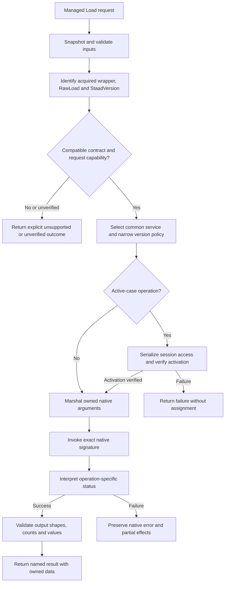
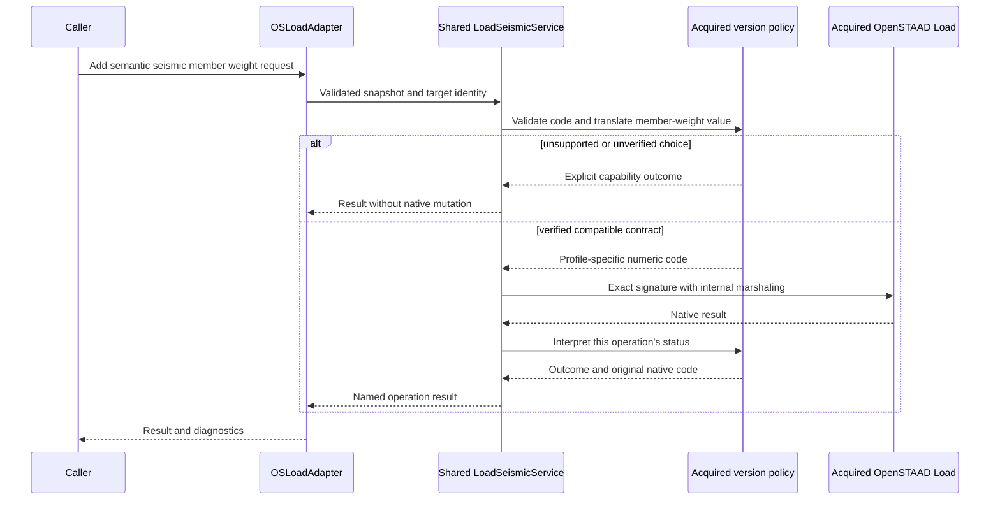

# OpenSTAAD Load multi-version comparison, architecture and implementation plan

**Review date:** 22 October 2026
**Baseline:** main at 1483c9c
**Scope:** All linked Load help sections installed with STAAD.Pro 2024, 2025 and 2026; the current managed Load surface and delegated entity implementations; the read-only main-project reference; and passive inspection of the installed 2025/2026 vendor interop assemblies.
**Status:** Original comparison and architecture proposals, with current reference-overload implementation status updated below. The full proposed architecture is not yet implemented.

## Current implementation update — 22 October 2026

Completed the final 15 private-main-interface reference overloads. IOSLoad and OSLoadAdapter now each expose **120 method overloads: all 115 reference signatures plus five repository conveniences**, with **zero reference interface overloads pending**. Current native dispatch coverage is **73 of 129 documented names**: 67 direct adapter targets plus six delegated member-load mutations. **56 native names** remain without a current dispatch.

The latest implementation completes member-weight conveniences, wall-area input, both spectrum APIs and direct-analysis definition creation/deletion. Reused source models/enums and checked snapshots, status handling and Single conversion. Wall-area code 15, definition codes, member-weight codes and the two spectrum-modal domains remain explicitly separate. Native-layout ambiguities are recorded in the [completion guide](../Load-Porting.md#load-reference-completion).

This completes private interface parity, not the report’s broader named-result APIs, semantic member-code translation or full polymorphic capability architecture. Those remain future work, along with additional native functions and live marshaling/engineering verification. Passed 2,185 offline tests (161 new cases); source XML verification covers 310 selected guarded examples. The comparison baseline, installed documentation/ABI evidence and original fingerprints remain provenance; current counts and call-site links are updated below.

## 1. Findings and recommended direction

Each reviewed version documents the same **129 native function names**, with a detailed contract for every name. All native declarations match across the three years. However, **identical declarations do not establish identical semantics**: seismic member-weight code numbers change, NRC 2020 is added to definition/parameter tables, and two error contracts change. The normalized 2025 and 2026 signatures, non-example contracts and examples match.

Use shared implementations for unchanged operations and narrow internal policies for seismic capabilities, seismic member-weight code translation and changed status interpretation. Do not duplicate the entire Load adapter for each year. Select the profile from **wrapper.StaadVersion**, which describes the acquired native application. **wrapper.ApplicationVersion describes the host/client**, and must not select native behavior.

| Measure | Finding |
| --- | ---: |
| Help pages traversed per year | 24 |
| Detailed native functions per year | 129 |
| Union / intersection of documented native names | 129 / 129 |
| Functions with changed native declarations | 0 |
| Shared contracts after formatting-only normalization | 123 |
| Further functions with an input-type clarification | 1 |
| Further functions with capability, mapping or status changes | 5 |
| Functions whose examples change between 2024 and 2025 | 35 |
| Native contract/example changes between 2025 and 2026 | 0 |
| Current IOSLoad / OSLoadAdapter public method overloads | 120 / 120 |
| Distinct native names called directly by OSLoadAdapter | 67 |
| Additional native names reached through member-load ApplyTo implementations | 6 |
| Documented native names with either dispatch form | 73 |
| Documented native names without either dispatch form | 56 |
| Methods in each inspected 2025/2026 IOSLoadUI | 132 |
| Metadata-only methods outside the traversed help inventory | 3 |
| Current main-project reference IOSLoad overloads | 115 |
| Matching reference overloads / pending reference overloads | 115 / 0 |
| Additional repository convenience overloads | 5 |

**Private-source parity and Bentley coverage are different measures.** No private-reference interface overload remains, but additional native operations are still unwrapped. Conversely, several documented operations are already composed behind a differently named managed function. Six member mutations are implemented in load entities and are counted here; an adapter-only text search would incorrectly report those as absent.

No year-exclusive native function names were found in these references. This does not justify three public year-specific adapters. Some **parameter choices** are version-sensitive, so availability must also be checked at the request/capability boundary. C# cannot remove an enum member or interface method from IntelliSense after connection to a particular STAAD instance.

## 2. References, scope and reproducibility

The top-level Load page contains only AddRSLoad and SplitLoadsOnBeam. All subgroup links were followed recursively, including grouping pages and sections containing no declared functions. Empty Time History, Snow and Physical Member sections are recorded as empty help sections; they do not prove that the installed application lacks those engineering features.

| Reference | Documented build | Pages | Detailed functions |
| --- | --- | ---: | ---: |
| [STAAD.Pro 2024 Load help](../../../../../../../../Program%20Files/Bentley/Engineering/STAAD.Pro%202024/OSAPP_Help/group___load_group.html) | `24.00.02.354` | 24 | 129 |
| [STAAD.Pro 2025 Load help](../../../../../../../../Program%20Files/Bentley/Engineering/STAAD.Pro%202025/OSAPP_Help/group___load_group.html) | `25.00.01.424` | 24 | 129 |
| [STAAD.Pro 2026 Load help](../../../../../../../../Program%20Files/Bentley/Engineering/STAAD.Pro%202026/OSAPP_Help/group___load_group.html) | `26.00.00.340` | 24 | 129 |

| Section | Functions in each year | Direct / delegated dispatches | Unmapped |
| --- | ---: | ---: | ---: |
| [Load](../../../../../../../../Program%20Files/Bentley/Engineering/STAAD.Pro%202026/OSAPP_Help/group___load_group.html) | 2 | 1 | 1 |
| [Load: Definition](../../../../../../../../Program%20Files/Bentley/Engineering/STAAD.Pro%202026/OSAPP_Help/group___property_load_def.html) | 0 | 0 | 0 |
| [Load: Load Case Details](../../../../../../../../Program%20Files/Bentley/Engineering/STAAD.Pro%202026/OSAPP_Help/group___property_load_case.html) | 2 | 2 | 0 |
| [Load: Load Envelopes](../../../../../../../../Program%20Files/Bentley/Engineering/STAAD.Pro%202026/OSAPP_Help/group___property_load_enve.html) | 8 | 5 | 3 |
| [Load Definition: Wind](../../../../../../../../Program%20Files/Bentley/Engineering/STAAD.Pro%202026/OSAPP_Help/group___property_load_def_wind.html) | 7 | 7 | 0 |
| [Load Definition: Seismic](../../../../../../../../Program%20Files/Bentley/Engineering/STAAD.Pro%202026/OSAPP_Help/group___property_load_def_seismic.html) | 7 | 7 | 0 |
| [Load Definition: Time History](../../../../../../../../Program%20Files/Bentley/Engineering/STAAD.Pro%202026/OSAPP_Help/group___property_load_def_t_h.html) | 0 | 0 | 0 |
| [Load Definition: Snow](../../../../../../../../Program%20Files/Bentley/Engineering/STAAD.Pro%202026/OSAPP_Help/group___property_load_def_snow.html) | 0 | 0 | 0 |
| [Load Definition: Reference](../../../../../../../../Program%20Files/Bentley/Engineering/STAAD.Pro%202026/OSAPP_Help/group___property_load_def_ref_load.html) | 4 | 4 | 0 |
| [Load Definition: Direct Analysis](../../../../../../../../Program%20Files/Bentley/Engineering/STAAD.Pro%202026/OSAPP_Help/group___property_direct_analysis.html) | 3 | 3 | 0 |
| [Load Case Details: Load Items](../../../../../../../../Program%20Files/Bentley/Engineering/STAAD.Pro%202026/OSAPP_Help/group___property_load_items.html) | 0 | 0 | 0 |
| [Load Case Details: Load Combination](../../../../../../../../Program%20Files/Bentley/Engineering/STAAD.Pro%202026/OSAPP_Help/group___property_load_comb.html) | 9 | 6 | 3 |
| [Load Case Details: Load Case Operation](../../../../../../../../Program%20Files/Bentley/Engineering/STAAD.Pro%202026/OSAPP_Help/group___property_load_operation.html) | 26 | 8 | 18 |
| [Load Items: SelfWeight](../../../../../../../../Program%20Files/Bentley/Engineering/STAAD.Pro%202026/OSAPP_Help/group___property_load_self_weight.html) | 2 | 1 | 1 |
| [Load Items: Nodal](../../../../../../../../Program%20Files/Bentley/Engineering/STAAD.Pro%202026/OSAPP_Help/group___property_load_nodal.html) | 5 | 4 | 1 |
| [Load Items: Member](../../../../../../../../Program%20Files/Bentley/Engineering/STAAD.Pro%202026/OSAPP_Help/group___property_load_mem.html) | 21 | 18 | 3 |
| [Load Items: Physical Member](../../../../../../../../Program%20Files/Bentley/Engineering/STAAD.Pro%202026/OSAPP_Help/group___property_load_p_mem.html) | 0 | 0 | 0 |
| [Load Items: Element](../../../../../../../../Program%20Files/Bentley/Engineering/STAAD.Pro%202026/OSAPP_Help/group___property_load_ele.html) | 8 | 1 | 7 |
| [Load Items: Floor](../../../../../../../../Program%20Files/Bentley/Engineering/STAAD.Pro%202026/OSAPP_Help/group___property_load_floor.html) | 4 | 0 | 4 |
| [Load Items: Temperature](../../../../../../../../Program%20Files/Bentley/Engineering/STAAD.Pro%202026/OSAPP_Help/group___property_load_temp.html) | 2 | 1 | 1 |
| [Load Items: Seismic](../../../../../../../../Program%20Files/Bentley/Engineering/STAAD.Pro%202026/OSAPP_Help/group___property_load_seismic.html) | 2 | 0 | 2 |
| [Load Items: Time History](../../../../../../../../Program%20Files/Bentley/Engineering/STAAD.Pro%202026/OSAPP_Help/group___property_load_t_h.html) | 0 | 0 | 0 |
| [Load Items: Wind and Snow](../../../../../../../../Program%20Files/Bentley/Engineering/STAAD.Pro%202026/OSAPP_Help/group___property_load_wind.html) | 1 | 0 | 1 |
| [Load Items: Repeat](../../../../../../../../Program%20Files/Bentley/Engineering/STAAD.Pro%202026/OSAPP_Help/group___property_load_repeat.html) | 16 | 5 | 11 |

The [contract inventory](OpenSTAAD-Load-API-Coverage-and-Contract-Inventory.md) gives all 129 declarations, native parameters and directions, return labels, current callers, the original 70 per-function API proposals (56 targets still unmapped), the three supplemental interop methods, all 120 current managed overloads, completed private-reference parity and every page fingerprint. The [comparison data](data/OpenSTAAD-Load-2024-2026-Comparison.json) records functional declarations and evidence hashes without reproducing complete vendor examples or narrative.

### 2.1 Passive interop corroboration

The installed 2025 and 2026 vendor assemblies each declare **132 distinct OpenSTAADUI.IOSLoadUI methods**. Names, return types, parameter types, by-reference shapes and recorded in/out/optional flags match. The **13 enum types used by these signatures also have matching names and numeric values** in both assemblies. All 129 documented names appear in both interfaces. The additional three names are AddSeismicDefElementWeight, AddSeismicDefFloorWeight and MergeLoadsOnBeam.

Both assemblies identify as StaadPro.Interop, Version=1.0.0.0, Culture=neutral, PublicKeyToken=b4d201f8319cef86. Their fingerprints differ:

| Product | SHA-256 |
| --- | --- |
| 2025 | CC724993AC9119138B7323E8C684997257E2851DE62E1551BA5D6D67A9DADC19 |
| 2026 | 6D153E80ED356A1B167ABB2EF19227FCFF510707A578AD304154652CC6C1F6D4 |

The [annex](OpenSTAAD-Load-API-Coverage-and-Contract-Inventory.md#2-supplemental-installed-interop-inventory) links the inspected files. Inspection used explicit installed paths and separate reflection-only processes because the vendor DLL and this repository's DLL share a short filename. No vendor binary was copied into the library, no production reference was added and no COM server was activated. The corresponding 2024 vendor interop file was unavailable at the inspected path, so the 2024 ABI remains uncorroborated.

Passive managed metadata is not acquired-server IDispatch evidence or live marshaling/engineering verification. The common method set does not prove that every servicing build, model state or licensed installation supports every call.

### 2.2 Review method and classification

1. Traverse and fingerprint all 24 pages per product year; reconcile every summary with a detailed member block.
2. Compare declarations, parameter tables, return/error tables, notes and examples separately. Keep summary/detail parameter aliases visible.
3. Normalize HTML, whitespace, Doxygen access labels, generated source-definition tooltips and syntax headings. Two apparent non-example changes are layout artifacts: an extra Parameters heading in the ASCE wind entry and literal tab markers in automatic repeat generation.
4. Parse current C# method syntax and delegated member-load ApplyTo calls, then compare the interface and adapter overload sets.
5. Compare the 115-overload read-only main interface by method name, generic arity and parameter types. Inspect relevant source models before proposing replacements.
6. Compare installed interop signatures, enum values and current native argument counts/explicit ref shapes. Record discrepancies without changing production code.
7. Separate observed documentation changes, architecture proposals and outstanding native verification.

**Common:** no substantive non-example difference after normalization. **Clarified:** additional input-type information. **Capability:** new supported engineering-code choice/keywords. **Mapping:** changed numeric encoding. **Status:** changed error information. None of these labels certifies a runtime change; a manual correction can produce the same observation.

## 3. Complete cross-version function matrix

Year cells link directly to each installed native reference. **D** means a direct OSLoadAdapter dispatch; **E** means dispatch through a member-load entity invoked by AddMemberLoad; **N** means neither was found. These are implementation-presence classifications, not native certification. A dispatch can still have an unresolved call shape or ignore a returned failure.

VARIANT is a native declaration, not a guarantee of Boolean success, a returned ID or an array. Function-specific contracts control its interpretation.

| Native function | 2024 return | 2025 return | 2026 return | Comparison | Dispatch | Current caller / planned phase |
| --- | --- | --- | --- | --- | --- | --- |
| [AddRSLoad](OpenSTAAD-Load-API-Coverage-and-Contract-Inventory.md#addrsload) | [VARIANT](../../../../../../../../Program%20Files/Bentley/Engineering/STAAD.Pro%202024/OSAPP_Help/group___load_group.html#ga1b938bf65248e91a620868453a458b9d) | [VARIANT](../../../../../../../../Program%20Files/Bentley/Engineering/STAAD.Pro%202025/OSAPP_Help/group___load_group.html#ga1b938bf65248e91a620868453a458b9d) | [VARIANT](../../../../../../../../Program%20Files/Bentley/Engineering/STAAD.Pro%202026/OSAPP_Help/group___load_group.html#ga1b938bf65248e91a620868453a458b9d) | Common | D | [AddRSLoad](../../src/StaadPro.Interop/Adapters/Models/OSLoadAdapter.cs#L167) |
| [SplitLoadsOnBeam](OpenSTAAD-Load-API-Coverage-and-Contract-Inventory.md#splitloadsonbeam) | [VARIANT](../../../../../../../../Program%20Files/Bentley/Engineering/STAAD.Pro%202024/OSAPP_Help/group___load_group.html#gaa4ef18bf50db77e41cc496a915955be4) | [VARIANT](../../../../../../../../Program%20Files/Bentley/Engineering/STAAD.Pro%202025/OSAPP_Help/group___load_group.html#gaa4ef18bf50db77e41cc496a915955be4) | [VARIANT](../../../../../../../../Program%20Files/Bentley/Engineering/STAAD.Pro%202026/OSAPP_Help/group___load_group.html#gaa4ef18bf50db77e41cc496a915955be4) | Common | N | L7 |
| [GetPrimaryLoadCaseCount](OpenSTAAD-Load-API-Coverage-and-Contract-Inventory.md#getprimaryloadcasecount) | [VARIANT](../../../../../../../../Program%20Files/Bentley/Engineering/STAAD.Pro%202024/OSAPP_Help/group___property_load_case.html#ga8c4ac07c10d5cfd0a2bda5d3f837db24) | [VARIANT](../../../../../../../../Program%20Files/Bentley/Engineering/STAAD.Pro%202025/OSAPP_Help/group___property_load_case.html#ga8c4ac07c10d5cfd0a2bda5d3f837db24) | [VARIANT](../../../../../../../../Program%20Files/Bentley/Engineering/STAAD.Pro%202026/OSAPP_Help/group___property_load_case.html#ga8c4ac07c10d5cfd0a2bda5d3f837db24) | Common | D | [ReadAllLoadCases](../../src/StaadPro.Interop/Adapters/Models/OSLoadAdapter.cs#L2349) |
| [SetLoadActive](OpenSTAAD-Load-API-Coverage-and-Contract-Inventory.md#setloadactive) | [VARIANT](../../../../../../../../Program%20Files/Bentley/Engineering/STAAD.Pro%202024/OSAPP_Help/group___property_load_case.html#ga065a2faa02e196d4ba47854653a7946b) | [VARIANT](../../../../../../../../Program%20Files/Bentley/Engineering/STAAD.Pro%202025/OSAPP_Help/group___property_load_case.html#ga065a2faa02e196d4ba47854653a7946b) | [VARIANT](../../../../../../../../Program%20Files/Bentley/Engineering/STAAD.Pro%202026/OSAPP_Help/group___property_load_case.html#ga065a2faa02e196d4ba47854653a7946b) | Common | D | [SetLoadCaseActive](../../src/StaadPro.Interop/Adapters/Models/OSLoadAdapter.cs#L1853); [ActivateQueryCase](../../src/StaadPro.Interop/Adapters/Models/OSLoadAdapter.cs#L2433) |
| [CreateLoadEnvelop](OpenSTAAD-Load-API-Coverage-and-Contract-Inventory.md#createloadenvelop) | [VARIANT](../../../../../../../../Program%20Files/Bentley/Engineering/STAAD.Pro%202024/OSAPP_Help/group___property_load_enve.html#ga9f28063ba9f67609d5489f069da32154) | [VARIANT](../../../../../../../../Program%20Files/Bentley/Engineering/STAAD.Pro%202025/OSAPP_Help/group___property_load_enve.html#ga9f28063ba9f67609d5489f069da32154) | [VARIANT](../../../../../../../../Program%20Files/Bentley/Engineering/STAAD.Pro%202026/OSAPP_Help/group___property_load_enve.html#ga9f28063ba9f67609d5489f069da32154) | Common | D | [CreateLoadEnvelopExt](../../src/StaadPro.Interop/Adapters/Models/OSLoadAdapter.cs#L2265) |
| [AddLoadCasesToEnvelop](OpenSTAAD-Load-API-Coverage-and-Contract-Inventory.md#addloadcasestoenvelop) | [VARIANT](../../../../../../../../Program%20Files/Bentley/Engineering/STAAD.Pro%202024/OSAPP_Help/group___property_load_enve.html#ga16a1d26c9c356a3c96cf81d43fac81fa) | [VARIANT](../../../../../../../../Program%20Files/Bentley/Engineering/STAAD.Pro%202025/OSAPP_Help/group___property_load_enve.html#ga16a1d26c9c356a3c96cf81d43fac81fa) | [VARIANT](../../../../../../../../Program%20Files/Bentley/Engineering/STAAD.Pro%202026/OSAPP_Help/group___property_load_enve.html#ga16a1d26c9c356a3c96cf81d43fac81fa) | Common | N | L5 |
| [RemoveLoadCasesFromEnvelop](OpenSTAAD-Load-API-Coverage-and-Contract-Inventory.md#removeloadcasesfromenvelop) | [VARIANT](../../../../../../../../Program%20Files/Bentley/Engineering/STAAD.Pro%202024/OSAPP_Help/group___property_load_enve.html#gac630898fc921f930e89fa9f8701ea9ba) | [VARIANT](../../../../../../../../Program%20Files/Bentley/Engineering/STAAD.Pro%202025/OSAPP_Help/group___property_load_enve.html#gac630898fc921f930e89fa9f8701ea9ba) | [VARIANT](../../../../../../../../Program%20Files/Bentley/Engineering/STAAD.Pro%202026/OSAPP_Help/group___property_load_enve.html#gac630898fc921f930e89fa9f8701ea9ba) | Common | N | L5 |
| [DeleteLoadEnvelop](OpenSTAAD-Load-API-Coverage-and-Contract-Inventory.md#deleteloadenvelop) | [VARIANT](../../../../../../../../Program%20Files/Bentley/Engineering/STAAD.Pro%202024/OSAPP_Help/group___property_load_enve.html#ga1ae3d8ba1801dbf2b3e85dff88948d05) | [VARIANT](../../../../../../../../Program%20Files/Bentley/Engineering/STAAD.Pro%202025/OSAPP_Help/group___property_load_enve.html#ga1ae3d8ba1801dbf2b3e85dff88948d05) | [VARIANT](../../../../../../../../Program%20Files/Bentley/Engineering/STAAD.Pro%202026/OSAPP_Help/group___property_load_enve.html#ga1ae3d8ba1801dbf2b3e85dff88948d05) | Common | N | L5 |
| [GetEnvelopeCount](OpenSTAAD-Load-API-Coverage-and-Contract-Inventory.md#getenvelopecount) | [long](../../../../../../../../Program%20Files/Bentley/Engineering/STAAD.Pro%202024/OSAPP_Help/group___property_load_enve.html#ga0b8f688b0cddf6f418356af7112bb474) | [long](../../../../../../../../Program%20Files/Bentley/Engineering/STAAD.Pro%202025/OSAPP_Help/group___property_load_enve.html#ga0b8f688b0cddf6f418356af7112bb474) | [long](../../../../../../../../Program%20Files/Bentley/Engineering/STAAD.Pro%202026/OSAPP_Help/group___property_load_enve.html#ga0b8f688b0cddf6f418356af7112bb474) | Common | D | [GetEnvelopeIds](../../src/StaadPro.Interop/Adapters/Models/OSLoadAdapter.cs#L2100) |
| [GetLoadEnvelopeDetails](OpenSTAAD-Load-API-Coverage-and-Contract-Inventory.md#getloadenvelopedetails) | [long](../../../../../../../../Program%20Files/Bentley/Engineering/STAAD.Pro%202024/OSAPP_Help/group___property_load_enve.html#gaf8b78c76d6f4c0151f6534f5848e77d6) | [long](../../../../../../../../Program%20Files/Bentley/Engineering/STAAD.Pro%202025/OSAPP_Help/group___property_load_enve.html#gaf8b78c76d6f4c0151f6534f5848e77d6) | [long](../../../../../../../../Program%20Files/Bentley/Engineering/STAAD.Pro%202026/OSAPP_Help/group___property_load_enve.html#gaf8b78c76d6f4c0151f6534f5848e77d6) | Common | D | [GetLoadEnvelopeDetail](../../src/StaadPro.Interop/Adapters/Models/OSLoadAdapter.cs#L2144) |
| [GetLoadListfromLoadEnvelope](OpenSTAAD-Load-API-Coverage-and-Contract-Inventory.md#getloadlistfromloadenvelope) | [long](../../../../../../../../Program%20Files/Bentley/Engineering/STAAD.Pro%202024/OSAPP_Help/group___property_load_enve.html#ga05374c9b5b38ea705b4db65d6f3ce20a) | [long](../../../../../../../../Program%20Files/Bentley/Engineering/STAAD.Pro%202025/OSAPP_Help/group___property_load_enve.html#ga05374c9b5b38ea705b4db65d6f3ce20a) | [long](../../../../../../../../Program%20Files/Bentley/Engineering/STAAD.Pro%202026/OSAPP_Help/group___property_load_enve.html#ga05374c9b5b38ea705b4db65d6f3ce20a) | Common | D | [GetLoadEnvelopeDetail](../../src/StaadPro.Interop/Adapters/Models/OSLoadAdapter.cs#L2152) |
| [GetEnvelopeIDs](OpenSTAAD-Load-API-Coverage-and-Contract-Inventory.md#getenvelopeids) | [long](../../../../../../../../Program%20Files/Bentley/Engineering/STAAD.Pro%202024/OSAPP_Help/group___property_load_enve.html#gaea479c68d7b2b2114d16e1ffd1a5a199) | [long](../../../../../../../../Program%20Files/Bentley/Engineering/STAAD.Pro%202025/OSAPP_Help/group___property_load_enve.html#gaea479c68d7b2b2114d16e1ffd1a5a199) | [long](../../../../../../../../Program%20Files/Bentley/Engineering/STAAD.Pro%202026/OSAPP_Help/group___property_load_enve.html#gaea479c68d7b2b2114d16e1ffd1a5a199) | Common | D | [GetEnvelopeIds](../../src/StaadPro.Interop/Adapters/Models/OSLoadAdapter.cs#L2104) |
| [AddWindDefinition](OpenSTAAD-Load-API-Coverage-and-Contract-Inventory.md#addwinddefinition) | [VARIANT](../../../../../../../../Program%20Files/Bentley/Engineering/STAAD.Pro%202024/OSAPP_Help/group___property_load_def_wind.html#ga2ae52c29c70f50fad759adefb71761e4) | [VARIANT](../../../../../../../../Program%20Files/Bentley/Engineering/STAAD.Pro%202025/OSAPP_Help/group___property_load_def_wind.html#ga2ae52c29c70f50fad759adefb71761e4) | [VARIANT](../../../../../../../../Program%20Files/Bentley/Engineering/STAAD.Pro%202026/OSAPP_Help/group___property_load_def_wind.html#ga2ae52c29c70f50fad759adefb71761e4) | Common | D | [AddWindDefinition](../../src/StaadPro.Interop/Adapters/Models/OSLoadAdapter.cs#L370) |
| [AddWindIntensity](OpenSTAAD-Load-API-Coverage-and-Contract-Inventory.md#addwindintensity) | [VARIANT](../../../../../../../../Program%20Files/Bentley/Engineering/STAAD.Pro%202024/OSAPP_Help/group___property_load_def_wind.html#ga8a39105b37ab53253129a83229559bee) | [VARIANT](../../../../../../../../Program%20Files/Bentley/Engineering/STAAD.Pro%202025/OSAPP_Help/group___property_load_def_wind.html#ga8a39105b37ab53253129a83229559bee) | [VARIANT](../../../../../../../../Program%20Files/Bentley/Engineering/STAAD.Pro%202026/OSAPP_Help/group___property_load_def_wind.html#ga8a39105b37ab53253129a83229559bee) | Common | D | [AddWindIntensity](../../src/StaadPro.Interop/Adapters/Models/OSLoadAdapter.cs#L413); [AddWindIntensity](../../src/StaadPro.Interop/Adapters/Models/OSLoadAdapter.cs#L428) |
| [ComputeWallWindPressureProfile](OpenSTAAD-Load-API-Coverage-and-Contract-Inventory.md#computewallwindpressureprofile) | [long](../../../../../../../../Program%20Files/Bentley/Engineering/STAAD.Pro%202024/OSAPP_Help/group___property_load_def_wind.html#ga14842eb0090688108f87a2412922b71d) | [long](../../../../../../../../Program%20Files/Bentley/Engineering/STAAD.Pro%202025/OSAPP_Help/group___property_load_def_wind.html#ga14842eb0090688108f87a2412922b71d) | [long](../../../../../../../../Program%20Files/Bentley/Engineering/STAAD.Pro%202026/OSAPP_Help/group___property_load_def_wind.html#ga14842eb0090688108f87a2412922b71d) | Common | D | [ComputeWallWindPressureProfile](../../src/StaadPro.Interop/Adapters/Models/OSLoadAdapter.cs#L199) |
| [ComputeWallWindPressureProfileASCE72016](OpenSTAAD-Load-API-Coverage-and-Contract-Inventory.md#computewallwindpressureprofileasce72016) | [long](../../../../../../../../Program%20Files/Bentley/Engineering/STAAD.Pro%202024/OSAPP_Help/group___property_load_def_wind.html#ga09d85745d67966ad0b323ddf4751b739) | [long](../../../../../../../../Program%20Files/Bentley/Engineering/STAAD.Pro%202025/OSAPP_Help/group___property_load_def_wind.html#ga09d85745d67966ad0b323ddf4751b739) | [long](../../../../../../../../Program%20Files/Bentley/Engineering/STAAD.Pro%202026/OSAPP_Help/group___property_load_def_wind.html#ga09d85745d67966ad0b323ddf4751b739) | Common | D | [ComputeWallWindPressureProfileASCE72016](../../src/StaadPro.Interop/Adapters/Models/OSLoadAdapter.cs#L212) |
| [AddWindDefinitionASCE7Parameters](OpenSTAAD-Load-API-Coverage-and-Contract-Inventory.md#addwinddefinitionasce7parameters) | [VARIANT](../../../../../../../../Program%20Files/Bentley/Engineering/STAAD.Pro%202024/OSAPP_Help/group___property_load_def_wind.html#gaeaa2d3d5e5b318160defa2f8596dc343) | [VARIANT](../../../../../../../../Program%20Files/Bentley/Engineering/STAAD.Pro%202025/OSAPP_Help/group___property_load_def_wind.html#gaeaa2d3d5e5b318160defa2f8596dc343) | [VARIANT](../../../../../../../../Program%20Files/Bentley/Engineering/STAAD.Pro%202026/OSAPP_Help/group___property_load_def_wind.html#gaeaa2d3d5e5b318160defa2f8596dc343) | Common | D | [AddWindDefinitionASCE7Parameters](../../src/StaadPro.Interop/Adapters/Models/OSLoadAdapter.cs#L185) |
| [AddWindExposure](OpenSTAAD-Load-API-Coverage-and-Contract-Inventory.md#addwindexposure) | [VARIANT](../../../../../../../../Program%20Files/Bentley/Engineering/STAAD.Pro%202024/OSAPP_Help/group___property_load_def_wind.html#ga30c27ad6bfef60382db306f1d8168cef) | [VARIANT](../../../../../../../../Program%20Files/Bentley/Engineering/STAAD.Pro%202025/OSAPP_Help/group___property_load_def_wind.html#ga30c27ad6bfef60382db306f1d8168cef) | [VARIANT](../../../../../../../../Program%20Files/Bentley/Engineering/STAAD.Pro%202026/OSAPP_Help/group___property_load_def_wind.html#ga30c27ad6bfef60382db306f1d8168cef) | Common | D | [AddWindExposure](../../src/StaadPro.Interop/Adapters/Models/OSLoadAdapter.cs#L382) |
| [DeleteWindDefinition](OpenSTAAD-Load-API-Coverage-and-Contract-Inventory.md#deletewinddefinition) | [VARIANT](../../../../../../../../Program%20Files/Bentley/Engineering/STAAD.Pro%202024/OSAPP_Help/group___property_load_def_wind.html#ga0b2356ca2a0d681720b9da8d3c022cc9) | [VARIANT](../../../../../../../../Program%20Files/Bentley/Engineering/STAAD.Pro%202025/OSAPP_Help/group___property_load_def_wind.html#ga0b2356ca2a0d681720b9da8d3c022cc9) | [VARIANT](../../../../../../../../Program%20Files/Bentley/Engineering/STAAD.Pro%202026/OSAPP_Help/group___property_load_def_wind.html#ga0b2356ca2a0d681720b9da8d3c022cc9) | Common | D | [DeleteWindDefinition](../../src/StaadPro.Interop/Adapters/Models/OSLoadAdapter.cs#L444) |
| [AddSeismicDefinition](OpenSTAAD-Load-API-Coverage-and-Contract-Inventory.md#addseismicdefinition) | [VARIANT](../../../../../../../../Program%20Files/Bentley/Engineering/STAAD.Pro%202024/OSAPP_Help/group___property_load_def_seismic.html#ga885d12987341c6323c4c71b02979af9b) | [VARIANT](../../../../../../../../Program%20Files/Bentley/Engineering/STAAD.Pro%202025/OSAPP_Help/group___property_load_def_seismic.html#ga885d12987341c6323c4c71b02979af9b) | [VARIANT](../../../../../../../../Program%20Files/Bentley/Engineering/STAAD.Pro%202026/OSAPP_Help/group___property_load_def_seismic.html#ga885d12987341c6323c4c71b02979af9b) | Capability | D | [AddSeismicDefinition](../../src/StaadPro.Interop/Adapters/Models/OSLoadAdapter.cs#L233) |
| [ModifySeismicDefinitionParams](OpenSTAAD-Load-API-Coverage-and-Contract-Inventory.md#modifyseismicdefinitionparams) | [VARIANT](../../../../../../../../Program%20Files/Bentley/Engineering/STAAD.Pro%202024/OSAPP_Help/group___property_load_def_seismic.html#ga5b4e6c8e6e7c46b829de3cb21c1f963d) | [VARIANT](../../../../../../../../Program%20Files/Bentley/Engineering/STAAD.Pro%202025/OSAPP_Help/group___property_load_def_seismic.html#ga5b4e6c8e6e7c46b829de3cb21c1f963d) | [VARIANT](../../../../../../../../Program%20Files/Bentley/Engineering/STAAD.Pro%202026/OSAPP_Help/group___property_load_def_seismic.html#ga5b4e6c8e6e7c46b829de3cb21c1f963d) | Capability | D | [ModifySeismicDefinitionParam](../../src/StaadPro.Interop/Adapters/Models/OSLoadAdapter.cs#L241) |
| [AddSeismicDefSelfWeight](OpenSTAAD-Load-API-Coverage-and-Contract-Inventory.md#addseismicdefselfweight) | [VARIANT](../../../../../../../../Program%20Files/Bentley/Engineering/STAAD.Pro%202024/OSAPP_Help/group___property_load_def_seismic.html#ga0aee693e0d969e310fc41938f5ca6cd3) | [VARIANT](../../../../../../../../Program%20Files/Bentley/Engineering/STAAD.Pro%202025/OSAPP_Help/group___property_load_def_seismic.html#ga0aee693e0d969e310fc41938f5ca6cd3) | [VARIANT](../../../../../../../../Program%20Files/Bentley/Engineering/STAAD.Pro%202026/OSAPP_Help/group___property_load_def_seismic.html#ga0aee693e0d969e310fc41938f5ca6cd3) | Clarified | D | [AddSeismicDefSelfWeight](../../src/StaadPro.Interop/Adapters/Models/OSLoadAdapter.cs#L287) |
| [AddSeismicDefMemberWeight](OpenSTAAD-Load-API-Coverage-and-Contract-Inventory.md#addseismicdefmemberweight) | [VARIANT](../../../../../../../../Program%20Files/Bentley/Engineering/STAAD.Pro%202024/OSAPP_Help/group___property_load_def_seismic.html#ga2299de54c2eeddab2a1ba7ba11b86052) | [VARIANT](../../../../../../../../Program%20Files/Bentley/Engineering/STAAD.Pro%202025/OSAPP_Help/group___property_load_def_seismic.html#ga2299de54c2eeddab2a1ba7ba11b86052) | [VARIANT](../../../../../../../../Program%20Files/Bentley/Engineering/STAAD.Pro%202026/OSAPP_Help/group___property_load_def_seismic.html#ga2299de54c2eeddab2a1ba7ba11b86052) | Mapping | D | [AddSeismicDefMemberWeight](../../src/StaadPro.Interop/Adapters/Models/OSLoadAdapter.cs#L325) |
| [AddSeismicDefJointWeight](OpenSTAAD-Load-API-Coverage-and-Contract-Inventory.md#addseismicdefjointweight) | [VARIANT](../../../../../../../../Program%20Files/Bentley/Engineering/STAAD.Pro%202024/OSAPP_Help/group___property_load_def_seismic.html#gae8c289357923e66c14f2b08417055bc7) | [VARIANT](../../../../../../../../Program%20Files/Bentley/Engineering/STAAD.Pro%202025/OSAPP_Help/group___property_load_def_seismic.html#gae8c289357923e66c14f2b08417055bc7) | [VARIANT](../../../../../../../../Program%20Files/Bentley/Engineering/STAAD.Pro%202026/OSAPP_Help/group___property_load_def_seismic.html#gae8c289357923e66c14f2b08417055bc7) | Status | D | [AddSeismicDefJointWeight](../../src/StaadPro.Interop/Adapters/Models/OSLoadAdapter.cs#L296) |
| [AddSeismicDefWallArea](OpenSTAAD-Load-API-Coverage-and-Contract-Inventory.md#addseismicdefwallarea) | [VARIANT](../../../../../../../../Program%20Files/Bentley/Engineering/STAAD.Pro%202024/OSAPP_Help/group___property_load_def_seismic.html#gad481a21e57f2ee6b953d5e1d111c34c7) | [VARIANT](../../../../../../../../Program%20Files/Bentley/Engineering/STAAD.Pro%202025/OSAPP_Help/group___property_load_def_seismic.html#gad481a21e57f2ee6b953d5e1d111c34c7) | [VARIANT](../../../../../../../../Program%20Files/Bentley/Engineering/STAAD.Pro%202026/OSAPP_Help/group___property_load_def_seismic.html#gad481a21e57f2ee6b953d5e1d111c34c7) | Common | D | [AddSeismicDefWallArea](../../src/StaadPro.Interop/Adapters/Models/OSLoadAdapter.cs#L70) |
| [AddResponseSpectrumLoadEx](OpenSTAAD-Load-API-Coverage-and-Contract-Inventory.md#addresponsespectrumloadex) | [VARIANT](../../../../../../../../Program%20Files/Bentley/Engineering/STAAD.Pro%202024/OSAPP_Help/group___property_load_def_seismic.html#gac24b840992cf7f15558b3c6844857f5a) | [VARIANT](../../../../../../../../Program%20Files/Bentley/Engineering/STAAD.Pro%202025/OSAPP_Help/group___property_load_def_seismic.html#gac24b840992cf7f15558b3c6844857f5a) | [VARIANT](../../../../../../../../Program%20Files/Bentley/Engineering/STAAD.Pro%202026/OSAPP_Help/group___property_load_def_seismic.html#gac24b840992cf7f15558b3c6844857f5a) | Common | D | [SubmitExtendedSpectrum](../../src/StaadPro.Interop/Adapters/Models/OSLoadAdapter.cs#L107) |
| [GetReferenceLoadCaseCount](OpenSTAAD-Load-API-Coverage-and-Contract-Inventory.md#getreferenceloadcasecount) | [long](../../../../../../../../Program%20Files/Bentley/Engineering/STAAD.Pro%202024/OSAPP_Help/group___property_load_def_ref_load.html#ga70c105eb346388eeed599db3ec1ea109) | [long](../../../../../../../../Program%20Files/Bentley/Engineering/STAAD.Pro%202025/OSAPP_Help/group___property_load_def_ref_load.html#ga70c105eb346388eeed599db3ec1ea109) | [long](../../../../../../../../Program%20Files/Bentley/Engineering/STAAD.Pro%202026/OSAPP_Help/group___property_load_def_ref_load.html#ga70c105eb346388eeed599db3ec1ea109) | Common | D | [ReadAllLoadCases](../../src/StaadPro.Interop/Adapters/Models/OSLoadAdapter.cs#L2349) |
| [GetReferenceLoadCaseNumbers](OpenSTAAD-Load-API-Coverage-and-Contract-Inventory.md#getreferenceloadcasenumbers) | [long](../../../../../../../../Program%20Files/Bentley/Engineering/STAAD.Pro%202024/OSAPP_Help/group___property_load_def_ref_load.html#gad56e67bc7dedd7e719cf97661581550c) | [long](../../../../../../../../Program%20Files/Bentley/Engineering/STAAD.Pro%202025/OSAPP_Help/group___property_load_def_ref_load.html#gad56e67bc7dedd7e719cf97661581550c) | [long](../../../../../../../../Program%20Files/Bentley/Engineering/STAAD.Pro%202026/OSAPP_Help/group___property_load_def_ref_load.html#gad56e67bc7dedd7e719cf97661581550c) | Common | D | [ReadAllLoadCases](../../src/StaadPro.Interop/Adapters/Models/OSLoadAdapter.cs#L2357) |
| [CreateNewReferenceLoad](OpenSTAAD-Load-API-Coverage-and-Contract-Inventory.md#createnewreferenceload) | [long](../../../../../../../../Program%20Files/Bentley/Engineering/STAAD.Pro%202024/OSAPP_Help/group___property_load_def_ref_load.html#ga13220ea514164923069da40dea5065fb) | [long](../../../../../../../../Program%20Files/Bentley/Engineering/STAAD.Pro%202025/OSAPP_Help/group___property_load_def_ref_load.html#ga13220ea514164923069da40dea5065fb) | [long](../../../../../../../../Program%20Files/Bentley/Engineering/STAAD.Pro%202026/OSAPP_Help/group___property_load_def_ref_load.html#ga13220ea514164923069da40dea5065fb) | Common | D | [CreateNewReferenceLoad](../../src/StaadPro.Interop/Adapters/Models/OSLoadAdapter.cs#L1822) |
| [SetReferenceLoadActive](OpenSTAAD-Load-API-Coverage-and-Contract-Inventory.md#setreferenceloadactive) | [long](../../../../../../../../Program%20Files/Bentley/Engineering/STAAD.Pro%202024/OSAPP_Help/group___property_load_def_ref_load.html#gad59a03aa194d6f31cbb49c59959dc053) | [long](../../../../../../../../Program%20Files/Bentley/Engineering/STAAD.Pro%202025/OSAPP_Help/group___property_load_def_ref_load.html#gad59a03aa194d6f31cbb49c59959dc053) | [long](../../../../../../../../Program%20Files/Bentley/Engineering/STAAD.Pro%202026/OSAPP_Help/group___property_load_def_ref_load.html#gad59a03aa194d6f31cbb49c59959dc053) | Common | D | [SetLoadCaseActive](../../src/StaadPro.Interop/Adapters/Models/OSLoadAdapter.cs#L1849); [ActivateQueryCase](../../src/StaadPro.Interop/Adapters/Models/OSLoadAdapter.cs#L2427) |
| [AddDirectAnalysisDefinitionParameter](OpenSTAAD-Load-API-Coverage-and-Contract-Inventory.md#adddirectanalysisdefinitionparameter) | [VARIANT](../../../../../../../../Program%20Files/Bentley/Engineering/STAAD.Pro%202024/OSAPP_Help/group___property_direct_analysis.html#gac8fe142a3657334769e6cbe960e40d1f) | [VARIANT](../../../../../../../../Program%20Files/Bentley/Engineering/STAAD.Pro%202025/OSAPP_Help/group___property_direct_analysis.html#gac8fe142a3657334769e6cbe960e40d1f) | [VARIANT](../../../../../../../../Program%20Files/Bentley/Engineering/STAAD.Pro%202026/OSAPP_Help/group___property_direct_analysis.html#gac8fe142a3657334769e6cbe960e40d1f) | Common | D | [AddDirectAnalysisDefinitionParameter](../../src/StaadPro.Interop/Adapters/Models/OSLoadAdapter.cs#L120) |
| [DeleteDirectAnalysisDefinitionParameter](OpenSTAAD-Load-API-Coverage-and-Contract-Inventory.md#deletedirectanalysisdefinitionparameter) | [VARIANT](../../../../../../../../Program%20Files/Bentley/Engineering/STAAD.Pro%202024/OSAPP_Help/group___property_direct_analysis.html#gacfb6b7aa2b317a90aced0bb8df579237) | [VARIANT](../../../../../../../../Program%20Files/Bentley/Engineering/STAAD.Pro%202025/OSAPP_Help/group___property_direct_analysis.html#gacfb6b7aa2b317a90aced0bb8df579237) | [VARIANT](../../../../../../../../Program%20Files/Bentley/Engineering/STAAD.Pro%202026/OSAPP_Help/group___property_direct_analysis.html#gacfb6b7aa2b317a90aced0bb8df579237) | Common | D | [DeleteDirectAnalysisDefinitionParameter](../../src/StaadPro.Interop/Adapters/Models/OSLoadAdapter.cs#L154) |
| [DeleteDirectAnalysisDefinition](OpenSTAAD-Load-API-Coverage-and-Contract-Inventory.md#deletedirectanalysisdefinition) | [VARIANT](../../../../../../../../Program%20Files/Bentley/Engineering/STAAD.Pro%202024/OSAPP_Help/group___property_direct_analysis.html#ga5577e10064596d7933dc30e5b68a66fd) | [VARIANT](../../../../../../../../Program%20Files/Bentley/Engineering/STAAD.Pro%202025/OSAPP_Help/group___property_direct_analysis.html#ga5577e10064596d7933dc30e5b68a66fd) | [VARIANT](../../../../../../../../Program%20Files/Bentley/Engineering/STAAD.Pro%202026/OSAPP_Help/group___property_direct_analysis.html#ga5577e10064596d7933dc30e5b68a66fd) | Common | D | [DeleteDirectAnalysisDefinition](../../src/StaadPro.Interop/Adapters/Models/OSLoadAdapter.cs#L160) |
| [GetLoadCombinationCaseCount](OpenSTAAD-Load-API-Coverage-and-Contract-Inventory.md#getloadcombinationcasecount) | [VARIANT](../../../../../../../../Program%20Files/Bentley/Engineering/STAAD.Pro%202024/OSAPP_Help/group___property_load_comb.html#ga4c6b39b1198e6e63aba6a7b56ca59dcc) | [VARIANT](../../../../../../../../Program%20Files/Bentley/Engineering/STAAD.Pro%202025/OSAPP_Help/group___property_load_comb.html#ga4c6b39b1198e6e63aba6a7b56ca59dcc) | [VARIANT](../../../../../../../../Program%20Files/Bentley/Engineering/STAAD.Pro%202026/OSAPP_Help/group___property_load_comb.html#ga4c6b39b1198e6e63aba6a7b56ca59dcc) | Common | D | [ReadCombinationCaseIds](../../src/StaadPro.Interop/Adapters/Models/OSLoadAdapter.cs#L2385) |
| [GetLoadCombinationCaseNumbers](OpenSTAAD-Load-API-Coverage-and-Contract-Inventory.md#getloadcombinationcasenumbers) | [VARIANT](../../../../../../../../Program%20Files/Bentley/Engineering/STAAD.Pro%202024/OSAPP_Help/group___property_load_comb.html#gafe01a8e664b6722b0e341e37152cb4a9) | [VARIANT](../../../../../../../../Program%20Files/Bentley/Engineering/STAAD.Pro%202025/OSAPP_Help/group___property_load_comb.html#gafe01a8e664b6722b0e341e37152cb4a9) | [VARIANT](../../../../../../../../Program%20Files/Bentley/Engineering/STAAD.Pro%202026/OSAPP_Help/group___property_load_comb.html#gafe01a8e664b6722b0e341e37152cb4a9) | Common | D | [ReadCombinationCaseIds](../../src/StaadPro.Interop/Adapters/Models/OSLoadAdapter.cs#L2388) |
| [CreateNewLoadCombination](OpenSTAAD-Load-API-Coverage-and-Contract-Inventory.md#createnewloadcombination) | [VARIANT](../../../../../../../../Program%20Files/Bentley/Engineering/STAAD.Pro%202024/OSAPP_Help/group___property_load_comb.html#ga8bb03f4733ba650a9df0a8fc16e4e523) | [VARIANT](../../../../../../../../Program%20Files/Bentley/Engineering/STAAD.Pro%202025/OSAPP_Help/group___property_load_comb.html#ga8bb03f4733ba650a9df0a8fc16e4e523) | [VARIANT](../../../../../../../../Program%20Files/Bentley/Engineering/STAAD.Pro%202026/OSAPP_Help/group___property_load_comb.html#ga8bb03f4733ba650a9df0a8fc16e4e523) | Common | D | [CreateLoadCombinations](../../src/StaadPro.Interop/Adapters/Models/OSLoadAdapter.cs#L738) |
| [AddLoadAndFactorToCombination](OpenSTAAD-Load-API-Coverage-and-Contract-Inventory.md#addloadandfactortocombination) | [VARIANT](../../../../../../../../Program%20Files/Bentley/Engineering/STAAD.Pro%202024/OSAPP_Help/group___property_load_comb.html#ga6f75602769cefbbcce48fa0098130c2a) | [VARIANT](../../../../../../../../Program%20Files/Bentley/Engineering/STAAD.Pro%202025/OSAPP_Help/group___property_load_comb.html#ga6f75602769cefbbcce48fa0098130c2a) | [VARIANT](../../../../../../../../Program%20Files/Bentley/Engineering/STAAD.Pro%202026/OSAPP_Help/group___property_load_comb.html#ga6f75602769cefbbcce48fa0098130c2a) | Common | D | [CreateLoadCombinations](../../src/StaadPro.Interop/Adapters/Models/OSLoadAdapter.cs#L740) |
| [GetNoOfLoadAndFactorPairsForCombination](OpenSTAAD-Load-API-Coverage-and-Contract-Inventory.md#getnoofloadandfactorpairsforcombination) | [VARIANT](../../../../../../../../Program%20Files/Bentley/Engineering/STAAD.Pro%202024/OSAPP_Help/group___property_load_comb.html#ga3f68ee33ca96f501438b78f008da34c8) | [VARIANT](../../../../../../../../Program%20Files/Bentley/Engineering/STAAD.Pro%202025/OSAPP_Help/group___property_load_comb.html#ga3f68ee33ca96f501438b78f008da34c8) | [VARIANT](../../../../../../../../Program%20Files/Bentley/Engineering/STAAD.Pro%202026/OSAPP_Help/group___property_load_comb.html#ga3f68ee33ca96f501438b78f008da34c8) | Common | D | [GetLoadCombination](../../src/StaadPro.Interop/Adapters/Models/OSLoadAdapter.cs#L622) |
| [GetLoadAndFactorForCombination](OpenSTAAD-Load-API-Coverage-and-Contract-Inventory.md#getloadandfactorforcombination) | [VARIANT](../../../../../../../../Program%20Files/Bentley/Engineering/STAAD.Pro%202024/OSAPP_Help/group___property_load_comb.html#ga02d917d448cea428dae77061868f19eb) | [VARIANT](../../../../../../../../Program%20Files/Bentley/Engineering/STAAD.Pro%202025/OSAPP_Help/group___property_load_comb.html#ga02d917d448cea428dae77061868f19eb) | [VARIANT](../../../../../../../../Program%20Files/Bentley/Engineering/STAAD.Pro%202026/OSAPP_Help/group___property_load_comb.html#ga02d917d448cea428dae77061868f19eb) | Common | D | [GetLoadCombination](../../src/StaadPro.Interop/Adapters/Models/OSLoadAdapter.cs#L628) |
| [IsCombinationCase](OpenSTAAD-Load-API-Coverage-and-Contract-Inventory.md#iscombinationcase) | [VARIANT](../../../../../../../../Program%20Files/Bentley/Engineering/STAAD.Pro%202024/OSAPP_Help/group___property_load_comb.html#gad07c8023e20a2452b79f0ac5a394a2d2) | [VARIANT](../../../../../../../../Program%20Files/Bentley/Engineering/STAAD.Pro%202025/OSAPP_Help/group___property_load_comb.html#gad07c8023e20a2452b79f0ac5a394a2d2) | [VARIANT](../../../../../../../../Program%20Files/Bentley/Engineering/STAAD.Pro%202026/OSAPP_Help/group___property_load_comb.html#gad07c8023e20a2452b79f0ac5a394a2d2) | Common | N | L5 |
| [AddAutoLoadCombinations](OpenSTAAD-Load-API-Coverage-and-Contract-Inventory.md#addautoloadcombinations) | [VARIANT](../../../../../../../../Program%20Files/Bentley/Engineering/STAAD.Pro%202024/OSAPP_Help/group___property_load_comb.html#ga0c6fba1b5eca1c912d70b36cbcac5763) | [VARIANT](../../../../../../../../Program%20Files/Bentley/Engineering/STAAD.Pro%202025/OSAPP_Help/group___property_load_comb.html#ga0c6fba1b5eca1c912d70b36cbcac5763) | [VARIANT](../../../../../../../../Program%20Files/Bentley/Engineering/STAAD.Pro%202026/OSAPP_Help/group___property_load_comb.html#ga0c6fba1b5eca1c912d70b36cbcac5763) | Status | N | L5 |
| [AddAutoCombinationRepeat](OpenSTAAD-Load-API-Coverage-and-Contract-Inventory.md#addautocombinationrepeat) | [VARIANT](../../../../../../../../Program%20Files/Bentley/Engineering/STAAD.Pro%202024/OSAPP_Help/group___property_load_comb.html#gab0a905a41051c3ae5c0d1d6e0586f544) | [VARIANT](../../../../../../../../Program%20Files/Bentley/Engineering/STAAD.Pro%202025/OSAPP_Help/group___property_load_comb.html#gab0a905a41051c3ae5c0d1d6e0586f544) | [VARIANT](../../../../../../../../Program%20Files/Bentley/Engineering/STAAD.Pro%202026/OSAPP_Help/group___property_load_comb.html#gab0a905a41051c3ae5c0d1d6e0586f544) | Common | N | L5 |
| [GetPrimaryLoadCaseNumbers](OpenSTAAD-Load-API-Coverage-and-Contract-Inventory.md#getprimaryloadcasenumbers) | [VARIANT](../../../../../../../../Program%20Files/Bentley/Engineering/STAAD.Pro%202024/OSAPP_Help/group___property_load_operation.html#ga3e518083ebff1f7eda2bad62d3696c0c) | [VARIANT](../../../../../../../../Program%20Files/Bentley/Engineering/STAAD.Pro%202025/OSAPP_Help/group___property_load_operation.html#ga3e518083ebff1f7eda2bad62d3696c0c) | [VARIANT](../../../../../../../../Program%20Files/Bentley/Engineering/STAAD.Pro%202026/OSAPP_Help/group___property_load_operation.html#ga3e518083ebff1f7eda2bad62d3696c0c) | Common | D | [ReadAllLoadCases](../../src/StaadPro.Interop/Adapters/Models/OSLoadAdapter.cs#L2356) |
| [CreateNewPrimaryLoad](OpenSTAAD-Load-API-Coverage-and-Contract-Inventory.md#createnewprimaryload) | [VARIANT](../../../../../../../../Program%20Files/Bentley/Engineering/STAAD.Pro%202024/OSAPP_Help/group___property_load_operation.html#ga65f4045dbd028cd4233c11f9797e453e) | [VARIANT](../../../../../../../../Program%20Files/Bentley/Engineering/STAAD.Pro%202025/OSAPP_Help/group___property_load_operation.html#ga65f4045dbd028cd4233c11f9797e453e) | [VARIANT](../../../../../../../../Program%20Files/Bentley/Engineering/STAAD.Pro%202026/OSAPP_Help/group___property_load_operation.html#ga65f4045dbd028cd4233c11f9797e453e) | Common | N | L5 |
| [GetActiveLoad](OpenSTAAD-Load-API-Coverage-and-Contract-Inventory.md#getactiveload) | [VARIANT](../../../../../../../../Program%20Files/Bentley/Engineering/STAAD.Pro%202024/OSAPP_Help/group___property_load_operation.html#ga0333e9a3b2b913fe2bd20a70807dd917) | [VARIANT](../../../../../../../../Program%20Files/Bentley/Engineering/STAAD.Pro%202025/OSAPP_Help/group___property_load_operation.html#ga0333e9a3b2b913fe2bd20a70807dd917) | [VARIANT](../../../../../../../../Program%20Files/Bentley/Engineering/STAAD.Pro%202026/OSAPP_Help/group___property_load_operation.html#ga0333e9a3b2b913fe2bd20a70807dd917) | Common | N | L5 |
| [GetLoadCaseTitle](OpenSTAAD-Load-API-Coverage-and-Contract-Inventory.md#getloadcasetitle) | [VARIANT](../../../../../../../../Program%20Files/Bentley/Engineering/STAAD.Pro%202024/OSAPP_Help/group___property_load_operation.html#gab2539a2b6546b0431bf1f871f5251365) | [VARIANT](../../../../../../../../Program%20Files/Bentley/Engineering/STAAD.Pro%202025/OSAPP_Help/group___property_load_operation.html#gab2539a2b6546b0431bf1f871f5251365) | [VARIANT](../../../../../../../../Program%20Files/Bentley/Engineering/STAAD.Pro%202026/OSAPP_Help/group___property_load_operation.html#gab2539a2b6546b0431bf1f871f5251365) | Common | D | [GetLoadCombination](../../src/StaadPro.Interop/Adapters/Models/OSLoadAdapter.cs#L625); [GetLoadCaseTitle](../../src/StaadPro.Interop/Adapters/Models/OSLoadAdapter.cs#L1837); [ReadLoadCaseMetadata](../../src/StaadPro.Interop/Adapters/Models/OSLoadAdapter.cs#L2373); [ReadCombinationCaseMetadata](../../src/StaadPro.Interop/Adapters/Models/OSLoadAdapter.cs#L2401) |
| [SetLoadType](OpenSTAAD-Load-API-Coverage-and-Contract-Inventory.md#setloadtype) | [VARIANT](../../../../../../../../Program%20Files/Bentley/Engineering/STAAD.Pro%202024/OSAPP_Help/group___property_load_operation.html#ga80c30f8628faf5a95ae2058d3dc7da91) | [VARIANT](../../../../../../../../Program%20Files/Bentley/Engineering/STAAD.Pro%202025/OSAPP_Help/group___property_load_operation.html#ga80c30f8628faf5a95ae2058d3dc7da91) | [VARIANT](../../../../../../../../Program%20Files/Bentley/Engineering/STAAD.Pro%202026/OSAPP_Help/group___property_load_operation.html#ga80c30f8628faf5a95ae2058d3dc7da91) | Common | N | L5 |
| [CreateNewPrimaryLoadEx](OpenSTAAD-Load-API-Coverage-and-Contract-Inventory.md#createnewprimaryloadex) | [VARIANT](../../../../../../../../Program%20Files/Bentley/Engineering/STAAD.Pro%202024/OSAPP_Help/group___property_load_operation.html#gafe08d35e098340b64412fc7af7cddef5) | [VARIANT](../../../../../../../../Program%20Files/Bentley/Engineering/STAAD.Pro%202025/OSAPP_Help/group___property_load_operation.html#gafe08d35e098340b64412fc7af7cddef5) | [VARIANT](../../../../../../../../Program%20Files/Bentley/Engineering/STAAD.Pro%202026/OSAPP_Help/group___property_load_operation.html#gafe08d35e098340b64412fc7af7cddef5) | Common | D | [CreateNewPrimaryLoad](../../src/StaadPro.Interop/Adapters/Models/OSLoadAdapter.cs#L1790) |
| [GetLoadType](OpenSTAAD-Load-API-Coverage-and-Contract-Inventory.md#getloadtype) | [VARIANT](../../../../../../../../Program%20Files/Bentley/Engineering/STAAD.Pro%202024/OSAPP_Help/group___property_load_operation.html#gae089cbb4d51b68b2ce6a39f82cf2e9cd) | [VARIANT](../../../../../../../../Program%20Files/Bentley/Engineering/STAAD.Pro%202025/OSAPP_Help/group___property_load_operation.html#gae089cbb4d51b68b2ce6a39f82cf2e9cd) | [VARIANT](../../../../../../../../Program%20Files/Bentley/Engineering/STAAD.Pro%202026/OSAPP_Help/group___property_load_operation.html#gae089cbb4d51b68b2ce6a39f82cf2e9cd) | Common | D | [ReadLoadCaseMetadata](../../src/StaadPro.Interop/Adapters/Models/OSLoadAdapter.cs#L2376) |
| [CreateLoadList](OpenSTAAD-Load-API-Coverage-and-Contract-Inventory.md#createloadlist) | [VARIANT](../../../../../../../../Program%20Files/Bentley/Engineering/STAAD.Pro%202024/OSAPP_Help/group___property_load_operation.html#ga7179492fe5d8a09023270b31fb703f00) | [VARIANT](../../../../../../../../Program%20Files/Bentley/Engineering/STAAD.Pro%202025/OSAPP_Help/group___property_load_operation.html#ga7179492fe5d8a09023270b31fb703f00) | [VARIANT](../../../../../../../../Program%20Files/Bentley/Engineering/STAAD.Pro%202026/OSAPP_Help/group___property_load_operation.html#ga7179492fe5d8a09023270b31fb703f00) | Common | D | [CreateLoadList](../../src/StaadPro.Interop/Adapters/Models/OSLoadAdapter.cs#L2300) |
| [GetLoadListCount](OpenSTAAD-Load-API-Coverage-and-Contract-Inventory.md#getloadlistcount) | [VARIANT](../../../../../../../../Program%20Files/Bentley/Engineering/STAAD.Pro%202024/OSAPP_Help/group___property_load_operation.html#ga5197fada7df8eb6345eef3983c9daca1) | [VARIANT](../../../../../../../../Program%20Files/Bentley/Engineering/STAAD.Pro%202025/OSAPP_Help/group___property_load_operation.html#ga5197fada7df8eb6345eef3983c9daca1) | [VARIANT](../../../../../../../../Program%20Files/Bentley/Engineering/STAAD.Pro%202026/OSAPP_Help/group___property_load_operation.html#ga5197fada7df8eb6345eef3983c9daca1) | Common | N | L5 |
| [GetLoadCountInLoadList](OpenSTAAD-Load-API-Coverage-and-Contract-Inventory.md#getloadcountinloadlist) | [VARIANT](../../../../../../../../Program%20Files/Bentley/Engineering/STAAD.Pro%202024/OSAPP_Help/group___property_load_operation.html#gabd66e32af1113e62601c497524654d9b) | [VARIANT](../../../../../../../../Program%20Files/Bentley/Engineering/STAAD.Pro%202025/OSAPP_Help/group___property_load_operation.html#gabd66e32af1113e62601c497524654d9b) | [VARIANT](../../../../../../../../Program%20Files/Bentley/Engineering/STAAD.Pro%202026/OSAPP_Help/group___property_load_operation.html#gabd66e32af1113e62601c497524654d9b) | Common | N | L5 |
| [GetLoadsInLoadList](OpenSTAAD-Load-API-Coverage-and-Contract-Inventory.md#getloadsinloadlist) | [VARIANT](../../../../../../../../Program%20Files/Bentley/Engineering/STAAD.Pro%202024/OSAPP_Help/group___property_load_operation.html#ga43ded5daa43065693c67f76dad7f022c) | [VARIANT](../../../../../../../../Program%20Files/Bentley/Engineering/STAAD.Pro%202025/OSAPP_Help/group___property_load_operation.html#ga43ded5daa43065693c67f76dad7f022c) | [VARIANT](../../../../../../../../Program%20Files/Bentley/Engineering/STAAD.Pro%202026/OSAPP_Help/group___property_load_operation.html#ga43ded5daa43065693c67f76dad7f022c) | Common | N | L5 |
| [DeleteLoadList](OpenSTAAD-Load-API-Coverage-and-Contract-Inventory.md#deleteloadlist) | [VARIANT](../../../../../../../../Program%20Files/Bentley/Engineering/STAAD.Pro%202024/OSAPP_Help/group___property_load_operation.html#ga42fbeecd03729b12aac29dd0b2c59bd0) | [VARIANT](../../../../../../../../Program%20Files/Bentley/Engineering/STAAD.Pro%202025/OSAPP_Help/group___property_load_operation.html#ga42fbeecd03729b12aac29dd0b2c59bd0) | [VARIANT](../../../../../../../../Program%20Files/Bentley/Engineering/STAAD.Pro%202026/OSAPP_Help/group___property_load_operation.html#ga42fbeecd03729b12aac29dd0b2c59bd0) | Common | N | L5 |
| [SetASDLoadAttribute](OpenSTAAD-Load-API-Coverage-and-Contract-Inventory.md#setasdloadattribute) | [long](../../../../../../../../Program%20Files/Bentley/Engineering/STAAD.Pro%202024/OSAPP_Help/group___property_load_operation.html#ga7946c813af9dd0c7427730474355b9c6) | [long](../../../../../../../../Program%20Files/Bentley/Engineering/STAAD.Pro%202025/OSAPP_Help/group___property_load_operation.html#ga7946c813af9dd0c7427730474355b9c6) | [long](../../../../../../../../Program%20Files/Bentley/Engineering/STAAD.Pro%202026/OSAPP_Help/group___property_load_operation.html#ga7946c813af9dd0c7427730474355b9c6) | Common | N | L5 |
| [SetLSDLoadAttribute](OpenSTAAD-Load-API-Coverage-and-Contract-Inventory.md#setlsdloadattribute) | [long](../../../../../../../../Program%20Files/Bentley/Engineering/STAAD.Pro%202024/OSAPP_Help/group___property_load_operation.html#gad4c0b38a84da05308d4844d122df5135) | [long](../../../../../../../../Program%20Files/Bentley/Engineering/STAAD.Pro%202025/OSAPP_Help/group___property_load_operation.html#gad4c0b38a84da05308d4844d122df5135) | [long](../../../../../../../../Program%20Files/Bentley/Engineering/STAAD.Pro%202026/OSAPP_Help/group___property_load_operation.html#gad4c0b38a84da05308d4844d122df5135) | Common | N | L5 |
| [RemoveAttribute](OpenSTAAD-Load-API-Coverage-and-Contract-Inventory.md#removeattribute) | [long](../../../../../../../../Program%20Files/Bentley/Engineering/STAAD.Pro%202024/OSAPP_Help/group___property_load_operation.html#ga9110cacabbaba9bc87e54fa1774885f3) | [long](../../../../../../../../Program%20Files/Bentley/Engineering/STAAD.Pro%202025/OSAPP_Help/group___property_load_operation.html#ga9110cacabbaba9bc87e54fa1774885f3) | [long](../../../../../../../../Program%20Files/Bentley/Engineering/STAAD.Pro%202026/OSAPP_Help/group___property_load_operation.html#ga9110cacabbaba9bc87e54fa1774885f3) | Common | N | L5 |
| [GetAttribute](OpenSTAAD-Load-API-Coverage-and-Contract-Inventory.md#getattribute) | [long](../../../../../../../../Program%20Files/Bentley/Engineering/STAAD.Pro%202024/OSAPP_Help/group___property_load_operation.html#gace56ab4ec380cbf3061131ddd5e2d6a1) | [long](../../../../../../../../Program%20Files/Bentley/Engineering/STAAD.Pro%202025/OSAPP_Help/group___property_load_operation.html#gace56ab4ec380cbf3061131ddd5e2d6a1) | [long](../../../../../../../../Program%20Files/Bentley/Engineering/STAAD.Pro%202026/OSAPP_Help/group___property_load_operation.html#gace56ab4ec380cbf3061131ddd5e2d6a1) | Common | N | L5 |
| [GetLoadTypeCount](OpenSTAAD-Load-API-Coverage-and-Contract-Inventory.md#getloadtypecount) | [long](../../../../../../../../Program%20Files/Bentley/Engineering/STAAD.Pro%202024/OSAPP_Help/group___property_load_operation.html#gad2e249f1e4ba8d8d76f6a7698da94a2a) | [long](../../../../../../../../Program%20Files/Bentley/Engineering/STAAD.Pro%202025/OSAPP_Help/group___property_load_operation.html#gad2e249f1e4ba8d8d76f6a7698da94a2a) | [long](../../../../../../../../Program%20Files/Bentley/Engineering/STAAD.Pro%202026/OSAPP_Help/group___property_load_operation.html#gad2e249f1e4ba8d8d76f6a7698da94a2a) | Common | N | L5 |
| [GetListSizeForLoadType](OpenSTAAD-Load-API-Coverage-and-Contract-Inventory.md#getlistsizeforloadtype) | [long](../../../../../../../../Program%20Files/Bentley/Engineering/STAAD.Pro%202024/OSAPP_Help/group___property_load_operation.html#ga8e2b9d3639488a9442eb4c4d1ec21e87) | [long](../../../../../../../../Program%20Files/Bentley/Engineering/STAAD.Pro%202025/OSAPP_Help/group___property_load_operation.html#ga8e2b9d3639488a9442eb4c4d1ec21e87) | [long](../../../../../../../../Program%20Files/Bentley/Engineering/STAAD.Pro%202026/OSAPP_Help/group___property_load_operation.html#ga8e2b9d3639488a9442eb4c4d1ec21e87) | Common | N | L5 |
| [GetAssignmentListForLoadType](OpenSTAAD-Load-API-Coverage-and-Contract-Inventory.md#getassignmentlistforloadtype) | [VARIANT](../../../../../../../../Program%20Files/Bentley/Engineering/STAAD.Pro%202024/OSAPP_Help/group___property_load_operation.html#ga35276014d19da32994c0adf4ab3e53eb) | [VARIANT](../../../../../../../../Program%20Files/Bentley/Engineering/STAAD.Pro%202025/OSAPP_Help/group___property_load_operation.html#ga35276014d19da32994c0adf4ab3e53eb) | [VARIANT](../../../../../../../../Program%20Files/Bentley/Engineering/STAAD.Pro%202026/OSAPP_Help/group___property_load_operation.html#ga35276014d19da32994c0adf4ab3e53eb) | Common | N | L5 |
| [DeletePrimaryLoadCases](OpenSTAAD-Load-API-Coverage-and-Contract-Inventory.md#deleteprimaryloadcases) | [VARIANT](../../../../../../../../Program%20Files/Bentley/Engineering/STAAD.Pro%202024/OSAPP_Help/group___property_load_operation.html#ga969b11631fb0bc3fcef22c4cc54b9017) | [VARIANT](../../../../../../../../Program%20Files/Bentley/Engineering/STAAD.Pro%202025/OSAPP_Help/group___property_load_operation.html#ga969b11631fb0bc3fcef22c4cc54b9017) | [VARIANT](../../../../../../../../Program%20Files/Bentley/Engineering/STAAD.Pro%202026/OSAPP_Help/group___property_load_operation.html#ga969b11631fb0bc3fcef22c4cc54b9017) | Common | N | L5 |
| [DeleteReferenceLoadCases](OpenSTAAD-Load-API-Coverage-and-Contract-Inventory.md#deletereferenceloadcases) | [VARIANT](../../../../../../../../Program%20Files/Bentley/Engineering/STAAD.Pro%202024/OSAPP_Help/group___property_load_operation.html#ga68d5bc5d7bbf772281bdec969832dd00) | [VARIANT](../../../../../../../../Program%20Files/Bentley/Engineering/STAAD.Pro%202025/OSAPP_Help/group___property_load_operation.html#ga68d5bc5d7bbf772281bdec969832dd00) | [VARIANT](../../../../../../../../Program%20Files/Bentley/Engineering/STAAD.Pro%202026/OSAPP_Help/group___property_load_operation.html#ga68d5bc5d7bbf772281bdec969832dd00) | Common | N | L5 |
| [ClearPrimaryLoadCase](OpenSTAAD-Load-API-Coverage-and-Contract-Inventory.md#clearprimaryloadcase) | [VARIANT](../../../../../../../../Program%20Files/Bentley/Engineering/STAAD.Pro%202024/OSAPP_Help/group___property_load_operation.html#gac60cdde591385334dbbfbc0e76da682c) | [VARIANT](../../../../../../../../Program%20Files/Bentley/Engineering/STAAD.Pro%202025/OSAPP_Help/group___property_load_operation.html#gac60cdde591385334dbbfbc0e76da682c) | [VARIANT](../../../../../../../../Program%20Files/Bentley/Engineering/STAAD.Pro%202026/OSAPP_Help/group___property_load_operation.html#gac60cdde591385334dbbfbc0e76da682c) | Common | D | [ClearPrimaryLoadCases](../../src/StaadPro.Interop/Adapters/Models/OSLoadAdapter.cs#L1731); [ClearPrimaryLoadCases](../../src/StaadPro.Interop/Adapters/Models/OSLoadAdapter.cs#L1754) |
| [ClearReferenceLoadCase](OpenSTAAD-Load-API-Coverage-and-Contract-Inventory.md#clearreferenceloadcase) | [VARIANT](../../../../../../../../Program%20Files/Bentley/Engineering/STAAD.Pro%202024/OSAPP_Help/group___property_load_operation.html#ga5651ca43e11e3932abde242666b7f6ad) | [VARIANT](../../../../../../../../Program%20Files/Bentley/Engineering/STAAD.Pro%202025/OSAPP_Help/group___property_load_operation.html#ga5651ca43e11e3932abde242666b7f6ad) | [VARIANT](../../../../../../../../Program%20Files/Bentley/Engineering/STAAD.Pro%202026/OSAPP_Help/group___property_load_operation.html#ga5651ca43e11e3932abde242666b7f6ad) | Common | D | [ClearReferenceLoadCases](../../src/StaadPro.Interop/Adapters/Models/OSLoadAdapter.cs#L1777) |
| [CreateNewPrimaryLoadEx2](OpenSTAAD-Load-API-Coverage-and-Contract-Inventory.md#createnewprimaryloadex2) | [VARIANT](../../../../../../../../Program%20Files/Bentley/Engineering/STAAD.Pro%202024/OSAPP_Help/group___property_load_operation.html#ga9246e3b7e18d22d556a9bbbd73572c6a) | [VARIANT](../../../../../../../../Program%20Files/Bentley/Engineering/STAAD.Pro%202025/OSAPP_Help/group___property_load_operation.html#ga9246e3b7e18d22d556a9bbbd73572c6a) | [VARIANT](../../../../../../../../Program%20Files/Bentley/Engineering/STAAD.Pro%202026/OSAPP_Help/group___property_load_operation.html#ga9246e3b7e18d22d556a9bbbd73572c6a) | Common | D | [CreateNewPrimaryLoad](../../src/StaadPro.Interop/Adapters/Models/OSLoadAdapter.cs#L1799) |
| [GetLoadItemsCount](OpenSTAAD-Load-API-Coverage-and-Contract-Inventory.md#getloaditemscount) | [VARIANT](../../../../../../../../Program%20Files/Bentley/Engineering/STAAD.Pro%202024/OSAPP_Help/group___property_load_operation.html#ga3597b11d8f108005e9be64e4761887e2) | [VARIANT](../../../../../../../../Program%20Files/Bentley/Engineering/STAAD.Pro%202025/OSAPP_Help/group___property_load_operation.html#ga3597b11d8f108005e9be64e4761887e2) | [VARIANT](../../../../../../../../Program%20Files/Bentley/Engineering/STAAD.Pro%202026/OSAPP_Help/group___property_load_operation.html#ga3597b11d8f108005e9be64e4761887e2) | Common | N | L5 |
| [GetLoadItemType](OpenSTAAD-Load-API-Coverage-and-Contract-Inventory.md#getloaditemtype) | [VARIANT](../../../../../../../../Program%20Files/Bentley/Engineering/STAAD.Pro%202024/OSAPP_Help/group___property_load_operation.html#ga90d695c8921e1e5eeb570ba37e1744fd) | [VARIANT](../../../../../../../../Program%20Files/Bentley/Engineering/STAAD.Pro%202025/OSAPP_Help/group___property_load_operation.html#ga90d695c8921e1e5eeb570ba37e1744fd) | [VARIANT](../../../../../../../../Program%20Files/Bentley/Engineering/STAAD.Pro%202026/OSAPP_Help/group___property_load_operation.html#ga90d695c8921e1e5eeb570ba37e1744fd) | Common | N | L5 |
| [AddSelfWeightInXYZ](OpenSTAAD-Load-API-Coverage-and-Contract-Inventory.md#addselfweightinxyz) | [VARIANT](../../../../../../../../Program%20Files/Bentley/Engineering/STAAD.Pro%202024/OSAPP_Help/group___property_load_self_weight.html#gac54227b07c765ba1cb94fb1d1f4271af) | [VARIANT](../../../../../../../../Program%20Files/Bentley/Engineering/STAAD.Pro%202025/OSAPP_Help/group___property_load_self_weight.html#gac54227b07c765ba1cb94fb1d1f4271af) | [VARIANT](../../../../../../../../Program%20Files/Bentley/Engineering/STAAD.Pro%202026/OSAPP_Help/group___property_load_self_weight.html#gac54227b07c765ba1cb94fb1d1f4271af) | Common | N | L6 |
| [AddSelfWeightInXYZToGeometry](OpenSTAAD-Load-API-Coverage-and-Contract-Inventory.md#addselfweightinxyztogeometry) | [VARIANT](../../../../../../../../Program%20Files/Bentley/Engineering/STAAD.Pro%202024/OSAPP_Help/group___property_load_self_weight.html#gac7bd07b68033a341b2ccd05d66cb1c90) | [VARIANT](../../../../../../../../Program%20Files/Bentley/Engineering/STAAD.Pro%202025/OSAPP_Help/group___property_load_self_weight.html#gac7bd07b68033a341b2ccd05d66cb1c90) | [VARIANT](../../../../../../../../Program%20Files/Bentley/Engineering/STAAD.Pro%202026/OSAPP_Help/group___property_load_self_weight.html#gac7bd07b68033a341b2ccd05d66cb1c90) | Common | D | [AddSelfweightInXYZTo](../../src/StaadPro.Interop/Adapters/Models/OSLoadAdapter.cs#L2230) |
| [AddNodalLoad](OpenSTAAD-Load-API-Coverage-and-Contract-Inventory.md#addnodalload) | [VARIANT](../../../../../../../../Program%20Files/Bentley/Engineering/STAAD.Pro%202024/OSAPP_Help/group___property_load_nodal.html#gafd43c265f2925cc1f0a3c0c654c981c1) | [VARIANT](../../../../../../../../Program%20Files/Bentley/Engineering/STAAD.Pro%202025/OSAPP_Help/group___property_load_nodal.html#gafd43c265f2925cc1f0a3c0c654c981c1) | [VARIANT](../../../../../../../../Program%20Files/Bentley/Engineering/STAAD.Pro%202026/OSAPP_Help/group___property_load_nodal.html#gafd43c265f2925cc1f0a3c0c654c981c1) | Common | D | [AddNodalLoad](../../src/StaadPro.Interop/Adapters/Models/OSLoadAdapter.cs#L2005) |
| [AddSupportDisplacement](OpenSTAAD-Load-API-Coverage-and-Contract-Inventory.md#addsupportdisplacement) | [VARIANT](../../../../../../../../Program%20Files/Bentley/Engineering/STAAD.Pro%202024/OSAPP_Help/group___property_load_nodal.html#gadbf5b06ad7b6120475c99d605c785118) | [VARIANT](../../../../../../../../Program%20Files/Bentley/Engineering/STAAD.Pro%202025/OSAPP_Help/group___property_load_nodal.html#gadbf5b06ad7b6120475c99d605c785118) | [VARIANT](../../../../../../../../Program%20Files/Bentley/Engineering/STAAD.Pro%202026/OSAPP_Help/group___property_load_nodal.html#gadbf5b06ad7b6120475c99d605c785118) | Common | D | [AddSupportSettlement](../../src/StaadPro.Interop/Adapters/Models/OSLoadAdapter.cs#L1922) |
| [GetNodalLoadCount](OpenSTAAD-Load-API-Coverage-and-Contract-Inventory.md#getnodalloadcount) | [VARIANT](../../../../../../../../Program%20Files/Bentley/Engineering/STAAD.Pro%202024/OSAPP_Help/group___property_load_nodal.html#gafe7311f8ee6677a22d22fde168a7c0dc) | [VARIANT](../../../../../../../../Program%20Files/Bentley/Engineering/STAAD.Pro%202025/OSAPP_Help/group___property_load_nodal.html#gafe7311f8ee6677a22d22fde168a7c0dc) | [VARIANT](../../../../../../../../Program%20Files/Bentley/Engineering/STAAD.Pro%202026/OSAPP_Help/group___property_load_nodal.html#gafe7311f8ee6677a22d22fde168a7c0dc) | Common | D | [GetNodalLoads](../../src/StaadPro.Interop/Adapters/Models/OSLoadAdapter.cs#L788) |
| [GetNodalLoads](OpenSTAAD-Load-API-Coverage-and-Contract-Inventory.md#getnodalloads) | [VARIANT](../../../../../../../../Program%20Files/Bentley/Engineering/STAAD.Pro%202024/OSAPP_Help/group___property_load_nodal.html#ga6ac19e170ef258bfd97ee9345850ebf1) | [VARIANT](../../../../../../../../Program%20Files/Bentley/Engineering/STAAD.Pro%202025/OSAPP_Help/group___property_load_nodal.html#ga6ac19e170ef258bfd97ee9345850ebf1) | [VARIANT](../../../../../../../../Program%20Files/Bentley/Engineering/STAAD.Pro%202026/OSAPP_Help/group___property_load_nodal.html#ga6ac19e170ef258bfd97ee9345850ebf1) | Common | D | [GetNodalLoads](../../src/StaadPro.Interop/Adapters/Models/OSLoadAdapter.cs#L794) |
| [GetNodalLoadInfo](OpenSTAAD-Load-API-Coverage-and-Contract-Inventory.md#getnodalloadinfo) | [VARIANT](../../../../../../../../Program%20Files/Bentley/Engineering/STAAD.Pro%202024/OSAPP_Help/group___property_load_nodal.html#ga53757ae693de6e733c1d842becdfccd9) | [VARIANT](../../../../../../../../Program%20Files/Bentley/Engineering/STAAD.Pro%202025/OSAPP_Help/group___property_load_nodal.html#ga53757ae693de6e733c1d842becdfccd9) | [VARIANT](../../../../../../../../Program%20Files/Bentley/Engineering/STAAD.Pro%202026/OSAPP_Help/group___property_load_nodal.html#ga53757ae693de6e733c1d842becdfccd9) | Common | N | L6 |
| [AddMemberUniformForce](OpenSTAAD-Load-API-Coverage-and-Contract-Inventory.md#addmemberuniformforce) | [VARIANT](../../../../../../../../Program%20Files/Bentley/Engineering/STAAD.Pro%202024/OSAPP_Help/group___property_load_mem.html#ga2c1823f8c9b8348eff1b2efb08011201) | [VARIANT](../../../../../../../../Program%20Files/Bentley/Engineering/STAAD.Pro%202025/OSAPP_Help/group___property_load_mem.html#ga2c1823f8c9b8348eff1b2efb08011201) | [VARIANT](../../../../../../../../Program%20Files/Bentley/Engineering/STAAD.Pro%202026/OSAPP_Help/group___property_load_mem.html#ga2c1823f8c9b8348eff1b2efb08011201) | Common | E | [MemberUniformlyDistributedLoad.ApplyTo](../../src/StaadPro.Interop/Entities/MemberUniformlyDistributedLoad.cs#L84) |
| [AddMemberUniformMoment](OpenSTAAD-Load-API-Coverage-and-Contract-Inventory.md#addmemberuniformmoment) | [VARIANT](../../../../../../../../Program%20Files/Bentley/Engineering/STAAD.Pro%202024/OSAPP_Help/group___property_load_mem.html#ga3da137976a73640b541a66c260693e48) | [VARIANT](../../../../../../../../Program%20Files/Bentley/Engineering/STAAD.Pro%202025/OSAPP_Help/group___property_load_mem.html#ga3da137976a73640b541a66c260693e48) | [VARIANT](../../../../../../../../Program%20Files/Bentley/Engineering/STAAD.Pro%202026/OSAPP_Help/group___property_load_mem.html#ga3da137976a73640b541a66c260693e48) | Common | E | [MemberUniformMoment.ApplyTo](../../src/StaadPro.Interop/Entities/MemberUniformMoment.cs#L75) |
| [AddMemberConcForce](OpenSTAAD-Load-API-Coverage-and-Contract-Inventory.md#addmemberconcforce) | [VARIANT](../../../../../../../../Program%20Files/Bentley/Engineering/STAAD.Pro%202024/OSAPP_Help/group___property_load_mem.html#gaa6fd59d87e1e940b83400684a9a21e63) | [VARIANT](../../../../../../../../Program%20Files/Bentley/Engineering/STAAD.Pro%202025/OSAPP_Help/group___property_load_mem.html#gaa6fd59d87e1e940b83400684a9a21e63) | [VARIANT](../../../../../../../../Program%20Files/Bentley/Engineering/STAAD.Pro%202026/OSAPP_Help/group___property_load_mem.html#gaa6fd59d87e1e940b83400684a9a21e63) | Common | E | [MemberConcentratedLoad.ApplyTo](../../src/StaadPro.Interop/Entities/MemberConcentratedLoad.cs#L76) |
| [AddMemberConcMoment](OpenSTAAD-Load-API-Coverage-and-Contract-Inventory.md#addmemberconcmoment) | [VARIANT](../../../../../../../../Program%20Files/Bentley/Engineering/STAAD.Pro%202024/OSAPP_Help/group___property_load_mem.html#ga80f43e61a87b337b821f317ab5b712cc) | [VARIANT](../../../../../../../../Program%20Files/Bentley/Engineering/STAAD.Pro%202025/OSAPP_Help/group___property_load_mem.html#ga80f43e61a87b337b821f317ab5b712cc) | [VARIANT](../../../../../../../../Program%20Files/Bentley/Engineering/STAAD.Pro%202026/OSAPP_Help/group___property_load_mem.html#ga80f43e61a87b337b821f317ab5b712cc) | Common | E | [MemberConcentratedMoment.ApplyTo](../../src/StaadPro.Interop/Entities/MemberConcentratedMoment.cs#L67) |
| [AddMemberLinearVari](OpenSTAAD-Load-API-Coverage-and-Contract-Inventory.md#addmemberlinearvari) | [VARIANT](../../../../../../../../Program%20Files/Bentley/Engineering/STAAD.Pro%202024/OSAPP_Help/group___property_load_mem.html#gae3ca9258f043cd379cfd0255ee55eb7b) | [VARIANT](../../../../../../../../Program%20Files/Bentley/Engineering/STAAD.Pro%202025/OSAPP_Help/group___property_load_mem.html#gae3ca9258f043cd379cfd0255ee55eb7b) | [VARIANT](../../../../../../../../Program%20Files/Bentley/Engineering/STAAD.Pro%202026/OSAPP_Help/group___property_load_mem.html#gae3ca9258f043cd379cfd0255ee55eb7b) | Common | E | [MemberLinearVaryingLoad.ApplyTo](../../src/StaadPro.Interop/Entities/MemberLinearVaryingLoad.cs#L68) |
| [AddMemberTrapezoidal](OpenSTAAD-Load-API-Coverage-and-Contract-Inventory.md#addmembertrapezoidal) | [VARIANT](../../../../../../../../Program%20Files/Bentley/Engineering/STAAD.Pro%202024/OSAPP_Help/group___property_load_mem.html#ga8e3a9cf9619680e33c05618e7de30d52) | [VARIANT](../../../../../../../../Program%20Files/Bentley/Engineering/STAAD.Pro%202025/OSAPP_Help/group___property_load_mem.html#ga8e3a9cf9619680e33c05618e7de30d52) | [VARIANT](../../../../../../../../Program%20Files/Bentley/Engineering/STAAD.Pro%202026/OSAPP_Help/group___property_load_mem.html#ga8e3a9cf9619680e33c05618e7de30d52) | Common | E | [MemberTrapezoidalLoad.ApplyTo](../../src/StaadPro.Interop/Entities/MemberTrapezoidalLoad.cs#L73) |
| [AddMemberAreaLoad](OpenSTAAD-Load-API-Coverage-and-Contract-Inventory.md#addmemberareaload) | [VARIANT](../../../../../../../../Program%20Files/Bentley/Engineering/STAAD.Pro%202024/OSAPP_Help/group___property_load_mem.html#ga3ead37c8f7e53bd37687be53194dccc4) | [VARIANT](../../../../../../../../Program%20Files/Bentley/Engineering/STAAD.Pro%202025/OSAPP_Help/group___property_load_mem.html#ga3ead37c8f7e53bd37687be53194dccc4) | [VARIANT](../../../../../../../../Program%20Files/Bentley/Engineering/STAAD.Pro%202026/OSAPP_Help/group___property_load_mem.html#ga3ead37c8f7e53bd37687be53194dccc4) | Common | N | L6 |
| [AddMemberFixedEnd](OpenSTAAD-Load-API-Coverage-and-Contract-Inventory.md#addmemberfixedend) | [VARIANT](../../../../../../../../Program%20Files/Bentley/Engineering/STAAD.Pro%202024/OSAPP_Help/group___property_load_mem.html#gaaf4468c2960776a1a18df2d7df79340b) | [VARIANT](../../../../../../../../Program%20Files/Bentley/Engineering/STAAD.Pro%202025/OSAPP_Help/group___property_load_mem.html#gaaf4468c2960776a1a18df2d7df79340b) | [VARIANT](../../../../../../../../Program%20Files/Bentley/Engineering/STAAD.Pro%202026/OSAPP_Help/group___property_load_mem.html#gaaf4468c2960776a1a18df2d7df79340b) | Common | N | L6 |
| [GetUDLLoadCount](OpenSTAAD-Load-API-Coverage-and-Contract-Inventory.md#getudlloadcount) | [VARIANT](../../../../../../../../Program%20Files/Bentley/Engineering/STAAD.Pro%202024/OSAPP_Help/group___property_load_mem.html#ga91881f1b488a97a80c79f05d19c9acb1) | [VARIANT](../../../../../../../../Program%20Files/Bentley/Engineering/STAAD.Pro%202025/OSAPP_Help/group___property_load_mem.html#ga91881f1b488a97a80c79f05d19c9acb1) | [VARIANT](../../../../../../../../Program%20Files/Bentley/Engineering/STAAD.Pro%202026/OSAPP_Help/group___property_load_mem.html#ga91881f1b488a97a80c79f05d19c9acb1) | Common | D | [GetMemberUniformlyDistributedLoads](../../src/StaadPro.Interop/Adapters/Models/OSLoadAdapter.cs#L846) |
| [GetUDLLoads](OpenSTAAD-Load-API-Coverage-and-Contract-Inventory.md#getudlloads) | [VARIANT](../../../../../../../../Program%20Files/Bentley/Engineering/STAAD.Pro%202024/OSAPP_Help/group___property_load_mem.html#ga37c0da9a1d06ec1a63b641c3023af35c) | [VARIANT](../../../../../../../../Program%20Files/Bentley/Engineering/STAAD.Pro%202025/OSAPP_Help/group___property_load_mem.html#ga37c0da9a1d06ec1a63b641c3023af35c) | [VARIANT](../../../../../../../../Program%20Files/Bentley/Engineering/STAAD.Pro%202026/OSAPP_Help/group___property_load_mem.html#ga37c0da9a1d06ec1a63b641c3023af35c) | Common | D | [GetMemberUniformlyDistributedLoads](../../src/StaadPro.Interop/Adapters/Models/OSLoadAdapter.cs#L852) |
| [GetUNIMomentCount](OpenSTAAD-Load-API-Coverage-and-Contract-Inventory.md#getunimomentcount) | [VARIANT](../../../../../../../../Program%20Files/Bentley/Engineering/STAAD.Pro%202024/OSAPP_Help/group___property_load_mem.html#ga6aeeb7f578026b4ef92ad0f89212b2a4) | [VARIANT](../../../../../../../../Program%20Files/Bentley/Engineering/STAAD.Pro%202025/OSAPP_Help/group___property_load_mem.html#ga6aeeb7f578026b4ef92ad0f89212b2a4) | [VARIANT](../../../../../../../../Program%20Files/Bentley/Engineering/STAAD.Pro%202026/OSAPP_Help/group___property_load_mem.html#ga6aeeb7f578026b4ef92ad0f89212b2a4) | Common | D | [GetMemberUniformMoments](../../src/StaadPro.Interop/Adapters/Models/OSLoadAdapter.cs#L1148) |
| [GetUNIMoments](OpenSTAAD-Load-API-Coverage-and-Contract-Inventory.md#getunimoments) | [VARIANT](../../../../../../../../Program%20Files/Bentley/Engineering/STAAD.Pro%202024/OSAPP_Help/group___property_load_mem.html#ga6a32b9122fb5a9c15b664aeeb0961862) | [VARIANT](../../../../../../../../Program%20Files/Bentley/Engineering/STAAD.Pro%202025/OSAPP_Help/group___property_load_mem.html#ga6a32b9122fb5a9c15b664aeeb0961862) | [VARIANT](../../../../../../../../Program%20Files/Bentley/Engineering/STAAD.Pro%202026/OSAPP_Help/group___property_load_mem.html#ga6a32b9122fb5a9c15b664aeeb0961862) | Common | D | [GetMemberUniformMoments](../../src/StaadPro.Interop/Adapters/Models/OSLoadAdapter.cs#L1154) |
| [GetTrapLoadCount](OpenSTAAD-Load-API-Coverage-and-Contract-Inventory.md#gettraploadcount) | [VARIANT](../../../../../../../../Program%20Files/Bentley/Engineering/STAAD.Pro%202024/OSAPP_Help/group___property_load_mem.html#ga69350aaa0a2878dbbf9df1054f5f082e) | [VARIANT](../../../../../../../../Program%20Files/Bentley/Engineering/STAAD.Pro%202025/OSAPP_Help/group___property_load_mem.html#ga69350aaa0a2878dbbf9df1054f5f082e) | [VARIANT](../../../../../../../../Program%20Files/Bentley/Engineering/STAAD.Pro%202026/OSAPP_Help/group___property_load_mem.html#ga69350aaa0a2878dbbf9df1054f5f082e) | Common | D | [GetMemberTrapezoidalLoads](../../src/StaadPro.Interop/Adapters/Models/OSLoadAdapter.cs#L1087) |
| [GetTrapLoads](OpenSTAAD-Load-API-Coverage-and-Contract-Inventory.md#gettraploads) | [VARIANT](../../../../../../../../Program%20Files/Bentley/Engineering/STAAD.Pro%202024/OSAPP_Help/group___property_load_mem.html#gad2ea85860050c89c48c74460358a65ca) | [VARIANT](../../../../../../../../Program%20Files/Bentley/Engineering/STAAD.Pro%202025/OSAPP_Help/group___property_load_mem.html#gad2ea85860050c89c48c74460358a65ca) | [VARIANT](../../../../../../../../Program%20Files/Bentley/Engineering/STAAD.Pro%202026/OSAPP_Help/group___property_load_mem.html#gad2ea85860050c89c48c74460358a65ca) | Common | D | [GetMemberTrapezoidalLoads](../../src/StaadPro.Interop/Adapters/Models/OSLoadAdapter.cs#L1093) |
| [GetLinearVaryingLoadCount](OpenSTAAD-Load-API-Coverage-and-Contract-Inventory.md#getlinearvaryingloadcount) | [long](../../../../../../../../Program%20Files/Bentley/Engineering/STAAD.Pro%202024/OSAPP_Help/group___property_load_mem.html#ga7d655dfad4f7f4b445f87b8888ab212c) | [long](../../../../../../../../Program%20Files/Bentley/Engineering/STAAD.Pro%202025/OSAPP_Help/group___property_load_mem.html#ga7d655dfad4f7f4b445f87b8888ab212c) | [long](../../../../../../../../Program%20Files/Bentley/Engineering/STAAD.Pro%202026/OSAPP_Help/group___property_load_mem.html#ga7d655dfad4f7f4b445f87b8888ab212c) | Common | D | [GetMemberLinearVaryingLoads](../../src/StaadPro.Interop/Adapters/Models/OSLoadAdapter.cs#L1027) |
| [GetLinearVaryingLoads](OpenSTAAD-Load-API-Coverage-and-Contract-Inventory.md#getlinearvaryingloads) | [VARIANT](../../../../../../../../Program%20Files/Bentley/Engineering/STAAD.Pro%202024/OSAPP_Help/group___property_load_mem.html#ga1fad2339bc39c95b60b75d110f0cd17e) | [VARIANT](../../../../../../../../Program%20Files/Bentley/Engineering/STAAD.Pro%202025/OSAPP_Help/group___property_load_mem.html#ga1fad2339bc39c95b60b75d110f0cd17e) | [VARIANT](../../../../../../../../Program%20Files/Bentley/Engineering/STAAD.Pro%202026/OSAPP_Help/group___property_load_mem.html#ga1fad2339bc39c95b60b75d110f0cd17e) | Common | D | [GetMemberLinearVaryingLoads](../../src/StaadPro.Interop/Adapters/Models/OSLoadAdapter.cs#L1034) |
| [GetConcForceCount](OpenSTAAD-Load-API-Coverage-and-Contract-Inventory.md#getconcforcecount) | [VARIANT](../../../../../../../../Program%20Files/Bentley/Engineering/STAAD.Pro%202024/OSAPP_Help/group___property_load_mem.html#gab1a51f83aa40e6178ba62688607c7877) | [VARIANT](../../../../../../../../Program%20Files/Bentley/Engineering/STAAD.Pro%202025/OSAPP_Help/group___property_load_mem.html#gab1a51f83aa40e6178ba62688607c7877) | [VARIANT](../../../../../../../../Program%20Files/Bentley/Engineering/STAAD.Pro%202026/OSAPP_Help/group___property_load_mem.html#gab1a51f83aa40e6178ba62688607c7877) | Common | D | [GetMemberConcentratedLoads](../../src/StaadPro.Interop/Adapters/Models/OSLoadAdapter.cs#L905) |
| [GetConcForces](OpenSTAAD-Load-API-Coverage-and-Contract-Inventory.md#getconcforces) | [VARIANT](../../../../../../../../Program%20Files/Bentley/Engineering/STAAD.Pro%202024/OSAPP_Help/group___property_load_mem.html#ga76ee32fe8074198ba6e64f446fea4aa0) | [VARIANT](../../../../../../../../Program%20Files/Bentley/Engineering/STAAD.Pro%202025/OSAPP_Help/group___property_load_mem.html#ga76ee32fe8074198ba6e64f446fea4aa0) | [VARIANT](../../../../../../../../Program%20Files/Bentley/Engineering/STAAD.Pro%202026/OSAPP_Help/group___property_load_mem.html#ga76ee32fe8074198ba6e64f446fea4aa0) | Common | D | [GetMemberConcentratedLoads](../../src/StaadPro.Interop/Adapters/Models/OSLoadAdapter.cs#L911) |
| [GetConcMomentCount](OpenSTAAD-Load-API-Coverage-and-Contract-Inventory.md#getconcmomentcount) | [VARIANT](../../../../../../../../Program%20Files/Bentley/Engineering/STAAD.Pro%202024/OSAPP_Help/group___property_load_mem.html#gaa25fc3980a9d39f787f0af3c16a661b6) | [VARIANT](../../../../../../../../Program%20Files/Bentley/Engineering/STAAD.Pro%202025/OSAPP_Help/group___property_load_mem.html#gaa25fc3980a9d39f787f0af3c16a661b6) | [VARIANT](../../../../../../../../Program%20Files/Bentley/Engineering/STAAD.Pro%202026/OSAPP_Help/group___property_load_mem.html#gaa25fc3980a9d39f787f0af3c16a661b6) | Common | D | [GetMemberConcentratedMoments](../../src/StaadPro.Interop/Adapters/Models/OSLoadAdapter.cs#L968) |
| [GetConcMoments](OpenSTAAD-Load-API-Coverage-and-Contract-Inventory.md#getconcmoments) | [VARIANT](../../../../../../../../Program%20Files/Bentley/Engineering/STAAD.Pro%202024/OSAPP_Help/group___property_load_mem.html#ga35e3e090648f7acf2f1b6dd40bf07ba0) | [VARIANT](../../../../../../../../Program%20Files/Bentley/Engineering/STAAD.Pro%202025/OSAPP_Help/group___property_load_mem.html#ga35e3e090648f7acf2f1b6dd40bf07ba0) | [VARIANT](../../../../../../../../Program%20Files/Bentley/Engineering/STAAD.Pro%202026/OSAPP_Help/group___property_load_mem.html#ga35e3e090648f7acf2f1b6dd40bf07ba0) | Common | D | [GetMemberConcentratedMoments](../../src/StaadPro.Interop/Adapters/Models/OSLoadAdapter.cs#L974) |
| [GetMemberLoadInfo](OpenSTAAD-Load-API-Coverage-and-Contract-Inventory.md#getmemberloadinfo) | [VARIANT](../../../../../../../../Program%20Files/Bentley/Engineering/STAAD.Pro%202024/OSAPP_Help/group___property_load_mem.html#gaa1df58fb5514e4c8814edb8e7987facd) | [VARIANT](../../../../../../../../Program%20Files/Bentley/Engineering/STAAD.Pro%202025/OSAPP_Help/group___property_load_mem.html#gaa1df58fb5514e4c8814edb8e7987facd) | [VARIANT](../../../../../../../../Program%20Files/Bentley/Engineering/STAAD.Pro%202026/OSAPP_Help/group___property_load_mem.html#gaa1df58fb5514e4c8814edb8e7987facd) | Common | N | L6 |
| [AddElementPressure](OpenSTAAD-Load-API-Coverage-and-Contract-Inventory.md#addelementpressure) | [VARIANT](../../../../../../../../Program%20Files/Bentley/Engineering/STAAD.Pro%202024/OSAPP_Help/group___property_load_ele.html#gaeec2ec071bdd84d6139282dc089b83a2) | [VARIANT](../../../../../../../../Program%20Files/Bentley/Engineering/STAAD.Pro%202025/OSAPP_Help/group___property_load_ele.html#gaeec2ec071bdd84d6139282dc089b83a2) | [VARIANT](../../../../../../../../Program%20Files/Bentley/Engineering/STAAD.Pro%202026/OSAPP_Help/group___property_load_ele.html#gaeec2ec071bdd84d6139282dc089b83a2) | Common | D | [AddPlateUniformPressure](../../src/StaadPro.Interop/Adapters/Models/OSLoadAdapter.cs#L2061) |
| [AddElementHydrostaticPressure](OpenSTAAD-Load-API-Coverage-and-Contract-Inventory.md#addelementhydrostaticpressure) | [VARIANT](../../../../../../../../Program%20Files/Bentley/Engineering/STAAD.Pro%202024/OSAPP_Help/group___property_load_ele.html#gac5b8a98ce4cceb2bea7775adb2b62ba2) | [VARIANT](../../../../../../../../Program%20Files/Bentley/Engineering/STAAD.Pro%202025/OSAPP_Help/group___property_load_ele.html#gac5b8a98ce4cceb2bea7775adb2b62ba2) | [VARIANT](../../../../../../../../Program%20Files/Bentley/Engineering/STAAD.Pro%202026/OSAPP_Help/group___property_load_ele.html#gac5b8a98ce4cceb2bea7775adb2b62ba2) | Common | N | L6 |
| [AddElementTrapPressureEx](OpenSTAAD-Load-API-Coverage-and-Contract-Inventory.md#addelementtrappressureex) | [VARIANT](../../../../../../../../Program%20Files/Bentley/Engineering/STAAD.Pro%202024/OSAPP_Help/group___property_load_ele.html#ga829edeccde827aef75e1d8fb8e297cdf) | [VARIANT](../../../../../../../../Program%20Files/Bentley/Engineering/STAAD.Pro%202025/OSAPP_Help/group___property_load_ele.html#ga829edeccde827aef75e1d8fb8e297cdf) | [VARIANT](../../../../../../../../Program%20Files/Bentley/Engineering/STAAD.Pro%202026/OSAPP_Help/group___property_load_ele.html#ga829edeccde827aef75e1d8fb8e297cdf) | Common | N | L6 |
| [GetElementPressureLoadCount](OpenSTAAD-Load-API-Coverage-and-Contract-Inventory.md#getelementpressureloadcount) | [VARIANT](../../../../../../../../Program%20Files/Bentley/Engineering/STAAD.Pro%202024/OSAPP_Help/group___property_load_ele.html#gac739a3b9dff3d045724072650172bf03) | [VARIANT](../../../../../../../../Program%20Files/Bentley/Engineering/STAAD.Pro%202025/OSAPP_Help/group___property_load_ele.html#gac739a3b9dff3d045724072650172bf03) | [VARIANT](../../../../../../../../Program%20Files/Bentley/Engineering/STAAD.Pro%202026/OSAPP_Help/group___property_load_ele.html#gac739a3b9dff3d045724072650172bf03) | Common | N | L6 |
| [GetElementPressureLoads](OpenSTAAD-Load-API-Coverage-and-Contract-Inventory.md#getelementpressureloads) | [VARIANT](../../../../../../../../Program%20Files/Bentley/Engineering/STAAD.Pro%202024/OSAPP_Help/group___property_load_ele.html#ga29a49308a9a4be3345a5dde809ccd6cf) | [VARIANT](../../../../../../../../Program%20Files/Bentley/Engineering/STAAD.Pro%202025/OSAPP_Help/group___property_load_ele.html#ga29a49308a9a4be3345a5dde809ccd6cf) | [VARIANT](../../../../../../../../Program%20Files/Bentley/Engineering/STAAD.Pro%202026/OSAPP_Help/group___property_load_ele.html#ga29a49308a9a4be3345a5dde809ccd6cf) | Common | N | L6 |
| [GetElementConcLoadCount](OpenSTAAD-Load-API-Coverage-and-Contract-Inventory.md#getelementconcloadcount) | [VARIANT](../../../../../../../../Program%20Files/Bentley/Engineering/STAAD.Pro%202024/OSAPP_Help/group___property_load_ele.html#ga86fa47a705ec3bd23b1a8ef5ab4353b6) | [VARIANT](../../../../../../../../Program%20Files/Bentley/Engineering/STAAD.Pro%202025/OSAPP_Help/group___property_load_ele.html#ga86fa47a705ec3bd23b1a8ef5ab4353b6) | [VARIANT](../../../../../../../../Program%20Files/Bentley/Engineering/STAAD.Pro%202026/OSAPP_Help/group___property_load_ele.html#ga86fa47a705ec3bd23b1a8ef5ab4353b6) | Common | N | L6 |
| [GetElementConcLoads](OpenSTAAD-Load-API-Coverage-and-Contract-Inventory.md#getelementconcloads) | [VARIANT](../../../../../../../../Program%20Files/Bentley/Engineering/STAAD.Pro%202024/OSAPP_Help/group___property_load_ele.html#ga68a485fc7281ecf5e60ce93672d6445d) | [VARIANT](../../../../../../../../Program%20Files/Bentley/Engineering/STAAD.Pro%202025/OSAPP_Help/group___property_load_ele.html#ga68a485fc7281ecf5e60ce93672d6445d) | [VARIANT](../../../../../../../../Program%20Files/Bentley/Engineering/STAAD.Pro%202026/OSAPP_Help/group___property_load_ele.html#ga68a485fc7281ecf5e60ce93672d6445d) | Common | N | L6 |
| [GetElementLoadInfo](OpenSTAAD-Load-API-Coverage-and-Contract-Inventory.md#getelementloadinfo) | [VARIANT](../../../../../../../../Program%20Files/Bentley/Engineering/STAAD.Pro%202024/OSAPP_Help/group___property_load_ele.html#gae252989768c7a639b3f13bb01cc84809) | [VARIANT](../../../../../../../../Program%20Files/Bentley/Engineering/STAAD.Pro%202025/OSAPP_Help/group___property_load_ele.html#gae252989768c7a639b3f13bb01cc84809) | [VARIANT](../../../../../../../../Program%20Files/Bentley/Engineering/STAAD.Pro%202026/OSAPP_Help/group___property_load_ele.html#gae252989768c7a639b3f13bb01cc84809) | Common | N | L6 |
| [AddMemberFloorLoad](OpenSTAAD-Load-API-Coverage-and-Contract-Inventory.md#addmemberfloorload) | [VARIANT](../../../../../../../../Program%20Files/Bentley/Engineering/STAAD.Pro%202024/OSAPP_Help/group___property_load_floor.html#gad8d2365f154d84c6ac48bf733b3a41fd) | [VARIANT](../../../../../../../../Program%20Files/Bentley/Engineering/STAAD.Pro%202025/OSAPP_Help/group___property_load_floor.html#gad8d2365f154d84c6ac48bf733b3a41fd) | [VARIANT](../../../../../../../../Program%20Files/Bentley/Engineering/STAAD.Pro%202026/OSAPP_Help/group___property_load_floor.html#gad8d2365f154d84c6ac48bf733b3a41fd) | Common | N | L6 |
| [GetBeamCountAtFloor](OpenSTAAD-Load-API-Coverage-and-Contract-Inventory.md#getbeamcountatfloor) | [VARIANT](../../../../../../../../Program%20Files/Bentley/Engineering/STAAD.Pro%202024/OSAPP_Help/group___property_load_floor.html#gaa95d436c89c336e5002ffc642fbed2b6) | [VARIANT](../../../../../../../../Program%20Files/Bentley/Engineering/STAAD.Pro%202025/OSAPP_Help/group___property_load_floor.html#gaa95d436c89c336e5002ffc642fbed2b6) | [VARIANT](../../../../../../../../Program%20Files/Bentley/Engineering/STAAD.Pro%202026/OSAPP_Help/group___property_load_floor.html#gaa95d436c89c336e5002ffc642fbed2b6) | Common | N | L6 |
| [GetInfluenceArea](OpenSTAAD-Load-API-Coverage-and-Contract-Inventory.md#getinfluencearea) | [VARIANT](../../../../../../../../Program%20Files/Bentley/Engineering/STAAD.Pro%202024/OSAPP_Help/group___property_load_floor.html#gaba0ac897a60241ed8a3a8e00506e5bed) | [VARIANT](../../../../../../../../Program%20Files/Bentley/Engineering/STAAD.Pro%202025/OSAPP_Help/group___property_load_floor.html#gaba0ac897a60241ed8a3a8e00506e5bed) | [VARIANT](../../../../../../../../Program%20Files/Bentley/Engineering/STAAD.Pro%202026/OSAPP_Help/group___property_load_floor.html#gaba0ac897a60241ed8a3a8e00506e5bed) | Common | N | L6 |
| [AddMemberFloorLoadEx](OpenSTAAD-Load-API-Coverage-and-Contract-Inventory.md#addmemberfloorloadex) | [VARIANT](../../../../../../../../Program%20Files/Bentley/Engineering/STAAD.Pro%202024/OSAPP_Help/group___property_load_floor.html#gae4dbae2a1476dc8b9105842bd568fb67) | [VARIANT](../../../../../../../../Program%20Files/Bentley/Engineering/STAAD.Pro%202025/OSAPP_Help/group___property_load_floor.html#gae4dbae2a1476dc8b9105842bd568fb67) | [VARIANT](../../../../../../../../Program%20Files/Bentley/Engineering/STAAD.Pro%202026/OSAPP_Help/group___property_load_floor.html#gae4dbae2a1476dc8b9105842bd568fb67) | Common | N | L6 |
| [AddTemperatureLoad](OpenSTAAD-Load-API-Coverage-and-Contract-Inventory.md#addtemperatureload) | [VARIANT](../../../../../../../../Program%20Files/Bentley/Engineering/STAAD.Pro%202024/OSAPP_Help/group___property_load_temp.html#ga63fe8160cb8445ac3d7acd1697b5b428) | [VARIANT](../../../../../../../../Program%20Files/Bentley/Engineering/STAAD.Pro%202025/OSAPP_Help/group___property_load_temp.html#ga63fe8160cb8445ac3d7acd1697b5b428) | [VARIANT](../../../../../../../../Program%20Files/Bentley/Engineering/STAAD.Pro%202026/OSAPP_Help/group___property_load_temp.html#ga63fe8160cb8445ac3d7acd1697b5b428) | Common | D | [AddAxialThermalGradientTo](../../src/StaadPro.Interop/Adapters/Models/OSLoadAdapter.cs#L502); [AddAxialThermalGradientTo](../../src/StaadPro.Interop/Adapters/Models/OSLoadAdapter.cs#L520) |
| [AddStrainLoad](OpenSTAAD-Load-API-Coverage-and-Contract-Inventory.md#addstrainload) | [VARIANT](../../../../../../../../Program%20Files/Bentley/Engineering/STAAD.Pro%202024/OSAPP_Help/group___property_load_temp.html#ga33d9916b222ffd303f9625232a287451) | [VARIANT](../../../../../../../../Program%20Files/Bentley/Engineering/STAAD.Pro%202025/OSAPP_Help/group___property_load_temp.html#ga33d9916b222ffd303f9625232a287451) | [VARIANT](../../../../../../../../Program%20Files/Bentley/Engineering/STAAD.Pro%202026/OSAPP_Help/group___property_load_temp.html#ga33d9916b222ffd303f9625232a287451) | Common | N | L6 |
| [AddSeismicLoad](OpenSTAAD-Load-API-Coverage-and-Contract-Inventory.md#addseismicload) | [VARIANT](../../../../../../../../Program%20Files/Bentley/Engineering/STAAD.Pro%202024/OSAPP_Help/group___property_load_seismic.html#gaef2b657a5ddda1beb6c8af149585ffc7) | [VARIANT](../../../../../../../../Program%20Files/Bentley/Engineering/STAAD.Pro%202025/OSAPP_Help/group___property_load_seismic.html#gaef2b657a5ddda1beb6c8af149585ffc7) | [VARIANT](../../../../../../../../Program%20Files/Bentley/Engineering/STAAD.Pro%202026/OSAPP_Help/group___property_load_seismic.html#gaef2b657a5ddda1beb6c8af149585ffc7) | Common | N | L6 |
| [IsDynamicLoadIncluded](OpenSTAAD-Load-API-Coverage-and-Contract-Inventory.md#isdynamicloadincluded) | [VARIANT](../../../../../../../../Program%20Files/Bentley/Engineering/STAAD.Pro%202024/OSAPP_Help/group___property_load_seismic.html#gafe4f103eedc99ab92900eb5342952e6f) | [VARIANT](../../../../../../../../Program%20Files/Bentley/Engineering/STAAD.Pro%202025/OSAPP_Help/group___property_load_seismic.html#gafe4f103eedc99ab92900eb5342952e6f) | [VARIANT](../../../../../../../../Program%20Files/Bentley/Engineering/STAAD.Pro%202026/OSAPP_Help/group___property_load_seismic.html#gafe4f103eedc99ab92900eb5342952e6f) | Common | N | L6 |
| [AddWindLoad](OpenSTAAD-Load-API-Coverage-and-Contract-Inventory.md#addwindload) | [VARIANT](../../../../../../../../Program%20Files/Bentley/Engineering/STAAD.Pro%202024/OSAPP_Help/group___property_load_wind.html#gaa9ed8f688a0b105d17f3540581472685) | [VARIANT](../../../../../../../../Program%20Files/Bentley/Engineering/STAAD.Pro%202025/OSAPP_Help/group___property_load_wind.html#gaa9ed8f688a0b105d17f3540581472685) | [VARIANT](../../../../../../../../Program%20Files/Bentley/Engineering/STAAD.Pro%202026/OSAPP_Help/group___property_load_wind.html#gaa9ed8f688a0b105d17f3540581472685) | Common | N | L6 |
| [AddRepeatLoad](OpenSTAAD-Load-API-Coverage-and-Contract-Inventory.md#addrepeatload) | [VARIANT](../../../../../../../../Program%20Files/Bentley/Engineering/STAAD.Pro%202024/OSAPP_Help/group___property_load_repeat.html#ga605977fe7246b588f3bcacfa4f74d80a) | [VARIANT](../../../../../../../../Program%20Files/Bentley/Engineering/STAAD.Pro%202025/OSAPP_Help/group___property_load_repeat.html#ga605977fe7246b588f3bcacfa4f74d80a) | [VARIANT](../../../../../../../../Program%20Files/Bentley/Engineering/STAAD.Pro%202026/OSAPP_Help/group___property_load_repeat.html#ga605977fe7246b588f3bcacfa4f74d80a) | Common | D | [AddRepeatLoadsTo](../../src/StaadPro.Interop/Adapters/Models/OSLoadAdapter.cs#L487) |
| [AddNotionalLoad](OpenSTAAD-Load-API-Coverage-and-Contract-Inventory.md#addnotionalload) | [long](../../../../../../../../Program%20Files/Bentley/Engineering/STAAD.Pro%202024/OSAPP_Help/group___property_load_repeat.html#gad19ac47adbd00da2d8e56ff8c7bea779) | [long](../../../../../../../../Program%20Files/Bentley/Engineering/STAAD.Pro%202025/OSAPP_Help/group___property_load_repeat.html#gad19ac47adbd00da2d8e56ff8c7bea779) | [long](../../../../../../../../Program%20Files/Bentley/Engineering/STAAD.Pro%202026/OSAPP_Help/group___property_load_repeat.html#gad19ac47adbd00da2d8e56ff8c7bea779) | Common | N | L7 |
| [GetRepeatLoadCount](OpenSTAAD-Load-API-Coverage-and-Contract-Inventory.md#getrepeatloadcount) | [long](../../../../../../../../Program%20Files/Bentley/Engineering/STAAD.Pro%202024/OSAPP_Help/group___property_load_repeat.html#ga079ca807e856f915ffdf411f9c7fa468) | [long](../../../../../../../../Program%20Files/Bentley/Engineering/STAAD.Pro%202025/OSAPP_Help/group___property_load_repeat.html#ga079ca807e856f915ffdf411f9c7fa468) | [long](../../../../../../../../Program%20Files/Bentley/Engineering/STAAD.Pro%202026/OSAPP_Help/group___property_load_repeat.html#ga079ca807e856f915ffdf411f9c7fa468) | Common | D | [GetRepeatLoadCases](../../src/StaadPro.Interop/Adapters/Models/OSLoadAdapter.cs#L600) |
| [GetNoLoadFactorInRepeatLoad](OpenSTAAD-Load-API-Coverage-and-Contract-Inventory.md#getnoloadfactorinrepeatload) | [long](../../../../../../../../Program%20Files/Bentley/Engineering/STAAD.Pro%202024/OSAPP_Help/group___property_load_repeat.html#ga6ec117c499264c58e0b43ed223909834) | [long](../../../../../../../../Program%20Files/Bentley/Engineering/STAAD.Pro%202025/OSAPP_Help/group___property_load_repeat.html#ga6ec117c499264c58e0b43ed223909834) | [long](../../../../../../../../Program%20Files/Bentley/Engineering/STAAD.Pro%202026/OSAPP_Help/group___property_load_repeat.html#ga6ec117c499264c58e0b43ed223909834) | Common | N | L7 |
| [GetRepeatLoadByIndex](OpenSTAAD-Load-API-Coverage-and-Contract-Inventory.md#getrepeatloadbyindex) | [long](../../../../../../../../Program%20Files/Bentley/Engineering/STAAD.Pro%202024/OSAPP_Help/group___property_load_repeat.html#ga823d0f1628893bee6ab495c46bffcfe7) | [long](../../../../../../../../Program%20Files/Bentley/Engineering/STAAD.Pro%202025/OSAPP_Help/group___property_load_repeat.html#ga823d0f1628893bee6ab495c46bffcfe7) | [long](../../../../../../../../Program%20Files/Bentley/Engineering/STAAD.Pro%202026/OSAPP_Help/group___property_load_repeat.html#ga823d0f1628893bee6ab495c46bffcfe7) | Common | N | L7 |
| [GetNotionalLoadCount](OpenSTAAD-Load-API-Coverage-and-Contract-Inventory.md#getnotionalloadcount) | [long](../../../../../../../../Program%20Files/Bentley/Engineering/STAAD.Pro%202024/OSAPP_Help/group___property_load_repeat.html#ga407c6622c4ba44ae45e96b60d943e51a) | [long](../../../../../../../../Program%20Files/Bentley/Engineering/STAAD.Pro%202025/OSAPP_Help/group___property_load_repeat.html#ga407c6622c4ba44ae45e96b60d943e51a) | [long](../../../../../../../../Program%20Files/Bentley/Engineering/STAAD.Pro%202026/OSAPP_Help/group___property_load_repeat.html#ga407c6622c4ba44ae45e96b60d943e51a) | Common | N | L7 |
| [GetNoLoadFactorDirectionInNotionalLoad](OpenSTAAD-Load-API-Coverage-and-Contract-Inventory.md#getnoloadfactordirectioninnotionalload) | [long](../../../../../../../../Program%20Files/Bentley/Engineering/STAAD.Pro%202024/OSAPP_Help/group___property_load_repeat.html#ga6a4ecff14aed8f0398fed83ab7781e9e) | [long](../../../../../../../../Program%20Files/Bentley/Engineering/STAAD.Pro%202025/OSAPP_Help/group___property_load_repeat.html#ga6a4ecff14aed8f0398fed83ab7781e9e) | [long](../../../../../../../../Program%20Files/Bentley/Engineering/STAAD.Pro%202026/OSAPP_Help/group___property_load_repeat.html#ga6a4ecff14aed8f0398fed83ab7781e9e) | Common | N | L7 |
| [GetNotionalLoadByIndex](OpenSTAAD-Load-API-Coverage-and-Contract-Inventory.md#getnotionalloadbyindex) | [long](../../../../../../../../Program%20Files/Bentley/Engineering/STAAD.Pro%202024/OSAPP_Help/group___property_load_repeat.html#gad309996311f49a218df37558d7ad7cb8) | [long](../../../../../../../../Program%20Files/Bentley/Engineering/STAAD.Pro%202025/OSAPP_Help/group___property_load_repeat.html#gad309996311f49a218df37558d7ad7cb8) | [long](../../../../../../../../Program%20Files/Bentley/Engineering/STAAD.Pro%202026/OSAPP_Help/group___property_load_repeat.html#gad309996311f49a218df37558d7ad7cb8) | Common | N | L7 |
| [AddReferenceLoad](OpenSTAAD-Load-API-Coverage-and-Contract-Inventory.md#addreferenceload) | [long](../../../../../../../../Program%20Files/Bentley/Engineering/STAAD.Pro%202024/OSAPP_Help/group___property_load_repeat.html#ga6b018e4f7084d51fdbcafafc7773257b) | [long](../../../../../../../../Program%20Files/Bentley/Engineering/STAAD.Pro%202025/OSAPP_Help/group___property_load_repeat.html#ga6b018e4f7084d51fdbcafafc7773257b) | [long](../../../../../../../../Program%20Files/Bentley/Engineering/STAAD.Pro%202026/OSAPP_Help/group___property_load_repeat.html#ga6b018e4f7084d51fdbcafafc7773257b) | Common | D | [AddReferenceLoadsTo](../../src/StaadPro.Interop/Adapters/Models/OSLoadAdapter.cs#L477) |
| [GetReferenceLoadCount](OpenSTAAD-Load-API-Coverage-and-Contract-Inventory.md#getreferenceloadcount) | [long](../../../../../../../../Program%20Files/Bentley/Engineering/STAAD.Pro%202024/OSAPP_Help/group___property_load_repeat.html#ga1ee158fd662d041c3676a3af85d76f17) | [long](../../../../../../../../Program%20Files/Bentley/Engineering/STAAD.Pro%202025/OSAPP_Help/group___property_load_repeat.html#ga1ee158fd662d041c3676a3af85d76f17) | [long](../../../../../../../../Program%20Files/Bentley/Engineering/STAAD.Pro%202026/OSAPP_Help/group___property_load_repeat.html#ga1ee158fd662d041c3676a3af85d76f17) | Common | N | L7 |
| [GetNoOfSetsInReferenceLoad](OpenSTAAD-Load-API-Coverage-and-Contract-Inventory.md#getnoofsetsinreferenceload) | [long](../../../../../../../../Program%20Files/Bentley/Engineering/STAAD.Pro%202024/OSAPP_Help/group___property_load_repeat.html#ga121e0d6b8f66e0ed27aed4ebdf73d67c) | [long](../../../../../../../../Program%20Files/Bentley/Engineering/STAAD.Pro%202025/OSAPP_Help/group___property_load_repeat.html#ga121e0d6b8f66e0ed27aed4ebdf73d67c) | [long](../../../../../../../../Program%20Files/Bentley/Engineering/STAAD.Pro%202026/OSAPP_Help/group___property_load_repeat.html#ga121e0d6b8f66e0ed27aed4ebdf73d67c) | Common | N | L7 |
| [GetReferenceLoadByIndex](OpenSTAAD-Load-API-Coverage-and-Contract-Inventory.md#getreferenceloadbyindex) | [long](../../../../../../../../Program%20Files/Bentley/Engineering/STAAD.Pro%202024/OSAPP_Help/group___property_load_repeat.html#gaa32d2d60d54563abc19c9be826990e3a) | [long](../../../../../../../../Program%20Files/Bentley/Engineering/STAAD.Pro%202025/OSAPP_Help/group___property_load_repeat.html#gaa32d2d60d54563abc19c9be826990e3a) | [long](../../../../../../../../Program%20Files/Bentley/Engineering/STAAD.Pro%202026/OSAPP_Help/group___property_load_repeat.html#gaa32d2d60d54563abc19c9be826990e3a) | Common | N | L7 |
| [GetReferenceLoadType](OpenSTAAD-Load-API-Coverage-and-Contract-Inventory.md#getreferenceloadtype) | [VARIANT](../../../../../../../../Program%20Files/Bentley/Engineering/STAAD.Pro%202024/OSAPP_Help/group___property_load_repeat.html#gad0770a978141a1c4f3a8874fe446da54) | [VARIANT](../../../../../../../../Program%20Files/Bentley/Engineering/STAAD.Pro%202025/OSAPP_Help/group___property_load_repeat.html#gad0770a978141a1c4f3a8874fe446da54) | [VARIANT](../../../../../../../../Program%20Files/Bentley/Engineering/STAAD.Pro%202026/OSAPP_Help/group___property_load_repeat.html#gad0770a978141a1c4f3a8874fe446da54) | Common | D | [ReadLoadCaseMetadata](../../src/StaadPro.Interop/Adapters/Models/OSLoadAdapter.cs#L2376) |
| [GetReferenceLoadCaseTitle](OpenSTAAD-Load-API-Coverage-and-Contract-Inventory.md#getreferenceloadcasetitle) | [VARIANT](../../../../../../../../Program%20Files/Bentley/Engineering/STAAD.Pro%202024/OSAPP_Help/group___property_load_repeat.html#ga801c4cec74cc10e3f8ac91559417414c) | [VARIANT](../../../../../../../../Program%20Files/Bentley/Engineering/STAAD.Pro%202025/OSAPP_Help/group___property_load_repeat.html#ga801c4cec74cc10e3f8ac91559417414c) | [VARIANT](../../../../../../../../Program%20Files/Bentley/Engineering/STAAD.Pro%202026/OSAPP_Help/group___property_load_repeat.html#ga801c4cec74cc10e3f8ac91559417414c) | Common | D | [ReadLoadCaseMetadata](../../src/StaadPro.Interop/Adapters/Models/OSLoadAdapter.cs#L2373) |
| [BeginLoadMerging](OpenSTAAD-Load-API-Coverage-and-Contract-Inventory.md#beginloadmerging) | [void](../../../../../../../../Program%20Files/Bentley/Engineering/STAAD.Pro%202024/OSAPP_Help/group___property_load_repeat.html#ga4a4a3ab7b12b6456ddce1d83568b50bf) | [void](../../../../../../../../Program%20Files/Bentley/Engineering/STAAD.Pro%202025/OSAPP_Help/group___property_load_repeat.html#ga4a4a3ab7b12b6456ddce1d83568b50bf) | [void](../../../../../../../../Program%20Files/Bentley/Engineering/STAAD.Pro%202026/OSAPP_Help/group___property_load_repeat.html#ga4a4a3ab7b12b6456ddce1d83568b50bf) | Common | N | L7 |
| [EndLoadMerging](OpenSTAAD-Load-API-Coverage-and-Contract-Inventory.md#endloadmerging) | [void](../../../../../../../../Program%20Files/Bentley/Engineering/STAAD.Pro%202024/OSAPP_Help/group___property_load_repeat.html#ga07b273284cfdb265a5fae76d7631155f) | [void](../../../../../../../../Program%20Files/Bentley/Engineering/STAAD.Pro%202025/OSAPP_Help/group___property_load_repeat.html#ga07b273284cfdb265a5fae76d7631155f) | [void](../../../../../../../../Program%20Files/Bentley/Engineering/STAAD.Pro%202026/OSAPP_Help/group___property_load_repeat.html#ga07b273284cfdb265a5fae76d7631155f) | Common | N | L7 |

## 4. Substantive differences and their implementation consequences

### 4.1 Seismic definition codes: NRC 2020

AddSeismicDefinition retains the same two-parameter VARIANT declaration and Boolean-style return. Its definition-code table appends **NRC 2020 = 25** in 2025/2026; the 2024 table ends with Turkish = 24. Existing definition-code values are not renumbered by this addition.

ModifySeismicDefinitionParams adds a matching NRC 2020 keyword set in 2025/2026. The new block includes SA1–SA6 with code-specific ordering, importance/site classification, directional factors, periods and other named parameters. A common string/double transport is appropriate; code/profile-specific validation must determine which keywords and combinations are admissible. Do not apply a universal keyword whitelist built from only one design code.

**Plan:** give each acquired profile a supported semantic seismic-code set and a keyword schema. Treat NRC 2020 on 2024 as unavailable under the reviewed contract unless separately verified. A matching method name is insufficient evidence of support for value 25. Do not activate or create a model/definition merely to probe capability.

### 4.2 Member-weight codes: the important renumbering

AddSeismicDefMemberWeight has a **different code-number domain from AddSeismicDefinition**. In 2025/2026 its table inserts NRC 2020 at 5; the previous entries from 5 onward shift by one. In particular, integer 5 means Chinese GB50011-2001 in the 2024 member-weight table and NRC 2020 in the newer table. Casting one enum into both functions would be incorrect even within the same product year.

| Semantic member-weight choice | 2024 code | 2025/2026 code |
| --- | ---: | ---: |
| Auto detect | 0 | 0 |
| Algerian RPA | 1 | 1 |
| Canadian NRC 1995 | 2 | 2 |
| Canadian NRC 2005 | 3 | 3 |
| Canadian NRC 2010 | 4 | 4 |
| Canadian NRC 2020 | Not listed | 5 |
| Chinese GB50011-2001 | 5 | 6 |
| Chinese GB50011-2010 | 6 | 7 |
| Colombian legacy entry | 7: NSR 98 | 8: NSR 95 |
| Colombian NSR 2010 | 8 | 9 |
| IBC 2000 | 9 | 10 |
| IBC 2003 / newer label ASCE 7-02 | 10 | 11 |
| IBC 2006 / newer label 2006/2009 ASCE 7-05 | 11 | 12 |
| IBC 2012 / newer label ASCE 7-10 | 12 | 13 |
| IBC 2015 / newer label ASCE 7-10 | 13 | 14 |
| IBC 2018 / newer label ASCE 7-16 | 14 | 15 |
| Indian IS 1893-1984 | 15 | 16 |
| Indian IS 1893-2002/2005 | 16 | 17 |
| Indian IS 1893-2016 | 17 | 18 |
| Indian IS 1893 Part 4 2015 | 18 | 19 |
| Japanese AIJ | 19 | 20 |
| Mexican CFE-1993 | 20 | 21 |
| Mexican NTC-1987 | 21 | 22 |
| Turkish | 22 | 23 |
| UBC 1985 | 23 | 24 |
| UBC 1994 | 24 | 25 |
| UBC 1997 | 25 | 26 |

The NSR 98 versus NSR 95 label discrepancy is unresolved; do not silently alias two potentially different engineering editions. Expanded IBC labels likewise need engineering/runtime verification before promising equivalence.

**Plan:** expose stable semantic choices, then internally translate using a version-specific member-weight map. Reuse the main project's separate SeismicCode and SeismicMemberWeightCode concepts, but do not reuse its newer numeric values as a universal wire encoding. A raw integer overload, if retained for source compatibility, must explicitly mean the native code for the acquired profile and bypass no availability/validation checks. The wrapper cannot infer which product-year table a caller intended from an unqualified integer.

AutoDetect = 0 can be offered explicitly, but relies on native definition state and is not a substitute for implementing the version map. No fallback to an unrelated engineering code is acceptable.

### 4.3 Joint-weight errors and input clarification

AddSeismicDefJointWeight has the same declaration in every reference. All list 0 success, -1 general failure and -106 array-shape error. The newer references also document **-100 invalid argument, -113 integer/array type mismatch, -2006 invalid node and -8034 missing seismic code**, and clarify Double weight plus Long array/scalar node input.

**Plan:** use a common marshaling implementation and a profile-aware error catalog. Preserve unrecognized native error numbers. A richer error table does not establish that older binaries never return those values; unknown codes remain failures with the original number retained. Do not reinterpret negative integers as VARIANT_TRUE for this operation.

AddSeismicDefSelfWeight gains a named Double input entry in 2025/2026. Its declaration and true/false return contract stay the same. This is a shared implementation with better XML documentation, not an additional version adapter.

### 4.4 Automatic combination generation errors and returned IDs

AddAutoLoadCombinations keeps the same four native parameters. The start-number slot is by reference; prose describes an initial preferred number that can be replaced, despite the table labeling it out. The managed API should accept a requested starting ID and return the actual starting ID in AutoCombinationResult.

The 2024 error table lists **0 success / -1 failure**. The 2025/2026 table lists **0 success / -8002 missing load case / -8040 invalid combination code name / -8041 invalid category name**. Native failure codes must survive the result boundary. Missing -1 in the newer table does not make -1 a success.

The 2024 prose repeats an ID-allocation rule that is omitted from a newer remarks block while still described in the parameter text. Do not infer a different allocation algorithm from that deletion. Count and identify created cases only when native outputs or an explicitly documented read-back establish them.

AddAutoCombinationRepeat has formatting-only changes in the compared prose and retains 0/-1 status semantics. It also returns a generated-count slot. Its null/empty input list means **all model cases**, which needs an explicit managed selection mode rather than an accidental consequence of an empty enumerable. Both automatic APIs reference Codes.ini/rule files; resolve rules for the acquired installation/user environment rather than copying a stale path containing STAAD.Pro 2023 or CONNECT Edition.

### 4.5 Formatting, examples and unchanged declarations

AddWindDefinitionASCE7Parameters gains an extra Parameters heading; AddAutoCombinationRepeat gains literal tab markers. Neither difference changes the reviewed contract. Thirty-five functions have changed example text between 2024 and 2025, including formatting and expanded examples; examples alone do not justify a product-year strategy. All compared 2025/2026 examples match after HTML/tooltip normalization.

The separate ASCE 7-2016 profile function is present in **all three STAAD product years**. Engineering standard edition and STAAD product version are independent axes. The common service selects the appropriate native wind function for the requested engineering edition; product-version policy only governs actual differences established for that acquired server.

## 5. Current implementation findings and verification priorities

### 5.1 Existing call-shape discrepancies

The static review found two discrepancies against **both** inspected vendor interfaces:

| Existing managed operation | Source shape | Inspected shape | Required investigation |
| --- | --- | --- | --- |
| CreateNewPrimaryLoad with explicit ID | Three value arguments to CreateNewPrimaryLoadEx2 | Title and load-type slots are Object by reference; ID is Int32 by value | Verify acquired IDispatch signature/dispatch behavior. If reference slots are required, create internal boxed variables and pass ref internally; retain a value-based public API. |
| AddPlateUniformPressure | Three arguments to AddElementPressure | Seven required Object parameters; coordinate arguments are not optional | Verify and supply all four rectangle-coordinate slots internally. Native help specifies four zeros for full-area pressure. Validate directions/status before treating this as a working full-area assignment. |

These are **static contract discrepancies**, not reproduced live failures. Dynamic COM binding may have behavior that a passive managed-interface comparison cannot prove. They are priority verification/fix candidates, not grounds for silently asserting that all 73 dispatched functions are production-qualified. No fix was implemented in this documentation review. The annex links the exact call sites.

The other direct and delegated native call sites match the inspected argument counts and explicit C# reference/value forms. That check does not prove correct engineering values, SAFEARRAY element types, native defaults or returned statuses.

### 5.2 Status handling cannot be universal

Existing paths already use several contracts:

| Operation family | Interpretation to preserve or verify |
| --- | --- |
| Wind definition/exposure/intensity/deletion | Integer 0 success; returned raw integer failures are preserved by current methods. |
| Nodal/member assignment retrieval and CreateLoadList | Integer 0 success; negative values must not become truthy. |
| Envelope retrieval | Integer 1 success; -1 failure. |
| Boolean-returning mutation/activation | Accept actual Boolean or specifically evidenced native Boolean representations; do not extend this rule to integer-status APIs. |
| Case-number fetches | Returned count must match requested/read buffers. |
| Case creation | Positive ID/data result, with operation-specific failure sentinels. |
| Presence tests | 1 true, 0 false, -1 failure. |
| Wind profile computations | Count/data result with -1 failure; not Boolean success. |
| BeginLoadMerging / EndLoadMerging | Native void; absence of an exception does not independently establish engineering success. |

The current RequireLoadMutationSuccess helper accepts true and integer 1/-1 for the operations using it. Current RequireQuerySuccess requires integer zero; RequireEnvelopeQuerySuccess requires integer one. These helpers must not be reused indiscriminately in future ports. In particular, -1 is a general error for many Load methods.

Legacy SetLoadCaseActive discards native activation statuses. AddNodalLoad, AddMemberLoad, support displacement and plate-pressure paths use it; an activation that returns only a failure status may therefore not prevent later assignment. Query/population paths instead use ActivateQueryCase with checked primary/reference activation. Consolidating safe internal activation is a first implementation phase while preserving documented public compatibility.

### 5.3 State, units and existing public compatibility

- Primary/reference/combination families need explicit identity. A positive number alone does not imply a particular family; reference command count is different from reference-definition count.
- Load querying often changes the active case. Current population paths are materialized and validate inputs before managed mutation, but later failures can leave partial managed refreshes and the last case active. Document this; do not promise transactions.
- Six member-load entities perform native assignments through ApplyTo. Their statuses are currently discarded. Future result-aware APIs must integrate these paths rather than add six duplicate assignment implementations.
- AddSupportSettlement accepts millimetres and divides by 1000 before native displacement. This requires unit verification against current native model units; it must not be generalized into a universal conversion.
- CreatePrimaryLoadCases currently uses automatic-ID creation, rather than preserving every supplied object's ID. A future batch result should report actual created IDs and per-item outcomes.
- Existing grouped APIs contain tuple-based public signatures. Preserve compatibility; new APIs should use named classes. Do not break published callers merely to make the new plan uniform.
- Existing public ComObject/raw wrapper objects are escape hatches. Managed capability checks cannot prevent callers from invoking native COM directly. The guarantee applies to the managed adapter path.
- Existing numeric enums describe different domains. Repository LoadType classifies cases; inspected OpenSTAADUI.LoadType describes load commands with codes such as 3110/3210. Existing LoadItemType has sequential broad categories and is not the detailed GetLoadItemType numeric table.

### 5.4 Shared manual ambiguities that block assumptions

| Area | Evidence / ambiguity | Handling |
| --- | --- | --- |
| ASCE wind arrays | Several arrays are described as size seven while tables enumerate indices 0–7; the factors table repeats the flags parameter name. | Reconcile source packers, native examples and acquired execution before fixing array lengths/types. Do not trim an eighth slot based on prose alone. |
| Wind computation output | ComputeWallWindPressureProfile returns a point count. Referenced GetWallWindPressureProfile and low-rise getters do not occur in the inspected IOSLoadUI method set. | Return a computation outcome/count only until a separate supported retrieval contract is located. |
| Direct analysis enum | Vendor metadata includes DA_FYLD=1; reviewed help describes FLEX=0 and AXIAL=2 only. | Do not expose FYLD support solely because Enum.IsDefined succeeds. |
| Legacy wind LoadingCode | Metadata also contains AISC97/AISC02 values outside the reviewed ASCE computation table. | Require separate contract/runtime evidence before supporting those choices. |
| GetAttribute | Returns long; help gives 0/-1 status without an attribute-output slot or explained encoding. | Do not invent an attribute object or assume zero means a particular design category. |
| GetLoadItemType | Native table assigns 3312 to both region nodal and partial plate descriptions. | Preserve raw code and relevant context; a single enum label cannot resolve the collision. |
| GetLoadsInLoadList | Help declares the output with const FAR reference; inspected metadata marks Object by reference. | Keep native reference handling internal and verify returned buffer/count behavior. |
| Index-based APIs | Some explicitly use zero-based indices; others say only index. | Check each function independently; distinguish index validation from positive case-ID validation. |
| Native counts/buffers | Returned buffers may have unexpected lengths, rank, element types or lower bounds; counts can change between calls. | Snapshot eagerly, validate every field and bound retries to proven-safe reads. |
| Floor-load directions | Legacy/general variants have different range/direction restrictions. | Model modes explicitly and verify engineering axes rather than applying one direction enum everywhere. |

## 6. Proposed internal architecture

The public entry remains IOSLoad implemented by the existing single, non-partial OSLoadAdapter. New method signatures belong on the interface; implementations delegate to narrowly scoped internal services. Keep OpenStaadWrapper and its public properties unchanged for this architecture.

Recommended organization, creating only services needed by the approved work:

```text
src/StaadPro.Interop/
  Adapters/Interfaces/IOSLoad.cs
  Adapters/Models/OSLoadAdapter.cs
  Services/Load/
    Common/       activation, query/mutation transport and buffer readers
    Definitions/  wind, seismic and direct-analysis orchestration
    Versions/     profile selector and focused internal version policies
    Capabilities/ acquired member evidence and supported request choices
  Models/Loads/   public named requests/results, Wind and Seismic subfolders
  Enums/          only reusable public semantic classifications
tests/StaadPro.Interop.Tests/Load/   focused offline and contract tests
```

### 6.1 Profile selection and evidence

Freeze the acquired native version, associate it with the acquired RawLoad/root identity and choose a candidate profile for the reviewed builds: 24.00.02.354, 25.00.01.424 or 26.00.00.340. These are **documentation-backed candidates**, not runtime-certified profiles. Product-year matches alone must not certify every servicing build. Do not derive native version from the installed help folder, DLL filename, host runtime or a different running STAAD process.

Use non-mutating acquired-member signature evidence where available. Resolve three separate questions: whether the member/signature is compatible, whether the requested engineering-code value is supported, and whether its marshaled/result contract has been verified for this profile. Member-name presence answers only the first part of the first question.

Unknown versions/builds or unavailable type information should produce an explicit unsupported/unverified capability result for version-sensitive operations. Do not silently select the latest seismic mapping or issue a mutation to discover support. Common operations may be admitted only under an explicitly established compatible contract, with diagnostics showing the evidence. Cache no capability globally by product year; invalidate when wrapper/server identity or native-version snapshot changes.

The existing Root signature-inspection/capability design is a useful source of patterns. Its Root-specific inspector currently knows Root contract types and must not be assumed reusable unchanged for Load. Extract a small shared inspection abstraction only where both domains need it; keep Root behavior and public contracts stable.

### 6.2 Internal polymorphism

The broader proposal remains: one shared LoadSeismicService handles validation, input snapshots, invocation and named results. An internal ILoadVersionPolicy supplies supported code choices, definition/member-weight encodings, parameter schemas and operation-specific status interpretation. Load2024Policy and Load2025And2026Policy implement only those differences. Shared status and buffer readers remain common.

The newer policy can serve both 2025 and 2026 because their reviewed Load contracts match; maintain separate acquired-build evidence entries. No duplicated OSLoadAdapter2024/2025/2026 classes or partial adapter files are proposed.

### 6.3 Public availability and compatibility

Keep all native function names common where contracts are shared. Gate the NRC 2020 **choice**, and any unverified newer keyword schema, through capability acquisition or request validation. A small optional interface may expose verified NRC 2020 operations only if an API truly must be unavailable through the common managed surface. Do not implement that interface directly on OSLoadAdapter and allow casting around the gateway.

A common semantic enum may still display NRC 2020 in IntelliSense on a client connected to 2024. Explain that limit. If strict access is needed, expose a capability-acquired object carrying the validated choice; do not pretend runtime discovery can hide enum members or change assembly metadata.

Preserve the original 90 overloads and their documented behavior unless an explicit compatibility decision authorizes change. C# cannot overload methods using return type alone. Named-result improvements therefore need additive method names or new request-type overloads, with deliberate migration guidance rather than changing an int/bool/fluent return in place. The reference signatures in the annex are provenance; their unported raw-result design is not automatically the approved new managed API.

## 7. Managed API and result design

Use descriptive public parameters such as targetCase, loadCaseId, memberIds, definitionId and requestedStartingCaseId. Keep native spellings in internal dispatch code and mapping documentation. Prefer named request/result classes over long parallel scalar lists and public tuples. Provide scalar/entity/ID-sequence overloads only when they represent useful caller workflows; delegate all overloads to one validated implementation.

Proposed reusable public contracts, names subject to API review:

| Contract | Purpose and data |
| --- | --- |
| LoadOperationResult | Outcome, IsSuccess, nullable NativeStatus, operation name and diagnostics. A valid no-op is distinct from failure/unverified support. |
| LoadQueryResult&lt;T&gt; | Outcome/status plus HasValue and independently owned Value; successful false/zero/empty is valid data. Failure never exposes an initialized-looking default as valid output. |
| LoadCaseIdentity | Positive case number and explicit family. |
| LoadFactorContribution / NotionalLoadContribution | Case identity plus factor, and direction where applicable; preserve input ordering and repeated references. |
| AutoCombinationResult | Requested and actual starting IDs, native status and only verifiable created-case information. |
| AutoRepeatCombinationResult | Requested/actual starting IDs and generated count from native output slots. |
| WindProfileComputationResult | Native status and valid generated-point count; no invented profile points. |
| LoadCaseCreationResult | Actual returned case identity and creation outcome. |
| LoadBatchResult | Ordered per-item outcomes and partial-completion information when multiple native mutations are necessary. |

Outcome can use an enum such as Succeeded, NativeFailure, Unsupported, ContractUnverified and InvalidNativeData. Keep unknown raw native codes. Invalid managed arguments should fail before mutation using standard argument exceptions; native reported failures belong in the result. COM/transport exceptions require a documented policy and must not be flattened into ordinary negative status codes. A void-returning native method can at most establish that invocation returned unless additional verification exists.

Collection results should expose materialized IEnumerable or read-only collection views backed by owned storage. Do not return deferred COM enumerations, caller-owned mutable buffers or fabricated zeros. Internal ref/out is allowed to meet native contracts; none is needed on newly exposed methods.

Reuse the main project's wind structure hierarchy, unit/factor configurations, seismic parameter models, response-spectrum request models, wall dimensions and direct-analysis definitions where they meet the reviewed contract. Retain WindIntensityPair already ported. Add finite-value checks, immutable snapshots and semantic mapping where source validation is incomplete; do not copy vendor enum dependencies into the distributed assembly.

**Wrapper reuse:** RawLoad supplies the native target; StaadVersion supplies native version selection; BaseUnitSystem, InputForceUnit and InputLengthUnit provide available unit context. Refresh unit metadata through the established wrapper mechanism when native units change. Those properties do not convert every load quantity automatically. Length, force, moment, line load, pressure, thermal gradient, acceleration and dimensionless factors need distinct semantics.

## 8. Acquisition and invocation flow





## 9. Failure cases and operating rules

| Case | Required behavior |
| --- | --- |
| Unknown native version, unreviewed servicing build or stale wrapper identity | Reject version-sensitive requests as unverified; never guess the newest code map. |
| Function exists but NRC 2020 is unsupported | Return unavailable choice before dispatch; do not substitute NRC 2010 or another seismic code. |
| Native member absent / incompatible / signature evidence unavailable | Distinguish these outcomes; do not probe with mutations. |
| No active model or unsupported model mode | Return a documented failure/capability outcome; do not create/open a model implicitly. |
| Wrong active case or failed status-only activation | Stop before assignment; include requested case/family in diagnostics. |
| External user/other client changes the active case | Serialize this client's operations and check relevant identity; acknowledge that local synchronization cannot lock out external changes. |
| Count changes between count/fetch | Reject inconsistent results, or use a small bounded retry for verified read-only operations; avoid infinite retries. |
| Native failure after earlier batch items succeeded | Return/report partial completion. Do not retry mutations automatically or promise rollback. |
| Malformed scalar, buffer or native enum value | Preserve diagnostic evidence; expose no unvalidated data as success. Retain unknown numeric classifications where safe. |
| Empty selection | Define per method: no-op, invalid, clear or all-model. Automatic-combination empty/all behavior must be explicit. |
| Duplicate IDs / repeated contributions | Preserve where semantically meaningful; reject/deduplicate only under a documented per-operation rule. |
| Scalar versus SAFEARRAY inputs | Preserve the native accepted forms; validate element type, rank, order and required paired lengths. |
| COM apartment/thread mismatch | Execute on the owning COM context; no Task.Run/parallel fan-out over a shared native object. |
| Native user modal dialog/server busy/disconnection | Preserve transport failure; cancellation can stop before/between calls but cannot guarantee interruption of a synchronous native invocation. |
| Units changed after wrapper acquisition | Refresh metadata and validate dimensional intent; do not silently use stale conversion factors. |
| License/engineering-feature unavailable | Report native outcome without equating a method's presence to license availability. |
| Begin/end load merging | Keep both on the same serialized context; attempt cleanup in finally and preserve both primary and cleanup failures. Do not advertise transactional rollback. |
| Wrapper disposed/rebound or native application closed | Refuse stale use; reacquire evidence and server identity. |
| Void native return | Report invocation evidence honestly; do not fabricate a native success code. |

## 10. Implementation sequence and approval checkpoints

The sequence below retains the original review workstreams. The completed reference-overload port dispatches all native targets in L2, L3 and L4. Broader result/capability architecture and remaining native targets are pending; the current update is described above.

| Phase | Scope | Native names without dispatch | Exit criterion |
| --- | --- | ---: | --- |
| L0 | Resolve static call-shape discrepancies and ambiguous contracts; agree additive result/error API | Existing mappings | Explicit Ex2 and seven-slot pressure evidence; status/compatibility decisions recorded. |
| L1 | Common activation, snapshots, buffer/status readers and acquired-version capability foundation | Infrastructure | Existing tests preserved; no unsafe latest-year fallback; no new public ref/out or tuples. |
| L2 | Seismic definitions, code translation, parameter schemas and weights | 0 remaining native targets | Golden maps for each reviewed version; NRC 2020 gating; source model parity and error preservation. |
| L3 | ASCE wind definition and both wall-pressure computations | 0 remaining native targets | Verified slot lengths/types, units, engineering-edition routing and honest count-only output. |
| L4 | Both response-spectrum APIs and three direct-analysis functions | 0 remaining native targets | Verified code-specific packets, keyword schemas, mutually exclusive input forms and internal by-reference handling. |
| L5 | Case operations, lists, attributes, automatic combinations and envelope mutation | 24 | Explicit family/index semantics; returned IDs/counts; attribute ambiguity resolved before that query ships. |
| L6 | Additional assignment/query families: self-weight, nodal/member info, plates, floor, strain, seismic/wind application | 20 | Correct activation, direction domains, units, status checks and materialized outputs. |
| L7 | Repeat/notional/reference item queries, beam splitting and merge lifecycle | 12 | Paired buffers/counts and index semantics verified; exception-safe merge cleanup. |
| L8 | Three metadata-only candidates, native verification and package documentation | Separate candidates | Independent contracts established; supported matrix and package evidence published accurately. |

The original L2–L4 workstreams covered the **30 private-source overload** backlog; all 30 of those overloads are now ported and none remain. Further implementation follows approved design choices; those overloads cover fewer than 30 distinct native names. L5–L7 extend beyond that private interface backlog. Some native alternatives can remain deliberately unexposed when a better existing managed composition covers the usage; record that disposition instead of creating duplicate public methods just to make every native row say implemented.

### 10.1 Original unmapped native workstreams and current disposition

**L2 (original 6; all six now dispatched):** [AddSeismicDefinition](OpenSTAAD-Load-API-Coverage-and-Contract-Inventory.md#addseismicdefinition), [ModifySeismicDefinitionParams](OpenSTAAD-Load-API-Coverage-and-Contract-Inventory.md#modifyseismicdefinitionparams), [AddSeismicDefSelfWeight](OpenSTAAD-Load-API-Coverage-and-Contract-Inventory.md#addseismicdefselfweight), [AddSeismicDefMemberWeight](OpenSTAAD-Load-API-Coverage-and-Contract-Inventory.md#addseismicdefmemberweight), [AddSeismicDefJointWeight](OpenSTAAD-Load-API-Coverage-and-Contract-Inventory.md#addseismicdefjointweight), [AddSeismicDefWallArea](OpenSTAAD-Load-API-Coverage-and-Contract-Inventory.md#addseismicdefwallarea).

**L3 (original 3; all three now dispatched):** [ComputeWallWindPressureProfile](OpenSTAAD-Load-API-Coverage-and-Contract-Inventory.md#computewallwindpressureprofile), [ComputeWallWindPressureProfileASCE72016](OpenSTAAD-Load-API-Coverage-and-Contract-Inventory.md#computewallwindpressureprofileasce72016), [AddWindDefinitionASCE7Parameters](OpenSTAAD-Load-API-Coverage-and-Contract-Inventory.md#addwinddefinitionasce7parameters).

**L4 (original 5; all five now dispatched):** [AddRSLoad](OpenSTAAD-Load-API-Coverage-and-Contract-Inventory.md#addrsload), [AddResponseSpectrumLoadEx](OpenSTAAD-Load-API-Coverage-and-Contract-Inventory.md#addresponsespectrumloadex), [AddDirectAnalysisDefinitionParameter](OpenSTAAD-Load-API-Coverage-and-Contract-Inventory.md#adddirectanalysisdefinitionparameter), [DeleteDirectAnalysisDefinitionParameter](OpenSTAAD-Load-API-Coverage-and-Contract-Inventory.md#deletedirectanalysisdefinitionparameter), [DeleteDirectAnalysisDefinition](OpenSTAAD-Load-API-Coverage-and-Contract-Inventory.md#deletedirectanalysisdefinition).

**L5 (24):** [AddLoadCasesToEnvelop](OpenSTAAD-Load-API-Coverage-and-Contract-Inventory.md#addloadcasestoenvelop), [RemoveLoadCasesFromEnvelop](OpenSTAAD-Load-API-Coverage-and-Contract-Inventory.md#removeloadcasesfromenvelop), [DeleteLoadEnvelop](OpenSTAAD-Load-API-Coverage-and-Contract-Inventory.md#deleteloadenvelop), [IsCombinationCase](OpenSTAAD-Load-API-Coverage-and-Contract-Inventory.md#iscombinationcase), [AddAutoLoadCombinations](OpenSTAAD-Load-API-Coverage-and-Contract-Inventory.md#addautoloadcombinations), [AddAutoCombinationRepeat](OpenSTAAD-Load-API-Coverage-and-Contract-Inventory.md#addautocombinationrepeat), [CreateNewPrimaryLoad](OpenSTAAD-Load-API-Coverage-and-Contract-Inventory.md#createnewprimaryload), [GetActiveLoad](OpenSTAAD-Load-API-Coverage-and-Contract-Inventory.md#getactiveload), [SetLoadType](OpenSTAAD-Load-API-Coverage-and-Contract-Inventory.md#setloadtype), [GetLoadListCount](OpenSTAAD-Load-API-Coverage-and-Contract-Inventory.md#getloadlistcount), [GetLoadCountInLoadList](OpenSTAAD-Load-API-Coverage-and-Contract-Inventory.md#getloadcountinloadlist), [GetLoadsInLoadList](OpenSTAAD-Load-API-Coverage-and-Contract-Inventory.md#getloadsinloadlist), [DeleteLoadList](OpenSTAAD-Load-API-Coverage-and-Contract-Inventory.md#deleteloadlist), [SetASDLoadAttribute](OpenSTAAD-Load-API-Coverage-and-Contract-Inventory.md#setasdloadattribute), [SetLSDLoadAttribute](OpenSTAAD-Load-API-Coverage-and-Contract-Inventory.md#setlsdloadattribute), [RemoveAttribute](OpenSTAAD-Load-API-Coverage-and-Contract-Inventory.md#removeattribute), [GetAttribute](OpenSTAAD-Load-API-Coverage-and-Contract-Inventory.md#getattribute), [GetLoadTypeCount](OpenSTAAD-Load-API-Coverage-and-Contract-Inventory.md#getloadtypecount), [GetListSizeForLoadType](OpenSTAAD-Load-API-Coverage-and-Contract-Inventory.md#getlistsizeforloadtype), [GetAssignmentListForLoadType](OpenSTAAD-Load-API-Coverage-and-Contract-Inventory.md#getassignmentlistforloadtype), [DeletePrimaryLoadCases](OpenSTAAD-Load-API-Coverage-and-Contract-Inventory.md#deleteprimaryloadcases), [DeleteReferenceLoadCases](OpenSTAAD-Load-API-Coverage-and-Contract-Inventory.md#deletereferenceloadcases), [GetLoadItemsCount](OpenSTAAD-Load-API-Coverage-and-Contract-Inventory.md#getloaditemscount), [GetLoadItemType](OpenSTAAD-Load-API-Coverage-and-Contract-Inventory.md#getloaditemtype).

**L6 (20):** [AddSelfWeightInXYZ](OpenSTAAD-Load-API-Coverage-and-Contract-Inventory.md#addselfweightinxyz), [GetNodalLoadInfo](OpenSTAAD-Load-API-Coverage-and-Contract-Inventory.md#getnodalloadinfo), [AddMemberAreaLoad](OpenSTAAD-Load-API-Coverage-and-Contract-Inventory.md#addmemberareaload), [AddMemberFixedEnd](OpenSTAAD-Load-API-Coverage-and-Contract-Inventory.md#addmemberfixedend), [GetMemberLoadInfo](OpenSTAAD-Load-API-Coverage-and-Contract-Inventory.md#getmemberloadinfo), [AddElementHydrostaticPressure](OpenSTAAD-Load-API-Coverage-and-Contract-Inventory.md#addelementhydrostaticpressure), [AddElementTrapPressureEx](OpenSTAAD-Load-API-Coverage-and-Contract-Inventory.md#addelementtrappressureex), [GetElementPressureLoadCount](OpenSTAAD-Load-API-Coverage-and-Contract-Inventory.md#getelementpressureloadcount), [GetElementPressureLoads](OpenSTAAD-Load-API-Coverage-and-Contract-Inventory.md#getelementpressureloads), [GetElementConcLoadCount](OpenSTAAD-Load-API-Coverage-and-Contract-Inventory.md#getelementconcloadcount), [GetElementConcLoads](OpenSTAAD-Load-API-Coverage-and-Contract-Inventory.md#getelementconcloads), [GetElementLoadInfo](OpenSTAAD-Load-API-Coverage-and-Contract-Inventory.md#getelementloadinfo), [AddMemberFloorLoad](OpenSTAAD-Load-API-Coverage-and-Contract-Inventory.md#addmemberfloorload), [GetBeamCountAtFloor](OpenSTAAD-Load-API-Coverage-and-Contract-Inventory.md#getbeamcountatfloor), [GetInfluenceArea](OpenSTAAD-Load-API-Coverage-and-Contract-Inventory.md#getinfluencearea), [AddMemberFloorLoadEx](OpenSTAAD-Load-API-Coverage-and-Contract-Inventory.md#addmemberfloorloadex), [AddStrainLoad](OpenSTAAD-Load-API-Coverage-and-Contract-Inventory.md#addstrainload), [AddSeismicLoad](OpenSTAAD-Load-API-Coverage-and-Contract-Inventory.md#addseismicload), [IsDynamicLoadIncluded](OpenSTAAD-Load-API-Coverage-and-Contract-Inventory.md#isdynamicloadincluded), [AddWindLoad](OpenSTAAD-Load-API-Coverage-and-Contract-Inventory.md#addwindload).

**L7 (12):** [SplitLoadsOnBeam](OpenSTAAD-Load-API-Coverage-and-Contract-Inventory.md#splitloadsonbeam), [AddNotionalLoad](OpenSTAAD-Load-API-Coverage-and-Contract-Inventory.md#addnotionalload), [GetNoLoadFactorInRepeatLoad](OpenSTAAD-Load-API-Coverage-and-Contract-Inventory.md#getnoloadfactorinrepeatload), [GetRepeatLoadByIndex](OpenSTAAD-Load-API-Coverage-and-Contract-Inventory.md#getrepeatloadbyindex), [GetNotionalLoadCount](OpenSTAAD-Load-API-Coverage-and-Contract-Inventory.md#getnotionalloadcount), [GetNoLoadFactorDirectionInNotionalLoad](OpenSTAAD-Load-API-Coverage-and-Contract-Inventory.md#getnoloadfactordirectioninnotionalload), [GetNotionalLoadByIndex](OpenSTAAD-Load-API-Coverage-and-Contract-Inventory.md#getnotionalloadbyindex), [GetReferenceLoadCount](OpenSTAAD-Load-API-Coverage-and-Contract-Inventory.md#getreferenceloadcount), [GetNoOfSetsInReferenceLoad](OpenSTAAD-Load-API-Coverage-and-Contract-Inventory.md#getnoofsetsinreferenceload), [GetReferenceLoadByIndex](OpenSTAAD-Load-API-Coverage-and-Contract-Inventory.md#getreferenceloadbyindex), [BeginLoadMerging](OpenSTAAD-Load-API-Coverage-and-Contract-Inventory.md#beginloadmerging), [EndLoadMerging](OpenSTAAD-Load-API-Coverage-and-Contract-Inventory.md#endloadmerging).

## 11. Verification, XML documentation and release gates

Offline tests should cover version selection from the acquired wrapper, unknown/stale profiles, request gating, exact per-version member-weight maps, operation-specific errors, malformed native values and every expected call shape. Verify the critical integer 5 collision explicitly. Distinguish definition-code values, member-weight values, case classifications, command kinds and direction domains.

Test scalar/array forms, null/empty/all behavior, enumeration exactly once, paired sequence lengths, order/duplicates, exception disposal, finite values, buffer rank/type/lower bounds, output initialization, count/fetch races, checked activation, partial mutation and same-thread execution. Prove that validation or unsupported requests make no native mutation. Verify neither public casting nor a common managed overload bypasses optional managed capability gating.

XML documentation must be present on IOSLoad and OSLoadAdapter and every public request/result/enum member. Document engineering units, axes, index bases, array/data ownership, defaults, destructive scope, active-case effects, native status semantics, partial completion, unsupported versions/choices and exceptions. Use guarded mutation examples and compile them against the packaged DLL/XML, including interface and concrete-adapter usage. IntelliSense must not imply that a returned value or supported method name certifies an engineering result.

Native integration checks are still required on isolated disposable models for each advertised build, correct process architecture and COM context. Check actual IDispatch signatures, return marshaling, code-number selection, created IDs, full-area pressure and Ex2 creation, definition state, units and active-case effects. Inspect generated model commands/read-back; do not rely only on a Boolean return. Review engineering meaning with suitable models before advertising compatibility.

The earlier implementation run reported **1,761 offline tests and 250 selected source-reference XML examples passing**. Those are historical source verification results, not tests newly run for this report and not live STAAD validation. The original review did not change production code. The subsequent reference-overload implementation passed 2,185 offline tests; current source XML verification selects 310 guarded examples. No native commands or NuGet package build/publication were performed for that increment.

Before a future package release: complete approved implementation and native support gates; update README and release notes professionally; build/test/pack the current source; inspect DLL/XML/nuspec contents; validate an installed-package consumer; and clearly distinguish supported builds, unresolved features and preview limitations. The existing public 1.0.0-preview.20261015 archive predates the latest Load additions and does not gain this report's proposed functionality automatically.

## 12. Review deliverables and status

- [Complete native contracts, managed coverage, pending signatures and fingerprints](OpenSTAAD-Load-API-Coverage-and-Contract-Inventory.md).
- [Machine-readable comparison evidence](data/OpenSTAAD-Load-2024-2026-Comparison.json).
- [Load porting progress and private-reference backlog](../Load-Porting.md).
- [Geometry architecture comparison](OpenSTAAD-Geometry-Multi-Version-Architecture-and-Plan.md).
- [Root architecture comparison](OpenSTAAD-Root-Multi-Version-Architecture-and-Plan.md).

The comparison and remaining implementation plan are available for review. All thirty originally pending reference overloads have since been ported; broader architecture, result APIs and additional compatibility changes remain proposed.
