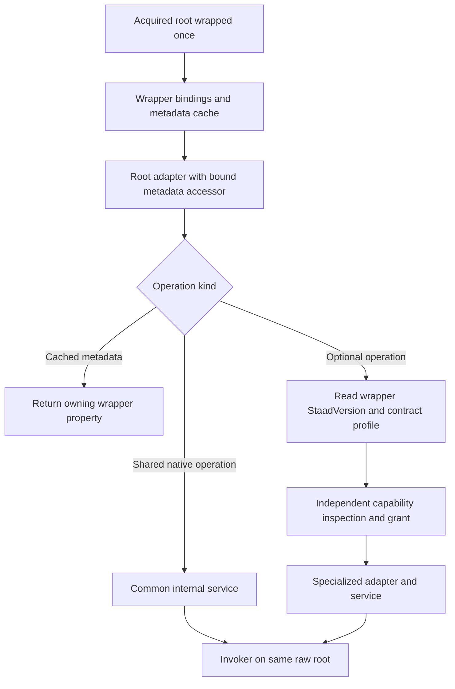
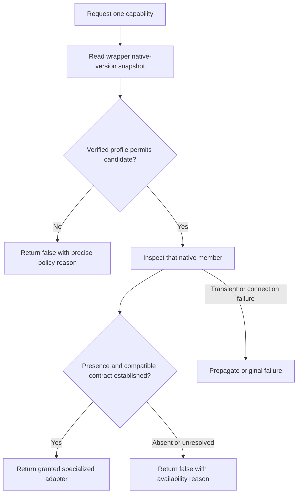

# OpenSTAAD Root multi-version review, architecture and implementation plan

**Review date:** 15 October 2026  
**Versions reviewed:** STAAD.Pro 2024, 2025 and 2026 installed OpenSTAAD help.  
**Status:** The approved wrapper foundation is now implemented, with raw bindings, metadata and adapter placeholders. Five Root metadata methods are now implemented through internal wrapper/raw accessors and shared native readers. Remaining Root operations and optional capabilities follow the [managed API design rules](../Root-Managed-API-Design.md); the version-profile engine remains proposed. Domain adapter functions remain outside the current scope.

## 1. Conclusions and proposed direction

Use the fully ported wrapper as the owner of cached application/model metadata. Implemented Root metadata methods project its properties; version selection uses **wrapper.StaadVersion**, not wrapper.ApplicationVersion. Use common Root services for unchanged native operations and separately acquired capability interfaces for newer optional functions. Any verified unit-query interpretation strategies belong beneath the wrapper metadata reader, not in a duplicate Root query implementation.

| Finding | Result |
| --- | --- |
| Root functions documented in the 2024 reference | 36 |
| Root functions documented in the 2025 reference | 37 |
| Root functions documented in the 2026 reference | 39 |
| Distinct functions across all three references | 39 |
| Functions listed in all three references | 36 |
| Common functions with unchanged documented signatures and contract prose, after formatting normalization | 34 |
| Common functions with changed documented return interpretation/output direction | 2: GetInputUnitForLength and GetInputUnitForForce |
| Additional function listed in 2025 and 2026 | ExportModelToADINA |
| Additional functions listed in 2026 | GetAnalysisErrorMessages and GetAnalysisWarningMessages |

**The unit-query difference is significant:** the 2024 page describes a success/failure return; 2025 and 2026 describe a returned unit code. The native declarations remain the same VARIANT-based signatures. This may represent a native behavior change, a correction to older documentation, or build-specific behavior. The documents alone do not establish which. A version strategy is justified as an architectural seam; enabling either interpretation in a release requires native verification.

**Availability in documentation is not proof of runtime availability.** An entry absent from an older help page might still exist in a server. Conversely, a documented function may be absent or unusable in a particular acquired build. The initial supported policy should expose a newer capability only when its version/profile contract and native member evidence both permit it. Unsupported or unresolved combinations must not silently fall through to a newer implementation.

The assembly cannot hide or remove C# interface members from IntelliSense after a runtime version is discovered. The achievable design is to keep version-specific operations off the common interface and return a specialized interface only after a successful capability acquisition. Section 6 describes this access boundary and its limits.

## 2. Evidence, provenance and comparison method

The source references are linked in the next table with short labels. Their targets point to the locally installed help; they are not portable web URLs. Links are relative to this report's workspace location so that Markdown previews can render them without displaying unsupported file-URL syntax.

| Reference | Documentation build | Root functions | Generator | File bytes |
| --- | --- | ---: | --- | ---: |
| [STAAD.Pro 2024 Root help](../../../../../../../../Program%20Files/Bentley/Engineering/STAAD.Pro%202024/OSAPP_Help/group___root.html) | `24.00.02.354` | 36 | Doxygen 1.8.7 | 114,611 |
| [STAAD.Pro 2025 Root help](../../../../../../../../Program%20Files/Bentley/Engineering/STAAD.Pro%202025/OSAPP_Help/group___root.html) | `25.00.01.424` | 37 | Doxygen 1.13.2 | 124,239 |
| [STAAD.Pro 2026 Root help](../../../../../../../../Program%20Files/Bentley/Engineering/STAAD.Pro%202026/OSAPP_Help/group___root.html) | `26.00.00.340` | 39 | Doxygen 1.13.2 | 136,359 |

<details>
<summary>Reference fingerprints for reproducibility</summary>

| Reference | SHA-256 |
| --- | --- |
| 2024 | `5DD4F21C6FA9954792FAEE13F46EB0817B9CAC18927D1F5BAB6D795F3884EB8D` |
| 2025 | `DB21AD5702868FD340FFA001A24CB566D2BB92759EFB151529A7624A0FA385F4` |
| 2026 | `3CAF7922E7A0BF895CF237106B02B7D923F0CD33778DCD7D741867801BFA64A5` |

</details>

All summary entries and all detailed member sections were inventoried: 36/36 in 2024, 37/37 in 2025 and 39/39 in 2026. The 2024 page uses the older Doxygen layout; it was parsed separately and checked against its summary, avoiding a false conclusion that its APIs were absent. The review compared declarations, parameter directions and descriptions, return tables, examples and related notes. HTML layout, whitespace, generated source-definition links and source line numbers were separated from API contract changes.

The 2025 and 2026 contract sections for their 37 shared functions match after normalization. Among the 36 functions shared with 2024, all native signatures match; two documented return/output contracts differ. Generated examples/source references changed in several places, but no additional behavioral difference was established from them.

The current repository baseline remains `main` at `36e9f811f28cf6c4594045b31b7bd374a565187e`, with 22 public `IOSRoot` methods and a net481 target. The existing [2026 coverage report and per-function plans](OpenSTAAD-Root-API-Coverage-and-Implementation-Plan.md) contain the source/assembly comparison, native parameter details, proposed signatures and existing implementation findings. This document adds cross-version evidence and overrides any assumption that all proposed APIs can use the 2026 contract on older versions.

The source wrapper was ported after the initial documentation comparison and has been built/tested offline. No live STAAD COM calls, typelib inspection, model mutation, native tests, NuGet package build or publication was performed. [Wrapper-Porting](../Wrapper-Porting.md) records the implemented scope, source parity and current validation.

## 3. Complete cross-version function matrix

**Shared:** unchanged documented contract across all three references. **Unit strategy:** same native signature, different documented interpretation. **Optional export/messages:** functions listed only in the indicated references. A dash means **not listed in that reference**, not proven absent from every server of that product year.

The last column links to the existing implementation plan where a dedicated adapter method is pending. Optional functions will move to capability interfaces instead of being placed directly on `IOSRoot`.

| Root function | 2024 | 2025 | 2026 | Proposed implementation | Current API / prior plan |
| --- | --- | --- | --- | --- | --- |
| `Analyze` | [Listed](../../../../../../../../Program%20Files/Bentley/Engineering/STAAD.Pro%202024/OSAPP_Help/group___root.html#ga646f2f0b6983135b4b3a8ded877475d7) | [Listed](../../../../../../../../Program%20Files/Bentley/Engineering/STAAD.Pro%202025/OSAPP_Help/group___root.html#ga646f2f0b6983135b4b3a8ded877475d7) | [Listed](../../../../../../../../Program%20Files/Bentley/Engineering/STAAD.Pro%202026/OSAPP_Help/group___root.html#ga646f2f0b6983135b4b3a8ded877475d7) | Shared | [P21](OpenSTAAD-Root-API-Coverage-and-Implementation-Plan.md#p21-analyze) |
| `AnalyzeEx` | [Listed](../../../../../../../../Program%20Files/Bentley/Engineering/STAAD.Pro%202024/OSAPP_Help/group___root.html#ga46f03d1be3c56877f5af4359764df907) | [Listed](../../../../../../../../Program%20Files/Bentley/Engineering/STAAD.Pro%202025/OSAPP_Help/group___root.html#ga46f03d1be3c56877f5af4359764df907) | [Listed](../../../../../../../../Program%20Files/Bentley/Engineering/STAAD.Pro%202026/OSAPP_Help/group___root.html#ga46f03d1be3c56877f5af4359764df907) | Shared | Adapter mapping exists; preserve documented limitations. |
| `AnalyzeModel` | [Listed](../../../../../../../../Program%20Files/Bentley/Engineering/STAAD.Pro%202024/OSAPP_Help/group___root.html#gadaa1e36df7e6b4fe5c056ede8270987c) | [Listed](../../../../../../../../Program%20Files/Bentley/Engineering/STAAD.Pro%202025/OSAPP_Help/group___root.html#gadaa1e36df7e6b4fe5c056ede8270987c) | [Listed](../../../../../../../../Program%20Files/Bentley/Engineering/STAAD.Pro%202026/OSAPP_Help/group___root.html#gadaa1e36df7e6b4fe5c056ede8270987c) | Shared | [P22](OpenSTAAD-Root-API-Coverage-and-Implementation-Plan.md#p22-analyzemodel) |
| `CloseSTAADFile` | [Listed](../../../../../../../../Program%20Files/Bentley/Engineering/STAAD.Pro%202024/OSAPP_Help/group___root.html#gaf249dc19ac760422e78351546918e65d) | [Listed](../../../../../../../../Program%20Files/Bentley/Engineering/STAAD.Pro%202025/OSAPP_Help/group___root.html#gaf249dc19ac760422e78351546918e65d) | [Listed](../../../../../../../../Program%20Files/Bentley/Engineering/STAAD.Pro%202026/OSAPP_Help/group___root.html#gaf249dc19ac760422e78351546918e65d) | Shared | Adapter mapping exists; preserve documented limitations. |
| `CreateNamedView` | [Listed](../../../../../../../../Program%20Files/Bentley/Engineering/STAAD.Pro%202024/OSAPP_Help/group___root.html#gaf331e2b24c0e4f4e57c2951594423b2d) | [Listed](../../../../../../../../Program%20Files/Bentley/Engineering/STAAD.Pro%202025/OSAPP_Help/group___root.html#gaf331e2b24c0e4f4e57c2951594423b2d) | [Listed](../../../../../../../../Program%20Files/Bentley/Engineering/STAAD.Pro%202026/OSAPP_Help/group___root.html#gaf331e2b24c0e4f4e57c2951594423b2d) | Shared | [P25](OpenSTAAD-Root-API-Coverage-and-Implementation-Plan.md#p25-createnamedview) |
| `ExportModelToADINA` | — | [Listed](../../../../../../../../Program%20Files/Bentley/Engineering/STAAD.Pro%202025/OSAPP_Help/group___root.html#ga212f15a4b5984734985d197b67de4199) | [Listed](../../../../../../../../Program%20Files/Bentley/Engineering/STAAD.Pro%202026/OSAPP_Help/group___root.html#ga212f15a4b5984734985d197b67de4199) | Optional export | [P29](OpenSTAAD-Root-API-Coverage-and-Implementation-Plan.md#p29-exportmodeltoadina) |
| `GetAnalysisErrorMessages` | — | — | [Listed](../../../../../../../../Program%20Files/Bentley/Engineering/STAAD.Pro%202026/OSAPP_Help/group___root.html#ga405205f5768fd9b1d16b8a35b72e86f4) | Optional messages | [P13](OpenSTAAD-Root-API-Coverage-and-Implementation-Plan.md#p13-getanalysiserrormessages) |
| `GetAnalysisStatus` | [Listed](../../../../../../../../Program%20Files/Bentley/Engineering/STAAD.Pro%202024/OSAPP_Help/group___root.html#ga731f741a97cb618d7409544055b8a2bb) | [Listed](../../../../../../../../Program%20Files/Bentley/Engineering/STAAD.Pro%202025/OSAPP_Help/group___root.html#ga731f741a97cb618d7409544055b8a2bb) | [Listed](../../../../../../../../Program%20Files/Bentley/Engineering/STAAD.Pro%202026/OSAPP_Help/group___root.html#ga731f741a97cb618d7409544055b8a2bb) | Shared | [P12](OpenSTAAD-Root-API-Coverage-and-Implementation-Plan.md#p12-getanalysisstatus) |
| `GetAnalysisWarningMessages` | — | — | [Listed](../../../../../../../../Program%20Files/Bentley/Engineering/STAAD.Pro%202026/OSAPP_Help/group___root.html#gae891bbde4b6fd5e7f3e56dbf0644386f) | Optional messages | [P14](OpenSTAAD-Root-API-Coverage-and-Implementation-Plan.md#p14-getanalysiswarningmessages) |
| `GetApplicationVersion` | [Listed](../../../../../../../../Program%20Files/Bentley/Engineering/STAAD.Pro%202024/OSAPP_Help/group___root.html#ga658ee126cc9aa9c5e35866e35f60260e) | [Listed](../../../../../../../../Program%20Files/Bentley/Engineering/STAAD.Pro%202025/OSAPP_Help/group___root.html#ga658ee126cc9aa9c5e35866e35f60260e) | [Listed](../../../../../../../../Program%20Files/Bentley/Engineering/STAAD.Pro%202026/OSAPP_Help/group___root.html#ga658ee126cc9aa9c5e35866e35f60260e) | Shared | Wrapper.StaadVersion available; [P06](OpenSTAAD-Root-API-Coverage-and-Implementation-Plan.md#p06-getapplicationversion)|
| `GetBaseUnit` | [Listed](../../../../../../../../Program%20Files/Bentley/Engineering/STAAD.Pro%202024/OSAPP_Help/group___root.html#ga7b1d941b62f317a0bdf104d2d4436ae1) | [Listed](../../../../../../../../Program%20Files/Bentley/Engineering/STAAD.Pro%202025/OSAPP_Help/group___root.html#ga7b1d941b62f317a0bdf104d2d4436ae1) | [Listed](../../../../../../../../Program%20Files/Bentley/Engineering/STAAD.Pro%202026/OSAPP_Help/group___root.html#ga7b1d941b62f317a0bdf104d2d4436ae1) | Shared | Wrapper property only; [P02](OpenSTAAD-Root-API-Coverage-and-Implementation-Plan.md#p02-getbaseunit) |
| `GetCONNECTEDProjectInfo` | [Listed](../../../../../../../../Program%20Files/Bentley/Engineering/STAAD.Pro%202024/OSAPP_Help/group___root.html#gab92e524c05abdf5e59e54adc95e0c9b0) | [Listed](../../../../../../../../Program%20Files/Bentley/Engineering/STAAD.Pro%202025/OSAPP_Help/group___root.html#gab92e524c05abdf5e59e54adc95e0c9b0) | [Listed](../../../../../../../../Program%20Files/Bentley/Engineering/STAAD.Pro%202026/OSAPP_Help/group___root.html#gab92e524c05abdf5e59e54adc95e0c9b0) | Shared | [P23](OpenSTAAD-Root-API-Coverage-and-Implementation-Plan.md#p23-getconnectedprojectinfo) |
| `GetErrorMessage` | [Listed](../../../../../../../../Program%20Files/Bentley/Engineering/STAAD.Pro%202024/OSAPP_Help/group___root.html#gab804cd4718b6a369ce6fb396c2df560d) | [Listed](../../../../../../../../Program%20Files/Bentley/Engineering/STAAD.Pro%202025/OSAPP_Help/group___root.html#gab804cd4718b6a369ce6fb396c2df560d) | [Listed](../../../../../../../../Program%20Files/Bentley/Engineering/STAAD.Pro%202026/OSAPP_Help/group___root.html#gab804cd4718b6a369ce6fb396c2df560d) | Shared | [P07](OpenSTAAD-Root-API-Coverage-and-Implementation-Plan.md#p07-geterrormessage) |
| `GetFullJobInfo` | [Listed](../../../../../../../../Program%20Files/Bentley/Engineering/STAAD.Pro%202024/OSAPP_Help/group___root.html#ga558ddaf8c6aa1913ed2ca06fd22beddd) | [Listed](../../../../../../../../Program%20Files/Bentley/Engineering/STAAD.Pro%202025/OSAPP_Help/group___root.html#ga558ddaf8c6aa1913ed2ca06fd22beddd) | [Listed](../../../../../../../../Program%20Files/Bentley/Engineering/STAAD.Pro%202026/OSAPP_Help/group___root.html#ga558ddaf8c6aa1913ed2ca06fd22beddd) | Shared | Adapter mapping exists; preserve documented limitations. |
| `GetInputUnitForForce` | [Listed](../../../../../../../../Program%20Files/Bentley/Engineering/STAAD.Pro%202024/OSAPP_Help/group___root.html#gabcc3db5863da3b119b2c5bd4a740f0cd) | [Listed](../../../../../../../../Program%20Files/Bentley/Engineering/STAAD.Pro%202025/OSAPP_Help/group___root.html#gabcc3db5863da3b119b2c5bd4a740f0cd) | [Listed](../../../../../../../../Program%20Files/Bentley/Engineering/STAAD.Pro%202026/OSAPP_Help/group___root.html#gabcc3db5863da3b119b2c5bd4a740f0cd) | Unit strategy | Wrapper property only; [P04](OpenSTAAD-Root-API-Coverage-and-Implementation-Plan.md#p04-getinputunitforforce) |
| `GetInputUnitForLength` | [Listed](../../../../../../../../Program%20Files/Bentley/Engineering/STAAD.Pro%202024/OSAPP_Help/group___root.html#ga8a846a4f4597cbb6cbed46e86442431c) | [Listed](../../../../../../../../Program%20Files/Bentley/Engineering/STAAD.Pro%202025/OSAPP_Help/group___root.html#ga8a846a4f4597cbb6cbed46e86442431c) | [Listed](../../../../../../../../Program%20Files/Bentley/Engineering/STAAD.Pro%202026/OSAPP_Help/group___root.html#ga8a846a4f4597cbb6cbed46e86442431c) | Unit strategy | Wrapper property only; [P03](OpenSTAAD-Root-API-Coverage-and-Implementation-Plan.md#p03-getinputunitforlength) |
| `GetMainWindowHandle` | [Listed](../../../../../../../../Program%20Files/Bentley/Engineering/STAAD.Pro%202024/OSAPP_Help/group___root.html#ga0c0b0f425cd8588f0df3c40ea08a05da) | [Listed](../../../../../../../../Program%20Files/Bentley/Engineering/STAAD.Pro%202025/OSAPP_Help/group___root.html#ga0c0b0f425cd8588f0df3c40ea08a05da) | [Listed](../../../../../../../../Program%20Files/Bentley/Engineering/STAAD.Pro%202026/OSAPP_Help/group___root.html#ga0c0b0f425cd8588f0df3c40ea08a05da) | Shared | Wrapper.StaadApplicationWindowHandle available; Internal use only; [P09](OpenSTAAD-Root-API-Coverage-and-Implementation-Plan.md#p09-getmainwindowhandle)|
| `GetProcessHandle` | [Listed](../../../../../../../../Program%20Files/Bentley/Engineering/STAAD.Pro%202024/OSAPP_Help/group___root.html#ga275b4bdab39a0afb0764d4d2e0b2f13e) | [Listed](../../../../../../../../Program%20Files/Bentley/Engineering/STAAD.Pro%202025/OSAPP_Help/group___root.html#ga275b4bdab39a0afb0764d4d2e0b2f13e) | [Listed](../../../../../../../../Program%20Files/Bentley/Engineering/STAAD.Pro%202026/OSAPP_Help/group___root.html#ga275b4bdab39a0afb0764d4d2e0b2f13e) | Shared | [P10](OpenSTAAD-Root-API-Coverage-and-Implementation-Plan.md#p10-getprocesshandle) |
| `GetProcessId` | [Listed](../../../../../../../../Program%20Files/Bentley/Engineering/STAAD.Pro%202024/OSAPP_Help/group___root.html#gac7c8010c34e57ab1443b8efacc3235a0) | [Listed](../../../../../../../../Program%20Files/Bentley/Engineering/STAAD.Pro%202025/OSAPP_Help/group___root.html#gac7c8010c34e57ab1443b8efacc3235a0) | [Listed](../../../../../../../../Program%20Files/Bentley/Engineering/STAAD.Pro%202026/OSAPP_Help/group___root.html#gac7c8010c34e57ab1443b8efacc3235a0) | Shared | Internal use only; [P08](OpenSTAAD-Root-API-Coverage-and-Implementation-Plan.md#p08-getprocessid) |
| `GetSTAADFile` | [Listed](../../../../../../../../Program%20Files/Bentley/Engineering/STAAD.Pro%202024/OSAPP_Help/group___root.html#ga2d0ebfc91441ee3b2331bcd2d0ad07d7) | [Listed](../../../../../../../../Program%20Files/Bentley/Engineering/STAAD.Pro%202025/OSAPP_Help/group___root.html#ga2d0ebfc91441ee3b2331bcd2d0ad07d7) | [Listed](../../../../../../../../Program%20Files/Bentley/Engineering/STAAD.Pro%202026/OSAPP_Help/group___root.html#ga2d0ebfc91441ee3b2331bcd2d0ad07d7) | Shared | Adapter mapping exists; preserve documented limitations. |
| `GetSTAADFileFolder` | [Listed](../../../../../../../../Program%20Files/Bentley/Engineering/STAAD.Pro%202024/OSAPP_Help/group___root.html#gaefa222ce265399686a53eb2a59d2e947) | [Listed](../../../../../../../../Program%20Files/Bentley/Engineering/STAAD.Pro%202025/OSAPP_Help/group___root.html#gaefa222ce265399686a53eb2a59d2e947) | [Listed](../../../../../../../../Program%20Files/Bentley/Engineering/STAAD.Pro%202026/OSAPP_Help/group___root.html#gaefa222ce265399686a53eb2a59d2e947) | Shared | [P01](OpenSTAAD-Root-API-Coverage-and-Implementation-Plan.md#p01-getstaadfilefolder) |
| `GetShortJobInfo` | [Listed](../../../../../../../../Program%20Files/Bentley/Engineering/STAAD.Pro%202024/OSAPP_Help/group___root.html#ga6d209f7c0ed0aaddfe84c6603078e5a2) | [Listed](../../../../../../../../Program%20Files/Bentley/Engineering/STAAD.Pro%202025/OSAPP_Help/group___root.html#ga6d209f7c0ed0aaddfe84c6603078e5a2) | [Listed](../../../../../../../../Program%20Files/Bentley/Engineering/STAAD.Pro%202026/OSAPP_Help/group___root.html#ga6d209f7c0ed0aaddfe84c6603078e5a2) | Shared | Adapter mapping exists; preserve documented limitations. |
| `IsAnalyzing` | [Listed](../../../../../../../../Program%20Files/Bentley/Engineering/STAAD.Pro%202024/OSAPP_Help/group___root.html#ga47cec0d70a609f2de2dd2e5214b7fa28) | [Listed](../../../../../../../../Program%20Files/Bentley/Engineering/STAAD.Pro%202025/OSAPP_Help/group___root.html#ga47cec0d70a609f2de2dd2e5214b7fa28) | [Listed](../../../../../../../../Program%20Files/Bentley/Engineering/STAAD.Pro%202026/OSAPP_Help/group___root.html#ga47cec0d70a609f2de2dd2e5214b7fa28) | Shared | [P11](OpenSTAAD-Root-API-Coverage-and-Implementation-Plan.md#p11-isanalyzing) |
| `IsPhysicalModel` | [Listed](../../../../../../../../Program%20Files/Bentley/Engineering/STAAD.Pro%202024/OSAPP_Help/group___root.html#ga95c33fb64a10923e179bf067fd006a7b) | [Listed](../../../../../../../../Program%20Files/Bentley/Engineering/STAAD.Pro%202025/OSAPP_Help/group___root.html#ga95c33fb64a10923e179bf067fd006a7b) | [Listed](../../../../../../../../Program%20Files/Bentley/Engineering/STAAD.Pro%202026/OSAPP_Help/group___root.html#ga95c33fb64a10923e179bf067fd006a7b) | Shared | [P05](OpenSTAAD-Root-API-Coverage-and-Implementation-Plan.md#p05-isphysicalmodel) |
| `ModifyNamedView` | [Listed](../../../../../../../../Program%20Files/Bentley/Engineering/STAAD.Pro%202024/OSAPP_Help/group___root.html#gadfb2385ac03c7bf740e24eb24fcca286) | [Listed](../../../../../../../../Program%20Files/Bentley/Engineering/STAAD.Pro%202025/OSAPP_Help/group___root.html#gadfb2385ac03c7bf740e24eb24fcca286) | [Listed](../../../../../../../../Program%20Files/Bentley/Engineering/STAAD.Pro%202026/OSAPP_Help/group___root.html#gadfb2385ac03c7bf740e24eb24fcca286) | Shared | [P28](OpenSTAAD-Root-API-Coverage-and-Implementation-Plan.md#p28-modifynamedview) |
| `NewSTAADFile` | [Listed](../../../../../../../../Program%20Files/Bentley/Engineering/STAAD.Pro%202024/OSAPP_Help/group___root.html#gacdd64b11752dc29f03537526d46553b4) | [Listed](../../../../../../../../Program%20Files/Bentley/Engineering/STAAD.Pro%202025/OSAPP_Help/group___root.html#gacdd64b11752dc29f03537526d46553b4) | [Listed](../../../../../../../../Program%20Files/Bentley/Engineering/STAAD.Pro%202026/OSAPP_Help/group___root.html#gacdd64b11752dc29f03537526d46553b4) | Shared | [P17](OpenSTAAD-Root-API-Coverage-and-Implementation-Plan.md#p17-newstaadfile) |
| `OpenSTAADFile` | [Listed](../../../../../../../../Program%20Files/Bentley/Engineering/STAAD.Pro%202024/OSAPP_Help/group___root.html#ga4ba715d4c1e519ed6f4645ca91db9f99) | [Listed](../../../../../../../../Program%20Files/Bentley/Engineering/STAAD.Pro%202025/OSAPP_Help/group___root.html#ga4ba715d4c1e519ed6f4645ca91db9f99) | [Listed](../../../../../../../../Program%20Files/Bentley/Engineering/STAAD.Pro%202026/OSAPP_Help/group___root.html#ga4ba715d4c1e519ed6f4645ca91db9f99) | Shared | Adapter mapping exists; preserve documented limitations. |
| `Quit` | [Listed](../../../../../../../../Program%20Files/Bentley/Engineering/STAAD.Pro%202024/OSAPP_Help/group___root.html#gadd624b0b5b4f45cf4ed97f9557cc88af) | [Listed](../../../../../../../../Program%20Files/Bentley/Engineering/STAAD.Pro%202025/OSAPP_Help/group___root.html#gadd624b0b5b4f45cf4ed97f9557cc88af) | [Listed](../../../../../../../../Program%20Files/Bentley/Engineering/STAAD.Pro%202026/OSAPP_Help/group___root.html#gadd624b0b5b4f45cf4ed97f9557cc88af) | Shared | [P30](OpenSTAAD-Root-API-Coverage-and-Implementation-Plan.md#p30-quit) |
| `RemoveNamedView` | [Listed](../../../../../../../../Program%20Files/Bentley/Engineering/STAAD.Pro%202024/OSAPP_Help/group___root.html#gacd98d0159150ffada6b7e62f2e1687d4) | [Listed](../../../../../../../../Program%20Files/Bentley/Engineering/STAAD.Pro%202025/OSAPP_Help/group___root.html#gacd98d0159150ffada6b7e62f2e1687d4) | [Listed](../../../../../../../../Program%20Files/Bentley/Engineering/STAAD.Pro%202026/OSAPP_Help/group___root.html#gacd98d0159150ffada6b7e62f2e1687d4) | Shared | [P27](OpenSTAAD-Root-API-Coverage-and-Implementation-Plan.md#p27-removenamedview) |
| `SaveModel` | [Listed](../../../../../../../../Program%20Files/Bentley/Engineering/STAAD.Pro%202024/OSAPP_Help/group___root.html#ga2984f37b5dde4651ffa18deacf441645) | [Listed](../../../../../../../../Program%20Files/Bentley/Engineering/STAAD.Pro%202025/OSAPP_Help/group___root.html#ga2984f37b5dde4651ffa18deacf441645) | [Listed](../../../../../../../../Program%20Files/Bentley/Engineering/STAAD.Pro%202026/OSAPP_Help/group___root.html#ga2984f37b5dde4651ffa18deacf441645) | Shared | Adapter mapping exists; preserve documented limitations. |
| `SaveNamedView` | [Listed](../../../../../../../../Program%20Files/Bentley/Engineering/STAAD.Pro%202024/OSAPP_Help/group___root.html#gaeca040a52040da606a81af5407aa464e) | [Listed](../../../../../../../../Program%20Files/Bentley/Engineering/STAAD.Pro%202025/OSAPP_Help/group___root.html#gaeca040a52040da606a81af5407aa464e) | [Listed](../../../../../../../../Program%20Files/Bentley/Engineering/STAAD.Pro%202026/OSAPP_Help/group___root.html#gaeca040a52040da606a81af5407aa464e) | Shared | [P26](OpenSTAAD-Root-API-Coverage-and-Implementation-Plan.md#p26-savenamedview) |
| `SetCONNECTEDProjectInfo` | [Listed](../../../../../../../../Program%20Files/Bentley/Engineering/STAAD.Pro%202024/OSAPP_Help/group___root.html#ga61d5d3fc321d74be1ede4c318426b9f6) | [Listed](../../../../../../../../Program%20Files/Bentley/Engineering/STAAD.Pro%202025/OSAPP_Help/group___root.html#ga61d5d3fc321d74be1ede4c318426b9f6) | [Listed](../../../../../../../../Program%20Files/Bentley/Engineering/STAAD.Pro%202026/OSAPP_Help/group___root.html#ga61d5d3fc321d74be1ede4c318426b9f6) | Shared | [P24](OpenSTAAD-Root-API-Coverage-and-Implementation-Plan.md#p24-setconnectedprojectinfo) |
| `SetFullJobInfo` | [Listed](../../../../../../../../Program%20Files/Bentley/Engineering/STAAD.Pro%202024/OSAPP_Help/group___root.html#ga519b55d96da3c901a6b4149a77480c9b) | [Listed](../../../../../../../../Program%20Files/Bentley/Engineering/STAAD.Pro%202025/OSAPP_Help/group___root.html#ga519b55d96da3c901a6b4149a77480c9b) | [Listed](../../../../../../../../Program%20Files/Bentley/Engineering/STAAD.Pro%202026/OSAPP_Help/group___root.html#ga519b55d96da3c901a6b4149a77480c9b) | Shared | [P19](OpenSTAAD-Root-API-Coverage-and-Implementation-Plan.md#p19-setfulljobinfo) |
| `SetInputUnitForForce` | [Listed](../../../../../../../../Program%20Files/Bentley/Engineering/STAAD.Pro%202024/OSAPP_Help/group___root.html#ga0d92e92cebdffc1dbf951d07f8d29f1e) | [Listed](../../../../../../../../Program%20Files/Bentley/Engineering/STAAD.Pro%202025/OSAPP_Help/group___root.html#ga0d92e92cebdffc1dbf951d07f8d29f1e) | [Listed](../../../../../../../../Program%20Files/Bentley/Engineering/STAAD.Pro%202026/OSAPP_Help/group___root.html#ga0d92e92cebdffc1dbf951d07f8d29f1e) | Shared | [P16](OpenSTAAD-Root-API-Coverage-and-Implementation-Plan.md#p16-setinputunitforforce) |
| `SetInputUnitForLength` | [Listed](../../../../../../../../Program%20Files/Bentley/Engineering/STAAD.Pro%202024/OSAPP_Help/group___root.html#ga6bc9354604b80ca54912ec586c4ff931) | [Listed](../../../../../../../../Program%20Files/Bentley/Engineering/STAAD.Pro%202025/OSAPP_Help/group___root.html#ga6bc9354604b80ca54912ec586c4ff931) | [Listed](../../../../../../../../Program%20Files/Bentley/Engineering/STAAD.Pro%202026/OSAPP_Help/group___root.html#ga6bc9354604b80ca54912ec586c4ff931) | Shared | [P15](OpenSTAAD-Root-API-Coverage-and-Implementation-Plan.md#p15-setinputunitforlength) |
| `SetInputUnits` | [Listed](../../../../../../../../Program%20Files/Bentley/Engineering/STAAD.Pro%202024/OSAPP_Help/group___root.html#ga287a24364161a41879432ebc256faea6) | [Listed](../../../../../../../../Program%20Files/Bentley/Engineering/STAAD.Pro%202025/OSAPP_Help/group___root.html#ga287a24364161a41879432ebc256faea6) | [Listed](../../../../../../../../Program%20Files/Bentley/Engineering/STAAD.Pro%202026/OSAPP_Help/group___root.html#ga287a24364161a41879432ebc256faea6) | Shared | Adapter mapping exists; preserve documented limitations. |
| `SetShortJobInfo` | [Listed](../../../../../../../../Program%20Files/Bentley/Engineering/STAAD.Pro%202024/OSAPP_Help/group___root.html#ga04af5d1d0aa713ba08032cf613aa2193) | [Listed](../../../../../../../../Program%20Files/Bentley/Engineering/STAAD.Pro%202025/OSAPP_Help/group___root.html#ga04af5d1d0aa713ba08032cf613aa2193) | [Listed](../../../../../../../../Program%20Files/Bentley/Engineering/STAAD.Pro%202026/OSAPP_Help/group___root.html#ga04af5d1d0aa713ba08032cf613aa2193) | Shared | [P18](OpenSTAAD-Root-API-Coverage-and-Implementation-Plan.md#p18-setshortjobinfo) |
| `SetSilentMode` | [Listed](../../../../../../../../Program%20Files/Bentley/Engineering/STAAD.Pro%202024/OSAPP_Help/group___root.html#ga21f063c7c8882dc7af286e5b18db11e0) | [Listed](../../../../../../../../Program%20Files/Bentley/Engineering/STAAD.Pro%202025/OSAPP_Help/group___root.html#ga21f063c7c8882dc7af286e5b18db11e0) | [Listed](../../../../../../../../Program%20Files/Bentley/Engineering/STAAD.Pro%202026/OSAPP_Help/group___root.html#ga21f063c7c8882dc7af286e5b18db11e0) | Shared | Adapter mapping exists; preserve documented limitations. |
| `UpdateStructure` | [Listed](../../../../../../../../Program%20Files/Bentley/Engineering/STAAD.Pro%202024/OSAPP_Help/group___root.html#gaaf431f1bfbee142cd7d55d454d56d995) | [Listed](../../../../../../../../Program%20Files/Bentley/Engineering/STAAD.Pro%202025/OSAPP_Help/group___root.html#gaaf431f1bfbee142cd7d55d454d56d995) | [Listed](../../../../../../../../Program%20Files/Bentley/Engineering/STAAD.Pro%202026/OSAPP_Help/group___root.html#gaaf431f1bfbee142cd7d55d454d56d995) | Shared | [P20](OpenSTAAD-Root-API-Coverage-and-Implementation-Plan.md#p20-updatestructure) |

## 4. Detailed differences and consequences

### 4.1 Input-unit getters: same signature, conflicting documented semantics

```cpp
VARIANT OpenSTAADUI::GetInputUnitForLength(VARIANT FAR &strUnit);
VARIANT OpenSTAADUI::GetInputUnitForForce(VARIANT FAR &strUnit);
```

| Contract detail | 2024 | 2025 and 2026 | Architecture consequence |
| --- | --- | --- | --- |
| Native declaration | VARIANT return; mutable VARIANT reference argument | Same | A changed signature cannot be used to detect the interpretation. |
| `strUnit` direction in parameter prose | Marked input, although described as receiving unit information | Marked output | Use a verified reference-output dispatch contract; do not pass a disposable by-value empty string. |
| Documented return | Boolean success/failure, described as 1/0 | Integer unit code 0–7 | Use an explicit, validated return interpretation associated with the bound server profile. |
| Length codes described in the page | 0 Inch; 1 Feet; 2 Feet; 3 CentiMeter; 4 Meter; 5 MilliMeter; 6 DeciMeter; 7 KiloMeter | Same semantic range; the label for code 2 becomes Foot | Preserve native code/text; deliberately normalize the two feet aliases. This wording difference alone does not require separate setter implementations. |
| Force codes described | 0 Kip; 1 Pound; 2 Kilogram; 3 Metric Ton; 4 Newton; 5 kN; 6 MN; 7 DecaNewton | Same range and meanings, with an explicit returned-code table | Do not treat the 2024 documented success value 1 as Pound. |
| Examples | VBA passes a string buffer without using a return code | Examples explicitly assign a returned unit code and include reference-output C# calls | Supports the documentation distinction, but does not prove a server behavior change. |

The distinction is especially important for code **0**: in the newer contract, zero is a valid unit (Inch or Kip), not failure. Likewise, a returned **1** may be a legacy success flag or a newer feet/pound code. There is no safe numeric heuristic that distinguishes these cases. A VARIANT Boolean may also arrive differently from an integer code; subtype observation helps establish a contract but cannot replace a verified profile when values overlap.

**Planned 2024 unit strategy:** provisionally interpret the return as a success indicator only after validation against the real 2024 build. On success, obtain the unit from the reference output using an explicit mapping of observed, supported native text/code forms. Preserve the original output. Never convert the success flag itself into a unit. If the output cannot be interpreted unambiguously, throw a documented invalid-output/contract exception rather than inventing a default. Establish whether an unsuccessful query can produce usable output; do not treat partial data as a successful result.

**Planned 2025/2026 unit strategy:** interpret the return as the documented integer unit code; retain the reference output as native unit text. Validate the numeric domain and output shape without converting bool to an integer unit. Code 0 must be accepted; code 1 must be retained even though the existing length enum names only `Feet = 2`.

**If native testing shows the 2024 help is wrong:** change the verified 2024 profile to use the shared enum-code strategy. Remove an unnecessary legacy implementation rather than maintaining a branch solely to mirror incorrect prose. If different builds actually behave differently, record non-overlapping full-version contract ranges and keep both strategies. Never choose based on whether the returned number happens to be 0 or 1.

The implemented wrapper now captures reference outputs, parses output before a usable native return, normalizes the feet alias and caches the resulting enums. It rejects Boolean/fractional unit coercion and conservatively avoids return-code interpretation for native major 24. Unparseable or failed unit queries retain the source-compatible base-system fallback (Imperial: Kip/Feet; otherwise: kN/Meter). This is implemented compatibility behavior, not proof of a native version contract.

Planned Root projections are `LengthInputUnit GetInputUnitForLength()` and `ForceInputUnit GetInputUnitForForce()`, returning `wrapper.InputLengthUnit` and `wrapper.InputForceUnit`. They make no additional native read when wrapper-bound. Refresh with `wrapper.RefreshUnits()` after changes. The earlier unit-info DTO proposal is superseded: the wrapper enums do not preserve original native text, code aliases or success provenance, and a Root method must not fabricate that information. A future raw-diagnostic feature would require an explicit additional contract.

### 4.2 ADINA export: additional documented availability

`ExportModelToADINA` is absent from the reviewed 2024 Root summary/details and listed in both 2025 and 2026 with matching contracts. Its absence was also checked against the older search index. This establishes **earliest documentation among the supplied references**, not the exact first native release.

```cpp
long OpenSTAADUI::ExportModelToADINA(int flagAxisSystem, int flagLCHandler);
```

| Input / result | Details |
| --- | --- |
| `flagAxisSystem`, input native int | 0 preserve convention; 1 Y-Up; 2 Z-Up. |
| `flagLCHandler`, input native int | 0 export separate load cases; 1 export time-history values. |
| Native long status | 0 success; -14501 successful with warnings; -14502 failure; -101 no model. Preserve unknown integer statuses. |
| Filesystem effect | Writes ADINA input and a companion ADINA log. The pages do not establish destination selection or overwrite rules. |

Use one shared export service for verified 2025/2026 profiles. There is no evidence supporting duplicate year-specific export implementations. The 2024 profile does not grant the export capability by default. An undocumented native member found there is recorded as an observation and remains disabled until its contract is verified and the compatibility policy is approved.

P29's planned operation moves from the common interface to `IOSRootAdinaExport`. Its signature remains status-oriented; use existing or approved public enums, or primitive integer options until those enum contracts are approved. Native Windows long status is proposed as managed int, subject to typelib verification.

### 4.3 Analysis messages: additional documentation in 2026

The two message methods are absent from the reviewed 2024 and 2025 Root pages/search indexes and present in 2026. `GetAnalysisStatus` itself is present, with the same documented contract, in all three versions.

```cpp
long OpenSTAADUI::GetAnalysisErrorMessages(
    LPCTSTR szModelNameWithPath, VARIANT FAR &ErrorMessages);
long OpenSTAADUI::GetAnalysisWarningMessages(
    LPCTSTR szModelNameWithPath, VARIANT FAR &WarningMessages);
```

| Native parameter / result | Meaning and implementation implications |
| --- | --- |
| `szModelNameWithPath`, input | Model filename with path; validated managed string. Do not implicitly open/analyze the model. |
| `ErrorMessages`, reference output buffer | Preallocated VARIANT containing a BSTR string array; capacity comes from the error count returned by GetAnalysisStatus. Error messages are described as coming from the analysis log. |
| `WarningMessages`, reference output buffer | Same array contract using the warning count; warnings are described as coming from the ANL file. |
| Native long statuses for both | 1 retrieved; 0 none; -1 general error; -2 bad model path; -107 not an array; -119 wrong array type; -108 insufficient capacity; -1001 required file absent; -10004 analysis running. |
| Concurrency | Counts can change between status and retrieval. Preserve -108 and allow a documented bounded read-only requery; no indefinite retry. |

P13/P14 move to separate `IOSRootAnalysisErrorMessages` and `IOSRootAnalysisWarningMessages` interfaces. Each is acquired independently so one missing native member does not hide the other. The 2026 message service may share array marshaling and status interpretation internally while retaining each distinct native call.

The initial 2024/2025 profiles do not grant these capabilities. Do not implement a log-file parser as an invisible fallback: file parsing is a different contract and would require its own approved feature, versioned file-format analysis and tests.

### 4.4 Shared contracts and unresolved issues remain shared

The 34 unchanged documented contracts should use common services, subject to native validation. Shared documentation can still be incomplete or inconsistent. None of these recurring issues justifies inventing a year-specific implementation:

- `AnalyzeModel` remains declared void while its C# example assigns a result; engine -1 is the only documented engine value.
- `SetSilentMode` documents returning the previous mode in all three versions. The current bool wrapper discards it. Changing that meaning under an existing signature would be a separate compatibility change.
- Several metadata/folder outputs are mislabeled input. Named-view `nError` is likewise described as an error output but labeled input.
- Named-view creation/modification flag values and error-code meanings remain unspecified. ModifyNamedView's entity-array prose remains ambiguous.
- Handle VARIANT subtype, width, ownership and validity context remain unspecified. Do not create an owning safe-handle abstraction from these pages.
- The SetSilentMode examples call AnalyzeEx with only two arguments although its declaration has three. This is another reason to derive wrapper contracts from verified declarations rather than copying snippets.
- Native full-job dates remain strings; the current managed getter parses them using current culture. Multi-version dispatch does not resolve formatting or lossless roundtripping automatically.
- Shared setters document length codes 1 and 2 as feet aliases. Existing enum validation rejects unnamed code 1. Resolve this explicitly without adding duplicate services.
- `ShowApplication` is used by the existing adapter but is absent from all three reviewed Root groups. Its existing implementation is outside the 39-function matrix and requires separate member/contract validation; it cannot be advertised as established common coverage from these pages.

## 5. Implemented wrapper foundation and Root reuse

The authoritative source is the user's read-only ReInvented.StaadPro.Interop project. The current port includes all **30 source properties**, both constructor forms, `RefreshComObjects`, `RefreshUnits` and `Dispose`, plus the existing `IsConnected`. The raw native types are adapted to object/dynamic to retain the package's Bentley-assembly-free build. See [the member-by-member wrapper report](../Wrapper-Porting.md).

The seven additional native domains and IDEA StatiCa have explicit binding placeholders, as approved. Their presence is not a claim that their typed domain functions are implemented. Existing Geometry, Load and Root implementations are retained. The default window service is bound to this wrapper's root, replacing the source's global process-name scan.

### 5.1 Properties that planned Root methods will reuse

| Planned Root operation / internal need | Wrapper property | Planned behavior / limitations |
| --- | --- | --- |
| GetApplicationVersion, and internal native-version selection | `StaadVersion` | Cached **native STAAD** version. Returns a defensive copy; null when its optional native member is absent. RefreshComObjects rereads it. No second Root bootstrap call is needed. |
| Host/application diagnostics | `ApplicationVersion` | **Host/client assembly** version. Must never be used to choose a native STAAD profile. It is not a substitute for GetApplicationVersion's native meaning. |
| GetBaseUnit | `BaseUnitSystem` | Cached normalized enum; RefreshUnits/RefreshComObjects update it. Unknown/native enum values must not be silently relabeled. |
| GetInputUnitForForce | `InputForceUnit` | Cached enum using wrapper parsing and explicit source-compatible fallback. It is not necessarily an independently measured unit after a failed query. |
| GetInputUnitForLength | `InputLengthUnit` | Cached enum; feet aliases normalize to Feet. Original native code/text are not retained by this property. |
| GetMainWindowHandle | `StaadApplicationWindowHandle` | Cached non-owning handle. Default comes from the acquired root; source-family rule queries it for Connect and otherwise yields zero. Not a live-window/readiness guarantee. |
| Legacy/Connect family description | `StaadEdition` | Source rule: major <= 20 is V8i; greater is Connect; unavailable version is None. This is not a capability matrix. |
| Native calls that have no wrapper value | `RawOpenStaad` and appropriate raw domain property | Use an internal bound native service when the operation actually needs dispatch. Do not substitute a global active object. |
| Bound root / managed domains | `Root`, `Geometry`, `Load`, and the new placeholders | Preserve the owning wrapper and correct raw identity; do not infer native member or feature support from a placeholder's presence. |
| GetProcessId | No corresponding wrapper property | Keep the existing live native PID query; no fabricated process ID from a cached window/process-name search. |

The five implemented typed metadata signatures on IOSRoot are:

```csharp
ApplicationVersion GetApplicationVersion(); // wrapper.StaadVersion, not wrapper.ApplicationVersion
BaseUnitSystem GetBaseUnit();
ForceInputUnit GetInputUnitForForce();
LengthInputUnit GetInputUnitForLength();
IntPtr GetMainWindowHandle();
```

These five Root members are now implemented. They have no separate native operation status to wrap. The earlier unit/version DTO proposals are superseded for these projections. If full native output text/ref fields are needed, design an explicit diagnostic/native-query API; do not reconstruct original values from a normalized cache.

### 5.2 Refresh, ownership and freshness

Construction binds raw/managed objects and reads native version, units and the applicable window handle. Property reads themselves do not repeat those COM calls. RefreshUnits rereads just base/force/length units, preserving adapter identities. RefreshComObjects rebinds all domains, replaces adapters and refreshes versions, units and the handle after the caller has allowed the native database to become ready. It does not introduce a delay/readiness probe or open/reopen a model.

Root projections must document snapshot semantics and the explicit refresh requirement. A planned unit setter may explicitly call RefreshUnits after a confirmed request if its approved contract requires refreshed caches; do not add that extra native work silently to existing methods. External/manual STAAD changes remain a source of stale cached values until refresh.

The stored native version is protected against edits through the returned mutable ApplicationVersion value: each StaadVersion access yields a copy. A selector takes its own immutable four-part snapshot. ApplicationVersion remains host metadata. A copied native version can guide profile selection but does not prove an operation's native signature, license, readiness or successful execution.

Refresh is in place, following the source wrapper: a propagated failure can leave partially refreshed state. This is documented and must not be described as transactional. Both refresh methods reject disposed wrappers. Dispose clears every wrapper binding without saving/closing a model, killing STAAD, final-releasing a caller-owned RCW or disposing injected services. Cached metadata remains available; previously held adapters are not revoked.

### 5.3 Wrapper-bound versus raw-root-only adapters

The current public OSRootAdapter constructor accepts a raw object. Preserve that signature and its capture-only behavior. The wrapper now supplies an internal property-backed metadata accessor, while the public raw-root constructor remains capture-only.

The internal IRootMetadataAccess seam has wrapper-owned and raw-root implementations. Wrapper-bound projections reuse the properties with zero extra native queries, include configured window services, and reject an owner disposed after the adapter was captured. No recursive wrapper or public service locator is created.

For callers who construct OSRootAdapter directly from a raw root, RawRootMetadataAccess uses the extracted WrapperMetadataReader on each query. Unit getters read version, base system and the selected unit; handle lookup reads version then the same-root handle for major > 20. Reads are sequential rather than atomic. No other process is acquired and no wrapper is created. Existing 22 operations remain unchanged; IOSRoot now exposes 27 methods.

## 6. Proposed internal services and folder organization

Keep signatures in interfaces, implementations in non-partial adapters, and selection/calling services internal. Metadata ownership belongs to the wrapper; Root adds projection, version policy and actual operation services around it.

| Component | Visibility / state | Responsibility |
| --- | --- | --- |
| OpenStaadWrapper / ApplicationVersion / ApplicationEdition | Public, implemented | Complete approved wrapper surface, cached metadata and source-compatible version/family values. |
| Seven new native-domain adapters/interfaces and IDEA placeholder | Public, implemented placeholders | Capture correct bindings only; no unported domain functions. |
| Services/Wrapper helpers | Implemented; normalization/bound-window helpers internal | Source-derived unit parsing, strict numeric reads and acquired-root window lookup. The injected model/interaction contracts are public source-compatible dependencies. |
| IOSRoot / OSRootAdapter | Public, five metadata queries added | Preserve existing operations; metadata methods delegate to the owning wrapper/accessor. |
| IRootMetadataAccess and accessors | Internal, implemented | Property-backed wrapper projection or standalone same-root reader fallback. |
| RootSessionContext / RootVersionResolver | Internal, proposed | Own the same raw identity and consume wrapper.StaadVersion/accessor evidence; no duplicate wrapper-bound native bootstrap. |
| Profiles / RootProfileSelector / RootServiceFactory | Internal, proposed | Immutable per-build contract rules and polymorphic composition; no global selected version. |
| RootDispatchInspector / RootComInvoker | Internal, proposed | Non-mutating member/signature inspection and bound dispatch with precise error handling. |
| Shared domain services | Internal, proposed | One implementation for unchanged contracts, including metadata projection where appropriate. |
| Optional export/message adapters and services | Specialized public interfaces, internal implementations; proposed | Return only granted operations; no public service implementations. |
| Verified unit interpretation strategies | Internal under Wrapper metadata, only if evidence requires; proposed | Resolve actual build differences where native data is captured. Root does not repeat unit interpretation over a second native call. |

```text
src/StaadPro.Interop/
  Models/
    OpenStaadWrapper.cs                 implemented wrapper
    ApplicationVersion.cs              implemented value model
    Root/                              planned operation result classes, created with their functions
  Enums/
    ApplicationEdition.cs              implemented source family rule
    Root/                              planned documented operation statuses/options
  Adapters/
    Interfaces/
      IOSRoot.cs                       existing; planned common additions
      IOSOutput.cs ... IOSView.cs       implemented binding placeholders
      IOpenStaadIdeaStatiCaAdapter.cs   implemented integration placeholder
      Capabilities/                    planned specialized interfaces
      Information/                     planned session/availability interfaces
    Models/
      OSRootAdapter.cs                 existing, single non-partial class
      OSOutputAdapter.cs ... OSViewAdapter.cs   implemented placeholders
      OpenStaadIdeaStatiCaAdapter.cs    implemented placeholder
      Capabilities/                    planned internal specialized adapters
  Interfaces/
    IStaadInteropInteractionService.cs  implemented host interaction contract
  Services/
    StaadInteropHostServices.cs         implemented noninteractive default/capture
    Wrapper/
      IStaadModelServices.cs            implemented wrapper-required window contract
      BoundStaadModelServices.cs        implemented same-root lookup
      WrapperUnitParser.cs             implemented source-derived normalization
      WrapperNativeValues.cs           implemented strict integer reads
      WrapperMetadataReader.cs         implemented shared native reads
      Versioning/                      planned verified strategies only if needed
    Root/                              metadata implemented; other folders below remain planned
      Abstractions/
      Context/
      Selection/
      Profiles/
      Metadata/
        WrapperRootMetadataAccess.cs      implemented
        RawRootMetadataAccess.cs          implemented
      Common/
        RootFileService.cs
        RootJobInfoService.cs
        RootApplicationService.cs
        RootAnalysisService.cs
        RootUnitWriteService.cs
        RootNamedViewService.cs
        RootConnectedProjectService.cs
        RootAdinaExportService.cs
      Versions/
        V2026/
          RootAnalysisMessageService.cs
      Interop/
      Diagnostics/
      Infrastructure/                  future isolated home for existing root helpers
```

The tree distinguishes implemented wrapper files from proposed Root infrastructure. No partial adapter classes are introduced. Public data/service dependencies required by the source wrapper are explicit; no version-selector, profile, invoker or internal strategy is exported. Domain placeholder types must not expand their APIs until those functions are separately ported and tested.

### 6.1 Dispatch flow



For the 34 unchanged documented contracts, share implementation. Five of their getters are wrapper projections; their underlying native capture stays owned by the wrapper. The two unit getters have a documented interpretation discrepancy that may require an internal wrapper-reader strategy after native evidence. Export has one shared implementation for verified 2025/2026 candidates. The two 2026 message calls can share array utilities but have independent grants.

## 7. Proposed API access and IntelliSense

A runtime version cannot remove members from one C# interface or change its assembly metadata. Keep the three optional functions off common IOSRoot and acquire their interfaces only when support is established. This follows the distinction between [C# compile-time and runtime types](https://learn.microsoft.com/en-us/dotnet/csharp/fundamentals/types/) and [interface member access](https://learn.microsoft.com/en-us/dotnet/csharp/language-reference/language-specification/interfaces).

```csharp
// Proposed, not implemented:
IOSRootSessionInfo SessionInfo { get; }
IOSRootCapabilities Capabilities { get; }

// IOSRootCapabilities:
IOSRootFeatureAvailability AdinaExportAvailability { get; }
IOSRootFeatureAvailability ErrorMessagesAvailability { get; }
IOSRootFeatureAvailability WarningMessagesAvailability { get; }
RootCapabilityResult<IOSRootAdinaExport> GetAdinaExport();
RootCapabilityResult<IOSRootAnalysisErrorMessages> GetAnalysisErrorMessages();
RootCapabilityResult<IOSRootAnalysisWarningMessages> GetAnalysisWarningMessages();

// Specialized interfaces, acquired separately:
AdinaExportResult ExportModelToAdina(AdinaAxisSystem axisSystem, AdinaLoadCaseHandling loadCaseHandling);
AnalysisMessagesResult GetAnalysisErrorMessages(string modelFilePath);
AnalysisMessagesResult GetAnalysisWarningMessages(string modelFilePath);
```

Each operation belongs only to its respective interface. A successful discovery result contains a non-null specialized adapter bound to the same context; unavailable results contain no adapter and include an availability reason. No public output parameters are exposed. Message buffers are allocated internally and status/data are returned together in named classes. Native connection, wrong-thread and transient discovery failures are exceptions, not ordinary unsupported results. Check the two message methods independently.

SessionInfo should expose observed native version components or a copied value, its normalized display, contract profile and verification state. Reuse StaadVersion for these values. The wrapper does not retain original native version text or unit-output provenance, so do not label a formatted display as original native text.

Availability states may distinguish Available, DisabledByVersionPolicy, NativeMemberAbsent, ContractUnverified and UnknownVersion. A known year alone does not grant a function. Optional concrete adapters/constructors remain internal. OSRootAdapter must not implement every optional interface, even explicitly, because consumers could then cast unsupported instances.

This is a typed access boundary. Public interface declarations remain inspectable in the assembly, and existing ComObject/RawOpenStaad allow deliberate raw dispatch. It is not a security barrier. Strict compile-time exclusion would require separate version-specific assemblies/packages and still would not eliminate runtime checks; that is not proposed for this adaptive wrapper.

## 8. Version identification, capability evidence and failure policy

### 8.1 Identification and selection sequence

1. Acquire the intended native root using the existing provider, then construct the wrapper. The implemented wrapper captures its own native version and metadata. No provider redesign is part of this task.
2. Future wrapper-bound Root services receive the owning wrapper/accessor internally. During binding, defer profile resolution until initialization has finished; avoid Root-to-wrapper-to-Root recursion.
3. On a version-sensitive request, read a copy of wrapper.StaadVersion. A null value remains unknown. Never classify the server from wrapper.ApplicationVersion, the NuGet/DLL version, a registry entry, the latest installed folder or a global active object.
4. Select an immutable verified full-version contract profile. The help build identifies the documentation snapshot, not a tested server. Numeric major/update/revision/build and verified runtime evidence determine the profile range.
5. Inspect each optional native member without invoking it. Combine documented candidate status, verified contract evidence and actual member/signature evidence into an independent grant.
6. Create an internal specialized adapter only after its grant. All calls remain bound to the same root. A positive grant does not establish model readiness, current results, licensing or success.
7. RefreshComObjects constructs new wrapper adapters and updates metadata. Future contexts/grants must account for that generation; old retained adapters must never silently retarget another process.

No duplicate native version query is needed for the normal wrapper-bound path. A standalone raw-root accessor uses a shared metadata reader as described in section 5.3, with explicit freshness/error behavior.

### 8.2 Initial conservative policy

| Observed/verified profile | Cached Root metadata projections | Additional unit-reader strategy | Export candidate | Error/warning candidates |
| --- | --- | --- | --- | --- |
| Verified 2024 | Reuse wrapper properties with documented fallback limits | Legacy-success only if native evidence confirms; otherwise corrected shared strategy or unresolved | Not granted by default | Not granted by default |
| Verified 2025 | Reuse wrapper properties | Verified enum-code interpretation | Yes, independently verified | Not granted by default |
| Verified 2026 | Reuse wrapper properties | Same enum-code strategy | Yes, shared export implementation | Yes, independent grants |
| Known year, unverified servicing build | Metadata remains a wrapper snapshot, not a contract guarantee | No guessed strategy | Disabled when contract evidence is insufficient | Disabled when evidence is insufficient |
| Unknown/missing/future native version | Cached values/fallbacks retain their wrapper meaning; native selection remains unknown | Do not infer return meaning from 0/1 alone | Disabled under initial policy | Disabled under initial policy |

The wrapper's implemented conservative 2024 return guard is not a populated verified profile registry. Native testing may establish a different real contract. If 2024 documentation is merely wrong and the native contract is identical, reuse the same internal reader rather than keeping an artificial year branch.

### 8.3 Inspection and caching

Use an internal tested IDispatch inspection layer. GetIDsOfNames establishes name resolution, not a compatible signature or successful operation; its DISPIDs belong to that object/interface lifetime. [Microsoft GetIDsOfNames](https://learn.microsoft.com/en-us/windows/win32/api/oaidl/nf-oaidl-idispatch-getidsofnames).

Use GetTypeInfoCount/GetTypeInfo where available to inspect signatures. Zero type-info count is not proof of absent dispatch functionality, and VARIANT metadata cannot settle legacy success versus unit-code semantics. [Microsoft GetTypeInfoCount](https://learn.microsoft.com/en-us/windows/win32/api/oaidl/nf-oaidl-idispatch-gettypeinfocount), [GetTypeInfo](https://learn.microsoft.com/en-us/windows/win32/api/oaidl/nf-oaidl-idispatch-gettypeinfo).

Distinguish an unknown member from an unknown LCID, disconnected/busy/rejected call, access failure or unavailable metadata. Preserve transient HRESULTs; do not cache them as absence. Member probing must never export, create/open/close a model, analyze, mutate a view/project or quit. Release only inspection-owned references; never final-release the caller's root RCW.

Cache profiles/grants per bound COM identity, wrapper generation, full observed version and LCID. Do not use a global selected year, PID alone or filename. Simultaneous different-version roots remain independent. Unit/model/status values require their own refresh semantics, not permanent application-wide caching.

Use the connected session's appropriate COM thread. No automatic Task.Run, silent migration to another STA, or lock advertised as COM thread safety. Do not hold a global lock across COM calls. A managed timeout cannot guarantee interruption of a blocked native invocation.

### 8.4 Acquisition flow



## 9. Edge cases and handling

| Situation | Handling |
| --- | --- |
| Several versions installed, older root acquired | Use that wrapper's StaadVersion and exact raw identity. |
| Host/client assembly version resembles a product year | Ignore ApplicationVersion for native routing. |
| Caller edits a returned StaadVersion | Defensive copy protects observed cache; selector freezes its own copy. |
| Wrapper cache is stale after external changes | Caller explicitly refreshes; Root projection XML identifies the snapshot semantics. |
| Unit query failed or output was unparseable | Wrapper fallback is documented; do not claim measured unit/provenance or manufacture native output fields. |
| Native 2024 return 1 could mean success or a unit | Prefer valid reference output; conservative wrapper behavior avoids interpreting return-only success as a unit. Final native contract still needs verification. |
| Help lists a function but acquired member is missing | No capability grant; precise NativeMemberAbsent reason. |
| Older help omits a member that resolves natively | Record evidence; default policy stays disabled until an approved verified contract covers it. |
| One message member is missing | Grant the other independently if its contract is verified. |
| Metadata is unavailable or a future build is unverified | Keep dependent support unknown/unverified; no newest-version fallback. |
| Version read is malformed or contradictory | Implemented wrapper rejects malformed/contradictory responses; a missing optional member yields null. No fabricated native year. |
| Readiness/analysis/license changes after acquisition | Preserve native business status or failure; availability is not an execution guarantee. |
| Message counts change between queries | Preserve -108/in-progress statuses; bounded explicit read-only requery only. |
| Mutation/export response is lost | Do not retry an uncertain mutation or claim rollback. |
| Injected window service selects another process | Its documented contract requires the same instance; the built-in service uses the bound native root. Do not copy the source global process scan. |
| Window handle becomes stale | Cached metadata is a snapshot; existing window mutations retain fresh native HWND/PID ownership checks. |
| Refresh fails midway | No transaction guarantee; report error and require deliberate recovery/refresh on the same session. |
| Retained adapter survives wrapper Dispose | Wrapper clears its properties, not external objects. Do not promise revocation or automatic process shutdown. |
| Domain placeholder is non-null | Only binding availability; no domain implementation/capability claim. |
| Third-party code implements IOSRoot | New members require compatibility/versioning review and migration notes. Existing raw-root construction must remain supported. |

## 10. XML documentation and tests

The implemented wrapper has XML for every public property, both constructors, refresh methods and disposal. Placeholder interfaces/adapters explicitly state their limited binding-only status. ApplicationVersion, ApplicationEdition, interaction and wrapper-required window-service contracts are documented. Offline tests cover the compiled wrapper XML as well as behavior.

Future Root XML must state the wrapper property used, cached versus fresh behavior, refresh requirement, fallback/unknown/null values, ownership/thread limits and exact native-versus-normalized distinction. GetApplicationVersion must explicitly name StaadVersion and distinguish host ApplicationVersion. Do not advertise an enum snapshot as a lossless native output record.

All new approved Root functions require matching interface/adapter summaries, parameters, returns/status tables, exceptions, examples and availability notes. Specialized interfaces explain successful acquisition, unavailable-result behavior, discovery errors and model effects. Internal service types must not appear in public signatures. Extend compiled XML/package validation; global suppression of missing-doc warnings is not proof of coverage.

| Test family | Required coverage |
| --- | --- |
| Implemented wrapper parity | All 30 source properties, two constructors, three public methods, nine raw bindings, Command spelling, placeholders, host/native version distinction and disposal. |
| Implemented cache/refresh tests | No native query on property reads; RefreshUnits only updates units; RefreshComObjects replaces bindings and rereads metadata; disposed refresh rejects. |
| Implemented normalization tests | Unit names/codes/aliases, zero codes, Boolean/fractional rejection, 2024 success ambiguity, source fallbacks, version validation and pointer conversions. |
| Implemented Root projection tests | Each of five methods uses the exact wrapper value with no duplicate COM call; standalone raw-root path uses the shared reader and documented freshness. |
| Future profile/inspection tests | Exact/build-range boundaries, overlapping range rejection, unknown/future versions, member versus signature evidence, absent type info and transient failures. |
| Future capability/access tests | No optional methods on common IOSRoot; no unconditional cast; independent grants; internal implementations; granted/non-null and unavailable/null guarantees. |
| Future isolation/lifetime tests | Two product versions/processes, identical filenames/recycled PIDs, wrapper refresh generation, cache ownership, disconnection and correct thread behavior. |
| Future native matrix | Actual 2024/2025/2026 builds: all units/subtypes/labels, shared operations, optional presence, blank/named models, export destinations, BSTR arrays and controlled failures. |

No live STAAD compatibility result is inferred from the current offline tests. Native mutations must use disposable test models/directories/processes, never users' active work. Preserve all relevant existing tests when extracting shared readers or moving helpers.

## 11. Implementation sequence and current status

| Phase | Work | Exit criteria |
| --- | --- | --- |
| 0 — Completed wrapper foundation | Raw objects, all source properties/methods/constructors, metadata, refresh, service hooks and approved domain placeholders. | Member parity, XML and offline regression tests; main source stays read-only. No domain-function or Root-engine completion claim. |
| 1 — Managed API rules / metadata complete | Five typed metadata projections, wrapper/raw accessors and shared readers implemented; result-object and no-public-reference rules recorded. Capability contracts remain proposed. | Existing behavior preserved; new interface members, XML and offline tests validated. |
| 2 — Native evidence | Verify actual version responses, unit interpretations and optional members in each supported build; record full-version ranges. | No runtime-verified registry entries from help alone. Resolve/defer ambiguous cases. |
| 3 — Internal plumbing | Wrapper metadata accessor, shared-reader extraction for raw-only bindings, immutable profiles, inspector/context/factory. Preserve Root constructor behavior and existing 22 methods. | No duplicated wrapper-bound version/unit/window reads; same-instance tests pass. |
| 4 — Metadata projections / common reads | P06 native version from StaadVersion; P02/P03/P04/P09 property reuse; P01 folder; P05 physical; P07 errors; P08 PID; P11/P12 analysis queries. | Correct snapshots, no host-version routing, live-only queries remain explicit. |
| 5 — Common mutations/lifecycle | P15/P16 unit writes; P18/P19 job writes; P20 update; P17 creation; P21/P22 analysis entry points; P10 process handle only after ownership evidence. | Validated inputs, explicit refresh/persistence policy, no uncertain mutation retries. |
| 6 — Optional capabilities | P29 export; P13/P14 independent message adapters; shared utilities only where contracts match. | Positive/negative access, profile, member and native tests pass. |
| 7 — Remaining common domains | P23/P24 CONNECTED project; P25/P26/P28/P27 named views. | Verified flags/arrays/error contracts; no artificial per-year copies. |
| 8 — Explicit shutdown | P30 Quit last, only in disposable dedicated processes. | Correct-instance behavior; no implicit disposal shutdown. |
| 9 — Documentation/release | Root XML/examples, matrix, migration/installation guidance and package validation. Update README/release notes for every new NuGet build. | Actual packaged API/docs match; net481 consumer checks and recorded native compatibility evidence. |

Five dedicated metadata methods P02/P03/P04/P06/P09 are complete. The remaining 25 functions comprise 22 common and three optional operations. Current coverage is **14 adapter mappings (including five wrapper-backed projections), 1 internal-only query and 24 functions without production native calls**. The suite passes 1,001 offline tests; native compatibility remains unverified.

The source project remains strictly read-only. The wrapper foundation and review documents were committed and pushed. This next increment adds only the five Root metadata methods and their helpers/tests/documentation. Other domain functions, profile engine, capability adapters and a new package build remain separate work.
