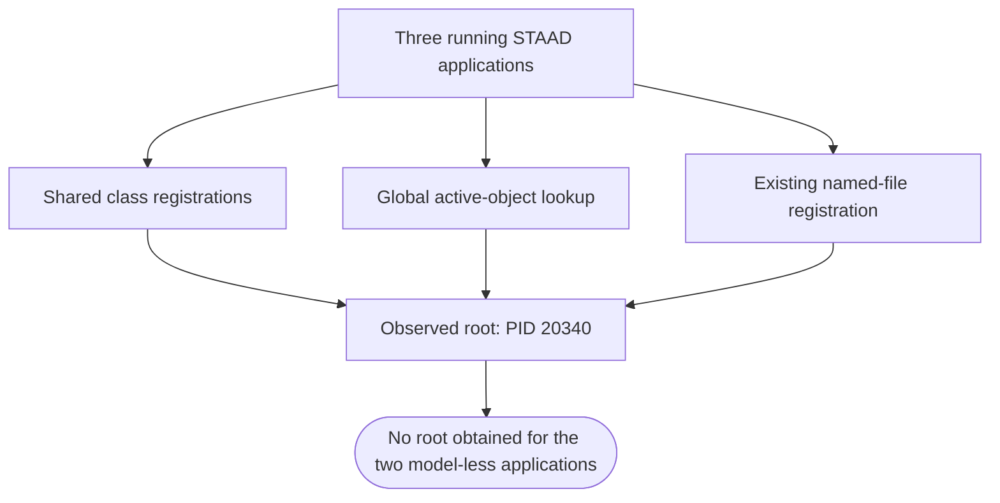
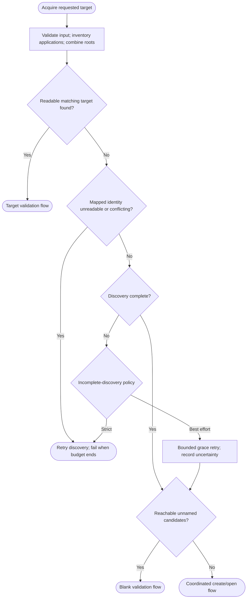
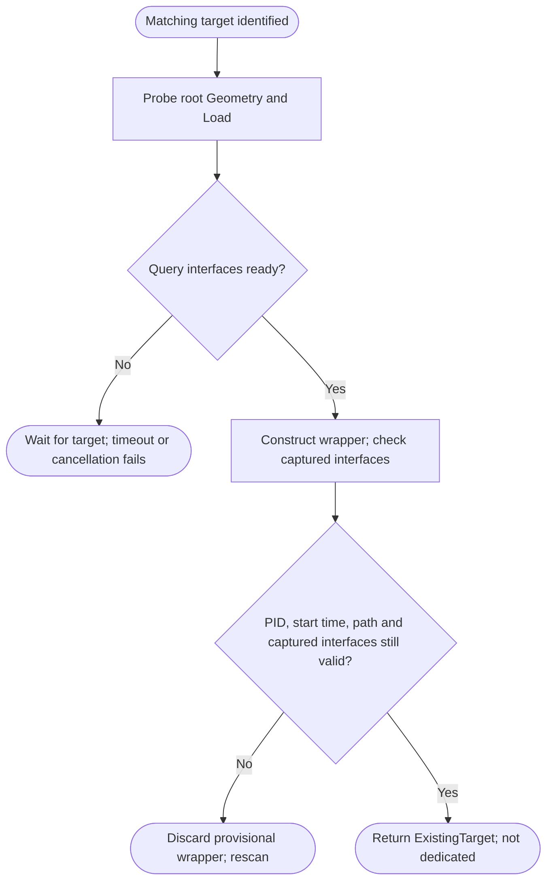
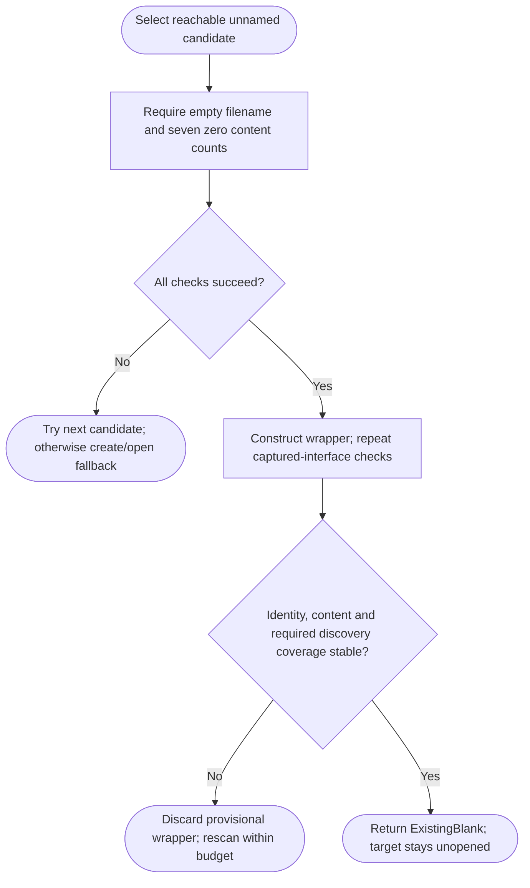
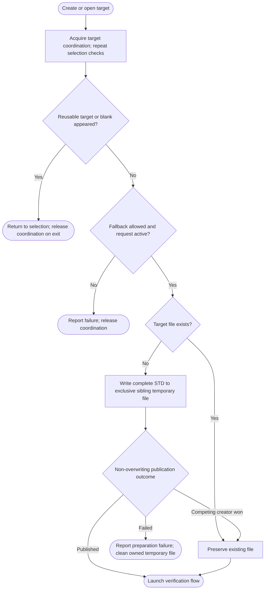
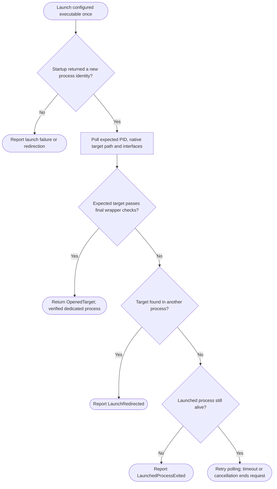

# OpenStaadWrapperProvider — acquisition flow and blank-instance verification

**Updated investigation: 13 October 2026.** Implementation audited: `517d79bf7bfea9e039a9a5c4cdea90ce61c0c238`. This document replaces the earlier proposed flow with a flow that explicitly accounts for applications whose OpenSTAAD objects cannot be reached.

**A reachable blank OpenSTAAD session can be wrapped. A general, reliable way to obtain the object of an arbitrary running blank STAAD application has not been established.** These are different capabilities. `GetProcessId()` identifies the application behind an object already obtained; it does not obtain an object from a process ID.

The existing `OpenStaadWrapperProvider.Get(targetFile)` still skips blank filenames and launches the target when it cannot identify a matching model. Counting applications would improve diagnostics, but would not make otherwise inaccessible objects accessible.

**Implementation status:** `OpenStaadSessionProvider` is now implemented independently, with native discovery, process identity checks, retained roots, explicit discovery policies, cancellation between calls, atomic target publication and typed diagnostics. The library builds for `net481` and `net8.0-windows`; existing provider/helper/wrapper source files are unchanged. See [provider usage and deployment](../OpenStaad-Session-Provider.md).

The native startup and attachment checks passed. An owned empty model became an unnamed application after closing it, but its native reference-load count was `-1`. The provider did not reinterpret that as zero; it used the create/open fallback. Retained-root reuse is available when the retained session actually passes the blank contract.

**What the evidence establishes**

| Question | Finding | Practical consequence |
|---|---|---|
| Can an obtained root be associated with a particular application? | Yes. `GetProcessId()` worked in the native C# probe. | Compare the returned PID with a live process; also record process start time to distinguish PID reuse. |
| Can a blank be wrapped if its root is reachable and ready? | Yes, subject to readiness and identity checks. The existing no-path attachment path can accept zero node/load counts. | Blank reuse is technically possible for an exposed session; this does not establish discovery of every blank. |
| Does one running application guarantee a ready blank root? | No. Startup, licensing, model mode, server readiness and COM visibility still matter. | Verify the root rather than treating one process as a successful attachment. |
| Does the global active-object call select a supplied PID? | No PID parameter exists in that lookup. | A PID cannot be passed to `Marshal.GetActiveObject("StaadPro.OpenSTAAD")` to choose another application. |
| Can enumeration of duplicate class monikers retrieve each application's root? | Not reliably. The three matching class registrations in the live test all returned the same PID. | Deduplicate by verified application identity; never equate moniker count with distinct roots or processes. |
| Can a filename distinguish a model-less application? | No filename was available for either newly launched model-less application. | The filename route cannot name those applications in their tested state. |
| Is arbitrary blank-by-PID binding impossible in every version or extension? | Not proved. No supported, generally usable mechanism was established in the reviewed sources or local test. | Describe the capability as unverified, not universally impossible. |

**Vendor and Windows evidence**

Bentley's Python root implementation uses a file-path connection when a path is supplied and a global active-object connection otherwise. It exposes `GetProcessId`, but the reviewed constructor does not accept a process ID. [Bentley Python root implementation](https://github.com/BentleySystems/openstaadpy/blob/233a74351e4903c0e0fc01bd1ef6ad11b584b87a/openstaadpy/os_analytical/openstaadroot.py#L63).

Bentley's published multi-instance scanner examines `.std` file monikers and reads the process ID from each obtained object. That scanner does not demonstrate enumeration of all filename-less applications. [Bentley multi-instance scanner](https://github.com/BentleySystems/openstaad-mcp/blob/1b12202f2344e9d7a4981d6342840807666aee6d/src/openstaad_mcp/connection.py#L100).

Windows `GetActiveObject` retrieves a registered running object using a CLSID. ROT `GetObject` resolves a registered moniker. Windows allows duplicate registrations for the same moniker; enumeration does not turn their shared name into a unique per-process selector. [GetActiveObject](https://learn.microsoft.com/en-us/windows/win32/api/oleauto/nf-oleauto-getactiveobject), [ROT GetObject](https://learn.microsoft.com/en-us/windows/win32/api/objidl/nf-objidl-irunningobjecttable-getobject), [ROT Register](https://learn.microsoft.com/en-us/windows/win32/api/objidl/nf-objidl-irunningobjecttable-register).

The installed STAAD.Pro 2026 VBA help also describes the default connection as connecting to the first started instance and recommends a file path for a specific open model. Local source: `C:\Program Files\Bentley\Engineering\STAAD.Pro 2026\Help\en\topics\OpenSTAAD\VBA\t-stpst_Instantiate_OpenSTAAD_in_VBA.html`. This is installed vendor documentation, not an API added by this repository.

**Live investigation and its limits**

The native probe ran on an STA thread against the local STAAD.Pro Advanced 2026 installation, executable file/product version `26.00.00.340`. The existing application had a named analytical model open. Two additional applications were launched without opening files, one at a time. Reads did not open, save, close, analyse or modify the existing model. [Structured observation record](evidence/OpenStaad-Blank-Instance-Probe-20261013.json).

| Test state or lookup | Observation |
|---|---|
| Initial application | Existing process PID `20340`; its root reported a named model, 424 nodes and 223 primary load cases. The customer's filename is deliberately omitted here. |
| One additional model-less application | New PID `35108`; two identical OpenSTAAD class monikers were enumerated. Both resolved to PID `20340`. |
| Two additional model-less applications | Additional PID `34060`; three identical class monikers were enumerated. All resolved to PID `20340`. |
| Class moniker | All matching class names were `!{1797F52C-C5E2-4F41-B524-F5A107EA6453}`. |
| Global active object | Returned PID `20340`, including while both new applications were running. |
| Existing model's file moniker | Resolved to PID `20340`; filename identity was independently read from its root. |
| `BindToObject` on class monikers | Failed with an invalid-argument error in this probe. It did not expose the two new application roots. |
| `BindToObject` on the named file moniker | Returned the existing model's root. |
| `AccessibleObjectFromWindow` with `OBJID_NATIVEOM` and `IID_IDispatch` on each main window | Returned `0x80004005` (`E_FAIL`) for all three main windows. This was a main-window probe, not exhaustive testing of child windows or custom vendor interfaces. |
| Cleanup | Normal close was requested only for PIDs `35108` and `34060`. Both exited; the original PID `20340` remained running. |

**The two new applications were model-less startup applications. Their zero-content analytical-model readiness could not be checked because their roots were not obtained.** This test therefore demonstrates a discovery failure for that state; it does not prove how every kind of unsaved blank model registers itself. A sole ready blank was observed in the earlier investigation, but that single-blank state was not recreated during this revision because the customer's existing named model was preserved.

Windows' native-object accessibility route requires support from the application's window implementation. Microsoft documents `OBJID_NATIVEOM` for specific Office window classes; that documentation is not evidence that STAAD supports the same route. [AccessibleObjectFromWindow](https://learn.microsoft.com/en-us/windows/win32/api/oleacc/nf-oleacc-accessibleobjectfromwindow).

**Why counting processes does not solve binding**



This diagram records the observed configuration. Association of the additional class registrations with the new applications is inferred from their sequential appearance; those registrations could not be independently bound to the new PIDs. It does not claim that every duplicate-moniker lookup must always select the first process. The PID is the evidence; class-name order is not a selection contract.

**Compliance of the existing implementation**

| Requested criterion | Current behaviour | Assessment |
|---|---|---|
| Count running STAAD applications | Enumerates ROT/active-object candidates and checks whether the candidate list is non-empty. | Partial: no zero/one/multiple process inventory. |
| No application: create/open target and attach | Creates a missing file, shell-launches it and waits for a matching ready root. | Partial: missing COM registrations do not prove zero applications; shell launch does not guarantee a new application. |
| One blank: return its wrapper | Path-based lookup rejects an empty filename. | Does not comply, even when the blank root is exposed. |
| One matching named model: return its wrapper | Compares normalized full paths, ignoring case, and probes Geometry/Load. | Complies when native identity and readiness reads succeed. |
| One different named model: create/open target separately | Launches the target when no matching candidate is identified. | Partial: a separate application is not guaranteed. |
| Multiple applications: prefer matching target | Searches obtained candidates for a matching path. | Complies for a discoverable, readable, ready matching root. |
| Multiple applications: then try a blank | There is no path-based blank-selection phase. | Does not comply; adding one still cannot expose unregistered or ambiguous roots. |
| No obtainable blank: create/open target | Launches without a complete application-to-root map. | Partial: unknown applications and unreachable blanks are not distinguished. |

The decisive existing rejection is:

```csharp
if (string.IsNullOrWhiteSpace(openFile) ||
    !string.Equals(Path.GetFullPath(openFile),
                   targetFullPath,
                   StringComparison.OrdinalIgnoreCase))
    continue;
```

Source: [existing attachment helper](https://github.com/structuraldeveloper/StaadPro.Interop/blob/517d79bf7bfea9e039a9a5c4cdea90ce61c0c238/src/StaadPro.Interop/Helpers/OpenStaadWrapperHelpers.cs#L97). The existing implementation is retained; this report does not change that code.

**Contracts the revised flow must preserve**

1. A returned blank wrapper means attachment to an existing unnamed session. Supplying a target path does not mean that path has been opened in the returned blank. The result must tell the caller which outcome occurred.
2. Create the target file only when it is missing. Preserve an existing file. An existing file's failure to open is not permission to truncate or replace it.
3. A running process without a reachable root is **unmapped**, not a verified blank. An empty application caption is not authoritative model identity.
4. A verified blank must have an explicitly written empty filename and the agreed content/readiness probes. A missing, null, unwritten, malformed or failed filename output is **unknown**.
5. Matching-target selection must precede blank selection across all obtained roots. A known matching target that is busy must be awaited rather than bypassed with a blank or a duplicate launch.
6. Returning a root never grants exclusive ownership of an existing application. A different process can still change its model after the last validation read.

**The better practical approach**

There is no confirmed general PID-to-OpenSTAAD binding mechanism in the reviewed APIs. There are, however, two useful improvements over relying on the global active object each time:

1. **Retain verified roots.** When a root is obtained through a unique named-model registration, or while its blank is reachable, retain it in a registry owned by the provider's STA context. On later acquisitions, revalidate its PID, process start time, current filename and interfaces. If its application becomes blank, try that already obtained root instead of rediscovering it through the ambiguous global class name. This is a design inference, not a claim that root validity survives every native model transition; integration tests must check those transitions and discard disconnected objects.
2. **Accept a verified root supplied by a supported integration.** A caller that already has the correct native root can register it with the same registry. Verify its PID/start time and readiness before using it. Registration does not manufacture a root for an otherwise inaccessible process. Do not assume that calling the global active-object function inside another STAAD instance returns that instance's own root.

Neither improvement can recover every never-observed blank after the provider starts. For that situation, the practical default is the create/open fallback you requested, with diagnostics explaining which applications were unmapped. An optional strict policy instead waits and fails if coverage remains incomplete.

| Strategy | Benefit | Boundary |
|---|---|---|
| Repeated global active-object lookup | Simple attachment to whichever root it exposes | Cannot select an arbitrary PID. |
| Existing named-file ROT lookup | Distinguishes an exposed named target without opening it again | Requires an existing usable registration and independent native-path validation. |
| Retained verified-root registry | Can continue trying a known application after it becomes unnamed | Does not recover never-observed roots; must validate lifetime, identity and apartment on every request. |
| Caller-supplied verified root | Allows supported host/integration code to supply the otherwise missing root | Caller must actually possess that root; verification cannot create it. |
| New named-target startup | Provides a filename route for a newly opened target when reusable attachment fails | Startup/process ownership must be verified; inaccessible applications may already contain the target. |

**Implemented provider contract**

`OpenStaadSessionProvider` is the new, independent provider. Its normal policy is **best effort discovery with explicit fallback**, matching your original sequence. Offer **RequireCompleteDiscovery** as an opt-in policy for applications that would rather fail than risk a duplicate opening. Neither policy should hide the fact that an already obtained root has a known matching target but is not ready: wait for that target, and fail on timeout rather than launch it again.

The provider's wrapper-returning `Get(targetFileFullPath)` should delegate to an acquisition operation that also makes a separate result available. Suggested result fields are the unchanged `OpenStaadWrapper`, requested path, actual native path, selected PID/start time, outcome (`ExistingTarget`, `ExistingBlank`, `OpenedTarget`, or failure), discovery completeness and diagnostics. These fields belong to a separate acquisition-result type, not to new wrapper properties. They make it clear when the returned blank has not opened the requested file.

For best effort fallback, a running application with no obtainable root is reported as unmapped. After a bounded discovery retry, the provider can try an already verified reachable blank or launch the target. It must not claim that unmapped applications are proven blank or that duplicate-target opening has been ruled out. In strict mode, the same unresolved state causes a diagnostic failure. An obtained root with an unreadable filename must be retried separately: it could be the target already in the middle of loading.

**Revised acquisition sequence**

1. Validate and normalize a supplied absolute `.std` target path. Reject invalid syntax or an unsupported extension before any launch or filesystem write. Set one request budget and cancellation policy.
2. Inventory STAAD applications in the relevant interactive session, with PID, process start time, executable/version and visibility/access errors. Explicitly define which editions and processes count as supported applications.
3. Combine retained verified roots, caller-registered roots, existing ROT roots and the global active root. Read `GetProcessId()` and current native path from each accessible object. Map roots to verified live applications and deduplicate aliases. Revalidate every retained root; a cache entry or moniker display name alone is insufficient identity.
4. Search all mapped roots for the target. Revalidate a ready match immediately before returning. If the match is identified but busy or not ready, wait within the same budget. If its model changes, restart selection.
5. Distinguish unreadable obtained-root identities and unmapped applications from known different models. Retry transient failures within the request budget. Do not bypass an obtained root whose target identity remains unreadable. For unmapped applications, best effort policy records incomplete discovery and continues after a bounded retry; strict policy waits and fails if coverage remains incomplete.
6. Once no matching target has been found among the readable roots, classify exposed unnamed sessions. Prefer a usable blank deterministically, for example by verified process start time and PID. In best effort mode this is a preference over observable candidates, not proof that an inaccessible target is absent. Do not use ROT enumeration order as ownership or identity.
7. Recheck PID/start time, native blank identity, content criteria and both interfaces after wrapper construction. If a candidate changes or disappears, retry another candidate or discovery. Return an unchanged `OpenStaadWrapper` only after those checks succeed.
8. If no usable exposed blank remains, recheck for a target or blank that became available. Then enter the shared create/open flow. A timeout or cancelled request must not trigger a late launch.
9. Preserve an existing target, or prepare a complete missing STD in an exclusive sibling temporary file and atomically publish it without overwriting. Launch the configured STAAD executable directly, rather than relying on file association, and establish the actual launched application identity.
10. Obtain the target through its existing registered file moniker. Verify native path, intended application identity and readiness; return only after they agree. If startup redirects to another process, requires licensing interaction or times out, return diagnostics rather than guessing ownership.

**The recommended default follows your fallback preference while reporting uncertainty.** Failure to obtain a root does not prove that its application is blank or that the target is absent. Best effort mode therefore cannot guarantee avoidance of a duplicate target in an inaccessible application. Strict mode provides the earlier conservative behaviour. The diagram shows both policies explicitly.

**Selection overview**

The overview delegates validation and fallback to the smaller flows below. Retry endpoints re-enter discovery or polling within the same request budget; they are drawn as endpoints so return arrows do not cross unrelated controls.



**Target validation flow**



**Blank validation flow**



**Shared create/open flow**



**Launch verification flow**



No-target `Acquire()` is attachment only: try ready named sessions or verified blanks and return diagnostics if none become usable. It never enters create/open fallback. Coordination is released on every exit. A published target is retained after later failure; only the owned temporary file is removed before publication.

**Application and root classification**

| State | Evidence needed | Action |
|---|---|---|
| Matching target, ready | Native full path, mapped live application, successful interface/content probes | Revalidate and attach. |
| Matching target, not ready | Target identity established; readiness unavailable or busy | Await that target. Do not select a blank or relaunch. |
| Different named model | Valid native full path differs from normalized target | Preserve it and continue searching. |
| Exposed unnamed candidate | Native API explicitly wrote an empty filename | Test the agreed blank and readiness criteria. |
| Verified usable blank | Exposed unnamed candidate passes content and readiness criteria | Revalidate and attach without opening the target. |
| Unnamed but nonempty or insufficiently checked | Empty filename, but content exists or necessary probes are unsupported | Do not label it a verified blank. Preserve its unsaved work. |
| Root busy or identity unreadable | Exception, unwritten output, invalid path or incomplete reads | Retry; fail diagnostically if unresolved. |
| Unmapped application | Application is running, but no obtained root has its verified identity | Do not infer its model from its caption. Bounded retry, then diagnostic fallback in best effort mode or failure in strict mode. |
| Duplicate registration | Multiple monikers resolve to the same live application/root identity | Count once; retain mapping diagnostics. |
| Stale candidate or PID reused | Application exited, start time changed, or COM object disconnected | Discard the candidate and rescan. |

**Blank does not mean only an empty filename.** Node and primary-load counts alone do not rule out other geometry, reference/combination loads, or unsupported model modes. The new provider specifies the seven content probes it supports and classify unsupported probes as unknown. It must not describe those probes as proof that every native definition is absent. Since blank attachment returns the session without opening a file into it, the flow also avoids treating an empty filename as permission to replace unsaved content.

**Edge cases and their handling**

| Edge case | Required place in the flow and handling |
|---|---|
| No processes and no roots | Enter final recheck, then exclusive file creation/direct launch. Verify the newly opened target. |
| Process enumeration denied or incomplete | Application-count branch is unknown. Retry and return diagnostics if unresolved. |
| One accessible ready blank | Revalidate its empty native filename, content contract and both interfaces; attach without opening the target. |
| One application at startup or licensing screen | Do not equate a process with a usable model. Wait for a reachable, ready root or return a bounded failure. |
| One blank exists but its root is inaccessible | It remains unmapped; process count does not provide a replacement object. Best effort mode can create/open the target after bounded discovery retry; strict mode fails. Neither claims blank attachment. |
| Multiple blanks, one root reachable | The obtained root's PID distinguishes that reachable application. Best effort mode can return that verified blank with incomplete-discovery diagnostics; strict mode may block it while other application identities remain unknown. |
| Named first application hides later blanks behind duplicate class names | Detect repeated PID mapping. Try retained verified roots; otherwise record unmapped identities and apply the explicit fallback policy. Never return the named model as a blank. |
| Multiple named models, target among them | Read all obtained paths; prefer the verified target regardless of enumeration order. |
| Both target and blank are available | Target wins. Do not short-circuit upon seeing a blank first. |
| Matching target identified but loading or analysing | Retry readiness for that target. Do not reopen it or silently select a blank. |
| Same target open in two applications | Apply a documented deterministic selection policy or return ambiguity; a path alone cannot establish exclusivity. |
| Target changes or closes during acquisition | Detect path/process changes before return; discard provisional wrapper and rescan. A later UI change remains possible. |
| Duplicate aliases for one root | Deduplicate mapped identity, not just managed-object reference equality or moniker strings. |
| Duplicate class registrations for different applications | A shared name is ambiguous; all may resolve to one root. Never infer one bound root per enumeration entry. |
| Stale COM proxy, crashed application or PID reuse | Match live PID plus start time; discard stale records. Do not operate on a new process under an old PID. |
| Empty, null, whitespace or unwritten filename output | Only an explicitly valid empty string qualifies for unnamed classification. Unwritten/null/whitespace-only malformed outputs remain unknown. |
| Unsupported, physical or newer model mode | Use documented capability checks. Report unsupported or unknown state rather than guessing readiness. |
| Filename case, relative paths, aliases, mapped drives, UNC or links | Define comparison semantics. Normalize complete paths; filesystem identity may still differ across aliases. Fail unresolved identity rather than comparing basenames. |
| Existing target is read-only, corrupt or blocked | Preserve its contents. Report the actual open/launch failure; do not replace the file with a blank. |
| Missing directory or filename; extension invalid | Validate first. Create directories only in the authorized creation branch; reject invalid paths/extensions before launching. |
| Two callers request the same missing file | Coordinate cooperating callers, recheck discovery, and use exclusive creation. Handle the loser of the race without overwriting. |
| Another caller requests a different target | Independent target locks cannot stop global active-object ambiguity or shared-session changes. Revalidate native PID/path. |
| File association points elsewhere | Directly launch an explicitly configured supported executable. Shell association is not a new-process guarantee. |
| Direct executable launch redirects to an existing process | Do not claim creation/ownership from a returned process handle alone. Verify the actual model-hosting process or fail diagnostically. |
| Licence dialog, busy dialog or long startup | Keep within one logical retry budget. Report pending interaction; do not repeatedly start applications. |
| Individual COM call hangs | A polling timeout cannot interrupt an in-progress synchronous native call. A genuine hard deadline requires a separately designed process boundary; abandoning a worker thread is not COM cancellation. |
| Wrong COM apartment, bitness, privilege or desktop/session | Require the appropriate STA usage and visibility scope. Report configuration/access failures rather than counting inaccessible applications as absent. |
| Cancellation or timeout just before launch | Check again at the final recheck and before each side effect. No late automatic launch. |
| Model has unsaved definitions but no filename | Preserve it. Content/readiness checks may permit attachment only under the agreed contract; never assume it can be overwritten. |
| Cleanup after failed launch or attachment | Dispose provisional managed wrappers; release owned enumerator/moniker references. Do not final-release shared roots or close existing applications. |
| Application changes after a successful return | No acquisition algorithm can make the customer's UI immutable. Callers must coordinate subsequent COM access and verify identity where necessary. |
| Previously known named application becomes blank | Retry its retained root on its owning STA context. Revalidate native PID/path/interfaces; discard it if the native transition disconnected the root. |

**Threading, readiness, time and ownership**

- Run acquisition and native calls on the appropriate STA thread and serialize subsequent use. Obtaining a wrapper on a temporary worker and returning it to arbitrary caller threads requires a separate COM-marshalling design.
- Probe both Geometry and Load using strict, nonnegative integer count semantics. Avoid loose conversions that accept malformed strings or fractional/Boolean values as valid counts. Recheck the interfaces captured by the unchanged wrapper after construction.
- Use one monotonic budget across discovery, busy retries, selection, coordination and launch. Distinguish logical retry timeout from hard interruption of a COM call.
- Treat native busy errors as retryable only where the HRESULT and operation justify it. Access denied, unsupported interfaces and invalid caller input need different diagnostics.
- Record target/blank/new-process outcome, actual PID/start time and discovery limitations **outside** `OpenStaadWrapper`. Its existing properties and constructor need no changes.
- Pass `isDedicated: false` for attachment to a pre-existing target or blank. A requested target path does not confer ownership. Use `true` only when a newly created process and its intended model have been verified. Existing wrapper disposal clears references and does not close STAAD.

**Implemented provider architecture and verification**

The implemented provider is `OpenStaadSessionProvider`. It uses independent process-inventory, retained-root registry, COM discovery, classification, selection and target-launch services without editing existing providers or creating partial adapter classes. Acquisition-result diagnostics should be a separate type; no wrapper properties need to be added. Keep the provider and registry on a defined STA context and do not distribute retained raw roots to arbitrary worker threads.

The implementation follows this sequence:

1. **Contracts and result types:** implement the two explicit discovery policies, acquisition outcomes, options for executable/path/timeouts, and diagnostics outside the wrapper. Make best effort fallback the normal policy. Document its duplicate-target limitation.
2. **Discovery and registry:** inventory relevant STAAD processes, combine new and retained roots, map PID/start time, deduplicate aliases, and remove stale roots. Add verified-root registration for callers that already possess a correct root.
3. **Selection:** prefer an existing target, wait for a known busy target, validate reachable blank candidates, then apply the chosen incomplete-discovery policy. Define blank/content probes precisely and classify unsupported probes as unknown.
4. **Create/open fallback:** coordinate cooperating callers, preserve existing files, exclusively create missing STD files, launch the configured executable once, and verify the actual target-hosting process and native path. Do not assume that a process returned by startup owns the final model.
5. **Tests and integration evidence:** cover all defined state-machine branches and run the native scenarios below. In particular, validate whether a retained root survives named-to-blank transitions. The earlier model-less startup tests do not substitute for ready-blank tests.
6. **Operational documentation:** explain STA/thread lifetime, subsequent COM use, cancellation, logical retry budgets versus hard deadlines, result outcomes, ownership and remaining vendor/version limits.

A supported host integration that supplies its own verified root, or vendor-supported PID-addressable registration, could improve binding coverage without changing the wrapper. No such integration was implemented or validated here. Retaining an already obtained root is implemented and managed-tested; native transitions must still pass the content contract. Giving a blank a unique temporary filename would alter its state and is not a transparent substitute for attachment to the existing blank. Creating a new COM server likewise does not establish attachment to a specified existing process.

**Verification coverage and remaining native limits**

- Deterministic tests for every classification and diagram branch, including target preference, busy-target waiting, unknown identities, duplicate registrations, changed models and zero/one/many applications.
- Filesystem tests proving exclusive creation, existing-byte preservation, creation-race handling, permission/write failure reporting and no late launch after cancellation.
- Launch-service tests proving intended-PID verification, redirection handling, exactly one launch attempt and correct ownership metadata.
- Native integration tests for one ready blank, multiple ready blanks and named-plus-ready-blank combinations, with observed PID/root maps and no changes to existing models.
- Registry tests for named-to-blank transitions, disconnected retained roots, PID reuse, apartment boundaries and caller-registered roots; verify both incomplete-discovery policies separately.
- Native checks of model-less startup versus a genuinely ready unnamed analytical model, supported editions/modes, COM visibility boundaries and both interface probes.
- XML documentation checks for all new public APIs, parameter/return contracts, ownership, timeout semantics, examples and diagnostics.
- Compatibility checks proving existing provider behaviour, adapter declarations and the `OpenStaadWrapper` public surface remain unchanged.

**Coverage statement:** the provider is implemented and tested for its defined contracts on .NET Framework 4.8.1 and Windows .NET 8. It does not promise universal blank-by-PID binding, immutable native state, interruption of hung synchronous COM calls, or absence of external STAAD/Windows/licensing failures. Older .NET Core targets, non-Windows operation, trimming, Native AOT and broader STAAD versions are not validated. Both legacy provider and wrapper source remain unchanged. A local dual-target package can be built; this work does not publish it publicly.

**Validation completed for this implementation**

The full automated suite passed **765 tests on net481 and 765 on net8.0-windows**, with zero failures. The two explicit native tests are separate from that offline count. Controlled startup/repeat-attachment/closed-model-fallback tests passed on both runtimes; read-only attachment and package-consumer checks also passed. Existing customer PID `20340` stayed running; only verified test-created processes were closed. [Structured implementation evidence](evidence/Prefer-Existing-Provider-Validation-20261013.json).

The local draft NuGet archive contains DLL/XML assets for both targets, the new usage guide and a modern WPF framework reference. Consumer projects restored it from a local feed, built without warnings and attached read-only on both runtimes. This draft was built from an uncommitted working tree and is not a publicly published release.
